<p align="center">
  
</p>

<h1 align="center">Syntopica</h1>

<p align="center">
  <strong>把分散的信息，整理成可以持续追踪的主题脉络。</strong>
</p>

<p align="center">
  本地优先 · 自选信息源 · 叙事工坊 · 每日脉络 · 关键事件 · 信号研究
</p>

[Demo 演示地址](http://zanebono.top/)

Syntopica 是一个面向个人研究的开源信息工作台：把 RSS、RSSHub 和网页里的文章收进来，按你定义的板块归位，形成每日脉络、泳道和关键事件，需要时再写成研究报告。

> 不追“今天又多了几篇”，只回答：我关注的这条线，今天走到哪了？

## 一条线怎么跑通

以 V2EX 为例，从订阅到研究只走这一条线：

`订阅 → 建板块 → 匹配回填 → 雷达 → 日报（标关键事件）→ 新建/编辑泳道 → 研究`

### 1. 订阅：用 V2EX 试一条源

添加 RSS 时可以直接用 `https://www.v2ex.com/feed/tab/creative.xml`。以 V2EX - 创意 为例：每小时刷新、最多保留 100 篇；打开 AI 打标，按需再开 AI 总结、全文抓取、AI 生成检测。超过 100 篇后旧文归档保留正文，不物理删除。也可以用 OPML 批量导入，或按分类管理源。

<p align="center">
  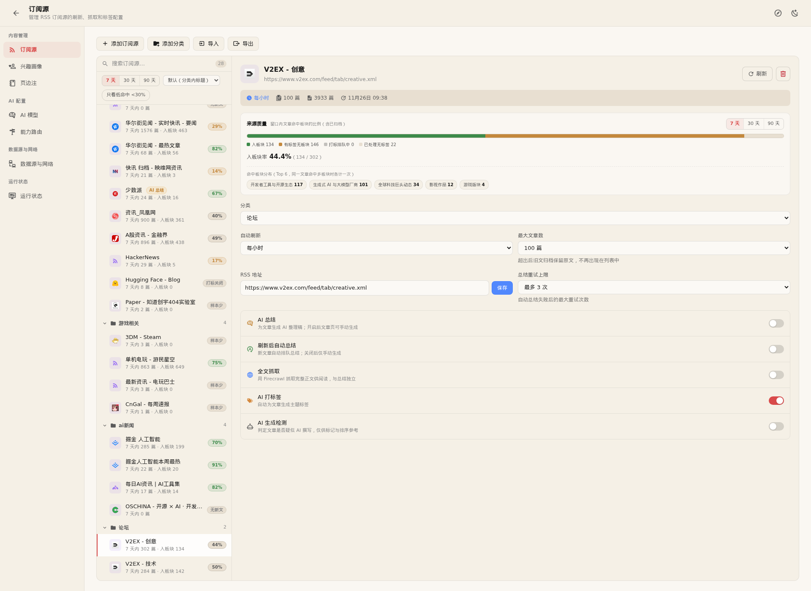
</p>

### 2. 建板块：把这条源收进来

叙事工坊 → 新建版块 → 填名称和描述 → 下一步选构成标签（可搜索、可推荐，也可跳过）→ 确认创建。

创建后会直接进入新板块。历史文章不会自动回填：到雷达右上「全局治理 → 匹配回填（全库）」跑一次（会提示耗时）；选了构成标签后，新文章会按标签、向量和规则自动归位，点标签能看到匹配证据。

<p align="center">
  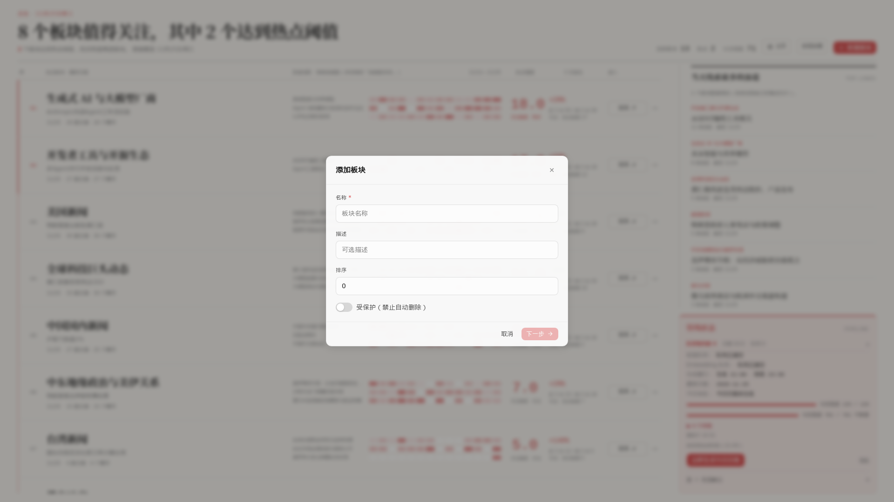
</p>

### 3. 雷达：今天哪个板块在动

雷达按关注强度排序，分热点、关注和常温；每行是最近 14 天的线索条码、当日线索、3 日变化和最新日报。右栏是当天线索最多的泳道；底部管线状态看日报有没有出、近 7 天缺哪几天。

<p align="center">
  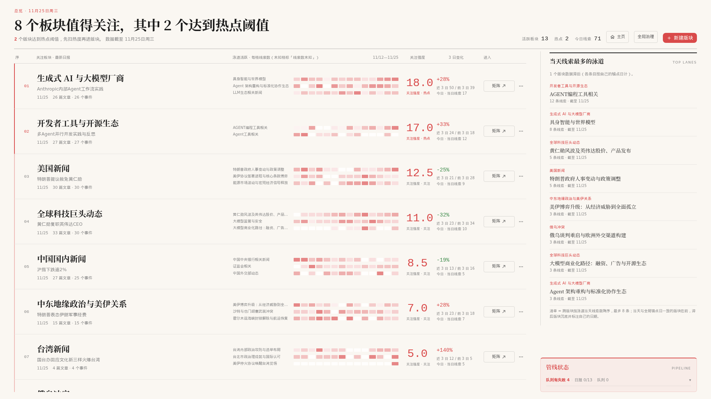
</p>

### 4. 板块态势：矩阵看线，关键事件看图

进板块先看「矩阵 / 追踪」：行是泳道、列是日期、格子是当天线索数；点格子读当天线索，下面是选中泳道的演进带和编年。

顶栏切到「关键事件」：人工确认的事件挂在泳道 × 日期轴上；选一个日期，就在对应泳道展开当天的卡片。再切「文章归档」，可以按日期和来源回看文章，点标签看匹配证据。

<p align="center">
  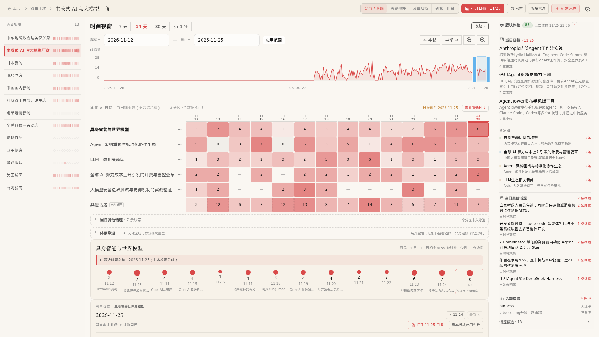
</p>

<p align="center">
  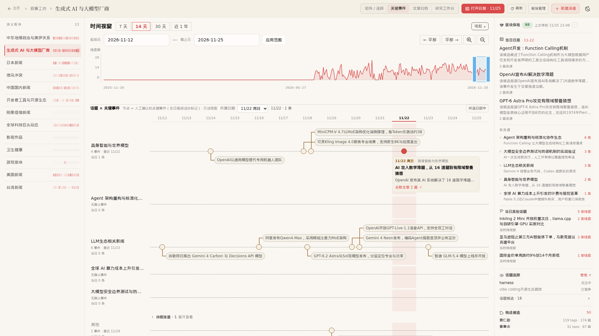
</p>

### 5. 日报：读当天，标关键

日报分「关心的话题」和「其他动态」；每条线索下面是它的相关线索 chip，点开能看标题、摘要和来源。线索行右侧可以「标为关键」；新日报里 AI 会给「确认为关键 / 不采纳」的建议，确认后进入上一步的关键事件图。

正文划选可以开「页边注」做问答：点「问一问」继续追问；缺报的日期去雷达的管线状态里补。

<p align="center">
  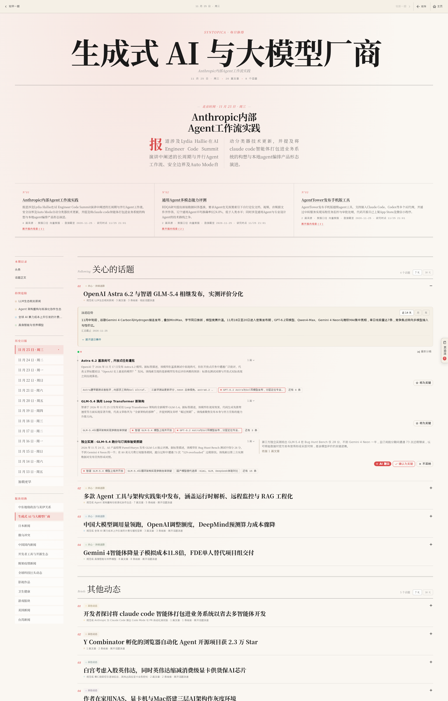
</p>

<p align="center">
  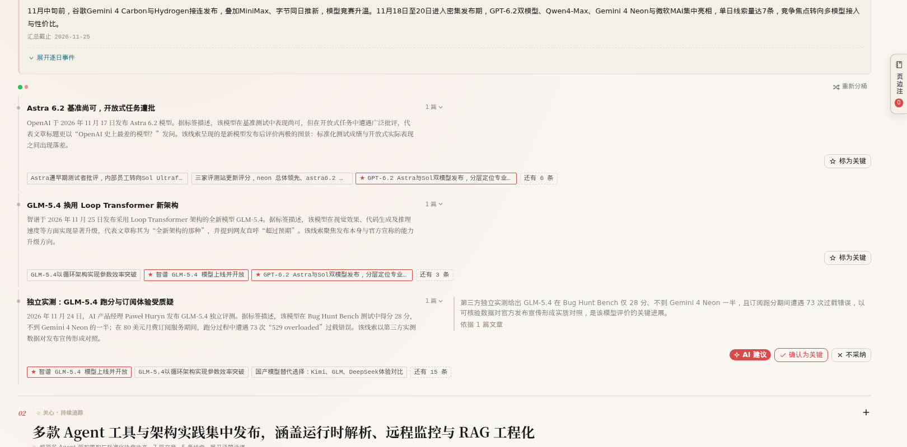
</p>

### 6. 新建 / 编辑泳道：把线索归到一起

板块顶栏「新建泳道」打开三栏画布：左边候选泳道（可整组勾选），中间事件关系画布，右边本次泳道和可补充事件；选好后「起名并创建」。

改泳道：矩阵行头「⋯ → 编辑泳道」或「泳道管理」。可以改名、移出/加回节点、重设首义（泳道的锚定主题）、加辅助标签；改动按标注的生效时机生效（立即 / 次日日报）。创建后回到矩阵，新泳道就是新的一行。

<p align="center">
  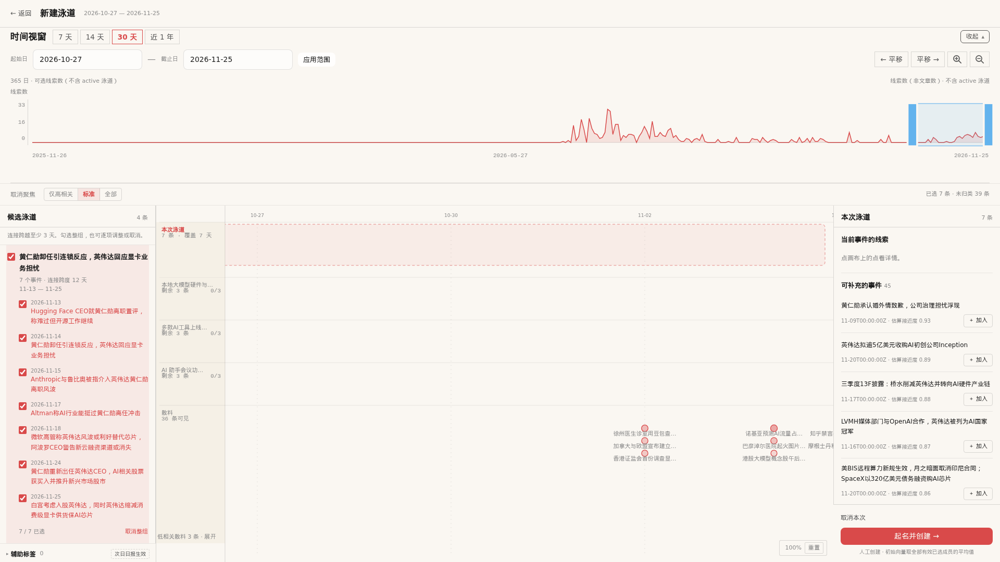
</p>

<p align="center">
  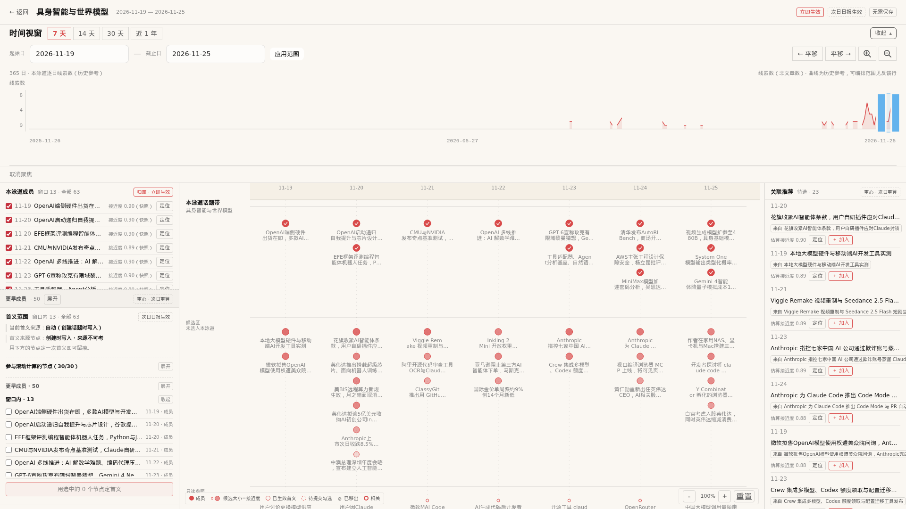
</p>

### 7. 研究：从候选到报告

板块顶栏「研究工作台」：左栏是线索索引，右栏是候选或报告。「发现信号」只存候选，不耗研究预算；点「深入分析」才启动带预算的研究。报告有事实、图表和附录，重新研究追加新版本。

研究取数接 EIA、JODI、WDI、Comtrade、Yahoo Finance、FRED、GDELT 七源（alpha），报告头标「数据截至」，缺失不补 0。已确认的关键事件会作为「发现信号」的关注线索。

## 有余裕时

主线之外，这三个入口用来补阅读和补信息源。

### 读原文

全部文章 / 收藏夹 / 关注标签 → 点文章在右栏读。三栏布局，支持原文、抓取正文、AI 整理稿三种视图，也可以开原网页 iframe、全屏、上一篇/下一篇；需要找回时用文章搜索（关键词 + 语义 + LLM 扩展，带命中原因）。

<p align="center">
  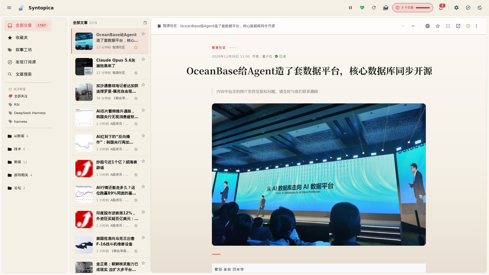
</p>

### 翻归档

板块态势 → 文章归档：按日期、来源和构成标签回看这个板块下的所有文章，能看到每篇入没入日报、命中哪个标签；点标签看匹配证据。适合不想看日报、只想把这一板块的文章翻一遍的时候。

<p align="center">
  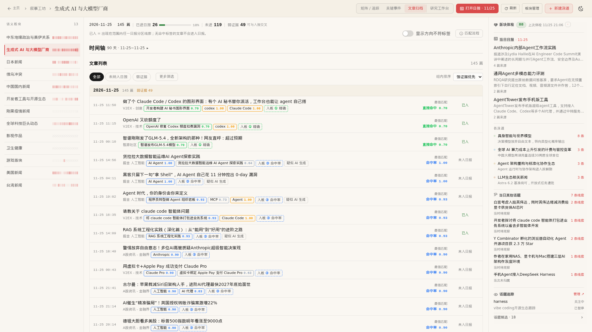
</p>

### 找新源

发现订阅源：按阅读行为生成兴趣画像，从 RSSHub 目录给带理由的推荐卡片（一键订阅 / 需填参数 / 已订阅），也可以直接提问；候选源库入库不等于订阅。

<p align="center">
  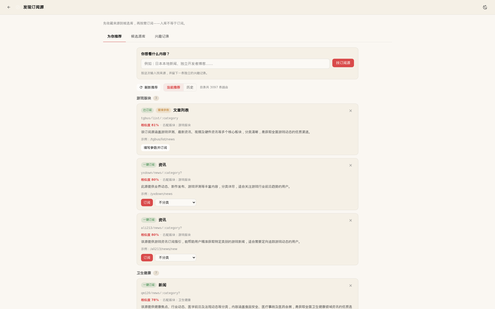
</p>

## LLM 花在哪里

- **每篇一次**：摘要、event / keyword 标签、Embedding；可选「疑似 AI 生成」判定。
- **每板块每天**：日报的分区、线索和今日重点。
- **手动**：研究；关键事件建议随日报生成，确认由人做。
- **板块匹配不调用 LLM**：标签命中、向量相似度和规则都在本地算。

## 适合谁

适合长期跟踪某个领域、愿意维护信息源和板块边界的人；不适合只要热榜和推送、需要全网分钟级监测，或需要多人协作与权限的团队。

## 边界

- 单用户、无认证，默认只放本机或可信内网。
- PostgreSQL + pgvector 是硬依赖；抓取、Embedding 和模型调用都要资源。
- 冷启动要积累文章；AI 管线有等待时间，日报可补，但队列没清空时不能手动生成。
- AI 生成判定、板块体检评语、关键事件建议都是模型判断，可能错，重要结论回原文。
- 研究数据源是 alpha；价格只有 Yahoo/FRED，事件只有 GDELT 热度，不是事实核查。
- 桌面壳目前只有远程模式（Windows NSIS），主形态仍是 Web。

## 快速开始

前置：Docker + Docker Compose；本地开发再加 Go、Node、pnpm。初始化脚本会引导配置基础服务和 AI 供应商：

```bash
# Linux；Windows 用 .\deploy\init.ps1
bash deploy/init.sh
```

启动后访问 `http://localhost:5100`。也可以直接用 Docker Compose：

```bash
docker compose --project-directory . -f deploy/compose/docker-compose.yml up -d
# 可选：Firecrawl / RSSHub
# deploy/compose/docker-compose.firecrawl.yml / docker-compose.rsshub.yml
```

本地开发：

```bash
docker compose -f docker-compose.pg.yml up -d
cd backend-go && go run cmd/server/main.go
cd front && pnpm install && pnpm dev
```

前端 `http://localhost:3000`，API `http://localhost:5100/api`。桌面壳见 [`desktop/README.md`](desktop/README.md)。

## AI 配置

在 Web UI 的「AI 模型」里按「供应商 → 模型」配置；能力路由把总结、正文补全、打标、Embedding 等能力分别指向模型，支持备用和降级观测。

本地模型可以用 Ollama：

```bash
ollama pull qwen3:8b
ollama pull nomic-embed-text
ollama serve
```

llama.cpp 示例见 [部署指南 · 本地 AI 推理](docs/reference/deployment.md#本地-ai-推理llamacpp)。

## 技术架构

- **前端**：Nuxt 4、Vue 3、TypeScript、Pinia、Tailwind CSS v4
- **后端**：Go、Gin、GORM
- **存储**：PostgreSQL + pgvector；Redis 可选
- **可选服务**：Firecrawl、RSSHub、Browserless、博查 / DeepSeek 联网搜索
- **AI**：OpenAI 兼容、Ollama、llama.cpp；供应商/模型两层、能力路由与降级观测
- **桌面与观测**：Tauri 2 远程壳；OpenTelemetry

## 文档

- [架构与业务域地图](docs/reference/architecture/map.md)
- [业务流程文档](docs/reference/flow/)
- [部署指南](docs/reference/deployment.md)（含 llama.cpp 本地推理与显存参考）
- [配置说明](docs/reference/configuration.md)
- [API 索引](docs/reference/api/_index.md) · [数据库文档](docs/reference/database/_index.md)
- [代码规范](docs/reference/standard/)

## 贡献

欢迎通过 Issue 描述真实使用场景、信息源兼容问题、错误归类或可复现缺陷。提交代码前请阅读根目录以及 `front/`、`backend-go/` 下的 `AGENTS.md`。

## License

[GNU General Public License v3.0](LICENSE)
