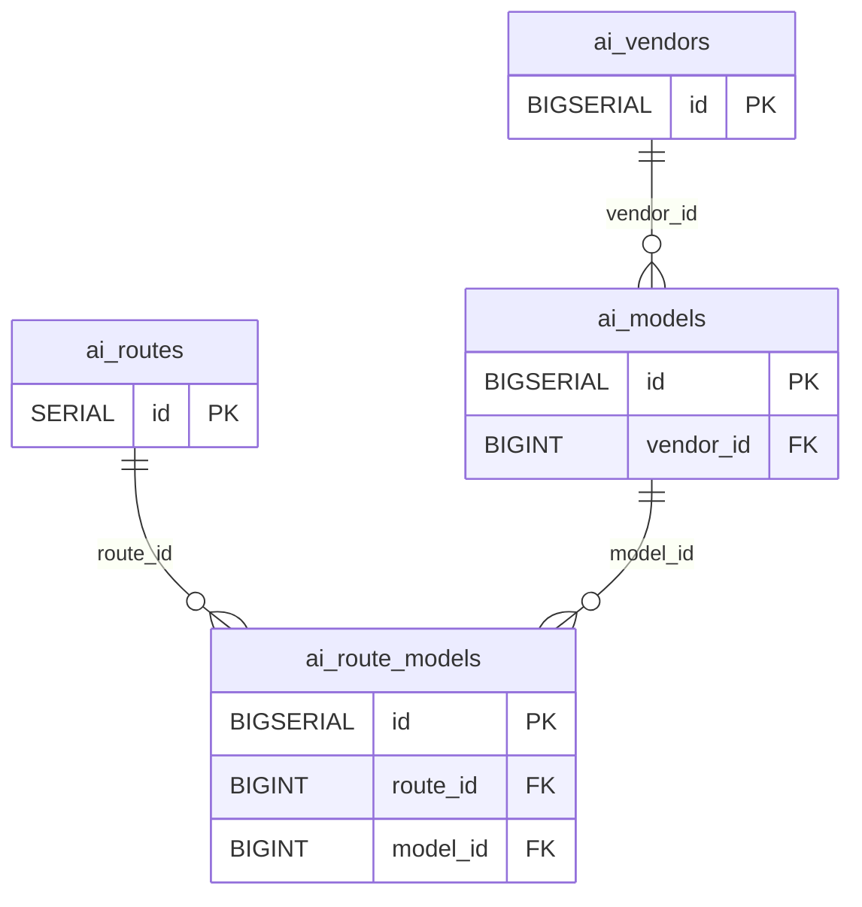

# AI 路由域（`tables/ai-routing.md`）

> 真相源 = 代码（GORM struct + `postgres_migrations.go`），本文件是投影。全局约定（FK 真相 / 向量维度 / 枚举 / 唯一与 CHECK 约束）见 [_conventions.md](_conventions.md)；完整表清单与导航见 [_index.md](../_index.md)。
>
> **2026-10 ai-provider-model-overhaul**：vendor/model 两层表（`ai_vendors`/`ai_models`/`ai_route_models`）由版本化迁移 `20261005_0001` 创建（**未注册 AutoMigrate**，字段演进必须走版本化迁移）；三张新表无物理 FK，级联删除走应用层单事务（`Store.DeleteVendor`）。旧 `ai_providers`/`ai_route_providers` 拆解改挂后**停写废弃**，物理表保留一个版本周期作回滚保险。

### 3.1 ai_vendors（AI 供应商）

vendor 承载协议/认证/端点/进程拉起与适配声明；`preset_id` 非空=预设目录供应商（deepseek/zai/…，前端常量），空=自定义。

| 字段名 | 类型 | 约束/默认/索引 | 用途 |
| -------- | ------ | ------ | ------ |
| `id` | BIGSERIAL | PK | 主键 |
| `name` | VARCHAR(100) | NOT NULL; UNIQUE `idx_ai_vendors_name` | 供应商名称（全局唯一，继承原 provider.name 语义） |
| `preset_id` | VARCHAR(50) | NOT NULL DEFAULT `''` | 预设标识（自定义供应商为空串） |
| `provider_type` | VARCHAR(50) | NOT NULL; index `idx_ai_vendors_provider_type` | 供应商类型：`openai_compatible` / `ollama`（应用层归一，空默认 `openai_compatible`） |
| `base_url` | VARCHAR(500) | NOT NULL | API 地址（应用层 TrimRight `/`） |
| `api_key` | TEXT | —（可空） | API 密钥（本地无认证服务可空；API 响应只回 `api_key_configured` 布尔，不回原文） |
| `timeout_seconds` | BIGINT | NOT NULL（应用层默认 120） | 请求超时 |
| `start_command` | TEXT | —（可空） | 本地模型进程启动命令；空=外部托管。启动健康检测按总开关 `auto_start_models` 拉起（见 `flow/scheduler.md` §业务约束 #7） |
| `thinking_dialect` | VARCHAR(50) | NOT NULL DEFAULT `'none'` | 思考方言：`qwen-chat-template` / `deepseek` / `reasoning-effort` / `none`（未知方言按 none 处理） |
| `structured_output` | VARCHAR(50) | NOT NULL DEFAULT `'json_schema'` | 结构化输出档位：`json_schema` / `json_object` / `none`（空串运行时按 none 防御） |
| `legacy_provider_id` | BIGINT | —（可空）; index `idx_ai_vendors_legacy_provider_id` | 迁移判重锚点（原 `ai_providers.id`），迁移完成后留作对账 |
| `enabled` | BOOLEAN | NOT NULL; index `idx_ai_vendors_enabled` | 是否启用 |
| `created_at` | TIMESTAMPTZ | NOT NULL DEFAULT now() | 创建时间 |
| `updated_at` | TIMESTAMPTZ | NOT NULL DEFAULT now() | 更新时间 |

> 无 `supports_embedding` 列（design 勘误）：云端/本地判定按 `hostIsLocal(base_url)` 动态计算（loopback/RFC1918=本地；解析失败一律视为云端）——云端 vendor 禁配 embedding 模型（`Store.UpsertModel` 校验）。

### 3.2 ai_models（AI 模型）

模型唯一挂 vendor；`unique(vendor_id, name)` 把模型名唯一性收敛到 vendor 内。清单由「模型清单刷新」（`Store.RefreshVendorModels`，`GET {base_url}/models` 对账）维护：上游新出现 INSERT（默认未启用、kind=llm）、已可见更新 `last_seen_at`（stale 复活 ok）、上游消失标 `stale` 不删。

| 字段名 | 类型 | 约束/默认/索引 | 用途 |
| -------- | ------ | ------ | ------ |
| `id` | BIGSERIAL | PK | 主键 |
| `vendor_id` | BIGINT | NOT NULL; index `idx_ai_models_vendor_id`; 复合唯一 `idx_ai_models_vendor_name(vendor_id, name)` | 所属 vendor（无物理 FK，级联走应用层） |
| `name` | VARCHAR(100) | NOT NULL; 复合唯一同上 | 模型名（vendor 内唯一） |
| `model_kind` | VARCHAR(20) | NOT NULL DEFAULT `'llm'`; index `idx_ai_models_model_kind` | 模型类型：`llm`（默认，对话/推理）/ `embedding`（向量嵌入）。与 `provider_type`（协议维度）正交 |
| `thinking_level` | VARCHAR(20) | —（可空） | 模型默认思考档，七档 `off/minimal/low/medium/high/xhigh/max`；embedding 恒 NULL（无思考语义；应用层校验拒绝） |
| `supports_xhigh_max` | BOOLEAN | NOT NULL DEFAULT false | 是否声明支持 xhigh/max 档（false 时运行时钳制为 high） |
| `enabled` | BOOLEAN | NOT NULL; index `idx_ai_models_enabled` | 是否启用（stale/未启用不进绑定候选） |
| `status` | VARCHAR(20) | NOT NULL DEFAULT `'ok'`; index `idx_ai_models_status` | 清单状态：`ok` / `stale`（上游清单消失标记，不删行、路由绑定保留） |
| `last_seen_at` | TIMESTAMPTZ | —（可空） | 最近一次清单刷新可见时间 |
| `created_at` | TIMESTAMPTZ | NOT NULL DEFAULT now() | 创建时间 |
| `updated_at` | TIMESTAMPTZ | NOT NULL DEFAULT now() | 更新时间 |

### 3.3 ai_route_models（AI 路由-模型绑定）

能力路由↔模型绑定，取代 `ai_route_providers` 的 provider 直挂。保存（`Store.UpsertRouteModels`）在单事务内全删全建（顺位调整与覆盖档同一次保存原子生效），priority 按提交顺位写 1..n；写入前校验存在性、stale/未启用、capability 类型匹配（embedding 路由只接 embedding 模型、llm 路由只接 llm 模型）、思考档合法值。

| 字段名 | 类型 | 约束/默认/索引 | 用途 |
| -------- | ------ | ------ | ------ |
| `id` | BIGSERIAL | PK | 主键 |
| `route_id` | BIGINT | NOT NULL; 复合唯一 `idx_air_route_model_link(route_id, model_id)` | 路由 ID（无物理 FK） |
| `model_id` | BIGINT | NOT NULL; 复合唯一同上 | 模型 ID |
| `priority` | BIGINT | NOT NULL; index `idx_air_route_models_priority` | 尝试顺位（1..n，数值越小越先） |
| `thinking_level` | VARCHAR(20) | —（可空） | 场景覆盖思考档（空/NULL=继承模型默认档）；embedding 绑定不得携带 |
| `enabled` | BOOLEAN | NOT NULL; index `idx_air_route_models_enabled` | 绑定是否启用 |
| `created_at` | TIMESTAMPTZ | NOT NULL DEFAULT now() | 创建时间 |
| `updated_at` | TIMESTAMPTZ | NOT NULL DEFAULT now() | 更新时间 |

### 3.4 ai_routes（AI 路由）

| 字段名 | 类型 | 约束/默认/索引 | 用途 |
| -------- | ------ | ------ | ------ |
| `id` | SERIAL | PK | 主键 |
| `name` | VARCHAR(100) | NOT NULL; 复合唯一 `idx_ai_routes_capability_name(name, capability)` | 路由名称（`default` 名优先被路由选中） |
| `capability` | VARCHAR(50) | NOT NULL; 复合唯一同上; index | 能力标识 |
| `enabled` | BOOLEAN | NOT NULL DEFAULT true; index | 是否启用 |
| `description` | VARCHAR(255) | — | 描述 |
| `max_concurrency` | INTEGER | NOT NULL DEFAULT 0 | 最大并发（0 = 用各能力的默认值） |
| `created_at` | TIMESTAMP | — | 创建时间 |
| `updated_at` | TIMESTAMP | — | 更新时间 |
| `strategy` | VARCHAR(50) | **死列**（存量库残留，NOT NULL DEFAULT 'ordered_failover'；全新库不建） | 业务不再引用（绑定链天然按 priority 顺序 failover） |
| `priority` | INTEGER | **死列**（存量库残留，NOT NULL DEFAULT 100 + index；全新库不建） | 业务不再引用（顺位由 `ai_route_models.priority` 承载） |

唯一约束：`idx_ai_routes_capability_name (name, capability)`。`AIRoute.RouteModels` 为逻辑关联（无 OnDelete）；`strategy`/`priority` 死列随 ai-provider-model-overhaul 从 GORM struct 删除——存量库物理列保留不 DROP（回滚保险，下个大版本清理），`AutoMigrate` 不会为新库重建。

### 3.5 ai_call_logs（AI 调用日志）

| 字段名 | 类型 | 约束/默认/索引 | 用途 |
| -------- | ------ | ------ | ------ |
| `id` | SERIAL | PK | 主键 |
| `operation` | VARCHAR(80) | NOT NULL; 复合索引 `idx_call_logs_op_time(operation, created_at)` priority:1 | 业务操作名（如 `daily_report.cluster_tags`） |
| `capability` | VARCHAR(50) | NOT NULL; index | 能力标识 |
| `route_name` | VARCHAR(100) | NOT NULL | 路由名称 |
| `provider_name` | VARCHAR(100) | NOT NULL | 供应商名称（vendor.name；vendor/model 两层化后仍取 vendor 维度） |
| `model` | VARCHAR(100) | — | 实际调用的模型名 |
| `success` | BOOLEAN | NOT NULL; index | 是否成功 |
| `is_fallback` | BOOLEAN | DEFAULT false | 是否为降级调用 |
| `latency_ms` | INTEGER | — | 延迟（毫秒） |
| `error_code` | VARCHAR(100) | — | 错误码 |
| `error_message` | TEXT | — | 错误信息 |
| `prompt` | TEXT | — | 完整 messages 文本（超 20000 runes 截断标注） |
| `request_meta` | TEXT | — | 请求元数据（结构化降级链带 `structured_stage`，观测还原降级方向） |
| `response_snippet` | TEXT | — | 响应片段（截取前 10000 runes） |
| `token_usage` | JSONB | — | prompt/completion/total token 用量 JSON |
| `trace_id` | VARCHAR(64) | index（`idx_call_logs_trace`，迁移 `20261005_0001`） | OpenTelemetry trace ID（同一 Router.Chat 全部尝试共组，降级观测分组键） |
| `session_id` | VARCHAR(120) | index（`idx_call_logs_session`） | 编排分组键（同一次编排内共享） |
| `created_at` | TIMESTAMP | index（`idx_ai_call_logs_created_at`） | 创建时间 |

`operation` / `prompt` / `token_usage` / `session_id` / `model` 五列由迁移 `20260704_0001` 补齐（R2 必记字段）；`idx_call_logs_trace` 由迁移 `20261005_0001` 补齐（降级观测按 trace_id 分组还原降级链）。

### 3.6 ai_embedding_cache（embedding 结果缓存）

`Router.Embed` 层的持久化缓存（`nightly-throughput-embedding-cache-parallel-crawl` 引入）：仅白名单 operation（`tagmanagement.embedding`，tag 固定属性输入、跨文章重复）参与缓存——白名单外 operation（`section.embedding` / `tagmanagement.auxlabel_embedding` / `discovery.route_embedding` 等一次性内容输入）不查不写（实测命中率 0-10%，纯存储浪费）。命中则跳过 provider HTTP 与信号量，直接返回；由 `job_log_cleanup` 清理 14 天前记录（命中集中在写入后 1-2 天的夜间窗口内）。

| 字段名 | 类型 | 约束/默认/索引 | 用途 |
| -------- | ------ | ------ | ------ |
| `cache_key` | VARCHAR(64) | PK | `SHA-256(绑定模型名 + "\\x00" + join(Input, "\\x00"))` 的 hex |
| `model` | VARCHAR(100) | index | 落缓存时的模型名（参与 key，防跨模型串向量空间） |
| `operation` | VARCHAR(80) | — | 业务操作名（仅白名单值会写入） |
| `embedding` | BYTEA | — | 小端 float32 字节流（`optimize-pg-storage` 起 bytea 替代 jsonb 浮点文本，2560 维行 ~10KB vs ~31.5KB，存量无损转换） |
| `dimensions` | INTEGER | — | 向量维度 |
| `input_preview` | VARCHAR(200) | — | 输入预览（前 200 runes） |
| `created_at` | TIMESTAMP | index | 创建时间（14 天 TTL 依据） |

### 3.7 ai_providers（AI 供应商）— ⛔ 已停写废弃

> **ai-provider-model-overhaul（迁移 `20261005_0001`）后停写**：每行拆解为 1 vendor + 1 model（`legacy_provider_id` 判重锚点；方言/结构化档按名称前缀推断 qwen*→qwen-chat-template+json_schema、deepseek*→deepseek+json_object；`enable_thinking` bool 按 true→high/false→off 迁模型默认思考档；embedding 行恒 NULL），绑定改挂 `ai_route_models`（priority 保序）。**新代码 SHALL NOT 读写此表**（GORM struct 仅保留供存量表与旧迁移测试编译）。物理表保留一个版本周期作回滚保险（代码回退旧版二进制可跑旧路径）；拆解前全表 JSON 快照落 `data/ai_providers_legacy_snapshot.json`。下个大版本清理。

| 字段名 | 类型 | 用途（历史） |
| -------- | ------ | ------ |
| `id` | SERIAL | 主键（→ vendor.legacy_provider_id） |
| `name` | VARCHAR(100) | UNIQUE NOT NULL；→ vendor.name |
| `provider_type` / `base_url` / `api_key` / `timeout_seconds` / `start_command` / `enabled` | — | → 同名 vendor 列 |
| `model` | VARCHAR(100) | → ai_models.name |
| `model_kind` | VARCHAR(20) | → ai_models.model_kind |
| `enable_thinking` | BOOLEAN | → ai_models.thinking_level（true→high / false→off） |
| `max_tokens` / `temperature` / `metadata` | — | 死字段，不迁移 |

### 3.8 ai_route_providers（AI 路由-供应商绑定）— ⛔ 已停写废弃

> 同 `ai_providers` 停写：`provider_id` 改挂为 `ai_route_models.model_id`（priority 保序、thinking_level=NULL）。物理表保留一个版本周期，下个大版本清理。

---

## 索引

### AI 调用日志索引

| 索引名 | 表 | 列 | 迁移 |
| -------- | ------ | ------ | ------ |
| `idx_call_logs_session` | ai_call_logs | `(session_id)` | `20260704_0001` |
| `idx_call_logs_op_time` | ai_call_logs | `(operation, created_at)` | `20260704_0001` |
| `idx_ai_call_logs_created_at` | ai_call_logs | `(created_at)` | AutoMigrate |
| `idx_call_logs_trace` | ai_call_logs | `(trace_id)` | `20261005_0001` |

### vendor/model 两层表索引（迁移 `20261005_0001`）

| 索引名 | 表 | 列 |
| -------- | ------ | ------ |
| `idx_ai_vendors_name` | ai_vendors | UNIQUE `(name)` |
| `idx_ai_vendors_provider_type` | ai_vendors | `(provider_type)` |
| `idx_ai_vendors_legacy_provider_id` | ai_vendors | `(legacy_provider_id)` |
| `idx_ai_vendors_enabled` | ai_vendors | `(enabled)` |
| `idx_ai_models_vendor_id` | ai_models | `(vendor_id)` |
| `idx_ai_models_vendor_name` | ai_models | UNIQUE `(vendor_id, name)` |
| `idx_ai_models_model_kind` | ai_models | `(model_kind)` |
| `idx_ai_models_enabled` | ai_models | `(enabled)` |
| `idx_ai_models_status` | ai_models | `(status)` |
| `idx_air_route_model_link` | ai_route_models | UNIQUE `(route_id, model_id)` |
| `idx_air_route_models_priority` | ai_route_models | `(priority)` |
| `idx_air_route_models_enabled` | ai_route_models | `(enabled)` |

---

## 域 ER 图

> 实线关系 = GORM 逻辑关联；本域三张新表**无 DB 物理外键**（级联删除走应用层单事务）。外域邻居表仅标名，字段见其所属域文档。

> 废弃关联（停写，回滚保险窗口内物理存在）：`ai_providers ||--o{ ai_route_providers`、`ai_routes ||--o{ ai_route_providers`。
