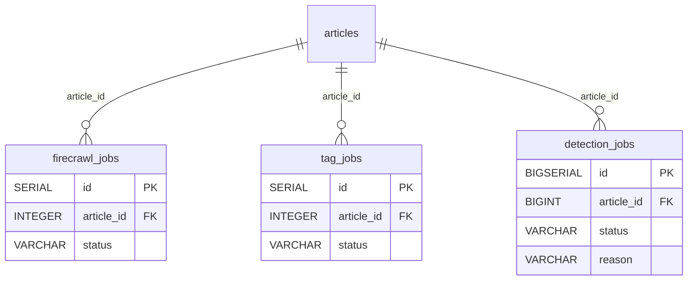

# 任务队列域（`tables/job-queues.md`）

> 真相源 = 代码（GORM struct + `postgres_migrations.go`），本文件是投影。全局约定（FK 真相 / 向量维度 / 枚举 / 唯一与 CHECK 约束）见 [_conventions.md](_conventions.md)；完整表清单与导航见 [_index.md](../_index.md)。

### 7.1 firecrawl_jobs（Firecrawl 抓取任务）

| 字段名 | 类型 | 约束/默认/索引 | 用途 |
| -------- | ------ | ------ | ------ |
| `id` | SERIAL | PK | 主键 |
| `article_id` | INTEGER | NOT NULL; index | 关联文章 ID（GORM 声明 OnDelete:CASCADE） |
| `status` | VARCHAR(20) | NOT NULL DEFAULT 'pending'; index | 状态：`pending` / `leased` / `completed` / `failed` |
| `priority` | INTEGER | DEFAULT 0; index | 优先级 |
| `attempt_count` | INTEGER | DEFAULT 0 | 尝试次数 |
| `max_attempts` | INTEGER | DEFAULT 5 | 最大尝试次数 |
| `available_at` | TIMESTAMP | NOT NULL; index | 可执行时间 |
| `leased_at` | TIMESTAMP | —（`*time.Time`，无 gorm tag 普通列） | 租约获取时间 |
| `lease_expires_at` | TIMESTAMP | —（`*time.Time`）; index | 租约过期时间 |
| `last_error` | TEXT | — | 最近错误 |
| `url_snapshot` | VARCHAR(1000) | — | URL 快照 |
| `created_at` | TIMESTAMP | — | 创建时间 |
| `updated_at` | TIMESTAMP | — | 更新时间 |

### 7.2 tag_jobs（标签任务）

| 字段名 | 类型 | 约束/默认/索引 | 用途 |
| -------- | ------ | ------ | ------ |
| `id` | SERIAL | PK | 主键 |
| `article_id` | INTEGER | NOT NULL; index | 关联文章 ID（GORM 声明 OnDelete:CASCADE） |
| `status` | VARCHAR(20) | NOT NULL DEFAULT 'pending'; index | 状态：`pending` / `leased` / `completed` / `failed` |
| `priority` | INTEGER | DEFAULT 0; index | 优先级 |
| `attempt_count` | INTEGER | DEFAULT 0 | 尝试次数 |
| `max_attempts` | INTEGER | DEFAULT 5 | 最大尝试次数 |
| `available_at` | TIMESTAMP | NOT NULL; index | 可执行时间 |
| `leased_at` | TIMESTAMP | —（`*time.Time`） | 租约获取时间 |
| `lease_expires_at` | TIMESTAMP | —（`*time.Time`）; index | 租约过期时间 |
| `last_error` | TEXT | — | 最近错误 |
| `feed_name_snapshot` | VARCHAR(200) | — | Feed 名称快照 |
| `category_name_snapshot` | VARCHAR(100) | — | 分类名称快照 |
| `force_retag` | BOOLEAN | DEFAULT false | 是否强制重新打标签 |
| `reason` | VARCHAR(50) | — | 入队原因 |
| `created_at` | TIMESTAMP | — | 创建时间 |
| `updated_at` | TIMESTAMP | — | 更新时间 |

> ⚠️ `firecrawl_jobs` / `tag_jobs` 的 `status`、`available_at`、`lease_expires_at` 均为各自单列索引（非旧文档所写复合索引）。

> 🔒 **部分唯一索引 `uq_tag_jobs_article_active`（迁移 `20261120_0002`，fix-feed-refresh-churn D4）**：`(article_id) WHERE status IN ('pending','leased')` —— 同文章至多一条未完成作业。建索引前先删存量同文章重复未完成行（只保留最小 `id`；删除前把较新行的 `priority` 取 MAX、`force_retag` 取 OR、`reason` 取最新非空值合并进保留行）。`Enqueue` 插入走 `ON CONFLICT DO NOTHING`，撞索引后按既有「原地更新」语义合并，并发双插收敛为零新行；`POST /api/tag-queue/retry` 批量重试跳过已有活动作业的文章、同文章多条 `failed` 只重试最新一条。

---

### 7.3 detection_jobs（疑似 AI 判定任务，add-ai-generated-article-detection）

与 `tag_jobs` 同构但**完全独立**（不共表、不共用 worker）：一篇一作业、乐观锁 claim + 租约、重试上限；判定失败不影响打标与摘要。表由迁移 `20261120_0001` 幂等建出（`CREATE TABLE IF NOT EXISTS` + 各列单列索引）。

| 字段名 | 类型 | 约束/默认/索引 | 用途 |
| -------- | ------ | ------ | ------ |
| `id` | BIGSERIAL | PK | 主键 |
| `article_id` | BIGINT | NOT NULL; index `idx_detection_jobs_article_id` | 关联文章 ID（GORM 声明 OnDelete:CASCADE） |
| `status` | VARCHAR(20) | NOT NULL DEFAULT 'pending'; index `idx_detection_jobs_status` | 状态：`pending` / `leased` / `completed` / `failed` |
| `priority` | INTEGER | NOT NULL DEFAULT 0 | 优先级（显式重判插到自动入队作业前） |
| `attempt_count` | INTEGER | NOT NULL DEFAULT 0 | 已尝试次数 |
| `max_attempts` | INTEGER | NOT NULL DEFAULT 5 | 重试上限（达上限置 `failed` 终止） |
| `available_at` | TIMESTAMPTZ | NOT NULL DEFAULT now(); index `idx_detection_jobs_available_at` | 可领取时间 |
| `leased_at` | TIMESTAMPTZ | NULL | 租约获取时间 |
| `lease_expires_at` | TIMESTAMPTZ | NULL; index `idx_detection_jobs_lease_expires_at` | 租约过期时间（过期可被重新领取） |
| `last_error` | TEXT | NOT NULL DEFAULT '' | 最近一次失败原因 |
| `reason` | VARCHAR(50) | NOT NULL DEFAULT '' | 入队来源：`firecrawl_completed`（全文抓取成功）/ `firecrawl_failed`（抓取终态失败降级）/ `article_ingested`（未开抓取入库即判）/ `manual_recheck`（用户显式重判，兼具 force 语义：绕过「人工结论优先」的跳过） |
| `created_at` | TIMESTAMPTZ | NOT NULL DEFAULT now(); index `idx_detection_jobs_created_at` | 创建时间 |
| `updated_at` | TIMESTAMPTZ | NOT NULL DEFAULT now() | 更新时间 |

> ⚠️ **部分唯一索引 `uq_detection_jobs_article_active`（迁移 `20261120_0003`，与 fix-feed-refresh-churn D4 同型）**：`(article_id) WHERE status IN ('pending','leased')` —— 同文章至多一条未完成作业；建索引前先删存量同文章重复未完成行（只保留最小 `id`）。入队 SQL 走 `ON CONFLICT DO NOTHING`，撞索引后按既有「原地更新」语义合并（`reason` 取新值、`priority` 只升不降），并发双插被收缩成零新行。`status` / `available_at` / `lease_expires_at` / `created_at` 各为单列索引（非复合）。

---

## 域 ER 图

> 实线关系 = GORM 逻辑关联；标注「真实DB FK」的边 = DB 物理外键（共 13 条，全清单见 [_conventions.md](_conventions.md)）。外域邻居表仅标名，字段见其所属域文档。

---

## notifications（add-notification-center，2026-09-17）

单用户通知信箱。**白名单 = 日报生成终态**（完成 / 一条失败汇总，互斥；高频过程类事件不落行）。

| 字段 | 类型 | 说明 |
| ------ | ------ | ------ |
| `id` | bigserial PK | |
| `type` | varchar | `success` / `error` |
| `title` | varchar | 如「日报已生成 · 2026-09-17」 |
| `summary` | text | 如「共 6 个版面，保存 42 条条目。」 |
| `link_type` / `link_id` | varchar | 可选跳转目标（`daily-report` → /tags 日报读者） |
| `is_read` | bool | 已读=已浏览（打开面板即全部置已读） |
| `created_at` | timestamptz | |

保留：**上限 500 行，写入路径内淘汰**（DELETE 最旧已读优先，全未读才删最旧未读）；不参与 log_cleanup。新行写入后同步经 WS 广播 `notification` 事件。模型：`internal/models/notification.go`，服务：`internal/platform/notification/`。
