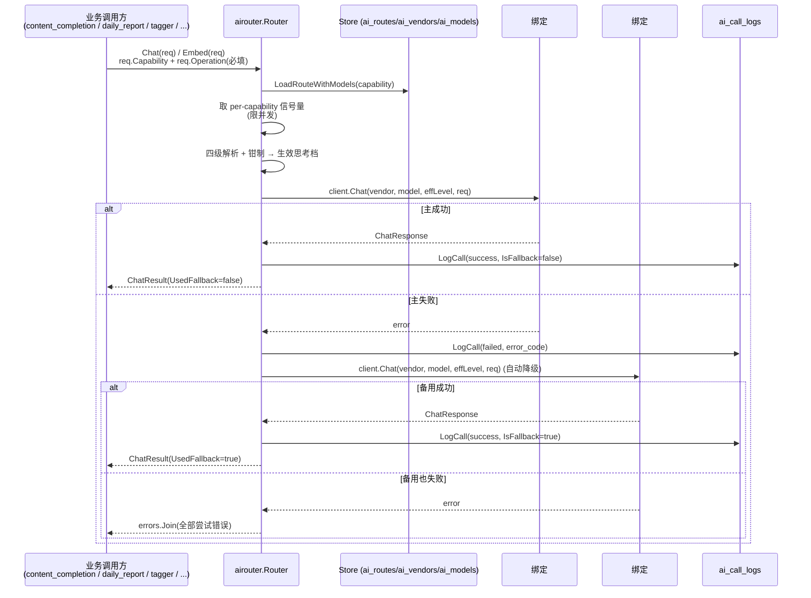

# AI 调用路由流程（AI Router / AI Summary）

<!-- doc-impact-applies: backend-go/internal/platform/airouter/, backend-go/internal/platform/aihealth/, backend-go/internal/admin/handler/ai_handler.go, backend-go/internal/admin/handler/ai_health_handler.go | section=业务约束与不变量 -->
> 大功能：统一 AI 调用路由——按 capability 选模型（vendor/model 两层注册表）、失败自动降级、per-capability 并发限流、思考七档与结构化输出适配、全量调用审计。
> 跨端（后端 airouter + 前端 AI 设置页）。互补：`flow/content-enrichment.md`（文章级整理稿走 `CapabilitySummary`）、`flow/daily-report.md`（日报管线走 `CapabilityDigestPolish`）。

## 需求说明

系统里有大量 AI 调用（文章整理稿、日报聚类/线程、标签提取、embedding、整理稿润色），早期各自直连 LLM、缺统一治理。AI 路由层（airouter）解决：

- **能力路由**：按「能力」（summary / topic_tagging / digest_polish / open_notebook / embedding）把请求路由到配置好的模型绑定链，不同能力可用不同模型/供应商。业务用途绑定：`summary` 文章整理、`topic_tagging` 标签提取、`digest_polish` 日报润色、`embedding` 向量化、`open_notebook` 日报页边注问答（回答调用 `daily_report.margin_note_qa` + 搜索词生成轻量调用 `daily_report.margin_note_search_query`（margin-note-llm-search-query），daily-report-margin-notes，2026-09 从预留槽转为首个实际调用方）。
- **失败降级**：同一能力下多个模型绑定按序尝试，主绑定失败自动切备用，调用方无感。
- **并发限流**：每能力独立并发上限，避免单能力打爆 LLM 配额。
- **调用审计**：每次调用（成功/失败）落 `ai_call_logs`，含 operation、prompt、token 用量、供应商、延迟、session，供调试幻觉 / 查错数据 / 重建编排；同一调用的全部尝试共享 trace_id，可还原降级链。
- **配置可视**：前端「AI」页管理供应商（vendor）与模型清单（刷新/勾选/思考档配置）、能力路由模型绑定链（可按场景覆盖思考档），AI 健康页查看降级观测面板，无需改后端代码。每条能力泳道行头附「供血对象」说明小字（`routeDescriptions`，add-capability-route-descriptions）——重点口径：`digest_polish` 供血日报生成 + 泳道趋势「近 14 天」档，`data_enrichment_news` 供血话题生命线月/年周期归档（泳道趋势「月」「年」档，与日报无关）。

> **范围说明（已确认过时，仅留路由层）**：本 flow 早期标题为「AI 总结批量生成（队列 + WebSocket 进度推送）」，描述的 `submitQueueSummary` / `AISummariesListView` / `useSummaryWebSocket` 等 feed 级批量总结功能在后端 router 与前端代码中**已不存在**。批量总结能力已被 **`content_completion` 调度器**（兼容别名 `ai_summary`）+ 文章级整理稿 API 取代（见 `flow/content-enrichment.md`）；版块级叙事走日报（见 `flow/daily-report.md`）。当前 `internal/platform/airouter/` + `front/app/features/ai/` 实际承载的是 **AI 调用路由层（airouter）**，本 flow 围绕此真实功能描述。

## 链路设计

### Chat / Embed 路由



### 前端配置链路

```text
AI 设置页 (front/app/features/ai/ + front/app/features/settings/)
  → AIProviderManagement: AI 设置主容器（SettingsWorkspace「AI 模型」分区）
  → VendorCard + VendorDialog: 供应商卡片（扇出徽章/展开模型清单）+ 两段式弹窗（预设三步接入/自定义表单）
  → AIRouterCapabilityRoutes + ThinkingLevelSelect: 能力↔模型绑定链（每绑定可覆盖思考档）
  → EmbeddingQueuePanel: embedding 队列状态
  → SettingsSectionAiHealth + DegradationPanel: 健康快照 + 降级观测面板
  → useAIVendors / useAIModels / useAIRoutes: 分域读写
```

## 业务约束与不变量

> 本节同时是 constraint-injection extension 的注入数据源——改 `internal/platform/airouter/` 代码前会被自动注入 system prompt，必读。

1. **Chat/Embed 请求必须携带非空 Operation，空则报错不发请求；Capability 同样必填并决定路由**：`Chat`/`Embed` 要求 `req.Operation != ""`，空则直接 `errors.New("airouter: Operation is required")` 不发请求。`Capability` 同样必填，决定路由到哪条 `ai_routes` 记录。
2. **capability 枚举固定为六类（summary/topic_tagging/digest_polish/open_notebook/embedding/feed_discovery），新增属跨域语义变更**：`summary` / `topic_tagging` / `digest_polish` / `open_notebook` / `embedding` / `feed_discovery`（`store.go` 常量；feed_discovery 由 discovery 域引入）。新增能力属于跨域语义变更，不是局部改动。
3. **并发必须按 capability 信号量限流，默认值可被 ai_routes.max_concurrency 覆盖**：默认并发 `topic_tagging:3 / digest_polish:2 / open_notebook:2 / embedding:5`（其他默认 3），可由 `ai_routes.max_concurrency` 覆盖；信号量按 capability 存于 `sync.Map`，`acquireSem` 用 `ctx.Done()` 抢占、避免无限等待。
4. **模型配置必须走 vendor/model 两层注册表，旧 ai_providers 单层实体已停写废弃**：`ai_vendors` 承载协议/认证/端点/进程拉起（`provider_type`/`base_url`/`api_key`/`timeout_seconds`/`start_command`）与适配声明（思考方言 `thinking_dialect`、结构化档 `structured_output`、预设标识 `preset_id`）；模型唯一挂 vendor 且 `unique(vendor_id, name)`（`ai_models`，vendor.name 仍全局唯一）。旧 `ai_providers` 由迁移 `20261005_0001` 拆解（每行 provider → 1 vendor + 1 model，`legacy_provider_id` 作判重锚点）后停写，物理表保留一个版本周期作回滚保险，拆解前全表快照落 `data/ai_providers_legacy_snapshot.json`；新代码一律走 `AIVendor`/`AIModel`/`AIRouteModel`，SHALL NOT 再读写旧表。
5. **模型清单刷新只标记不静默删除，stale/未启用模型不得进入绑定候选**：`RefreshVendorModels` 拉取 `GET {base_url}/models` 对账——上游新出现的 INSERT（默认未启用、kind=llm）、已可见的更新 `last_seen_at`（stale 复活为 ok）、库内有而清单无的标 `status=stale` 不删（路由绑定保留）；刷新失败库内零改动。`LoadRouteWithModels` 过滤绑定候选：绑定 enabled 且 `model.enabled` 且 `status=ok` 且 `vendor.enabled`，stale/未启用模型不可被绑定也不参与调用（`UpsertRouteModels` 保存时同样拒绝）。云端 vendor（`hostIsLocal(base_url)=false`，loopback/RFC1918 之外；解析失败一律视为云端，误判方向收紧）禁配 embedding 模型（`UpsertModel` 拒绝）；vendor 级联删除（`DeleteVendor`）在单事务内解绑→删模型→删 vendor，不因仍被路由引用而拒绝。
6. **provider 失败必须按列表顺序依次降级尝试，全部失败以 errors.Join 聚合所有错误返回**：`LoadRouteWithModels` 返回按 priority 有序的模型绑定列表，按 `idx` 依次尝试；成功的 `IsFallback = (idx > 0)`；全部失败用 `errors.Join` 聚合所有绑定错误返回。调用方据此决定是否还有下游 fallback（如 content_completion 在 router 失败后还回退 legacy `AIService`）。
7. **每次 AI 调用尝试无论成败都必须写 ai_call_logs 审计，成功额外记 prompt 与 response_snippet**：每次尝试都写 `ai_call_logs`（`store.LogCall`），含 `operation` / `capability` / `route_name` / `provider_name`（vendor 名）/ `model` / `success` / `is_fallback` / `latency_ms` / `error_code` / `session_id`；成功还记 `prompt`（`formatMessages`）+ `response_snippet` + `token_usage`。结构化输出的 400 降级链**每一档是一次真实 HTTP 调用、各写一行审计**（`RequestMeta` 带 `structured_stage` 标记档位，1 次 HTTP = 1 行；链穷尽时失败档已逐行留痕、不再补笼统失败行）。审计是调试幻觉 / 查错数据的唯一回放源。
8. **审计日志必须做截断保护：response_snippet 截 10000 runes，prompt 截 20000 runes 保头尾**：`response_snippet` 截到 `maxResponseSnippet=10000` runes；`prompt` 截到 `maxPromptRunes=20000` runes（超长保头 18000 + 尾 2000 + 截断标记），避免长 prompt 撑爆日志列。
9. **vendor 类型只支持 openai_compatible/ollama 两种 client，未知类型记 unsupported 并跳过**：内置仅 `openai_compatible` / `ollama` 两种 client（均走 `OpenAICompatibleClient`，api_key 为空时不发 Authorization 头）；未知 `vendor.provider_type` 记为 `unsupported` 并跳过该绑定。
10. **ai_call_logs 默认 7 天周期清理，审计窗口有限，长期分析必须另行保存**：`ai_call_logs` 由 `job_log_cleanup.go` 周期清理（默认 7 天），审计窗口有限，长期分析需另存。
11. **思考档固定七档（off..max），四级解析优先级 + 按模型支持度钳制 + 方言映射必须在 wire 之前完成**：值域 `off/minimal/low/medium/high/xhigh/max`（全局默认 `medium`，`thinking.go`），扩展值域属跨域语义变更。生效档四级解析：请求级（`req.ThinkingLevel`）> capability 绑定覆盖级（`ai_route_models.thinking_level`，空=继承）> 模型默认档（`ai_models.thinking_level`，embedding 恒 NULL）> 全局默认 medium，空/非法值逐级回落。钳制发生在解析之后、wire 之前：模型未声明 `supports_xhigh_max` 时 xhigh/max 一律降 high。方言映射 `thinkingToWire(dialect, level, supportsXhighMax)` 集中单函数：`qwen-chat-template` 全档显式发 `chat_template_kwargs.enable_thinking`（off→false、其余→true——模板缺省默认开启思考，省略 ≠ off）；`deepseek` 发 `thinking={"type":"disabled"/"enabled"}`；`reasoning-effort` off 不发字段、minimal..high 直传档位（xhigh/max 钳 high 后直传）；`none` 及未知方言恒不发参数（档位仅影响输出清理）。输出清理跟随生效档：off 保留原文（含 `<think>` 标签），非 off 剥离 `<think>` 块（`stripThinkTags`）。
12. **结构化输出按 vendor 声明档位三档构造 payload，400 时同尝试内三档降级且档位不落库**：仅 `req.JSONMode` 生效，按 `vendor.structured_output` 构造——`json_schema` 发 `response_format={type:json_schema,...}`（ollama 特例发 `format=<schema>`）、不注入 prompt；`json_object` 发 `response_format={type:json_object}`（ollama 发 `format:"json"`）并把 schema 以指令文本注入最后一条 user message 末尾；`none`/plain 不发 response_format、schema 仍注入（json_schema 档无 schema 可带时降按 json_object）。降级链仅在「JSONMode+JSONSchema+vendor 声明 json_schema」时启用：`json_schema → json_object → plain` 同一尝试内三档，仅 4xx 且非 429 降档（429/5xx/网络错误不降级）；降级方向不持久化 vendor 档位、只靠审计行 `structured_stage` 还原。解析纠错（`correctStructuredJSON`）：2xx 内容先按生效档清理 `<think>` 再校验 JSON——原文合法原样返回，否则提取首个花括号平衡 JSON 块（`extractBalancedJSON`，引号内花括号/转义不计数）再校验，均失败按该次尝试失败（`parse_error`）走 provider 降级，不把非 JSON 原文冒充结果返回。
13. **model_kind 必须区分 llm/embedding 且与 vendor 协议类型正交，embedding 路由只接 embedding 模型（UpsertRouteModels 校验）**：与 `vendor.provider_type`（协议维度）正交——`model_kind` 表达功能类型（对话/推理 vs 向量嵌入），默认 `llm`。embedding 任务路由硬约束只接 `embedding` 模型、llm 路由只接 `llm` 模型（`UpsertRouteModels` 保存时校验，违反返回错误；embedding 绑定不得携带思考档覆盖）；vendor 可选 `start_command`（本地进程启动命令，启动健康检测时按总开关 `auto_start_models` 拉起，见 `flow/scheduler.md` §业务约束 #7 健康门）。
14. **Router.Embed 仅白名单 operation 可走持久化缓存，缓存读写失败一律降级为未命中、不得阻断真实调用**：只有 `embeddingCacheOperations` 白名单内的 operation（当前仅 `tagmanagement.embedding`，输入由 tag 固定属性构成、跨文章重复）参与缓存；白名单外（`section.embedding` 文章正文、`tagmanagement.auxlabel_embedding` 标签+文章上下文一次性组合、`discovery.route_embedding` 路由回填等）不查不写直接走 provider（实测命中率 0-10%，命中无收益纯占存储）。白名单内：route 加载后、**acquireSem 之前**按 `SHA-256(绑定首位模型名 + "\x00" + join(Input, "\x00"))` 查 `ai_embedding_cache`（命中不占信号量、不发 HTTP，直接反序列化返回，`ai_call_logs` 记 `Success=true` + `request_meta` 含 `"cache_hit":true`）；provider 调用成功后按成功绑定的模型名 `ON CONFLICT DO NOTHING` 幂等落缓存（embedding 列存 bytea 二进制小端 float32 字节流，2026-08-28 起替代 jsonb 浮点文本，2560 维行 ~10KB vs 原 ~31.5KB，存量已无损转换；input_preview 截 200 runes，写失败仅 warn 不阻断）。缓存读写失败均降级为未命中，不得阻断真实调用。缓存记录由 `job_log_cleanup` 顺带清理 14 天前数据（命中集中在写入后 1-2 天的夜间窗口，更长保留无命中率贡献）。注意：缓存 key 的 model 取路由绑定的模型名（当前所有调用点均不设 `req.Model`；client 层绑定模型优先，未来新增调用点若设了 `req.Model` 需先归一 effective model 再参与 key）。
15. **降级观测必须是对 ai_call_logs 的纯读聚合，stats 与 events 口径分离且事件类型二分**：`QueryDegradations` 只读聚合既有审计（不写库、不改 schema；7d 窗口受 #10 的 7 天清理约束，按现存日志计算）。stats 口径：`calls`=窗口内调用组数（非空 `trace_id` 共组、空 trace_id 每行自成组）；`degradations`=structured+fallback 迁移事件数（全链失败不计入）；`failures`=全链失败组数（组内全败）单独统计。`capability` 过滤只裁剪 events，stats 恒为全窗口口径。事件类型二分：`structured`（同 vendor+model 的相邻两行 `structured_stage` 不同 → 降档事件，code=「X→Y」降级方向；三档连降产生两条）/`fallback`（失败行→成功行的顺位迁移，from/to 为组内 0-based 序号；两者皆 nil 表达全链失败，code=最后错误码）。events 按 occurred_at 降序。
16. **健康探测对象是每条路由首位可用模型所属 vendor，快照字段为 primary_model+vendor**：探测用 `ResolvePrimaryModel` 取 capability 首位可用绑定，对其 vendor 发 `GET {base_url}/models` 零 token 探测；`GET /api/ai/health` 快照每条路由回 `primary_model` + `vendor`（取代旧 `primary_provider` 字段）。健康门判定（embedding+topic_tagging 核心路由硬条件）与心跳/拉起语义见 `flow/scheduler.md` §业务约束 #7。
17. **新路由绑定推理模型（deepseek/reasoning-effort 方言，max_tokens 含 reasoning）SHALL 在绑定级显式评估思考档，不得默认继承模型档了事**：DeepSeek 推理模型的 `max_tokens` 是**含 reasoning 的输出总预算**——思考烧满预算后 content 空（finish_reason=length），被归一化为 `empty_response` 后 token 照扣、产出为空（2026-09-25 至 10-01 digest_polish 路由 DeepSeek 失败率 60-88% 的根因）。绑定总结/聚类/抽取类不依赖深思考的任务时，绑定级或模型级 SHALL 显式配 `off`（`deepseek-flash` 两级均 off，双保险防回漂）；确需深思考的路由（如 `data_enrichment_analysis`×`deepseek-v4-pro`）显式保留。模型同步（`SyncModels`）只更新 `last_seen_at` 不回洗思考档，配置持久。
18. **失败行 token_usage 记账：HTTP 200 且响应携带 usage 块的失败（empty_response/parse_error）SHALL 落库该用量，无响应体失败（网络/HTTP 4xx-5xx）SHALL 保持 NULL**：usage/finish_reason 经 `ProviderError.Usage`/`ProviderError.FinishReason` 可选载荷携带（构造点在 Router 空响应归一化与结构化解析失败处，网络/HTTP 错误路径天然无值），失败行 `response_snippet` 前缀 `finish_reason=<值>` 使「预算耗尽型空响应」（length）与「服务端真空响应」可区分；`token_usage` 解析支持 `completion_tokens_details.reasoning_tokens` → 附加 `reasoning` 可选键（基础三键形状不变），session 聚合按行累加含失败行——账实相符，空思考烧掉的 token 在 session 视图直接可见。

## 代码入口

- **后端 airouter（核心）**：`backend-go/internal/platform/airouter/router.go`（`Router.Chat` / `Router.Embed` / 信号量 / 降级链 / 四级解析+钳制 / 结构化解析纠错 `correctStructuredJSON` / 逐行审计）、`store.go`（`Capability` 常量、`LogCall`、embedding 缓存读写）、`store_vendor.go`（vendor/model 两层数据面唯一 Store 实现：`LoadRouteWithModels` / `UpsertRouteModels` / `ResolvePrimaryModel` / `ListRoutesWithModels`，vendor CRUD `CreateVendor`/`UpdateVendor`/`DeleteVendor`/`ListVendors`，`UpsertModel`/`ListModels`，清单刷新 `RefreshVendorModels`，连通探测 `TestVendorConnection`，本地判定 `hostIsLocal`）、`thinking.go`（七档常量/`effectiveThinkingLevel` 四级解析/`clampLevel`/`thinkingToWire` 方言映射纯函数）、`openai_compatible.go`（`OpenAICompatibleClient`、`buildPayload` 三档构造、`chatWithDegradeChain` 400 降级链、schema 注入 `injectSchemaInstruction`、`stripThinkTags`/`extractBalancedJSON`）、`observability.go`（`QueryDegradations` 只读聚合 + `restoreGroup` 事件还原）、`fallback.go`（legacy `AIService`）、`embedding.go`（向量工具）。
- **后端 AI 健康（ai-model-health-gate）**：`backend-go/internal/platform/aihealth/aihealth.go`（启动健康检测 + 自动拉起 + 心跳复检 + 内存快照；`Healthy()`/`GetSnapshot()`/`RunStartupProbe`，快照未就绪 fail-closed；`RouteHealth` 承载 `PrimaryModel`+`Vendor`），见 `flow/scheduler.md` §业务约束 #7 健康门。
- **后端配置/审计**：`internal/models/ai_models.go`（`AIVendor` / `AIModel` / `AIRouteModel` + 废弃保留的 `AIProvider` / `AIRouteProvider`）、`backend-go/internal/admin/routes.go`（AI 端点注册）、`backend-go/internal/admin/handler/ai_handler.go`（vendor/model/route/observability 管理端点）、`ai_health_handler.go`（健康快照查询）、`ai_call_log_handler.go`（调用日志/会话查询）、`backend-go/internal/admin/scheduler/job_log_cleanup.go`（日志清理）、`backend-go/internal/platform/database/postgres_migrations.go`（`vendorModelMigration` = `20261005_0001` 两层表建表 + 存量拆解 + 快照）。
- **消费方**：`internal/reader/service/content_completion_service.go`（`CapabilitySummary`）、`internal/topicgraph/service/`（`CapabilityDigestPolish` 等日报 LLM）、`internal/tagmanagement/service/`（`CapabilityTopicTagging`）。
- **前端**：`front/app/features/ai/components/`（AIProviderManagement 主容器 / VendorCard / VendorDialog / ThinkingLevelSelect / AIRouterCapabilityRoutes / EmbeddingQueuePanel）、`front/app/features/settings/components/`（SettingsWorkspace「AI 模型」分区、SettingsSectionAiHealth + DegradationPanel 降级观测）、`front/app/features/ai/composables/`（useAIVendors / useAIModels / useAIRoutes）、`front/app/types/ai.ts`、`front/app/api/aiAdmin.ts`。

## 变更溯源

| 日期 | 变更 | 摘要 | 归档位置 |
|------|------|------|----------|
| 2026-07-05 | ai-call-logging-schema | `AICallLog` 补 4 列（`operation` / `prompt` / `token_usage` / `session_id`），把 prompt 真正落库、补查询 API 与前端视图，让 AI 调用可观测/可回放/可审计 | [`openspec/changes/archive/2026-07-05-ai-call-logging-schema`](../../../openspec/changes/archive/2026-07-05-ai-call-logging-schema) |
| 2026-08-04 | ai-model-health-gate | AI provider 增 `model_kind`（llm/embedding）区分 + `start_command`（本地模型自动拉起配置）；路由绑定按 capability 校验 provider 类型（embedding 路由只接 embedding provider，llm 路由只接 llm），冲突拒绝；启动探针与健康门禁见 scheduler 流程 | [`openspec/changes/archive/2026-08-04-ai-model-health-gate`](../../../openspec/changes/archive/2026-08-04-ai-model-health-gate) |
| 2026-08-21 | nightly-throughput-embedding-cache-parallel-crawl | `Router.Embed` 增持久化缓存（白名单制，仅 `tagmanagement.embedding`；TTL 14 天，命中不占信号量，`ai_call_logs` 记 cache_hit）；firecrawl 队列串行→3 worker 并行（atomic 计数+500ms 限速），夜间窗口吞吐 ×3 | [`openspec/changes/archive/2026-08-21-nightly-throughput-embedding-cache-parallel-crawl`](../../../openspec/changes/archive/2026-08-21-nightly-throughput-embedding-cache-parallel-crawl) |
| 2026-08-31 | optimize-pg-storage | 缓存 embedding 列 jsonb→bytea（float32 小端字节流，~31.5KB→~10KB/行，存量无损预迁移）；tracing 默认采样 1.0→0.05（`TRACE_SAMPLE_RATIO` 可调，otel_spans 日增降 ~96%）；docker-compose autovacuum 调优 | [`openspec/changes/archive/2026-08-31-optimize-pg-storage`](../../../openspec/changes/archive/2026-08-31-optimize-pg-storage) |
| 2026-09-04 | constraint-declaration-redline | 约束节红线句格式化：本域「业务约束与不变量」节每条约束改写为首行加粗自含红线句 + 细节跟后（语义不变），declaration 注入降为红线层（上线后实测 bytes 降约 60%），细节层经关键词/JIT 全节注入按需补全；本域为格式改写，无业务行为变更 | [`openspec/changes/archive/2026-09-04-constraint-declaration-redline`](../../../openspec/changes/archive/2026-09-04-constraint-declaration-redline) |
| 2026-09-16 | ai-health-heartbeat-reprobe | 健康快照从「健康即停探测」改为双向心跳：每 60s 无条件复检、连续 2 次失败降级 not healthy、单次探通恢复；分析门禁（IsPaused）随快照降级自动暂停任务，AI 调用侧（airouter）行为不变 | [`openspec/changes/archive/2026-09-16-ai-health-heartbeat-reprobe`](../../../openspec/changes/archive/2026-09-16-ai-health-heartbeat-reprobe) |
| 2026-09-19 | fix-ai-call-log-token-usage | `token_usage` 自上线首次真实生效：`TokenUsage.UnmarshalJSON` 双键族解析（OpenAI 兼容标准键 `prompt_tokens` 等为准，兼容历史存储键），存储 jsonb 形状不变；embedding 调用补齐 usage 解析→`EmbeddingResult.Usage`→LogCall 管道，缓存命中记 NULL、失败/无 usage 块不落全零 | [`openspec/changes/archive/2026-09-19-fix-ai-call-log-token-usage`](../../../openspec/changes/archive/2026-09-19-fix-ai-call-log-token-usage) |
| 2026-09-19 | merge-tag-extraction-branches | mono 打标双分支提取合并为单次调用双数组：`tagmanagement.extractor_enhanced` 每篇文章调用数 2→1、prefill 减半（~950 篇/晚 → 1890→950 次），晚间批处理打标段墙钟预期压缩 ~35-45%；airouter `topic_tagging` capability 吞吐画像随之变化，观测口径见 ai_call_logs `meta.operation=tag_extraction_merged` | [`openspec/changes/archive/2026-09-19-merge-tag-extraction-branches`](../../../openspec/changes/archive/2026-09-19-merge-tag-extraction-branches) |
| 2026-09-23 | fix-provider-delete-route-deadlock | Provider 删除从「挂线路即 409 拒绝」改为单事务级联解绑（先删 `ai_route_provider` 关联再删 provider，响应带解绑数）；被摘空线路保留、调用走既有无 provider 报错；前端删除按钮移除挂线路 disabled（原禁用致级联解绑在 UI 上点不到）、行内提示改解绑告知、确认弹窗换全局 `useConfirm`/`AppConfirmDialog` | [`openspec/changes/archive/2026-09-23-fix-provider-delete-route-deadlock`](../../../openspec/changes/archive/2026-09-23-fix-provider-delete-route-deadlock) |
| 2026-09-26 | daily-report-margin-notes | `open_notebook` capability 首个业务绑定生效：日报页边注问答（operation `daily_report.margin_note_qa`，JSONMode 单次调用产出 answer/cited_article_ids/terms/web_sources，cited 与 web_sources 双白名单校验、搜索失败静默降级）；配置键 `searxng_config`（endpoint+enabled，DB>env>config.yaml）对齐 bocha_config 动态现读语义 | [`openspec/changes/archive/2026-09-26-daily-report-margin-notes`](../../../openspec/changes/archive/2026-09-26-daily-report-margin-notes) |
| 2026-10 | ai-provider-model-overhaul | vendor/model 两层注册表取代 ai_providers 单层（迁移 `20261005_0001` 拆解停写、快照落 data/）：思考七档（四级解析+按模型支持度钳制+四方言 wire 映射+输出清理跟随生效档）、结构化输出三档构造 + 400 同尝试三档降级链（每档一行审计、`structured_stage` 还原方向）+ 解析纠错、模型清单刷新（stale 不删）、降级观测纯读面板（trace_id 分组统计+事件流）、admin API 面 vendors/models/routes/observability 全量替换 providers 端点、健康快照字段 primary_model+vendor | [`openspec/changes/archive/2026-09-29-ai-provider-model-overhaul`](../../../openspec/changes/archive/2026-09-29-ai-provider-model-overhaul)（2026-10 实施完成，2026-09-29 归档） |
| 2026-10-01 | fix-deepseek-thinking-empty-response | DeepSeek 空 content 事故根因修复：推理模型思考烧满 max_tokens 总预算致 content 空（finish_reason=length）→空响应降级烧钱。`deepseek-flash` 模型级+digest_polish 绑定级思考档改 `off`（v4-pro 保留思考）；失败行记账补强——`ProviderError` 携带 `Usage`/`FinishReason` 可选载荷，HTTP 200 带 usage 块的失败（empty_response/parse_error）落库 token_usage（含 reasoning 可选键）且 snippet 带 `finish_reason=` 前缀，空思考烧掉的钱在账上直接可见；运维约定见约束 #17/#18。**部署后量化（2026-10-02）**：当晚 21:06 日报全版面 DeepSeek 零失败零降级，对照前夜同管线失败 157 行（empty_response，qwen 降级接管） | [`openspec/changes/archive/2026-10-02-fix-deepseek-thinking-empty-response`](../../../openspec/changes/archive/2026-10-02-fix-deepseek-thinking-empty-response) |
