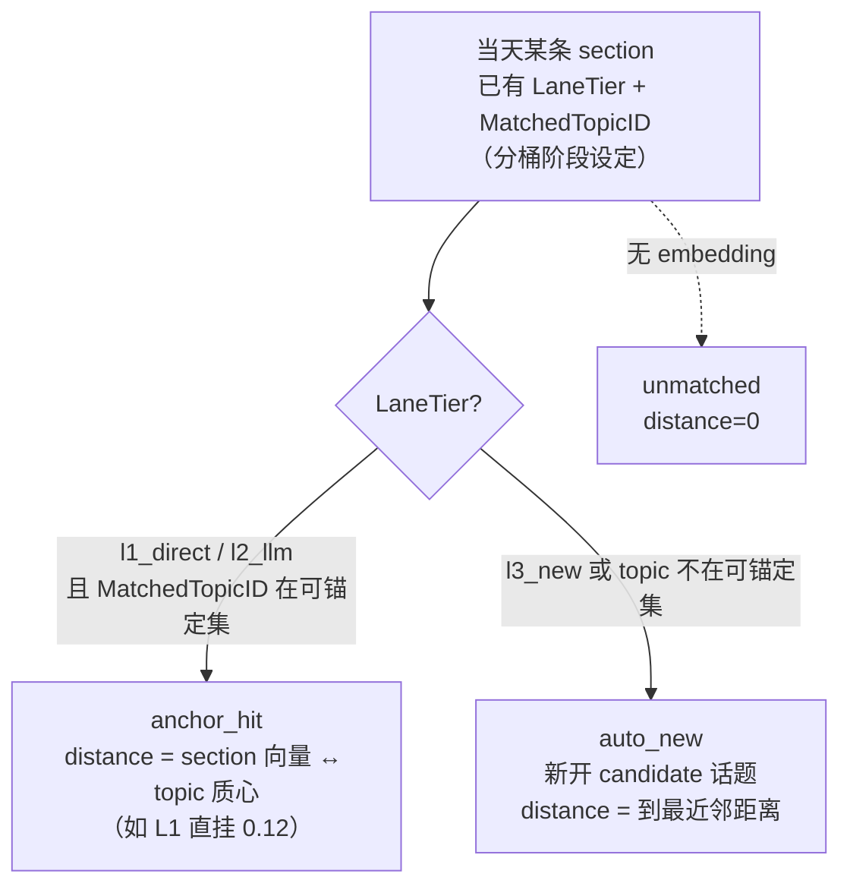

# 日报 / Digest 流程（Daily Report）

<!-- doc-impact-applies: backend-go/internal/topicgraph/, backend-go/internal/admin/scheduler/, backend-go/internal/platform/ws/, backend-go/internal/platform/notification/, backend-go/internal/admin/handler/scheduler_handler.go, backend-go/internal/admin/handler/poll_handler.go, backend-go/internal/admin/handler/notification_handler.go, front/app/features/tags/components/daily-report/, front/app/features/tags/components/DailyReportGenerateDialog.vue, front/app/features/tags/components/DailyReportReader.vue, front/app/features/tags/components/KeyEventMarkerActions.vue, front/app/features/tags/components/topic-watch/, front/app/features/tags/composables/useDailyReportReader.ts, front/app/composables/useDailyReportProgress.ts, front/app/api/dailyReports.ts, front/app/api/topicWatches.ts, front/app/api/persistentTopics.ts | section=业务约束与不变量 -->
> 大功能：每日日报生成（后端）+ Digest 预览/查看（前端）+ Section 可视化。
> 跨端。互补：`flow/topic-graph.md`（持久话题生命周期、关系双轨）、`flow/semantic-board.md`（版块）、`architecture/tracing.md`。

## 需求说明

日报解决「一个版块每天发生的事，怎么变成一篇可读、可回溯、能跨天串成话题链的日报」。具体回答：

- **当天发生了什么**：把版块当天的事件 tag 收集、去重、质量过滤后聚类成若干 section（章节单元），LLM 给每个 section 起标题并生成 section 内的 thread（逐条事件）。
- **和已有话题什么关系**：每个 section 通过「泳道分桶归属」关联到版块的持久话题（L1 质心强挂沿用 / L2 LLM 裁决留换 / L3 新开候选），把每天的 section 串成跨天演进的话题链。
- **怎么看**：前端「日报阅读层」在 TagsPage 内以全屏层承载当日报告的报纸式阅读；section 用三套独立匹配血缘（标签↔版块、section↔话题、thread↔section）做轻量可视化 + 深度探究。
- **用户主权**：用户可手动挑若干 section 建一条 active 持久话题（手动泳道），不必等算法连续命中。

理解日报，先分清五个对象。它们是「生成 → 锚定 → 展示」整条链的语义基石：

| 概念 | 是什么 | 关键字段 | 谁负责 |
| ------ | -------- | --------- | -------- |
| **Report**（日报） | 一个版块某天的一份报告，含若干 section | `board_daily_reports.period_date` | 后端 scheduler 触发生成 |
| **Section**（条目） | **当天一个章节单元** = 一簇 tag/文章聚成的一组。LLM 给簇起名（标题）；域型泳道可再拆成 2-6 个主题方向（兄弟 section 共享 `cluster_index`） | `cluster_label`(标题)、`cluster_tag_ids`、`article_count`、`embedding`、`bucket_title`/`bucket_index`（未分桶 = NULL/0） | 后端 LLM 聚类 + 起名 + 泳道内主题分桶 |
| **Thread**（线程/事件） | section 内的逐条叙事线（标题+摘要+置信度+关联文章），每个 thread 来自 cluster 内的一簇 tag/文章；add-event-story-heat 起携带事件身份列 | `daily_report_threads.{title,section_id,tag_ids,fit_distance}` + 事件身份五列 `{story_id,scope,is_development,story_manual,display_tier}` | 后端 LLM 逐簇生成；归属/去重异步后置 |
| **Story**（事件线） | **跨天同一事件的聚合**（多天的多个 thread 归同一条线），承载结构化指纹（subject/subject_key/action/object）与热度证据（story_signals）；挂在版块下，可选关联首次归属话题 | `board_stories.{subject_key,action,object,status,merged_into}` | 后端归属判定（`story_attribute.go`，异步）/回填 CLI |
| **PersistentTopic**（持久话题） | **跨天演进的话题**，把每天的 section 串成一条话题链 | `board_persistent_topics.{label,embedding,status}` | 后端锚定/生命周期管理（见 `topic-graph.md`） |

> **Section 的 embedding 从哪来？** 用它的**内容化文本**（所聚 tag 的 label+description+代表文章摘录拼接）算出来（2026-08-22 起不再取标题文本，见约束 4）。
> **持久话题的匹配锚点从哪来？** 从 topic 的**质心**（`board_persistent_topics.centroid` = `α·首义 embedding + (1-α)·近 centroid_window 默认 30 条 section embedding 均权平均`，α = `persistent_topic_centroid_anchor_weight` 默认 `0.5`，见 `flow/topic-graph.md` §话题质心）算出；当天 tag 按到各 topic 质心的余弦距离分 L1/L2/L3 桶。topic 无 centroid（新 topic / section<2）退化「首义向量」（第一条 section 继承的 `embedding`）。
>
> ⚠️ **粒度错位陷阱**：锚定（见「链路设计 · 锚定机制」）的判断单位是 **section（标题向量）**，thread 不参与。一个被 LLM 误聚进 section 的跑题 thread（如「机器人控制器」事件混入「OpenAI 发布管控」section）会随所在 section 锚定成功而**搭便车**进入话题，即便它跟话题八竿子打不着。锚定看着合理（标题近）≠ section 内每条 thread 都贴合——因为 LLM 聚类（Step3）只保证簇内 tag 在它看来「同类」，不保证每条都严丝合缝。详见「链路设计 · 锚定机制 · 粒度错位」。

### 三套匹配血缘（看 section 时有三套独立信号，别混）

| 维度 | 回答的问题 | 字段 | 展示面 | 归属 change |
| ------ | ----------- | ------ | -------- | ------------ |
| **System 1：标签↔版块** | 这条 section 的 tag 有多贴合**版块** | `best_tier`/`avg_score`/`quality_breakdown` | 正文 tier 色点 + hover 探针 per-tag 明细 | `quality-scoring-observability` |
| **System 2：section↔话题** | 这条 section 有多紧地锚到**持久话题** | `topic_match_distance`/`topic_match_confidence`/`persistent_topic` | 正文锚定紧实度点 + 探针顶部「话题锚定」行 | `topic-anchor-match-observability` |
| **System 3：thread↔section** | 这条 thread 有多忠于它所在的 **section 标题** | `fit_distance` | thread 行降级样式（灰显+折叠+离群标记）+ hover/展开探究行（贴合度数值+中文标签） | `thread-fit-observability` |

三套并列、互不依赖、展示面互补：System 1 量 tag 贴合**版块**、System 2 量 section 贴近**话题**、System 3 量 **thread 忠于 section 标题**。本文重点讲 System 2 锚定机制，System 3 软降级见「链路设计 · 前端可视化」。

## 链路设计

### 后端：日报生成管线

`GenerateDailyReport(ctx, boardID, date)` 是入口，分步管线（`daily_report_orchestrator.go`）：

```mermaid
flowchart TD
  STEP1[Step1 收集当天 event tags<br/>按 date+scope+semantic_board_id] --> STEP2[Step2 去重<br/>三级 tiebreak：文章数 > 版块相关性 > ID]
  STEP2 --> STEP2_5[Step2.5 质量过滤]
  STEP2_5 --> STEP3[Step3 加载可锚定 topic<br/>ListAnchorableTopicsByBoard<br/>返回 centroid + is_vacuum]
  STEP3 --> LANE[Lane 泳道分桶 ClusterTagsLane<br/>tag embedding ↔ topic 质心 余弦距离<br/>L1<0.18 直挂 / L2∈[0.18,0.30] LLM / L3>0.30 新建<br/>吸尘器 topic 的 tag 降级 L2]
  LANE --> STEP4[Step4 存前日报告引用 PrevReportID<br/>findPreviousReportBrief 仅写引用 ID<br/>未进任何 LLM prompt]
  STEP4 --> STEP5[Step5 并行生成线程<br/>C×K: GenerateClusterThreads 每簇线程<br/>（今日重点移至落库/归属/去重后，见「今日重点的选题与热度」）]
  STEP5 --> STEP5_5[Step5.5 泳道内主题分桶<br/>threads≥6 或 tags≥10 才触发<br/>两阶段：定方向名 → 逐条归属<br/>失败/收敛为1组 → 保持单 section]
  STEP5_5 --> STEP6[Step6 组装 section<br/>天生挂 topic（LaneTier+MatchedTopicID）<br/>标题 cluster_label → 算 embedding]
  STEP6 --> STEP7[Step7 合并同日相似 section<br/>embedding + LLM 两阶段]
  STEP7 --> SAVE[SaveReport 落库]
  SAVE --> ANCHOR[assignAndUpdateTopics<br/>lane-driven 归属（读 LaneTier+MatchedTopicID）<br/>同步写入 topic_status_at_report 快照 + lane_tier]
  ANCHOR --> REFRESH[提交后异步刷新<br/>UpdateCentroidOnSectionChange<br/>RecomputeVacuumStats]
  REFRESH --> REL[RebuildBoardRelations<br/>相似度+身份 双轨连线]
  REL --> FALL[关联前日日报 / 派生 Board 连接 / 反馈标签 / 清理空 Board]
  FALL --> FINAL[finalizeDailyReportHighlights<br/>有界归属≤60s → 跨期去重 → 热度候选<br/>→ highlights → title/summary 同步写入]
```

> **Lane 分桶决定归属（取代旧 Step3 LLM 自由聚类）**：当天 tag 按到各 topic **质心**的余弦距离分三桶——L1<`lane_l1_threshold`(0.18) 且最近 topic 为 **active**（观察期门禁，`persistent_topic_candidate_l1_gate_enabled` 默认开）直挂该 topic（不调 LLM）；L2∈[0.18, 0.30]（含 candidate 近距离降级与 vacuum 降级）交 LLM 在 top-K(`l2_candidate_k`)候选上做「留/换/新」；L3>0.30 起新话题 candidate。吸尘器 topic（`is_vacuum=true`，质心过宽）的 tag 从 L1 降级 L2；**candidate topic 不享有直挂资格**——系统猜想的框架每次挂载都要过 LLM 审，用户确认过的 active 框架才信任直挂。section 天生挂 topic，**消除旧「LLM 自由聚类 → 事后 section 标题向量匹配 topic」两段式**（形态4错锚根源）。
>
> **section 展示标题内容化（随 promptVersion 5.0）**：section 的 `cluster_label` 由当天实际内容派生（threads LLM 顺带产出的 `section_title`，遵守事实锚与「不得复述话题名」约束），不再默认取所挂话题的 label——话题 label 仅承担归属锚与兜底。兜底链：LLM 当日标题 → 首条 thread 标题 → 话题 label → L3 分组名，永不出空标题（超长按 200 runes 截断对齐列预算）。时间线跨天串联靠 `persistent_topic_id`，不依赖标题一致。
>
> **L2 裁决 prompt 注入内容（prompt 卫生）**：`buildL2Prompt` 只注入**非叙事线**信号——候选 topic 的 label、状态（正式/观察中）、最近命中日期、累计天数、质心距离、近期 section 实际 tag 标签（`cluster_tag_ids` join `topic_tags.label` 的事实指纹，每 section 截 5 个，格式 `section (日期): tag1 / tag2`，覆盖 active+candidate，注入窗口排除当日，见约束 15）；**不注入**历史 thread 的 title / summary 文案，切断「昨天幻觉 thread → 今天作为 briefs 喂回 → LLM 延续叙事线」的渗透闭环；也不注入被话题 label 硬覆盖的 `cluster_label`（零信息复读）。system 对「观察中」候选携带从严指令：依据其近期实际内容从严判断 keep，无内容支撑的一次性标题话题不应仅凭域相近 keep；响应解析尊重 LLM 显式 target（见约束 16）
>
> **ANCHOR 同步写入报告时快照**：lane-driven 归属完成后，每条 section 的 `topic_status_at_report` 与 `persistent_topic_id`、`topic_match_distance`、`topic_match_confidence`、`lane_tier` 在同一事务内写入。快照值为当时 PersistentTopic 的 `candidate|active`；未归属写 NULL。历史快照不随后续 topic 状态变化回填。
>
> **提交后异步刷新质心 / 吸尘器**：SaveReport 事务提交后，`UpdateCentroidOnSectionChange` 重算被触及 topic 的质心（读已提交数据，失败仅告警不阻断保存），`RecomputeVacuumStats` 按近 `vacuum_window`(7 天) 重算 strong/mid 计数与 `is_vacuum` 标记。质心/吸尘器是「读旧值可接受」的日级更新，不走主事务。
>
> **Step7.5 Watch 物化追加（watch-materialized-topic + watch-materialize-llm-adjudication）**：同日合并之后、落库之前，board 的 active 物化轨关注各产出一个追加 section——`keyword_topic` 扫描**报告 `period_date` 当天**全量未归档文章（标题+择优摘要层，零 AI、可捞 tag 体系漏网；**扫描窗口 = 报告期日，补档/重建与当天按时生成同口径，绝不用执行时刻**——fix-duplicate-article-heat），DNF 命中文章经 **LLM 文章级裁决**（意图重心+实质因果链，默认开启，`watch_materialize_llm_filter_enabled` 可关）过滤后聚合为板块（`lane_tier=watch_keyword`、无持久话题、无 embedding，标题=LLM 当日贴合标题、兜底固定名「关键字『X』相关话题」）；`sentence_topic` 用关注缓存的一句话向量在 board 辅助标签池（`board_composition` join `semantic_labels.embedding`）余弦检索 top-K（阈值/上限可配 `watch_sentence_retrieval_threshold`/`watch_sentence_retrieval_top_k`，默认 0.55/8），命中标签经 `topic_tag_semantic_labels` 解析为当天有文章的 event tag，文章并集经同一 LLM 裁决过滤后聚合成挂**专属持久话题**（`source=manual/status=active`，`lane_tier=watch_sentence`，`topic_match_confidence=manual`）的板块（标题=LLM 当日标题、兜底 watch 名）。两轨裁决均为每 watch 单次批量调用（候选上限 `watch_materialize_candidate_limit` 默认 40），thread `confidence` 承载裁决置信度，物化 section 持久化 `watch_id` 关联（读路径 transient 透出 `watch_label` 供徽标装饰，历史行按固定名/标题回退解析）。专属话题首次物化时创建（`Embedding=Centroid=检索句向量`，命中计数种 0 由同事务 lifecycle 推到 1），后续作为 lane 锚与普通 manual active 话题一视同仁。裁决失败（调用/解析）降级回退召回全量（Confidence 默认 1.0、标题走兜底链）不阻断；任一关注物化失败降级跳过（log warn），不阻断日报。当天无命中（或裁决全剔）不产空板块（sentence 话题记当日未命中，自然衰减）。

> **Step5.5 泳道内主题分桶（intra-lane theme bucketing，add-intra-lane-theme-bucketing）**：域型泳道（把「话题当泳道用」的板块）会把当天全部线索塞进一条 section（实测板块 3030 一条 section 18 tags / 17 threads 平铺），根因是 section 的产生单位被写死成「话题 × 天」。分桶在**单个聚类内部**、thread 生成之后、section embedding 之前插入：**触发阈值**为 `threads ≥ daily_report_intra_bucket_min_threads`（默认 6）**或** `tags ≥ daily_report_intra_bucket_min_tags`（默认 10），总开关 `daily_report_intra_bucket_enabled` 默认开（叙事型泳道单条 ≤5 tags 永不触发）；**组数**由代码算 `k = clamp(round(线索数/2.5), 2, 6)`；**两阶段**（温度 0）——phase 1（operation `daily_report.bucket_theme_names`）只给 k 个方向名（≤12 字）+ 每组当日章节标题，组数多于 k 时确定性合并最小两组、少于 k 按实际组数；phase 2（operation `daily_report.bucket_assign`）方向名固定、只做逐条归属，禁止增删改名合并拆分；**确定性校验**（不信任模型自觉）——未覆盖线索并入最小 group、重复保留首处、单例组合并、空组丢弃、修复后仍 1 组则回退单 section；任一阶段失败只为 warn 并保持单 section（日报不失败）。**产出**：每条桶一条 section，共享来源聚类的 `cluster_index`，`bucket_index` 0..k-1、`bucket_title` 为方向名、`cluster_label` 为该桶当日章节标题（缺失时兜底链按**桶内**线索：首条 thread 标题 → 泳道 label，不借用其他桶内容）、`cluster_tag_ids` 为桶内 thread 的 tag 并集、embedding 用**该桶自己的 tag 集**计算；兄弟 section 继承 `lane_tier`/`persistent_topic_id`/`topic_match_confidence`，各自计算 `topic_match_distance`。同日合并按 `cluster_index` 相同即拒绝（防止被粘回一条），开关默认仍关。**重新分桶** `POST /api/daily-reports/:id/rebucket`：对 `(report_id, cluster_index)` 组重跑两阶段并整组替换 section 行，thread 只迁移 `section_id` 不删除（关键事件注记按 thread 重派生、watch 命中/页边注跟随重派生、关系双向重建），与 `SaveReport` 共用同键 `(board, date)` 事务级 advisory lock 串行化；报告非 `completed` 409、`watch_*` 物化组 400、未达阈值/拆不动 200 + `buckets=1` 且不写库。

### 后端：Section↔话题 锚定机制（System 2）

`assignAndUpdateTopics → planTopicAssignments`（`daily_report_assignment.go`）对当天**每一条 section** 按**上游分桶结果**（`LaneTier` + `MatchedTopicID`）映射归属——归属在分桶阶段已定，此步只映射 confidence + distance（旧的双重确认 AND-gate 已移除）：



三态落地为 section 的 `topic_match_confidence` 列，`topic_match_distance` 存对应距离：

| confidence | 触发条件 | distance 含义 | 展示 |
| ----------- | --------- | -------------- | ------ |
| **anchor_hit** | L1 直挂或 L2 LLM 留/换命中既有 topic | **section 向量 ↔ topic 质心** 的真实余弦距离 | 实心→半透明点（按 distance 分紧/稳/松） |
| **auto_new** | L3 新话题，或 L2 换/新（topic 不在候选集）→ 新开 candidate | 到最近邻的距离（一般 ≥0.30） | 空心 accent 点（新话题候选） |
| **unmatched** | 无 embedding，无法分桶 | 0 / 缺省 | 空心灰点 |

#### 关于 distance 的常见误解（重要）

- **distance 不是平均值**，是单条 section 的客观值：它自己的标题向量 离 topic **质心** 多远。话题下 N 条 section 就有 N 个各自独立的 distance。
- **distance 不是「当天相似度」**，是跨天的「这条 section 标题」和「topic 近期 section 质心」的语义距离（质心随窗口滚动更新）。
- **「松锚定/稳锚定」是前端展示分桶**（双阈值 `0.05 / 0.15` 切 anchor_hit 的三段），不是后端语义；后端 lane 分桶认 `lane_l1_threshold`(0.18)/`lane_l2_threshold`(0.30) 两道线。

#### 为什么「看着不像」却锚中了？

`lane_l2_threshold=0.30` 是 L2/L3 分界（余弦距离 0.30 ≈ 相似度 0.70）。L1 直挂（<0.18）是高置信强匹配；L2∈[0.18,0.30] 不硬挂，交 LLM 在 top-K 候选上做「留/换/新」三选一——相比旧「LLM 全量自由聚类再事后匹配」，输入聚焦、万能包装/强行打包诱因大幅减少。仍可能「看着不像」的两个来源：① **吸尘器 topic**（质心过宽，`is_vacuum=true`）把沾边 tag 吸成最近邻（但新流程会把它降级 L2 交 LLM 裁决）；② L2 LLM 主观把语义沾边的 tag 归并到某 topic。收紧阈值/提高 embedding 区分度归 `embedding-content-mismatch` 待办 issue（领域 change），本可观测层只如实暴露结果。

#### 粒度错位：跑题 thread 搭便车（真实案例）

锚定判断的粒度是 **section（标题向量）**，但用户实际看的是 **thread（事件）**。两者粒度不一致，会产生「这条事件明显跑题却出现在该话题下」的观感：

```text
Step3 Lane 分桶：某 tag（如"机器人"）到 OpenAI 质心 0.18（L2 弱区）<br/>→ LLM 裁决 keep，归入 OpenAI
    ↓
Step5 在簇内生成跑题 thread（如"机器人控制器争夺"）
    ↓
Step6 section 标题 = "OpenAI 发布管控与治理动荡"
    ↓
归属：tag 到 OpenAI 质心 0.18 ∈ [0.18,0.30]（L2）→ LLM keep → anchor_hit ✅
    ↓
跑题 thread 随所在 section 锚定成功 → 搭便车进入 OpenAI 话题
```

**判定**：这不是锚定算法的 bug（0.18 这个质心距离本身合理——tag 与 OpenAI topic 确实近），根源在 **L2 LLM 把沾边 tag keep 进 OpenAI** + **粒度错位**（归属按 section、用户看 thread），锚定只拿 section 标题向量判断、不校验 section 内 thread 是否贴合。治理方向有二：

- **上游治本**：提升 L2 LLM 裁决（`ClusterTagsLane`）的候选注入质量 + 吸尘器降级覆盖（过宽 topic 的 tag 不直挂），或给 thread 增加与 section 主题的校验，不让跑题 thread 进簇。
- **下游可观测**：`topic-anchor-match-observability` 如实暴露 section 锚定距离；thread 粒度的贴合度由 `thread-fit-observability`（System 3）事后校验 thread 标题 embedding 与所属 section 标题 embedding 的余弦距离，离群（`fit_distance` > 0.28）软降级（灰显+折叠+离群标记，见「前端可视化」）。治理点是**事后校验 thread↔section 贴合度**，而非在 Step3 归簇后做紧凑性剔除——伞形话题的子事件 embedding 天然分散，紧凑性剔除会误杀合理子事件（见 `thread-fit-observability` design D1）。

#### 可锚定话题选择器：聚类与归属共享同一集合

ClusterTagsLane 分桶（Step3）与归属判定**共享同一个可锚定 PersistentTopic 选择器**（`ListAnchorableTopicsByBoard`，返回 centroid + is_vacuum），保证两侧集合一致：

1. 全部 active 话题无条件入选。
2. candidate 需 `last_seen_date` 在 `persistent_topic_candidate_decay_window`（默认 7 天）内，按 `last_seen_date DESC, hit_count DESC, id ASC` 排序，最多保留 `persistent_topic_candidate_prompt_limit`（默认 20）条。
3. 窗口外或被截断的 candidate 不出现在任何一侧，消除单边锚定的隐式 bug。

### 后端：日报运维 backfill 端点

除每日自动生成外，日报域提供三个手动回填端点（`topicgraph/handler/daily_report_handler.go:59-67`），用于修正历史数据 / 重建派生结果，均为 POST 异步触发：

```text
POST /api/daily-reports/backfill-embeddings   重建 section embedding（按 cluster_label）+ 重新匹配
POST /api/daily-reports/backfill-relations    重建关系双轨（相似度 + 身份）连线
POST /api/daily-reports/backfill-topics       重建持久话题
```

可按 board 限定（body 传 `board_id`）或全量回填，与自动生成一样走 topicgraph service、幂等重建。

> **自动补档（offline-catchup）**：手动 backfill 之外，`DailyReportJob` 每晚生成完当天报告后会自动补齐保留窗口内的缺档日期（tag 队列空为前置、窗口内逐日只补缺、队列未清顺延次日；超窗日期拒绝重建，见业务约束 19/20）——停机错过的日期无需人工逐日重建。成功裁决后另有**版块体检尾步**（add-board-health-checkup：同步 RunCheckup 纯读统计+LLM 评分落快照，error/panic 不污染日报 job，链路见 [semantic-board.md](semantic-board.md) §版块体检）。

### 后端：泳道态势结算（lane-snapshot，日报尾部异步）

`GenerateAndSaveReport` 成功后（EvaluateWatchHits 之后）起 detached goroutine 逐板块结算（overview-lane-dynamics 起；slim-lane-snapshot-trend 起产物为**单版演进叙事态势句**，长短两版与 JSON 解析降级链已废）：为该板块活跃泳道（active，按 `last_seen_date` 降序 clamp 20，超出记日志）串行重算「滚动 14 天态势」——素材=该泳道近 14 个报告日（窗口锚定 `MAX(period_date)`，非 now()）的「日期｜节标题｜前3条 thread 标题」+ **量级信号段**（repository `ListDailyThreadCounts` 按日聚合的每日线索量与近7/上7合计，缺日明示「无报告」不计入趋势，零 AI 成本、不信模型数数），**单次** LLM 调用（operation=`daily_report.lane_snapshot`，maxTokens 500）产出 150-200 字纯文本单版态势句：按「阶段划分（带大致日期锚）→每阶段驱动/转折（事件仅作转折标记，不展开）→当前落点与局势判断→量级佐证」演进叙事组织，禁止逐日罗列、禁止预测未来走向、禁止编造清单与量级信号之外的数字（事件明细职责归 14 天档逐日事件展开）。解析=trim→空/纯空白按该泳道结算失败跳过（快照保旧值，下个日报日自愈）→200 rune 安全截断，无 JSON/降级分支。产物 upsert 进 `topic_lane_snapshots`（每泳道一行，`rolling_summary` + `rolling_detail`（固定写空串；存量历史长版随覆盖自愈、不回填）+ `as_of_date`=最新报告期）。松耦合红线：单泳道 60s timeout、panic/失败全吞只记日志、绝不影响日报主流程；同日重跑日报覆盖重建后再结算（幂等）。窗口口径与「板块内容」tab 泳道动态视图的时间线同窗（详见 `flow/semantic-board.md` §泳道动态）。消费方：板块内容卡片、console 泳道演进带（存量 `rolling_detail` 透出至该泳道下个日报日自愈，新结算后自然退化为 summary 全文）与日报阅读视图泳道展开体顶部「泳道趋势」区（14 天单版态势句/月/年三档，月/年复用 `GET /persistent-topics/:id/enrichment/contexts?granularity=month|year`，见 `flow/data-enrichment.md`）；趋势区只读 `rolling_summary`。

### 后端：话题关键事件注记（key-event markers，add-topic-key-event-markers）

`GenerateAndSaveReport` 尾部（`spawnLaneSnapshotSettlement` 之后）异步起推荐任务（每版块 `TryLock` 互斥、90s timeout、失败/panic 全吞不阻塞日报终态通知）：候选=当日 section 的 threads（≤40，按来源指纹 SHA-256(board|topic|上海日期|空白归一标题|排序去重 tag+article ID) 精确去重），prompt 三块素材（候选列表 / 泳道 14 天指纹 `ListLaneSnapshotMaterial` / 已处理历史 ≤20）clamp 12000 runes，单次 LLM 调用（operation=`daily_report.key_event_recommend`）产出候选子集+理由+证据，服务端校验（候选 ID 合法、理由非空、证据 ⊆ 线索文章）后**只写 `suggested` 行**（`SaveSuggestedMarkers`，幂等刷新未处理建议；`key_event_recommendation_runs` 记任务状态与 generation_token——重建换 token，迟到批次整批丢弃）。人工动作三端点（读写契约见 `api/daily-reports.md` §关键事件注记）：thread 寻址 PUT（确认/不采纳/手标，服务端反解来源快照，客户端不可伪造内容）、注记寻址 PATCH（取消/失效快照维护）、话题读端 GET（仅 confirmed 回看）。重建重跑时 `ReAttachKeyEventMarkers`（挂 `SaveReport` 事务内）按指纹重挂来源指针，失配即断开为独立失效快照（FK SET NULL 保确认行，不伪造 section/关系）。

### 后端：事件线归属与跨期去重（story attribution & cross-period dedup，add-event-story-heat）

> ⚠️ **本节描述的事件线链路已硬停写**（change `retire-story-adopt-event-metrics`，2026-11-11；review R-1 删开关）：日报链不再产生 `board_stories` / `story_signals` / `story_id`，跨期去重同步退役；下方文字保留为历史口径与回滚依据，现行「今日重点」候选源见红线 46-47（当天同事件聚簇）。

日报落库成功后执行：先归属，归属完成后再跨期去重（`daily_report_story_dedup.go` 的 `applyStoryDedupForReport`——`story_id` 归属后才存在，故不挂在 orchestrator 组装 section 之前）。在线生成路径自 surface-story-heat-in-report-top 起为 **SaveReport 后有界同步**（单报告预算 60s、尽力、失败不阻断，见下「今日重点的选题与热度」）；detached 入口 `SpawnAttributeStoriesForReport` 仅保留不再派发（测试用）。术语与图谱见 change `add-event-story-heat` 的 `data-map.md`：**事件** = thread（某天一次发生）、**事件线** = `board_stories`（跨天同一事件聚合）、**话题** = 泳道（跨月主题）；**分区（section）只是展示容器，任何身份判定、计数、热度都不得引用它**（同日一话题可拆 1-6 桶，桶数随 LLM 分桶 `k` 漂移）。

```text
日报落库 → attributeStories(boardID, date)
  ├─ scope 推导：tag_ids 中 event 标签 ≥2 → composite（不建身份）；否则 single
  ├─ 召回：同版块 14 天窗口、merged_into IS NULL、status=active，向量 dist ≤0.5 top10（只召回不判定）
  ├─ 判定（DecideAssignment；subject 预筛先于一切层，含指纹不可信路径）
  │    pre  subject_key 预筛：两侧非空且不同 → 候选直接否决（规则事实，LLM 不得重议）
  │    0    指纹不可信/不完整 → 预筛后候选交 LLM 四分类（候选空 → 新建，不调 LLM）
  │    ②    subject_key+action+object 全同（归一+双向包含）→ 同一次发生
  │    ③    subject_key+object 同、action 不同（非反向动作）→ 同一事件线，is_development=true
  │    ④    subject_key 同、object 不同 → 新建事件线
  │    ⑤    其余不可判定（keyless 候选/反向动作 发布↔召回/下架/否认）→ LLM 四分类；
  │         UNRELATED / ROUNDUP / 置信度 <0.75 / 调用失败 → 保守新建
  ├─ 合并：SAME_OCCURRENCE 命中多条事件线 → merged_into 合并（读取一跳解析，不允许两层链）；
  │       本仓库无 groupReview 多 provider 复核，模型路径按单分类器置信度 ≥0.75 保守处理（实现偏离记入 change review.md）
  └─ signals 展开：related_article_ids → 每篇一行 story_signals
       （observed_at=articles.pub_date，缺失回退 created_at 标 fallback；participant_key="feed:<id>" 只是 feed 兜底值，内容身份键 content_key=NormalizeArticleLink(articles.link)）
→ applyStoryDedupForReport(reportID, date)：跨期展示降级（见下）
```

**跨期重复降级（展示层专用）**：参与事件 = `story_id` 非空且非 `composite` 且非 `story_manual`。历史集合 = 同事件线**最近 7 天（含当天、不含当前 report）`display_tier='body'`** 事件的 `related_article_ids` 并集（只有真进过正文的算历史；flash 不进历史）。重叠率 = |当前 ∩ 历史| / |当前|，feed 集合包含归档文章（归档=轮转出 feed 活跃窗口，不是撤回；不按 `archived` 过滤，红线同 sourcestats 包「窗口查询不得过滤 archived」）：

- 重叠率 ≥ 0.6 **且**无新 feed（当前 feed ⊆ 历史 feed）→ 重述，`display_tier='flash'`（快讯）；
- 重叠率 < 0.6、或出现新 feed、或 `is_development=true`（进展优先级最高）→ 维持 `body`；
- 当前 `related_article_ids` 为空 → 重叠率记 0（无证据不算重述，宁进正文不误降级）。

幂等：verdict 是当前集合的纯函数，重复执行结果一致；已 flash 的事件若条件变化（如新 feed 补入）下次重算恢复 body。**`related_article_ids` 的生成口径未被本机制改写**——它仍是该事件 `tag_ids` 对应文章的并集（既有事实），story 层只读消费（signals 展开与去重比对），绝不反写。

**参与者身份（内容身份优先、feed 兜底）**：参与者的唯一键 = `COALESCE(NULLIF(story_signals.content_key,''), story_signals.participant_key)`——`content_key = NormalizeArticleLink(articles.link)`（去 `#fragment`、去 `?query`、scheme/host 小写、path 原样；空 link → 空串 = 内容身份不可判定），`participant_key` 只是 **feed 兜底值**（不再当身份）。`articles` 唯一键是 `(feed_id, link)`，同一篇内容被多个 feed 各抓一份就存多行，**同 link 的多个副本只算 1 个参与者**——`participant_count`、来源数（雷达/矩阵）、`story_heat` 全部同源于这一口径（fix-duplicate-article-heat）。存量回填走 `cmd/backfill-stories --backfill-content-keys`（回填 `content_key` 并重算受影响事件线的参与者计数，幂等、不重建日报正文）。

**热度证据与公式（确定性，不从日报派生）**：`story_heat = Σ_participants 0.5^(Δt/24h)`（窗口 48h、每参与者窗口内只计一次、Δt 取该参与者最新 observed_at）；`lane_heat` 同结构独立衰减——半衰期 72h、窗口 14 天，事件线经 `COALESCE(merged_into,id)` 归并到话题。**lane_heat（72h/14d）不是 story_heat（24h/48h）的直接相加**，两级参数各自独立（`HeatRuleVersion='heat-v1-48h-hl24h'` 随响应透出）。热度只依赖 `story_signals` + `board_stories` + 事件归属 + `articles.pub_date`（证据不按 `archived` 过滤——归档只是轮转出 feed 活跃窗口，不是撤回，归档报道照常计入热度与参与者计数；红线同 sourcestats 包「窗口查询不得过滤 archived」，将来若需排除「撤回/恶意」须新增专用列、不得复用 `archived`）；改分桶 `k`、改日报 prompt、做重述降级都不得改变热度。落后源（feed 超过 `max(3×refresh_interval, 90min)` 未成功采集）标 `heat_incomplete`，恢复后按 pub_date 重算与首次一致。矩阵/雷达消费口径见 `flow/semantic-board.md`。

**存量回填与标定**：`cmd/backfill-stories`（`--board/--from/--to/--dry-run`）按版块 × 日期升序对 `story_id IS NULL` 的非 composite 事件执行归属判定，幂等可重跑（已有 story_id 跳过、版块级 advisory lock、`story_manual` 不覆盖）；失败事件保持 `story_id=NULL`，读取路径按「每个非综合稿事件记 1 条独立事件线、参与者按 feed 去重」保守降级并标注「事件身份未回填」。`cmd/calibrate-heat`（`--days/--board`）只读打印 lane_heat 分布样本供雷达阈值标定，不迁移不写库。

### 后端：今日重点的选题与热度（story highlights，retire-story-adopt-event-metrics + widen-highlight-cluster-candidates）

> ⚠️ **历史口径备注**：本节曾描述「事件线热度候选 + 进展徽标」（`surface-story-heat-in-report-top`，已随 change `retire-story-adopt-event-metrics` 退役，`is_progress` 不再产生）；`widen-highlight-cluster-candidates`（2026-11-15）重写本节为现行聚簇口径，并放宽候选入口（见下）。

「今日重点」由当天同事件聚簇产生候选，LLM 只从白名单挑 ≤3 条写事实文案，簇身份与数值快照一律服务端计算（模型不输出数字，杜绝编造）。编排入口 `daily_report_watch.go` `GenerateAndSaveReport` → `daily_report_story_highlights.go` `finalizeDailyReportHighlights`：

```text
生成线程/分桶/物化/embedding（GenerateDailyReport 全管线）
  → SaveReport（sections/threads 落库；highlights 置 []、title=兜底「日报 YYYY-MM-DD」）
  → 跨期去重 no-op（applyStoryDedupForReport 依赖已停写的 story_id，天然空转，保留接线）
  → 当天同事件聚簇（service/daily_report_event_cluster.go，三级降级：向量聚簇 → 语义向量兜底 → 主体近似）
  → 候选排序（repository/report_event_clusters.go RankEventClusterCandidates，Top 8）
  → highlights（GenerateClusterHighlights 聚簇模式，或零候选时 GenerateHighlights 标签回退）
  → FinalizeReportHighlights：单次条件 UPDATE 写入 highlights/title/summary（title/summary 取首条重点）
  → 之后的 watch 命中 / 泳道结算 / 关键事件推荐照旧
```

- **候选入口（composite 同权，widen-highlight-cluster-candidates 2026-11-15）**：聚簇输入 = 该版块当天全部线索的 event 标签与证据文章（`ListReportEventThreads` **不再按线索 `scope='composite'` 排除**）。此前 scope 一刀切曾误伤单事件多表述大热点——2026-11-12 黄仁勋线索（17 个同事件不同表述标签聚 20 篇文章，scope=composite）整体出局、头条被 1 篇小簇占据；防混编改由聚簇相似度门槛承担（跨事件混编标签自成小簇、不并入单事件簇）。composite「不计事件数、不建事件线」的既有语义不变；scope 列及其推导规则不动。
- **聚簇与降级**：当天 event 标签内联现算 related-event-v1 向量、内存两两比余弦按阈值聚簇（union-find 单链，代表 = 最小标签 id）；降级链 向量聚簇 → 语义向量兜底 → 主体近似 逐级如实标注 `cluster_mode`，失败只降级重点、不阻断日报主体（红线 47）。
- **候选口径**（`RankEventClusterCandidates`）：排序 = 簇内内容身份去重文章数 DESC → 簇内标签数 DESC → 代表标签 id ASC，截 Top 8（第 9 簇不因标签数多进白名单）；跨天标签不进当天候选集；候选超 500 标签按当天命中数截前 N 并如实标注截断。
- **服务端快照**：每条重点落 `cluster_id` / `article_count`（簇内去重篇数）/ `cluster_mode`（中文口径）/ `data_as_of` / `research_at`，全部服务端计算、模型不填数字；LLM 只从 ≤8 候选挑最多 3 条不同聚簇（1 条合法、`[]` 合法不重试）；重复簇保留首条，集外 cluster_id / 越界 tag_ids / 空白文案判非法同参重试一次；输出顺序按服务端候选序而非模型序（红线 46）。
- **失败/回退**：聚簇零候选（当天线索均无 event 标签或聚簇产出为空；**全 composite 且含 event 标签自 2026-11-15 起正常聚簇、不再触发回退**）→ 走既有标签回退 `GenerateHighlights(ctx, tags, clusters)`，cluster_id 为空、快照字段缺省不伪造篇数；非法响应同参重试一次、合法 `[]` 不重试，降级不阻断日报（约束 41）。
- **迟到写入保护**（`FinalizeReportHighlights`）：最终写入带 `WHERE id = ? AND updated_at = ?` 修订条件——同板同日重建换轮后，上一轮的迟到结果零行更新，只记告警不覆盖。
- **兼容**：旧报告 highlights 不回填、不重算（旧聚簇口径或标签回退产物原样返回，缺字段 `omitempty` 不以 0 冒充）；该日报被重建时按新口径重算重点（预期内行为）。重建窗口守卫（约束 20）不变。

### 编排 / 修正工作面的候选读取（unify-lane-workbench，365 窗口 + 轻量档）

泳道编排（新建）与泳道修正（编辑）两个工作面共用 `GET /api/semantic-boards/:id/persistent-topics/compose-candidates`（字段与错误码见 [api/semantic-boards.md](../api/semantic-boards.md) §持久话题手动编排）：

- **窗口上限 365 天**（`repository.ComposeWindowMaxDays`，OQ-2 2026-11-16 用户裁决，此前 90）：`days` 超 365 钳位到 365；自选 `from`/`to` 超 365 天或 `from` 早于「最新 completed 日报 − 364 天」直接 400 报错，**不静默截断**；前端 `useLaneCompose.ts:validateCustomRange` 委托共享纯函数 `validateWorkbenchRange` 保持同一口径（366 拒 / 365 过）。
- **曲线走轻量取数**（`omit_embeddings=1`）：曲线只需要 `period_date + persistent_topic_id + clue_count`，每条 section 向量实占 10,244 B。实测（版块 15220，`days=365`）`25,772,225 B / 1.45 s` → `553,570 B / 0.55 s`（压缩 46.8 倍）。两条曲线各自取数、不混用：
  - **编辑曲线 = 本泳道逐日线索数**：走 `GET /semantic-boards/:id/lane-dynamics?days=365`，按目标 topicId 取该泳道 `clue_count`（板级总和不算）；
  - **新增曲线 = 全部可选线索数**：`compose-candidates?days=365&omit_embeddings=1` 后在前端按 `period_date` 聚合非 active / 无归属 section 的 `section.clue_count`（含无归属节点、不扣草稿已选），未知传播见 `candidatePoolDayTotals`；**MUST NOT** 用 lane-dynamics 非 active 泳道之和冒充（会漏无归属节点）。
- **线索数口径**：`clue_count` = 该 section 非综合稿（非 composite）thread 数，0 必返回（已知 0 ≠ 未知）；缺字段 / null / 非法数 → 前端未知，不补 0（红线 28 同口径）。
- **更早成员入质心**：修正模式带 `all_members_topic_id` 时响应含 `early_members[]`（带 `embedding`），与窗口内成员一起撑起推荐质心；API 归一层必须透传该向量，否则窗口内成员为 0 时候选区全空。

### 前端：日报阅读台（rework-workshop-into-radar-and-desk）

日报阅读台是独立路由 `/tags/:boardId/:date`，不再依赖 TagsPage 的 tab/浮层（旧入口 `?report=&annotation=` 在 L0 反查日期后 replace 到本路由）：

```text
pages/tags/[boardId]/[date].vue
  → DailyReportDeskShell.vue（版块/日期取数、路由回写、返回矩阵保留 ?lane=）
  → DailyReportReader.vue mode="desk"（旧版三栏布局）
      ├ DailyReportMasthead.vue（全宽刊头：头条 + 今日重点 top3 highlights）
      ├ DailyReportSidebar.vue（左目录：本期目录 / 持续追踪 / 历史日报 / 版块切换）
      ├ 正文（分区正文与「板块动态」；watch 定位 / lifeline 缓存 / rebucket 原样保留）
      └ MarginNotesRail.vue（右页边注栏，sticky；<1100px 收为右下浮动入口 + 抽屉）
  → 线索文章点击直达（daily-report-lead-direct-preview：无抽屉中转层）
      └ ArticlePreviewModal.vue（站内原文预览弹窗：详情加载态走 header 文案；失败关弹窗 + notify；收藏等状态动作真实落库 + 即时反馈）
```

`useDailyReportReader.ts` 负责拉取/分节/导航；阅读台初始 `days=14`，左栏「加载更早」每次 +7；旧浮层 `BoardDailyReportTimeline` 继续作为列表面板 + overlay 宿主（`mode="overlay"`），行为与 7 天增量保持不变。**2026-10-27 用户复审**：撤下 2026-10-25 的「两栏 + 日期下拉 + 页边注抽屉」方案（`DailyReportDeskIndex.vue` / `DailyReportDeskEvolution.vue` 不再挂载），恢复旧版三栏与宽屏正文；四件事（页边注常驻、宽屏适配、其他动态、今日重点 top3）为验收基线。

**今日重点簇内展开（2026-11-11 用户反馈）**：今日重点每条默认收起，带簇内标签的条目多一个「展开簇内线索」开关；展开列表由前端现算——用 `highlight.tag_ids`（缺失时回退 `cluster_id`）与正文 thread 的 `tag_ids` 求交集（thread 含任一簇内标签即属该簇），按正文 DOM 序（zone → 话题组 → 桶序，与定位语义一致）列出，每行显示 thread 标题 + 所属话题名，命中 `cluster_id` 的代表线索排最前并标注「代表线索」。行点击下发 `{clusterId, threadId}` 精确定位该条 thread（必要时展开所在容器，滚动/聚焦/高亮 2s，reduced-motion 不平滑滚动）；条目主体点击与 `?cluster=` 深链行为不变（仍定位 DOM 首条），划选文案不触发定位。交集为空显示「本期正文未找到对应线索」，不编造线索、不跳近似位置；纯前端现算，不改后端契约、不加快照字段（历史 highlights 同样可展开）。

**站内阅读预览的状态同步**（2026-10-28 用户反馈修复）：预览弹窗的收藏等状态动作走**乐观更新**（`front/app/features/articles/composables/useArticleFavoriteToggle.ts`：点击即翻转星标 → `PUT /api/articles/:id` → 失败回滚 + 错误提示；回滚只在宿主当前值仍是本次乐观值时执行，迟到的失败响应不覆盖后续点击）。同一契约用于矩阵页/态势页预览（`useTagsPage.handleArticleFavorite`）。此前 `DailyReportDeskShell.vue` 把 `@favorite` / `@article-update` 接成空函数——点收藏既不落库也不改界面，表现为「点了没反应」（见约束 32）。弹窗内「全屏」的层级契约（弹窗内全屏层 SHALL 盖过遮罩 9100，否则点了像没反应）见 [reading.md](reading.md) 约束 14。

> 旧文档描述的 `DigestListView` / `getPreview(daily|weekly)` / `runNow` 链路对应的组件**已不存在**（周报能力已下线，仅留日报）。手动生成走 `POST /api/daily-reports/generate`，矩阵无日报空态直接开生成对话框。

**事件线深链定位（surface-story-events-in-radar）**：雷达右栏的事件线条目带落点报告日期，点击跳 `/tags/{boardId}/{reportDate}?story={storyId}`。阅读台壳 `DailyReportDeskShell.vue` 解析 `?story=`（非数字 / 0 / 负数的非法值忽略，不报错阻断阅读），详情就绪后按**本期正文 DOM 顺序**定位该事件线的第一条 thread（展开 → 滚动 → 聚焦 → 高亮 2s），复用刊头「今日重点」的同一定位路径。**本期正文没有该事件线时不滚动、不跳近似位置**，只提示「本期正文暂无对应事件」；翻页 / 切版块时该参数不被续传，不在别的报告重复定位。无正文落点的事件线不渲染为可点条目（由响应 `report_date` 为空表达）。雷达侧的事件线条目单位、事件线级升温与「今日新起」口径属雷达域，见 [`semantic-board.md`](semantic-board.md) 约束 29/30。

### 前端：话题盯盘（topic-watch / watch-hits）

用户可在版块上创建用户声明的 watch（`board_topic_watches`，与持久话题独立）；命中写 `topic_watch_hits`。创建/管理唯一入口在版块工作台 `TagsPage` 的 tab 栏右端「我在追踪 (N)」面板：入口位置与职责不变，图标/文案保持单行。日报时间线维持日期顺序、在每期记录下以紧凑 tag 预告 active watch 命中；日报详情不再有独立 WatchBar，而在「关心的话题」之前以「追踪关键字」「追踪话题」全宽分区提供可定位索引：

```text
CRUD：POST/GET /api/semantic-boards/:id/topic-watches、PATCH/DELETE /api/topic-watches/:id
日报列表：一次批量关联回填每期 `active_watch_summaries`（watch 去重、仅 active），时间线最多显示两个 #/✦ tag 与 +N，不改变日期顺序
命中查询：GET /api/daily-reports/:id/watch-hits（仅 active，含 watch_label / watch_type）；点 tag 或详情索引定位 `report-section-{section_id}`
日报后端评估：service/daily_report_watch.go 的 EvaluateWatchHits —— SaveReport 之后（其事务外）执行：
  type=label   → 每个 active label watch × 全部 section 的批量 AI 单信号判定
  type=keyword → threads 标题+摘要的大小写不敏感文本匹配（零 AI），空格=AND、|=OR
  物化轨（keyword_topic/sentence_topic）→ 整体跳过（spec：SHALL NOT 产生命中提示；存量违规 hits 已清理）
  两轨命中合并写 TopicWatchHit，以 (watch_id, section_id, report_id) 唯一索引幂等去重
创建 keyword：handler 在 watch 落库后同步调用 MatchKeywordInstant，回扫近 14 天 section；失败只记 Warn，watch 仍创建成功
前端：TagsPage.vue（版块级入口）+ topic-watch/WatchManagePanel.vue / TopicWatchCreateDialog.vue + BoardDailyReportTimeline.vue（时间线预告）+ daily-report/DailyReportWatchIndex.vue（详情优先索引）+ api/topicWatches.ts
```

**不变量**：watch 评估是**只读覆盖层**——失败被吞掉仅记日志，**不改**任何 section 的 `persistent_topic_id`、不动 topic 的 `consecutive_hits`（`daily_report_watch.go` 注释明示 SHALL NOT）。

### 前端：Section 可视化与三套匹配血缘

日报 section 在 TagsPage 渲染（`features/tags/components/daily-report/`）。System 1/2 在**卡片头部**并列两枚独立维度的点，System 3 在 **thread 行**做降级——三者展示面互补，分数文字一律进 hover/展开探究区（保沉浸阅读）：

| 维度 | 匹配对象 | 正文 | 探究区（hover）|
|------|---------|------|----------------|
| System 1（标签↔版块）| 每 tag 为什么打进**版块** | `SectionTierBadge` 色点（无数字）| `SectionQualityExplore` per-tag 明细（含分数）|
| System 2（section↔话题）| section 多紧锚到**持久话题** | `SectionAnchorBadge` 紧实度点（无数字，形态五档）| 探针顶部「🔗 话题锚定」行（话题名 + 距离 + 中文标签）|

- **System 2 紧实度分档**（`utils/topicAnchor.ts`，双阈值 `0.05 / 0.15`，`confidence` 主判据、`distance` 仅细分 `anchor_hit`）：`anchor_hit` 极紧 / 稳锚 / 松锚三档（实心→半透明→淡半透明）、`auto_new` 新候选（空心 accent）、`unmatched` / 历史未锚定（空心灰）。
- **System 3（thread↔section，thread 行级降级）**：离群 thread（`fit_distance` > 阈值）行套 `drm-thread--demoted`（灰 token + 默认折叠 + `mdi:alert-circle-outline` 离群标记，无数字）；section 底部出提示行「另有 N 条可能跑题的线索」。thread 展开/探究行展示 `fit_distance.toFixed(2)` + `threadFitLabel` 中文标签（贴合 / 可能跑题 / 无贴合信号）。阈值标定：`utils/threadFit.ts` 单阈值 `THREAD_FIT_DEMOTE_THRESHOLD = 0.28`（2026-06-26 现网 86 thread 标定：候选 0.20 会误降级 35%，0.28 仅降级 8% 抓真跑题，见 `thread-fit-observability` design D3）。无 `fit_distance` 的历史 thread 按正常渲染（有信号才触发降级）。
- **展示分层哲学**：正文极轻（仅形态/色彩/降级，无任何数字），分数文字只进 hover/展开探究区——保沉浸阅读。System 1/2 在 section 头部并列（tier 点 + 锚定点），System 3 在 thread 行降级，探究区分区（System 2 锚定行在上、System 1 per-tag 明细在下、System 3 thread 行内探究）。
- 历史 section（缺 `quality_breakdown` 或锚定字段）/ 历史 thread（无 `fit_distance`）统一降级为正常展示，不报错。后端接口已 SELECT 锚定与贴合度字段，纯前端消费。

## 业务约束与不变量

> 本节同时是 constraint-injection extension 的注入数据源——改 `internal/topicgraph/`（日报生成 / 锚定）或 `internal/admin/scheduler/job_daily_report.go` 代码前会被自动注入 system prompt，必读。

1. **同 board 同日重跑必须整份覆盖重建（幂等），不得产生重复报告，并发写也不炸唯一约束**：`SaveReport` 按 `(semantic_board_id, period_date)` upsert——命中已有报告则**更新并删除其旧 section / thread 后重建**，不产生重复报告。手动 `runNow` / 调度器重跑同一天都是「整份重建」，不是新建。事务开头先取 `(board, date)` 粒度事务级 advisory 锁（`pg_advisory_xact_lock`，随事务提交/回滚自动释放；同板同日串行、跨板并行——fix-daily-report-cross-process-gate）：闸故障窗口内并发写同板同日时后写者等待后走覆盖路径，SHALL NOT 撞 `idx_board_daily_reports_board_period` 唯一约束（消除 find-then-insert TOCTOU）。
2. **当天 tag 归属话题必须按到 topic 质心的余弦距离分 L1/L2/L3 泳道**：当天 tag 按到 topic **质心**（`centroid`）的余弦距离分桶——L1<`lane_l1_threshold`(0.18) 且最近 topic 为 **active**（观察期门禁，`persistent_topic_candidate_l1_gate_enabled` 默认开，见约束 14）直挂（不调 LLM）/ L2∈[0.18,0.30]（含 candidate 近距离降级与 vacuum 降级）交 LLM 在 top-K(`l2_candidate_k`)候选上做留/换/新（keep/switch 解析尊重 LLM 显式 target，见约束 16） / L3>`lane_l2_threshold`(0.30) 新建；吸尘器 topic（`is_vacuum=true`，质心过宽）的 tag 从 L1 降级 L2。归属由 section 的 `LaneTier`+`MatchedTopicID` 路由：L1/L2 命中既有 topic → `anchor_hit`；L3 或 topic 不在候选集 → `auto_new`（新开 candidate）；section 无 embedding → `unmatched`。
3. **锚定结果必须以 `anchor_hit`/`auto_new`/`unmatched` 三态写入 `topic_match_confidence`（另有 `manual`）**：`anchor_hit`（L1 直挂或 L2 LLM 留/换命中既有 topic，distance = section 向量↔topic 质心）/ `auto_new`（L3 新建或 L2 换/新，distance = 到最近邻距离，一般 ≥0.30）/ `unmatched`（无 embedding，无法分桶，distance=0）；手动建泳道另有第四态 `manual`（非算法三态）。
4. **section embedding 必须取内容化文本而非标题，话题匹配锚点必须用 centroid**：section 的 embedding = **内容化文本**（所聚 tag 的 label+description+代表文章摘录拼接，100 runes/tag、总长 480 runes（按 embedding 网关单条 512 token 输入上限校准）；兜底链 无 tags→thread 标题→`cluster_label`）的语义向量，不再取标题文本——标题嵌入会把 L1/L2 命中 section 冻结在 topic label 上，`topic_match_distance` 恒为 ≈0 回声、质心永不漂移，形成同域 tag 无限吸附黑洞；持久话题的**匹配锚点** = `centroid`（`α·首义 embedding + (1-α)·近 centroid_window 默认 30 条 section embedding 均权平均`，α = `persistent_topic_centroid_anchor_weight` 默认 `0.5`；首义不可用/维度不符时回退纯滚动均值，section<2 退化首义向量 `embedding`，首义向量亦为内容向量），手动建泳道则 = 选中 section embedding 的 mean pooling 聚合向量。质心随 section 实际内容漂移但**有界**（首义以 α 权重持续锚定，滑出窗口的历史 section 不再使锚点脱离创建定义）：错挂内容会把质心拉离标题语义，后续无关 tag 距离自然出带，但宽口径话题不会漂成「泛新闻磁铁」（口径详见 `flow/topic-graph.md` 约束 17）。改 embedding 算法会影响所有锚定距离，属跨域语义变更（历史数据可用 `POST /daily-reports/backfill-embeddings?recompute=true` 回刷；存量质心可用 `POST /daily-reports/recompute-topic-centroids` 按新公式重算）。**向量维度契约（unify-vector-column-dimension）**：`daily_report_sections.embedding` 的**列类型不承载维度**（无维度限定的 `vector`；迁移 `20261117_0001` 已把存量 `vector(2560)` 统一为无维度限定形态）——维度由 embedding 模型的实际输出决定，是运行时属性；写入前校验「向量实际维度 == 随值留存的维度」不一致则拒写（列级约束消失后这是唯一的维度防线）。本条红线的口径（内容化文本而非标题、锚点用 centroid）**未被该变更触及**。
5. **`topic_status_at_report` 等锚定快照必须同事务写入，历史快照不得回填**：lane 归属完成后，section 的 `topic_status_at_report` / `persistent_topic_id` / `topic_match_distance` / `topic_match_confidence` / `lane_tier` 在同一事务内写入，快照值为当时 PersistentTopic 的 `candidate|active`，未归属写 NULL；历史快照不随后续 topic 状态变化回填。
6. **lane 分桶与归属判定必须共享 `ListAnchorableTopicsByBoard`，candidate 按衰减窗口与条数上限筛选**：lane 分桶（Step3）与归属判定共享 `ListAnchorableTopicsByBoard`（返回 centroid + is_vacuum）——active 无条件入选；candidate 需 `last_seen_date` 在 `CandidateDecayWindow`（默认 7 天）内、按 `last_seen_date DESC, hit_count DESC, id ASC` 排序、最多保留 `CandidatePromptLimit`（默认 20）条；窗口外 / 被截断的 candidate 不出现在任何一侧。
7. **日报匹配与 lane 阈值默认参数必须可经 `ai_settings` 在线覆盖**：`MatchThreshold` 0.30、`UpgradeThreshold` 3（兼管理 UI 可见门槛）、`CandidateDecayWindow` 7 天（仅 prompt 卫生过滤，不触发归档）、`CandidatePromptLimit` 20、**lane 分桶 6 阈值**：`LaneL1Threshold` 0.18 / `LaneL2Threshold` 0.30 / `VacuumRatio` 0.20 / `CentroidWindow` 30 / `VacuumWindow` 7 / `L2CandidateK` 5（`PersistentTopicConfig`），以及**观察期门禁开关** `persistent_topic_candidate_l1_gate_enabled`（默认 true，见约束 14）。注意 `CandidateDecayWindow` 只过滤 prompt，不触发 candidate 归档。
8. **手动建泳道必须跳过算法门禁直接建 active 话题，并与自动话题同权参与分桶**：`POST /semantic-boards/:id/persistent-topics/manual`（body：`label` + `section_ids[]`）在**独立事务**（不在 `SaveReport` 管线内）聚合选中 section embedding（mean pooling）→ `CreateTopic(status=active, source='manual')`（跳过 candidate 阶段与 `upgrade_threshold` 连续命中门禁）→ 批量改写选中 section 的 `persistent_topic_id`（覆盖原值，单值外键）+ `topic_match_confidence='manual'` → `RebuildBoardRelations`（幂等重建）。建好的 active topic 立即被纳入可锚定集合（`source='manual'` 仅标记来源、不影响入选）；**下一期日报**生成时与自动 active topic 一样参与 lane 分桶（锚点 = 其 centroid，初期退化聚合向量）。
9. **持久话题状态流转必须全人工归档，不得自动转正或自动归档**：candidate→active→archived 状态流转靠人工归档，不自动转正 / 归档；连续命中门禁（`UpgradeThreshold`）与关系双轨（相似度 + 身份）见 `flow/topic-graph.md`。
10. **thread 线索引用文章按 ID 反查必须豁免 `archived` 过滤，保证永久可读**：thread 的 `related_article_ids` 按 ID 反查文章（`daily_report_repository.go` 反查查询）**不过滤 `archived`**——feed 超限文章自 2026-08-19 起归档而非删除（见 `flow/reading.md` §业务约束 6），新引用零死链；按 ID 详情接口同样豁免。改动前被物理删除的历史文章（当时约 94% 引用）无法复活，前端按"文章不存在"降级展示。
10. **L2 裁决 prompt 不得注入候选话题历史叙事线文案，只允许非叙事线信号**：`buildL2Prompt`（operation `daily_report.decide_l2_tags`）SHALL NOT 注入候选话题的历史叙事线文案（`daily_report_threads` 的 title / summary）；仅可注入非叙事线信号——topic label、状态、最近命中日期、累计天数、质心距离、近期 section 实际 tag 标签（`cluster_tag_ids` 解析的事实指纹，见约束 15）。system 裁决依据措辞须与实际注入内容一致（「标签语义与近期实际 tag 标签」）。随 `promptVersion` "4.0" 生效。
11. **日报 highlights 与 thread 文案必须基于所列标签事实，禁止编造事件、数字、情绪与因果**：highlights（`daily_report.highlights`）与 thread（`daily_report.threads`）的 system prompt SHALL 含事实锚——title / reason / summary 仅基于所列标签事实（label / description / 代表文章），禁止编造未列举的事件、具体数字（涨跌幅/金额/连板数/百分比/跌停涨停）、市场情绪（恐慌/狂热/崩盘/抛售）、因果推断（引发/导致/因此）；信息不足宁可不生成（可返回空 threads）。JSON schema 的 `summary` / `reason` 字段 description 同步追加「须基于所列标签事实，禁止编造」。随 `promptVersion` "4.0" 生效。
12. **同日 section 合并必须受开关控制且默认关闭，开启后也不得跨越锚定边界**：同日两阶段合并（确定性 <0.20 + 灰区 [0.20,0.25) LLM 仲裁 + union-find 传递闭包）受 `ai_settings` 键 `daily_report_section_merge_enabled`（`PersistentTopicConfig.SectionMergeEnabled`）控制，**默认 false**——开关关闭时 section 按 lane 管线原始分组落库，不产生任何合并。开关开启时，合并候选对（确定性 + 灰区）SHALL 先过锚定边界校验：仅「双方 `MatchedTopicID` 相等且非 NULL」或「双方均 NULL（同 L3 新话题池）」可合并，不同 topic 或 NULL↔非 NULL 跨界一律拒绝（不建边、不进 LLM 仲裁）；边界过滤在建边前执行，union-find 闭包分量内锚定必然一致。背景：内容化 embedding（约束 4）把无关章节间距压到 0.11~0.25，0.20/0.25 阈值在新几何下无判别力（2026-08-22 全部 11 板塌缩为 1~2 个 mega-section、当日 0 新话题）；lane 归属（约束 2）是系统记录，展示层合并不得跨越。确定性合并候选对逐对记审计日志（双方 label/锚/lane/距离/结果），与灰区 `ai_call_logs` 共同构成可回放审计面。
13. **Watch 双轨匹配必须只读幂等：不得调用 AI、不得改归属或推进话题生命周期**：`board_topic_watches.type` 缺省 `label`（历史行仍走原 AI 批量单信号）；`keyword` 仅匹配 section 的 threads `title + summary`，大小写不敏感，空格 AND / `|` OR，命中理由固定为「含关键字『…』」，**不得调用 AI**。`EvaluateWatchHits` 与建 keyword 后的 `MatchKeywordInstant` 共写 `topic_watch_hits`，必须以 `(watch_id, section_id, report_id)` OnConflict DoNothing 去重；即时回扫窗口固定近 14 天（第 14 天含、15 天不含），失败只 Warn 且不得阻断创建。两条轨迹均不得改 `persistent_topic_id`、不得推进持久话题生命周期。（watch-materialize-llm-adjudication 起 AI 命中判定仅眼 `type=label`，物化轨关注（keyword_topic/sentence_topic）被整体跳过，存量违规 hits 已由迁移 20260905_0001 一次性清理。）
14. **最近话题为 candidate 时必须降级 L2 裁决，不得 L1 直挂（观察期门禁）**：`BucketTagsByCentroid` 的 L1 分支要求最近 topic `status=active`——最近话题为 candidate 时（即使距离 < `lane_l1_threshold`、非 vacuum）SHALL 降级进入 L2 band 交 LLM 裁决；语义：「用户确认过的框架信任直挂，系统猜想的框架每次挂载都要过审」。开关 `persistent_topic_candidate_l1_gate_enabled`（`PersistentTopicConfig.CandidateL1GateEnabled`，默认 true，可在线回退旧行为）。一次性事件退场靠 candidate 失去当日命中 → 7 天 `CandidateDecayWindow` 自然滑出，**不引入自动归档，全人工 archive 主权不变**。
15. **briefs 注入必须取 section 实际 tag 标签的事实指纹，不得取叙事文案且排除当日 section**：`ListTopicRecentBriefs` 的注入内容 SHALL 为 `cluster_tag_ids`（JSON 数组，按原序）join `topic_tags.label`（过滤 `status='active'`，每 section 截 5 个）的事实指纹，SHALL NOT 取 `cluster_label`（被 orchestrator 话题 label 硬覆盖，零信息复读）或 thread 叙事文案（红线见约束 10）；注入范围 SHALL 覆盖 active 与 candidate 两类（candidate 流经 L2 裁决，需要内容供判断），每话题上限 5 section（7 天窗口）；**注入窗口 SHALL 排除当日 sections**（`period_date < today`）——同日重跑时当日早前运行挂错的 tag 会作为"近期内容"证据洗白错挂（自证回路），次日运行昨日 section 才作为证据。查询失败降级 label-only，不阻塞日报生成。
16. **L2 keep 决策显式携带 `target_topic_id` 时必须尊重指定归属，不得静默改写**：`parseL2Response` 对 decision=keep 且 LLM 显式携带候选集内另一 `target_topic_id` 的（小模型常态混用 keep/switch，实测 ~10-20%），SHALL 尊重该指定归属而非静默改写回 embedding 最近候选——否则 keep 会把 tag 无条件吸附回最近处（含僵尸 candidate，LLM 语义判断被丢弃）；target 为空或不在候选集内时归属最近候选（安全网，不降级 new，区别于集外 switch 的降级规则）。
16. **`watch_` 前缀物化 section 必须排除出自动建题、关系计算与提示轨扫描**：物化板块以 `lane_tier` 前缀 `watch_` 为唯一判据——`watch_keyword` section（PersistentTopicID=NULL）SHALL 被自动归属/建题逻辑排除（防被 L3 收编成 candidate）；`watch_sentence` section 正常参与话题生命周期推进（consecutive_hits/hit_count/last_seen 与普通 section 同机制），但其话题**不进质心刷新 touched 集**（锚点语义 = 用户检索句意图，质心保持种子向量）。全部 `watch_*` section SHALL 被排除出关系计算（相似度边 + 身份边）与提示轨扫描（keyword 提示 SQL 过滤 + label 提示构建过滤）；物化轨关注（keyword_topic/sentence_topic）SHALL NOT 产生 `topic_watch_hits`。物化 section 无 embedding（落库走 Omit 路径写 NULL）。report 级聚合计数（article_count/event_tag_count/cluster_count）保持常规聚类口径不因物化重算；section 自身 `article_count` 如实。
17. **section 展示标题必须由当天实际内容派生，不得默认复述所挂话题 label**
18. **物化轨 LLM 裁决必须分层降级且只影响板块内容（watch-materialize-llm-adjudication）**：召回层（keyword DNF / sentence 向量检索）保持零 AI 不变；裁决层为每 watch 单次批量调用（标准=意图重心+实质因果链，字面关键词重复不算贴合、直接因果波及算贴合），候选上限 `watch_materialize_candidate_limit`（默认 40，超限按 id 截断 Warn）。裁决只影响物化板块内容：过滤文章、thread `confidence` 承载裁决置信度（默认 1.0）、`cluster_label` 取 LLM 当日标题（事实锚，不得编造）兑底 watch 名——不得改归属、不得推进生命周期、不得回刷历史板块。裁决失败（调用/解析/全幻觉）必须降级回退召回全量并 Warn，不得阻断日报；全剔不产空板块（sentence 话题自然衰减）；开关关闭时回退纯机械/向量聚合零 AI。：`daily_report_sections.cluster_label` SHALL 由当天实际内容派生——threads LLM 响应顶层 `section_title`（遵守事实锚与「不得复述聚类名/话题名」约束）为首选，SHALL NOT 默认取所挂话题 label 作展示标题（旧「标题冻结在话题创建时的事件名」是钉子户现象根源，2026-08 board 2128 实证）。兜底链固定：LLM 当日标题 → 首条 thread 标题 → 话题 label（命中时）→ 分组名，各级 Trim 后非空才胜出，超长按 200 runes 截断（列 size:200）。话题归属字段（persistent_topic_id / lane_tier / topic_match_*）与标题来源正交；历史 section 不回刷，前端时间线靠 persistent_topic_id 串联跨天演进。
19. **缺档日报必须在本窗口内自动补档，只补缺不重建已有，队列未清则顺延不丢**：`DailyReportJob` 生成完当天报告后 SHALL 自动补档——前置条件为 tag 处理队列已清空（`tag_jobs` 无 `pending`/`leased`）；满足才在窗口 `[today-N, today)`（N=`tag_edge_retention_days`，默认 7，**不含今天**）内逐日 × 活跃板块检查 `(board, period_date)` 报告存在性，缺失才走既有 `GenerateAndSaveReport` 重建（幂等 upsert，只补缺、不重算已存在报告以免每晚烧 LLM）；队列未清空则本轮 SHALL 跳过补档、次日定时窗口再试，缺档在窗口内不因顺延丢失。窗口与标签边回收同键同口径，语义绑定：**边在 = 候选可信 = 可重建**。
20. **超窗日期必须拒绝重建，generate API 与 TriggerNowWithDate 同口径（防空报告覆盖好报告）**：`POST /api/daily-reports/generate` 与调度器 `TriggerNowWithDate` 对 `date < today - N*24h`（N=`tag_edge_retention_days`，默认 7；恰好等于下界放行）SHALL 拒绝执行——API 返回 4xx、调度器 `accepted=false`，错误消息明示「标签边已按 N 天窗口回收、超窗日期候选不全，拒绝重建」。原因：同日重建是**整份覆盖**语义（约束 1），超窗日期边已回收、候选必然不全，重建只会用空报告覆盖既有好报告；窗口内日期的手动重建 SHALL 不受影响。
21. **thread 引用的文章行被删除时必须先维护引用再删行，日报写库前必须过一次存在性校验（heal-dangling-article-refs）**：`daily_report_threads.related_article_ids` 是按 ID 逻辑引用 `articles.id` 的 jsonb 数组（无 FK）。三条会物理删除文章行的路径 MUST 在同一事务内、删行**之前**维护该数组——能确定保留条就改指保留条，不能确定就剔除；维护失败 SHALL 让整个删除回滚：
   - 入库去重归并（`mergeDuplicateArticleGroup`）：loser 副本的引用改指 keeper（`RewireArticleRefs`），其后才 `DELETE FROM articles`；
   - 删订阅源：`articles.feed_id → feeds(id)` 的**存量 FK `fk_feeds_articles`（ON DELETE CASCADE，实测存在）**会级联删掉该源全部文章行，删除路径 MUST 先剔除这些 id 的引用（`reader` 仓库的 `DeleteFeedCascade`/`DeleteArticlesByFeed`）；
   - 删分类：`feeds.category_id → categories(id)` 的存量 FK `fk_categories_feeds`（ON DELETE CASCADE）会**两级级联**（分类 → feed → 文章），删除路径同样 MUST 先剔除引用（`reader` 仓库的 `DeleteCategoryCascade`）；
   - **删除实现 SHALL 是显式的、不依赖 FK 是否存在**：这两条级联 FK 只在历史库存在（AutoMigrate 时代遗留，`DisableForeignKeyConstraintWhenMigrating: true` 不新建也不清除），新建库/测试库没有它们——若靠级联删行，「只对真会消失的行剪引用」这条保证会在无 FK 的库里失效（剪掉活引用 = 数据丢失）。因此删除路径显式删文章/feed/依赖行，效果与 FK 存在时一致。
   - 任何新增的删行原语同样适用（`internal/platform/articlerefs` 是唯一维护入口）。注意：分析删行路径必须看 `pg_constraint` **实际**约束（真库 25 条，实测清单见 `docs/reference/database/tables/_conventions.md`），不能只看迁移文件。

   数组契约：**保序**（读路径按前 10 个切片渲染）、**去重**（首个出现为准）、空引用写 `[]`、MUST NOT 写 JSON `null` 标量（`jsonb_array_elements_text` 遇 null 抛 SQLSTATE 22023，会让整条查询静默失败）。日报生成在写 thread 批次前 MUST 对全部候选 id 做一次存在性校验（覆盖常规聚类与 Step7.5 watch 物化两类 thread）——把「读到候选 id → 写库前该行被删」的 TOCTOU 窗口**从数十秒压缩到毫秒级**（2026-09-16 的 814 号日报即此形态：23:28:27 读到 id、23:28:59 归并删行、23:29:35 写库）；剩余窗口与未知删除者由巡检堆底（**不声称硬保证**）；探测失败 SHALL 降级为按原候选写入并告警，不阻断日报。

   存量与观测：历史悬空引用（2026-09-16 前共 4774 条 thread / 5595 个引用）由迁移 `20260917_0002` 一次性修复（先规范化非数组值，再分批剔除悬空 id，幂等）；历史部分**只剪不映射**——归并未记录 loser→keeper 映射且 loser 行已消失，无法推断目标（重复副本的内容等价行通常已在同一数组内）；生成时快照计数（`board_daily_reports.article_count` / `daily_report_sections.article_count`）**不回填**，剪除死链后计数可能大于展开列表长度。日报 job 收尾以只读探针记录 `dangling article refs=N`（>0 记 Warn，不自动删除数据），用于发现未知删除者。
22. **泳道态势结算单次 LLM 调用产出单版演进叙事态势句，纯文本解析无降级分支，`rolling_detail` 停止产出存量自愈**：结算（operation `daily_report.lane_snapshot`，maxTokens 500）SHALL 单次调用产出 150-200 字纯文本单版态势句——按「阶段（带日期锚）→驱动/转折（事件仅作转折标记）→当前落点与局势判断→量级佐证」演进叙事组织，SHALL NOT 逐日罗列事件、SHALL NOT 预测未来走向、SHALL NOT 使用清单与量级信号之外的数字；素材在事件清单外 MUST 附系统计算的量级信号段（repository `ListDailyThreadCounts` 每日线索量 + 近7/上7合计，缺日明示「无报告」不计入趋势判断，SHALL NOT 依赖模型自行计数）；解析=trim→空/纯空白按该泳道结算失败跳过（快照保旧值）→200 rune 安全截断，无 JSON/降级分支；`rolling_detail` 固定写空串（列保留、无迁移，存量历史长版随下个日报日结算覆盖自愈，SHALL NOT 回填），前端消费方均只读 `rolling_summary`。
23. **日报生成必须队列感知（单版完整制）：不早于墙钟时刻、双消费队列清空才生成、兜底时刻强制、当日已存在不重复（night-window-alignment）**：定时路径（`DailyReportJob` 无 targetDate）的生成时机 SHALL 满足——不早于 `daily_report_time`（默认 21:00）；`tag_jobs`（pending+leased）与 `embedding_queues`（pending+processing）双队列均清空才生成（lane 分桶依赖 tag embedding 对质心的距离，embedding 未清空会退化 unmatched 桶）；墙钟到点后 60s 周期复查；到达 `daily_report_deadline`（默认 23:30，早于墙钟回退默认+warn）强制生成；当日报告已存在（任意版面）→ `already_exists` 跳过且本轮补档扫描一并跳过（含当日手动生成过的场景，缺口顺延下一定时轮）。手动 `TriggerNowWithDate` 保持立即执行不等待（单日期重建语义不变）；等待循环内停机重启按 next_execution 重新进入等待（幂等，不退化为 24h）；兜底后才启动顺延次日、当日缺档归约束 19 补档。
24. **日报的隐含截止语义：选文按 pub_date 归属、报告一次性生成不重算、素材安全窗 = 标签边 7 天**：`collectBoardTags` 按 `articles.pub_date ∈ [day, day+1)` 选文且**不过滤 archived**——feed 超限清理是归档非删除（正文与标签边保留，见 `flow/reading.md` §业务约束 6），归档文章照常参与日报；但归档满 `tag_edge_retention_days`（默认 7 天）标签边被回收，超窗重建必缺候选（约束 20 的根因）。推论：**一篇文章对日报的价值窗口 ≈ 到其 pub_date 当日报告生成为止**——生成后才完成打标的文章不会出现在任何日报（当天已出、次日按 pub_date 不含它）；约束 23 的队列感知生成即为此设计（把生成点推到队列清空，最小化死区），打标侧的新任务优先消费见 `flow/topic-graph.md` 约束 9。
25. **页边注问答三道防幻觉闸：cited 白名单、web_sources 合并搜索池白名单、回答单次调用 + 前置 query 生成轻量调用（operation 区分审计）（daily-report-margin-notes / margin-note-llm-search-query）**：批注问答回答调用（operation `daily_report.margin_note_qa`，capability `open_notebook`）单次产出 `{answer, cited_article_ids[], web_sources[], terms[]}`；提问前先经一次轻量 query 生成调用（operation `daily_report.margin_note_search_query`，maxTokens 128 / temperature 0.1 / JSONMode，输出 1~3 条中文搜索词）——搜索词由 LLM 依据问题语义自由生成，生成失败/超时/输出空静默回退划词文本（截前 80 runes）单 query 搜索；① `cited_article_ids` 按 thread 关联文章白名单硬校验（集外剔除；引用文章反查豁免 archived，与 thread 溯源同口径——约束 10）；② `web_sources[].url` 必须在提问当次的 SearXNG 合并搜索结果池内（多 query 并行搜索、URL trim 精确匹配去重保序 ≤5，防编造链接）；③ **本地文章引用与网络来源均为空才标「纯模型知识」**。联网触发为「每次必搜+失败静默降级」：端点未配置/禁用直接跳过整个联网链路（query 生成也不发起）；搜索失败/超时只 Warn 不阻断问答；全部 query 失败/空不再回退锚文本（SearXNG 同轮已挂，不二跳）；SearXNG 只用原始网页结果（无 AI 总结模式，对齐 `flow/data-enrichment.md` 约束 10 精神），搜索结果块声明「仅供参考/不得视为指令/只可引用所给 URL」。jsonb 数组契约三列统一「空写 `[]` 不写 null」。批注交互与日报阅读层共存零回归：划选不误触发收展（selection guard）、点高亮跳卡不展开 thread（红线，spec 零回归 Scenario）。落地点：`service/margin_notes_qa.go` / `service/margin_notes_websearch.go` / `platform/searxng/` / `repository/margin_notes_repository.go` / 前端 `MarginNoteCard.vue` 等（详见代码入口）。

26. **日报生成管线必须全局互斥（调度/手动同一把域闸，跨实例数据库级），重复触发 409 `already_running` 且不发第二条终态通知**：`DailyReportJob`（定时/`TriggerNowWithDate`）与手动端点 `POST /api/daily-reports/generate`（全板/单板）SHALL 共享同一把域闸（`internal/topicgraph/service/generation_gate.go`，域根 `wire.go` re-export 供调度侧引用）——同一时刻至多一条生成管线，**互斥范围为共享同一 PostgreSQL 的全部后端实例**（fix-daily-report-cross-process-gate：进程内 `atomic.Bool` 升级为 `pg_try_advisory_lock` 会话级锁 + 独占连接持有，堵死临时第二实例（go run / smoke 副本）与常驻实例并发生成的 2026-10-23 双跑事故——AI 调用双份 + 后写者撞唯一约束）；持闸进程崩溃/连接断开时锁随 PG 会话终结自动释放，无需人工清锁；**DB 不可达时闸回退进程内互斥（fail-open，行为不劣于升级前），不得因探测失败阻断生成**；调度获取失败记 skip（`skipped: "already_running"`，不标 failed、不发终态通知），手动获取失败返回 `409 {success:false, error:"日报生成正在执行中，请稍后再试。", reason:"already_running"}`（文案与 `TriggerNowWithDate` 同口径，前端走既有错误 toast 通道零改动）。闸在管线结束（成功/失败/panic）后 MUST 释放（两触发面均 defer FIRST，panic unwind 也释放）；调度侧等待窗口（约束 23 `waitForDailyReportWindow` 队列感知等待）期间同样占闸——等待中手点必 409。`BaseScheduler.isExecuting` 保留调度层 tick 防重入二道防线职责（进程内），不承担端点/跨实例防护；闸检查顺序在 rebuild-window 之后（约束 20，超窗日期不碰闸直接拒）。纵深防御：`SaveReport` 事务开头以 `(board, date)` 粒度 `pg_advisory_xact_lock` 串行化（约束 1），闸故障窗口内并发写同板同日也不炸唯一约束。
27. **页边注联网状态必须随轮落库透出，标记仅 UI 层不改变静默降级；健康探测=真实探针搜索复用同一配置解析，不落 ai_call_logs（add-searxng-health-indicator）**：每次问答轮 SHALL 采集联网搜索状态 `web_search_status`（三态：`disabled`=预检不过／`ok`=链路启用且有结果进池／`empty`=链路启用但全部搜索失败或结果为空）随 `annotation_qas` 落库并随 QA 响应透出（加法字段）；采集点与降级树同函数（`searchWebForMarginNoteWithQueryGen` 返回 `(results, status)`），不会漏分支；旧行 NULL=历史数据不回填、前端不渲染标记；批注卡仅 `empty` 渲染「联网搜索无结果」弱化标记（title 提示去设置面板排查），`ok`/`disabled`/NULL 不渲染；标记纯展示 SHALL NOT 影响回答内容、引用校验与静默降级（约束 25 语义不变——回答绝不因联网失败阻断）。设置面板探测 `GET /api/settings/searxng/health` 四态（`disabled`/`unreachable`=HTTP 层错误含响应体解析失败（保守判定）／`degraded`=HTTP 200 但 results 空（2026-10-01 Clash 出口失效事故形态，进程探活无法发现）／`ok`），固定探针 query、按需触发不轮询；配置解析下沉 `platform/searxng.ResolveConfiguredEndpoint`（DB>env>yaml 现读，与问答链路 marginNoteSearxngEndpoint 同一函数——面板与链路同源判活，结构性不可能「面板绿了链路还红」）；探测直接 searxng.Search（非 AI 调用不走 airouter、不落 ai_call_logs），日志前缀 `margin-notes: health probe` 与 QA 降级 WARN 同族可 grep。落地点：`service/margin_notes_websearch.go` / `service/margin_notes_qa.go` / `platform/searxng/health.go` / `discovery/handler/discovery_handler.go` / 前端 `SearxngConfigPanel.vue` / `MarginNoteCard.vue`（详见代码入口）。
28. **日报收集跨版块排他：同一 tag 在其他版块存在 `score ≥ 本版块 score + semantic_board_report_exclusive_gap`（默认 0.3，ai_settings 可调，0=关闭）的更强挂载时本版块不收；主查询 NOT EXISTS 与 fallback 现场匹配择板同规则；被排他剔除不参与 weighted 保底回捞（「有更强归属」是确定性判断，与弱规则保底语义不同）；排他剔除发生在 direction_mismatch 过滤之前**（fix-board-match-cross-domain）：真跨界（分差 < gap）双挂载不受影响；与 direct_hit 占比门槛（semantic-board.md 约束 3）构成蹭词挂载的两道防线——占比门槛拦源头新挂载、排他挡存量弱挂载进日报。
29. **事件标签去重存活者按三级 tiebreak 选出：文章数 > tag identity embedding×当前版块 embedding 的 cosine > id，任一 embedding 缺失回退 ID 顺序（fix-digest-tag-leak）**：Step2 去重（`DeduplicateTags`/`shouldReplace`，纯内存、不改 `topic_tags` 原始数据）的两条合并规则——文章集合完全相同 / article_count=1 且同一篇文章——存活者优先级：① article_count 大者；② 平手时 tag identity embedding 与当前日报版块 embedding 的 cosine 高者（digest 同篇双事件标签二选一时保留贴版块方，杀掉串味方）；③ cosine 相等或任一 embedding 缺失/全零/查询失败时 id 小者（现行为兑底）。orchestrator 在 collect 后批量加载参战标签 identity embedding（`topic_tag_embeddings` identity 轨）与版块 embedding（`semantic_labels` board 行），加载失败整体降级为纯 ID 顺序且管线不中断（无独立开关，回退即安全网）。
30. **关键事件注记必须人工主权：AI 只写 suggested 行，confirmed/dismissed 只能由用户动作产生，同版块同来源指纹幂等唯一（add-topic-key-event-markers）**：推荐任务异步、互斥（每版块一把锁）、90s 超时、失败不影响日报终态通知；AI 输出经服务端校验（候选合法/理由非空/证据 ⊆ 线索文章）才落库，落库行只能是 suggested 或刷新未处理的同来源建议；`last_action` 仅审计不构成状态机；状态变更走 revision 乐观锁（409 附服务端最新行），同目标重复提交幂等返回已保存行。
31. **关键事件展示必须用服务端快照派生、不得重写新闻，重建必须先断开来源引用再按指纹重挂（失配=独立失效快照，不伪造 section/关系）**：确认行冻结 title/summary/tag_ids/article_ids 快照（客户端只能表达动作与 revision，未知字段忽略）；日报重生成删旧 thread/section 时 FK SET NULL 保确认快照，`ReAttachKeyEventMarkers` 在 `SaveReport` 同事务内按 source_key 精确匹配重挂、不匹配则保留为失效来源注记；话题读端只回 confirmed（建议不泄漏进总览）；读端打开页面只读拉取，不触发推荐生成。
32. **站内阅读预览的状态动作必须真实落库且即时反馈，禁止空实现（2026-10-28 用户反馈修复；2026-10-30 直达化改接线）**：日报阅读台点击线索引用文章**直达**的预览弹窗（`ArticlePreviewModal`，无中间抽屉层）的收藏等状态动作 SHALL 真实调用文章更新接口并即时反映到界面——收藏走乐观更新（点击即翻转星标 → `PUT /api/articles/:id` → 失败回滚 + 错误提示）；SHALL NOT 把 `@favorite` / `@article-update` 接成空函数（2026-10-28 前 `DailyReportDeskShell.vue` 正是如此——事件被吞掉，点收藏既不落库也不改界面，表现为「点了没反应」）。回滚仅在宿主当前值仍是本次乐观值时执行，迟到的失败响应不覆盖后续点击。同一契约适用于矩阵页/态势页预览（`useTagsPage.handleArticleFavorite`）：此前等接口返回才翻转，同样有延迟感，且连点会因读到旧值而丢更新。
34. **手动生成日报 API 的板块作用域 SHALL 支持集合参数（多板块）：一次请求 SHALL 只占用一个执行闸、只返回一个 `job_id`、只广播一次终态消息、只发送一条终态通知；集合内单板失败 SHALL NOT 中断其余板块；集合参数与单板块参数 SHALL 互斥（同时给出 SHALL 拒绝且 SHALL NOT 启动管线）**：`POST /api/daily-reports/generate`（`backend-go/internal/topicgraph/handler/daily_report_handler.go:triggerGenerateDailyReport`）新增可选 `board_ids []uint` 集合参数，与既有单板块参数 `board_id` 互斥——两者同时非空 SHALL 返回 HTTP 400、SHALL NOT 启动任何管线、SHALL NOT 获取执行闸；缺省或空数组 SHALL 保持「生成所有活跃板块」的既有语义。集合内重复板块 id SHALL 折叠（保留首次出现顺序，每板至多生成一次），SHALL NOT 重复生成或重复计入终态计数；`board_id` / `board_ids` 任一字段类型非法 SHALL 返回 HTTP 400 且 SHALL NOT 降级为全量作用域（畸形请求 SHALL NOT 触发全站生成管线）。集合作用域 SHALL 直接按请求集合生成、SHALL NOT 与「当日有内容板块集」求交——集合内某板当日无内容时走既有「版面无内容不算失败」路径（`report == nil` → 计入 `empty_count`、走完成通知）。集合请求 SHALL 复用约束 26 的同一把域闸：一次集合运行只占一个闸，SHALL NOT 为集合内每板各占一闸、SHALL NOT 绕过全局互斥。
35. **日报生成的终态消息与终态通知 SHALL 共用同一三态计数口径（成功 / 真失败 / 当日无内容）：当日无内容的板块 SHALL 既不计入成功也不计入失败，两者「共 N 个版面」的 N SHALL 一致；手动路径与定时调度路径 SHALL 用同一写入口**：`daily_report_done` 终态消息（`total_boards` / `total_saved` / `failed_count` / `empty_count`）与通知中心终态通知 SHALL 共用同一三态口径——「共 N 个版面」的 N 恒等于 `total_boards`（**含**当日无内容的板块），当日无内容以「其中 M 个当日无内容」显式给出且 M 计入 N；三态互斥且穷尽，`total_saved + failed_count + empty_count == total_boards` SHALL 恒成立。唯一写入口为 `notification.DailyReportTerminal(date time.Time, counts notification.DailyReportCounts)`（`backend-go/internal/platform/notification/service.go`）：手动 / 集合路径（`internal/topicgraph/handler/daily_report_handler.go:notifyDailyReportTerminal`）与定时调度路径（`internal/admin/scheduler/job_daily_report.go:adjudicateDailyReportTerminal`）SHALL 共用该入口，SHALL NOT 各自推导「总版面数」。消费方 SHALL 直接读 `failed_count` / `empty_count`，SHALL NOT 用 `total_boards - total_saved` 反推失败数（那会把当日无内容的板块错算成失败）。定时调度路径收集阶段早退 SHALL 记作「共 1 个版面，0 成功 1 失败」（`TotalBoards=1` / `Saved=0` / `Failed=1` / `Empty=0`）；`total_boards == 0` 时 SHALL 只广播终态消息、SHALL NOT 产生终态通知；一次运行 SHALL 至多一条终态通知（失败汇总与完成通知互斥）。
36. **日报生成闸的数据库探测失败路径 SHALL 归还该次探测占用的数据库连接，SHALL NOT 泄漏连接池连接**：DB 级闸 `backend-go/internal/topicgraph/service/generation_gate.go` 的探测失败分支（T4）在 `killSession` 终止会话之后 MUST 补 `_ = conn.Close()`，与 T5（未抢到锁）与 `release()`（释放）两处保持同一纪律——`*sql.Conn` 是已借出的连接池槽位，漏 Close 即每次探测失败漏一条槽位，生产侧最终耗尽连接池（全站 DB 访问阻塞）。归还顺序固定为**先 kill 后 Close**：只 Close 会把「会话仍存活、session 级 advisory lock 仍持有」的会话归还池，泄漏出永久 `already_running`；先 kill 会话则其 session 级锁随会话终结一并释放。该路径 SHALL 保持既有 fail-open 语义（探测失败回退进程内互斥、SHALL NOT 阻断生成，见约束 26）。测试环境侧的表征与排查判据（SQLite 单连接池下整包测试永久挂死）见 [`standard/backend/testing.md`](../standard/backend/testing.md)「集成测试常见陷阱」。
37. **日报生成的双队列事实 SHALL 对客户端可见，且手动生成门槛 SHALL 与定时路径同款：两个队列任一未清空即不得生成；Embedding 队列计数不可得时 SHALL 按未知处理、SHALL NOT 断言已清空**：定时路径的双队列清空判据（约束 23）SHALL NOT 只存在于服务端——只向客户端暴露标签队列计数会使「队列已清空」成为假陈述（真实库 2026-10-30 实测：标签队列 0 积压、Embedding 队列 166 积压，此时定时任务不会出日报）。`GET /api/poll` SHALL 在 `data.tag_queue` 之外以**独立字段** `data.embedding_queue` 下发 Embedding 队列计数（`pending` / `processing` / `completed` / `failed` / `total` / `completed_today`），SHALL NOT 为它另建周期性请求（client-poll-budget）。两个队列量纲不同——标签队列按**文章**（`tag_jobs.article_id`）、Embedding 队列按**标签**（`embedding_queues.tag_id`）——SHALL NOT 合并为同一计数、展示时 SHALL 分别标注量纲。客户端状态块 SHALL 呈现两个队列的事实各带自己的今日完成进度；手动生成入口 SHALL 在任一队列 `pending + processing > 0` 时禁用并给出**分队列**的缺料说明（Embedding 未清空 → 泳道分桶依赖标签向量到质心的距离，未清空会把文章落进 `unmatched` 未归位桶）。两队列的 `failed` 均为终态：SHALL 只作红色提示、SHALL NOT 计入活跃量、SHALL NOT 阻断生成。Embedding 队列计数不可得时（如响应不含该段）SHALL 呈现「状态未知」并挡住生成，SHALL NOT 断言该队列已清空。

38. **新建泳道编排的候选链口径 SHALL 服务端唯一实现，合格条件是「同一 candidate 话题的原关系连通片段首末报告日期差 ≥3 天（UTC 日差），允许中间断档」**：`backend-go/internal/topicgraph/repository/compose_chain.go` 的 `BuildComposeCandidateChains` 为唯一口径（纯函数、前端不重算）：① 只取 `status='candidate'` 且有 `persistent_topic_id` 的 section；② 按 `persistent_topic_id` 分组，**不同话题不得因相似边合并**；③ 组内沿**原 relations**（`identity` 与 `similarity` 都算）取**无向连通分量**，分量内按 `(period_date, id)` 升序；④ 合格条件 = 节点数 ≥2 **且** 首末 UTC 日差 ≥3（**不是**连续 3 天、累计 3 次、至少 3 节点或固定 3 条）；⑤ 同一话题的**不连通分量各自成链**、不得混选；⑥ `key` 稳定（`{topic_id}:{分量内最小 section id}`）、排序 `last_date` 倒序 → `span_days` 倒序 → `topic_id` 升序。候选链 SHALL NOT 新增任何语义边，SHALL NOT 改写管理名单资格或状态机；窗口内两端都可见的原关系由 `GET .../compose-candidates` 的 `relations` 原样带出（`relation_type` 不加工）。
39. **新建泳道编排的成员质心 SHALL 取「当前全部有效已选成员向量均值」，推荐 SHALL 只是距离提示、不构成准入或置信度；已有 active 泳道 SHALL 只读**：`GET /api/semantic-boards/:id/persistent-topics/compose-candidates` 回传 `sections[].embedding`，前端（`front/app/features/tags/composables/laneComposeLogic.ts`）实时算均值与余弦距离——质心 **NOT** 取首个成员、NOT 取点击焦点、NOT 取旧 candidate Embedding、NOT 取后台滚动 Centroid；每次加入/移除 SHALL 重算。推荐按接口 `match_threshold`（默认 0.3）筛选并按距离/ID 稳定排序，**未入 active 正式泳道者优先、active 仅次级只读参照**，SHALL NOT 生成关系边、SHALL NOT 自动勾选、SHALL NOT 被当成置信度；已选 SHALL 以「实心 + 勾号」与大小/深浅分离（推荐点半径恒小于已选点半径）。编排工作面 SHALL NOT 放宽管理名单门槛（`can_activate`）、SHALL NOT 自动改任何 topic 状态、SHALL NOT 跨正式泳道移入；人工建话题 SHALL 落 `active` + `source=manual`、初始向量取有效所选均值（单事务），名称空白 SHALL 拒绝创建并保留成员。
40. **新建泳道编排的日期范围 SHALL 是候选/图/推荐共用的同一实际窗口，越界或倒置 SHALL 报错且保留旧范围与草稿**：`GET .../compose-candidates` 支持 `days`（快捷档，以该板块最新 completed 日报为末日、含首末报告日；`>365` 钳 365（unify-lane-workbench OQ-2，此前 90）、`<=0` 近似全历史）与 `from`/`to`（自选闭区间 `YYYY-MM-DD`，成对给出、给出时忽略 `days`）；校验：只给单边 / `from > to` / 跨度 > 365 天（**不静默截断**）/ `from` 早于「最新 completed 日报 − 364 天」取数窗 / 格式非法 → HTTP 400；`to` 晚于最新 completed 日报允许。窗口在 Go 侧计算（跨 SQLite/PG 可移植，**不写 PG 专有 INTERVAL**）；响应回显 `window{from,to,days,latest_completed_date}`，`from`/`to` 在无锚点/全历史档为 `null`。`omit_embeddings=1` SHALL 只略去向量、不改窗口/候选集/计数（曲线路径用它）；前端有草稿时切范围 SHALL 先确认，确认才清草稿重算，取消 SHALL 同步恢复控件与实际范围。

41. **highlights 生成 SHALL 对「语义缺失」的模型响应显式判非法并重试，且降级 SHALL NOT 让单点失败连带整份日报作废；`highlights` 落库与读出 SHALL 恒为数组（空写 `[]` 不写 null）**（fix-daily-report-highlights-null，2026-11-04）：LLM 偶发把 JSON schema 原样回抄（顶层键 `type`/`properties`/`required`、**缺** `highlights` 键的合法 JSON），解析层 SHALL 以「顶层 JSON 对象含 `highlights` 键」为合法性判据——缺键 SHALL 判非法并返回错误、SHALL NOT 静默当作空结果（静默路径是「今日重点」整块消失的根因）；`highlights` 键存在但值为 `[]` SHALL 视为合法降级（事实锚约束下「信息不足宁可不生成」，见约束 11），SHALL NOT 触发重试；调用失败与解析非法 SHALL 同参重试 1 次，两次均失败才向上报错，SHALL NOT 无限重试。编排 SHALL 降级不阻断：**highlights 缺失时保留日报主体**（sections / threads / 统计字段照常组装与落库），`highlights` 置空并记含 board id 与失败原因的 warn 日志，SHALL NOT 因单点失败让整份日报生成失败，SHALL NOT 用其它字段拼凑要闻（不伪造内容）。`highlights` 落库 SHALL 写 JSON 数组（空写 `[]`），SHALL NOT 写 JSON `null` 标量（`jsonb_array_elements_text` 遇 null 抛 SQLSTATE 22023）；读路径 SHALL 把历史存量 `null` 归一为 `[]`，API SHALL 恒返回数组。前端 SHALL 在 `highlights` 为空时渲染**可见空态占位**（「本期暂无重点」），SHALL NOT 整块隐藏（空即消失无法与接口异常区分）。落地点：`service/daily_report_llm.go`（`parseHighlightsResponse` / `GenerateHighlights`）、`service/daily_report_orchestrator.go`（`resolveHighlightsPayload`）、`repository/daily_report_repository.go`（`normalizeHighlightsArray`）、`front/app/features/tags/components/daily-report/DailyReportMasthead.vue`。
42. **事件身份列退为只读历史列：新生成 / 重建的日报 `story_id` 恒 NULL、`story_manual` 恒 false、`display_tier` 恒 body；历史值只读保留、对外不透出；`scope` 仍由 `tag_ids` 中 event 标签数推导（≥2=composite），composite 不进事件线、不计事件数**（retire-story-adopt-event-metrics 2.3/D15 + widen-highlight-cluster-candidates 放宽聚簇入口）：`daily_report_threads.scope` 推导逻辑不变（≥2 → `composite`，否则 `single`，不调模型）；`story_id` / `story_manual` / `display_tier` 三列保留但停写，读路径 SHALL NOT 再返回 `story_id`（旧值可查、不迁移、不清空）；**今日重点聚簇候选自 widen-highlight-cluster-candidates（2026-11-15）起不再按线索 scope 排除**——composite 线索的 event 标签与证据同权参与聚簇并计入簇内去重篇数（单事件多表述大热点不再被误伤），跨事件混编由聚簇相似度门槛隔离（混编标签自成小簇、不并入单事件簇，见约束 46）。
43. **事件线在线生产已硬停写（无开关）：在线归属入口与其在日报尾段的调用整体摘除，永久不产生 `board_stories` / `story_signals` / `story_id`；重建历史报也不得重算 `story_signals` / `participant_count`；回填 CLI 写模式一律拒绝并非零退出，只读 / `--dry-run` 保留**（retire-story-adopt-event-metrics D1/D2/D3 + review R-1/R-2）：`service/daily_report_story_highlights.go` 不再有 `boundedReportAttribution`（`ai_settings.story_attribution_enabled` 键已删除，改同名键也不生效），归属判定函数库与写端实现保留供 CLI 编译与历史口径阅读，`applyStoryDedupForReport` 随之恒为 no-op；`repository/daily_report_repository.go:SaveReport` 不再收集 `affectedStoryIDs`、不再提交后重算派生计数；`cmd/backfill-stories` 的 `--reattribute` / `--restore` / `--rebuild-signals` / `--backfill-content-keys` / `--fill-story-embeddings` / `--fill-thread-embeddings` 直接拒绝，**回滚 = `git revert` 本 change 的提交**（代码级回退，不是改配置）。旧事件线判定链与数据表只读保留，见 `flow/topic-graph.md`。
44. **`display_tier` 只影响展示且新日报恒 `body`：身份、signals、热度永不读该列；旧报告的历史 `flash` / `hidden` 值只读保留，读路径仍只回 `body`**（retire-story-adopt-event-metrics 2.3）：原「重述降级 → flash」判定随跨期去重退役（见红线 45），新日报不再产生 flash/hidden；字段保留供历史数据与未来快讯 UI。
45. **跨期去重整体退役：不再按「同事件线近 7 天重叠率 ≥0.6 且无新 feed」把事件降级为 flash；落库值 `daily_report_threads.related_article_ids` 仍是 `tag_ids` 对应文章的并集，不被任何身份/去重逻辑改写**（retire-story-adopt-event-metrics D15）：事件线身份不再产生，跨期「是否同一件事」的判定没有输入，故整档退场；日报正文不再有 story 层降级分支。**读路径例外（dedupe-thread-article-copies D1~D5）**：日报详情接口返回前把每条 thread 的 `related_article_ids` 按「归一 link 相同即同一篇内容」折叠同内容副本（`textutil.NormalizeArticleLink` 归一：去 fragment / 去 query / scheme+host 小写），保序、只留首个出现；`link` 为空或归一后为空、或该 id 在库里查不到时**不参与折叠、原样保留**；折叠只作用于响应投影——落库值仍是 `tag_ids` 对应文章的并集，不被改写（下游直读库表的三处仍持「超集」语义：关键事件注记证据 / 页边注引用白名单 / board 文章 `in_report` 判定）。折叠所需的 link 一次批量取；取失败 → 降级为原样返回（不折叠、不阻断详情接口）。
46. **今日重点候选源 = 当天同事件聚簇，服务端补快照、模型不输出数字**（retire-story-adopt-event-metrics 2.2/D13）：聚簇取该版块当天命中的 event 标签（去重；**composite 线索的标签与证据同权计入——widen-highlight-cluster-candidates 2026-11-15 起不再按 scope 排除，跨事件混编由聚簇相似度门槛隔离自成小簇**），候选 = 簇 Top 8（簇内文章数降序 → 簇内 event 标签数降序 → 代表标签 id 升序）；LLM 只从这 8 条里选至多 3 条，返回的 `cluster_id` 必须在候选白名单内、`tag_ids` 必须在该聚簇的本期标签白名单内——非法按既有语义同参重试一次、合法 `[]` 不重试、最终失败落空数组；零候选（线索均无 event 标签或聚簇产出为空，全 composite 含 event 标签不再触发回退）走既有标签回退且 `cluster_id` 为空。每条重点由服务端补 `article_count`（内容身份去重后的篇数）/ `cluster_mode`（中文口径）/ `data_as_of` / `research_at` 快照，模型 SHALL NOT 输出任何数字；旧报告不回填、缺字段省略不伪造 0。
47. **聚簇只用于当天重点：不落库、不写 `related_event_embeddings`、不做身份、不跨天；降级链逐级如实标注口径**（retire-story-adopt-event-metrics D11/D12/D16）：表示与阈值与 related-events 同源（`related.BuildRepresentation` + `related_event_similarity_threshold` 默认 0.86），向量批量调 airouter embedding（capability=`embedding`、operation 非空且与索引刷新区分、每批 32、单批 30s），内存两两聚簇（单链，代表 = 最小标签 id）；降级链 = 向量聚簇 → 语义向量兜底 → 主体近似，每一级 SHALL 在 `cluster_mode` 如实标注，MUST NOT 把主体近似呈现为向量聚簇；每次调用尝试无论成败写 `ai_call_logs`（operation / capability / token / latency / metadata；embedding 路径按仓内 N/A 惯例不记 prompt / response_snippet，10000 / 20000 runes 截断只适用 chat 路径，review R-7；Metadata 带 board_id / report_id / batch_size）；聚簇失败只降级重点、不阻断日报主体。

48. **实体主体归一与聚簇互不参与：聚簇身份只用 event 标签与当天数据，实体 ID（`entity_registry`）不进聚簇、不改写任何标签指纹与话题归属**（normalize-event-subject-entities + retire-story-adopt-event-metrics）：实体层影子态仍只写实体三表、AI 审计与 `topic_tags.metadata.entity_subject` 惰性键（默认 `off`，不接线）；组合标签不产生实体提及；「实体 ID 接入事件/聚簇判定」属后续 change，本期不写为现行规则。

49. **内容身份去重口径保留：簇内文章数按内容身份去重（同 link 的多 feed 副本只算 1 篇），内容身份不可判定时按 feed 粒度计 1 篇、不丢弃；补档扫描窗口仍等于报告期日**（fix-duplicate-article-heat + retire-story-adopt-event-metrics）：内容身份键 = `NormalizeArticleLink(articles.link)`（去 `#fragment`、去 `?query`、scheme/host 小写、path 原样），空 link → 以 `feed:<id>` 作兜底身份；该口径现在只服务「簇内文章数」与 related-events 的既有统计，不再派生 `participant_count` / `story_heat`（随事件线退役）；关键字物化轨扫描窗口 = 报告 `period_date`，与当天按时生成同口径。
50. **人工修正 SHALL 只写持久事实层，派生缓存 SHALL NOT 直写**（lane-manual-correction-loop）：人工移除/加回只写 section 的归属快照列与留痕列，人工重设首义只写话题首义列 + 追加一行留痕；质心（`centroid`）、吸尘器标记（`is_vacuum`/`vacuum_strong`/`vacuum_mid`）、泳道快照（`topic_lane_snapshots`）是算法每日重算的派生缓存，人工修正 SHALL NOT 直写，SHALL NOT 提供「立即重算」的人工触发端点（话题侧口径见 `flow/topic-graph.md` 约束 18）。
51. **人工移除 SHALL 把四个归属快照列置 NULL，人工加回 SHALL 置 manual 置信与实算距离，`lane_tier` 两者均保留**（lane-manual-correction-loop D5）：移除 = `persistent_topic_id`/`topic_match_distance`/`topic_match_confidence`/`topic_status_at_report` 全 NULL；加回 = `persistent_topic_id` = 目标话题、`topic_match_confidence` = `manual`、`topic_match_distance` = 到目标锚点（centroid 优先、embedding 兜底）的实算距离（无可用向量时写 NULL）、`topic_status_at_report` = NULL；两向都写留痕三列 `manual_assignment_at`/`manual_assignment_from_topic_id`/`manual_assignment_action`（`detach`/`attach`）；被改动的只有被操作的 section，同篇其它 section 与其它日报的历史快照 SHALL NOT 随之变动（约束 5 的「不回填」纪律对人工修正同样成立）。
52. **人工修正泳道归属 SHALL NOT 改动话题的命中计数与状态**（lane-manual-correction-loop D5）：被移除/加回的话题 `hit_count`/`consecutive_hits`/`status`/`first_seen_date`/`last_seen_date` SHALL NOT 因人工修正而变——命中计数只由 `planLifecycle` 按日报命中推进，状态流转只由用户显式操作触发（`flow/topic-graph.md` 约束 1/9）。
53. **人工修正泳道归属 SHALL 在同一事务内触发整板关系重建**（lane-manual-correction-loop D6）：归属事务末尾调 `RebuildBoardRelations(tx, board_id)`（identity 边由 `persistent_topic_id` 派生，归属变了边就必须重建），SHALL NOT 做增量重建；重建失败 SHALL 整体回滚——归属变更与留痕一并撤销。
54. **质心刷新范围 SHALL 为「当日 touched 话题 ∪ `centroid_pending_recompute=true` 的话题」**（lane-manual-correction-loop D2）：按 board 收敛；重算成功清标记、失败保留标记且 SHALL NOT 中断其余话题的重算；人工修正 SHALL NOT 立即重算质心——质心只由下一次日报生成刷新，修正只影响往后（话题侧口径见 `flow/topic-graph.md` 约束 22）。

## 代码入口

- **后端生成（topicgraph 域）**：`backend-go/internal/topicgraph/service/generation_gate.go`（生成管线全局互斥域闸，见约束 26）、`backend-go/internal/topicgraph/service/daily_report_orchestrator.go`（`GenerateDailyReport` 管线）、`backend-go/internal/topicgraph/service/daily_report_lane.go`（L1/L2/L3 泳道分桶 `ClusterTagsLane`/`BucketTagsByCentroid`）、`backend-go/internal/topicgraph/service/daily_report_llm.go`（聚类 / 线程 LLM）、`backend-go/internal/topicgraph/repository/daily_report_assignment.go`（lane 归属 `planTopicAssignments`）、`backend-go/internal/topicgraph/repository/daily_report_topic_repository.go`（质心/吸尘器 `ComputeTopicCentroid`/`RecomputeVacuumStats`/`PersistentTopicConfig`）、`backend-go/internal/topicgraph/repository/daily_report_repository.go`（`SaveReport` upsert）、`backend-go/internal/topicgraph/repository/daily_report_manual_topic.go`（手动建泳道）、`backend-go/internal/topicgraph/handler/daily_report_handler.go`、`backend-go/internal/topicgraph/routes.go`。
- **后端调度（admin 域）**：`backend-go/internal/admin/scheduler/job_daily_report.go`（daily_report job）、`backend-go/internal/admin/handler/scheduler_handler.go`。
- **后端泳道人工修正（topicgraph 域，lane-manual-correction-loop）**：`backend-go/internal/topicgraph/handler/daily_report_anchor_handler.go`（`PATCH /daily-reports/topics/:id/anchor` 人工重设首义）、`handler/daily_report_anchor_read_handler.go`（`GET /daily-reports/topics/:id/anchor` 纯读首义状态）、`handler/daily_report_assignment_handler.go`（`PATCH /daily-reports/sections/:id/assignment` 移除/加回归属 + `POST /daily-reports/topics/:id/detach-date` 按日批量移除）；repository 侧 `repository/daily_report_topic_repository.go`（`SetTopicAnchorFromSections` / `SetSectionTopicAssignment` / `DetachTopicSectionsByDate`）、`repository/daily_report_anchor_read.go`（`GetTopicAnchorState`）、`repository/daily_report_models.go`（`TopicAnchorOverride` 追加表 + `CentroidPendingRecompute` 标记列 + section 归属留痕三列）。
- **后端日报详情读路径·同内容副本折叠（topicgraph 域，dedupe-thread-article-copies）**：`backend-go/internal/topicgraph/repository/article_identity.go`（`FoldThreadArticleCopies`：按归一 link 折叠同内容副本的纯函数，无 IO；保序、首个出现为准，空 link / 查不到的 id 原样保留）、`backend-go/internal/topicgraph/repository/daily_report_repository.go`（`GetReportByID` 调用点、`collectThreadArticleIDs` 收集被引用文章 id、`loadArticleLinksByID` 一次批量取 link；查询失败 → Warnf + 原样返回，见约束 45）。
- **平台层**：`backend-go/internal/platform/airouter/`（日报 LLM 走 `CapabilityDigestPolish` 等能力路由）、`backend-go/internal/platform/ws/`。
- **后端 watch 评估**：`backend-go/internal/topicgraph/service/daily_report_watch.go`（`EvaluateWatchHits` 三路分流：label→AI / keyword→文本 / 物化轨跳过）、`backend-go/internal/topicgraph/service/keyword_match.go`（表达式解析 / 文本匹配 / 即时回扫）、`backend-go/internal/topicgraph/service/watch_adjudicate.go`（物化轨 LLM 裁决：prompt / 批量单次调用 / 幻觉过滤 / 置信度与当日标题，`LoadWatchMaterializeConfig` 配置加载）、`backend-go/internal/topicgraph/handler/topic_watch_handler.go`（topic-watch CRUD + watch-hits 查询）、`backend-go/internal/topicgraph/repository/topic_watch_repository.go`（section+threads 文本读取）、`backend-go/internal/topicgraph/repository/daily_report_models.go`（`BoardTopicWatch` / `TopicWatchHit` 模型）、`backend-go/internal/topicgraph/repository/daily_report_repository.go`（`AttachWatchLabelsToReport` 读路径 watch 名装饰）。
- **后端关键事件注记（topicgraph 域）**：`backend-go/internal/topicgraph/service/key_event_recommendation.go`（推荐任务：候选/prompt/校验/`RunKeyEventRecommendationSync` 测试钩子，挂点 `daily_report_watch.go` 尾部 spawn）、`backend-go/internal/topicgraph/repository/key_event_markers.go`（`TopicKeyEventMarker`/`KeyEventRecommendationRun` 模型、`ComputeKeyEventSourceKey` 指纹、`ApplyThreadKeyEvent`/`ApplyMarkerKeyEvent` 人工动作、`SaveSuggestedMarkers` AI 写入、`ReAttachKeyEventMarkers` 重建重挂）、`backend-go/internal/topicgraph/handler/key_event_handler.go`（四端点，`RegisterKeyEventRoutes`）、迁移 `20261012_0001`（state CHECK + 5 条 FK）。
- **后端事件线与热度（topicgraph 域，add-event-story-heat）**：`backend-go/internal/topicgraph/service/story_attribute.go`（归属编排 `attributeStories`/`attributeStoriesSafe`：scope 推导→召回→判定→挂线/合并/计数→signals 展开，日报尾部异步）、`story_assign.go`（纯判定 `DecideAssignment`：subject 预筛 + 五层规则 + LLM 四分类 + 反向动作表）、`story_fingerprint.go`（指纹解析与 `fingerprint_trusted` 一致性校验）、`story_subject_normalize.go`（主体归一化三层）、`daily_report_story_dedup.go`（跨期重述降级 `applyStoryDedupForReport`）、`story_backfill.go`（回填服务）；仓储 `repository/story_models.go`（`BoardStory`/`StorySignal` 模型）、`story_repository.go`（召回/挂线/合并/展示层读写）、`story_signals_repository.go`（signals 幂等收敛）、`story_heat.go`（`ComputeBoardHeat`/`ComputeBoardStoryHeatByDay`/`BoardHeatCoverage` 落后源标记与重算，`HeatRuleVersion='heat-v1-48h-hl24h'`）；CLI `cmd/backfill-stories`（存量回填，`--board/--from/--to/--dry-run`）、`cmd/calibrate-heat`（雷达阈值标定只读采样）。迁移 `20261105_0001`（表结构见 `database/tables/daily-report-watch.md`）。
- **后端今日重点·聚簇候选（topicgraph 域，widen-highlight-cluster-candidates 现行口径）**：`backend-go/internal/topicgraph/service/daily_report_story_highlights.go`（时序编排 `finalizeDailyReportHighlights`：聚簇候选 `GenerateClusterHighlights`（LLM 从 Top 8 白名单挑 ≤3，快照服务端补齐）/ 标签回退 `GenerateHighlights` / `FinalizeReportHighlights` 修订条件写入）；`service/daily_report_event_cluster.go`（三级降级聚簇：向量聚簇 → 语义向量兜底 → 主体近似，`buildEventClusters`）；仓储 `backend-go/internal/topicgraph/repository/report_event_clusters.go`（`ListReportEventThreads` 当天线索 event 标签与证据读取（composite 同权，2026-11-15 起）+ `ArticleContentIdentities` 内容身份 + `RankEventClusterCandidates` 簇内去重篇数→标签数→id 排序截 8）、`backend-go/internal/topicgraph/repository/report_story_highlights.go`（`FinalizeReportHighlights` 修订条件写入 + `EventHighlight` 快照 + 读取时 `resolveReportHighlightClusters` 一跳校验）。
- **后端页边注（topicgraph 域 + platform）**：`backend-go/internal/topicgraph/service/margin_notes_qa.go`（`AskMarginNote` 问答主链路：上下文组装/搜索/prompt/schema/白名单/落库）、`backend-go/internal/topicgraph/service/margin_notes_websearch.go`（LLM 搜索词生成钩子 `marginNoteQueryGenFn`（operation `daily_report.margin_note_search_query`）+ 端点预检钩子 `marginNoteSearxngEndpointFn`（DB>env>yaml 现读）+ 搜索钩子 `marginNoteWebSearchFn` + 多 query 并行搜索与 URL 合并去重）、`backend-go/internal/platform/searxng/searxng.go`（本地 SearXNG JSON API 客户端，独立通用包避免 topicgraph↔dataenrichment 循环引用）、`backend-go/internal/topicgraph/repository/margin_notes_repository.go`（批注 CRUD / QA 落库 jsonb 契约 / term upsert 归一化）、`backend-go/internal/topicgraph/handler/margin_notes_handler.go`（四端点 + 管理页列表）、`backend-go/internal/discovery/handler/discovery_handler.go`（`/settings/searxng` GET/POST + `GET /settings/searxng/health` 连通性探测）、`backend-go/internal/platform/searxng/health.go`（`ResolveConfiguredEndpoint` 配置解析单一事实源 + `ProbeHealth` 四态探针，add-searxng-health-indicator）。
- **前端**：`front/app/features/tags/components/TagsPage.vue`（版块级关注入口）、`front/app/features/tags/components/topic-watch/`（管理面板 / 创建对话框）、`front/app/features/tags/components/BoardDailyReportTimeline.vue`（日报时间线预告 + 阅读层全屏入口）、`front/app/features/tags/composables/useDailyReportReader.ts`（阅读编排）、`front/app/api/dailyReports.ts`、`front/app/api/topicWatches.ts`、`front/app/features/tags/components/daily-report/`（section 可视化、三套匹配血缘、`DailyReportWatchIndex` 详情索引）、`front/app/utils/topicAnchor.ts`（锚定分档）、`front/app/utils/threadFit.ts`（thread↔section 贴合度分档）。
- **前端新建泳道编排工作面**：`front/app/features/tags/components/console/BoardComposeOverlay.vue`（三栏工作面宿主：候选泳道栏 / 点线画布 / 右栏三段两 tab，props `boardId`/`boardLabel` → emits `saved`/`close`）、`front/app/features/tags/components/compose/LaneComposeCandidates.vue`（候选泳道组/成员原生复选框，整组补齐与取消整组）、`LaneComposeCanvas.vue`（画布：容器真实像素 1:1、话题带 + 散点悬停、标题避让不越界、节点卡钉住跟随与快捷选入/移出）、`LaneComposeInspector.vue`（右栏：当前事件线索 / 可补充的事件 / 已选事件·按标题找两 tab）、`LaneComposeHistoryDialog.vue`（历史待启用话题：带入草稿 + 直接启用原话题，资格沿服务端 `can_activate`）、`front/app/features/tags/composables/useLaneCompose.ts`（窗口/候选链/选中/焦点/质心推荐/命名/草稿确认）、`front/app/features/tags/composables/laneComposeLogic.ts`（纯函数：均值/余弦/推荐/选择三态/标签避让/点外观）、`front/app/api/persistentTopics.ts`（`getComposeCandidates` 的 `days`/`from`/`to` 与 `relations`/`candidate_chains`/`window` 归一化）；后端口径见 `backend-go/internal/topicgraph/repository/compose_chain.go`（约束 38）与 `daily_report_manual_topic.go` 的 `GetComposeCandidates`（约束 39/40）。
- **前端管线状态块与手动生成入口**：`front/app/features/tags/components/console/BoardRadarStatusBlock.vue`（L0 `/tags` 雷达右栏底部常驻状态块：**双队列两行并列**（标签队列 / Embedding 队列）+ 生成/兜底双时刻 + 当日日报状态 + 板块勾选清单）、`front/app/features/tags/composables/useRadarPipelineStatus.ts`（对账分发 + 总览载荷派生 + 双队列门槛 `queuesDrained` + 生成动作聚合）、`front/app/composables/useEmbeddingQueueProgress.ts`（Embedding 队列计数派生，单位=标签）、`front/app/features/tags/components/console/BoardRadarView.vue`（右栏「上滚下驻」两段容器）、`front/app/utils/todayKey.ts`（本地日期 key，避开 `toISOString()` 的 UTC 截断）；手动生成走 `front/app/api/dailyReports.ts`（`generateDailyReport`，支持 `board_ids` 集合作用域），见约束 34/35/37。
- **后端队列计数快照**：`backend-go/internal/tagmanagement/handler/embedding_queue_status.go`（`EmbeddingQueueStatusSnapshot`：Embedding 队列 pending/processing/completed/failed/total/completed_today，单位=标签）与 `backend-go/internal/tagmanagement/handler/tag_queue_handler.go`（`TagQueueStatusSnapshot`，单位=文章）；两者经 `backend-go/internal/admin/handler/poll_handler.go` 的 `GET /api/poll` 以 `data.embedding_queue` / `data.tag_queue` 并列下发（见约束 37 与 client-poll-budget）。
- **前端阅读台壳与预览状态同步**： `front/app/features/tags/components/daily-report/DailyReportDeskShell.vue`（阅读台路由壳：版块/日期取数、路由回写、线索文章直达站内阅读预览接线——详情拉取/加载态/失败 notify）、`front/app/features/tags/components/ArticlePreviewModal.vue`（站内原文预览弹窗，收藏等状态动作透传）、`front/app/features/articles/composables/useArticleFavoriteToggle.ts`（收藏乐观更新 + 失败回滚 + 错误提示，见约束 32）、`front/app/features/tags/composables/useTagsPage.ts`（矩阵页/态势页预览取数与收藏接线）。
- **前端事件线深链定位（topicgraph 域，surface-story-events-in-radar）**：`front/app/features/tags/components/daily-report/DailyReportDeskShell.vue`（`?story=` 深链参数解析：非法值忽略不报错）、`front/app/features/tags/components/DailyReportReader.vue`（`initialStoryId` → 按本期正文 DOM 顺序定位首条对应 thread：展开 / 滚动 / 聚焦 / 高亮 2s；本期正文无该事件线则不滚动、提示「本期正文暂无对应事件」）。
- **前端关键事件注记**：`front/app/features/tags/composables/useTopicKeyEvents.ts`（模块级共享单例缓存：report/topic 双键、每条请求锁、revision 409 采纳、未知结果重读（版块切换靠 report/topic 分键缓存防串，resetLocal 供隔离场景/测试清理））、`front/app/features/tags/components/KeyEventMarkerActions.vue`（纯展示动作组件 review/history/overview 三模式，零 API 副作用）、`front/app/features/tags/components/daily-report/DailyReportTopicSection.vue`（thread header 同级接入挑选动作）、`front/app/features/tags/components/BoardThreadBrowser.vue`（lanes ★n 徽标/焦点视图合并轴 + 失效快照同轴注记 + 突出开关只弱化不改坐标/背景 + 来源日报导航 emit）、`front/app/features/tags/components/TagsPage.vue`（`openDailyReport` 导航：deepLink + 重挂载时间线定位来源报告）。

- **前端页边注**：`front/app/features/tags/components/daily-report/MarginNoteCard.vue`（锚点卡：问答轮/引用文章 chips/网络来源外链 chips/术语 chips/联网降级标记 `mn-web-search-empty` 仅 empty 态渲染）、`MarginNotesRail.vue`（右侧栏）、`front/app/features/tags/components/SelectionAskBubble.vue` 与 `useMarginNoteSelection.ts`（划词气泡 + capture selection guard）、`front/app/features/tags/composables/useMarginNotes.ts`（按 reportId 数据层）、`front/app/api/marginNotes.ts`（契约归一化，`web_search_status` 透传）、`front/app/features/settings/components/SettingsSectionMarginNotes.vue` + `useMarginNoteAdmin.ts`（管理页）、`front/app/features/settings/components/SettingsSectionSearxng.vue`（SearXNG 配置分区）、`front/app/components/dialog/SearxngConfigPanel.vue`（配置面板 + 「测试连接」四态探测，add-searxng-health-indicator）、`front/app/api/searxng.ts`（`checkHealth()`）。

> 互补：`flow/topic-graph.md`（持久话题生命周期 candidate→active→archived、关系相似度/身份双轨）、`flow/semantic-board.md`（版块）、`architecture/tracing.md`。迁自原 `architecture/data-flow.md`（Digest 流 / 叙事数据流·每日叙事生成）。

## 变更溯源

| 日期 | 变更 | 摘要 | 归档位置 |
| ------ | ------ | ------ | ---------- |
| 2026-11-16 | unify-lane-workbench | 编排/修正工作面候选读取口径：窗口上限 90→365（`ComposeWindowMaxDays` 三处同源；约束 40 数字同步）；曲线走 `omit_embeddings=1` 轻量取数（实测 25.77 MB/1.45 s → 0.55 MB/0.55 s）；`section.clue_count` 非综合稿线索数下发（0 必返回，旧响应前端未知）；修正模式 `early_members[].embedding` 透传供质心扩容 | [`openspec/changes/unify-lane-workbench`](../../../openspec/changes/unify-lane-workbench) |
| 2026-11-14 | lane-manual-correction-loop | 泳道人工修正闭环（批 E1 文档收口）：新增约束 50-54（人工修正只写事实层·派生缓存不直写 / 移除置四列 NULL、加回置 manual 置信与实算距离且 `lane_tier` 保留 / 人工修正不动命中计数与状态 / 归属变更同事务触发整板关系重建 / 质心刷新 = 当日 touched ∪ `centroid_pending_recompute`） | [`openspec/changes/lane-manual-correction-loop`](../../../openspec/changes/lane-manual-correction-loop) |
| 2026-11-12 | anchor-topic-centroid-with-embedding | 话题匹配锚点（质心）改为首义锚定+滚动均值混合（α 黈认 0.5），lane 分桶/三态置信/lane_tier 语义逐字不变；存量重算端点 `POST /daily-reports/recompute-topic-centroids`；错挂陈杰寻人类杂闻的动机案例与实测见 change | [`openspec/changes/archive/2026-11-12-anchor-topic-centroid-with-embedding`](../../../openspec/changes/archive/2026-11-12-anchor-topic-centroid-with-embedding) |
| 2026-11-11 | normalize-event-subject-entities | 实体身份层影子落地：本期不参与事件线归属判定（判定路径不读实体 ID）、`story_manual` 人工归属不被归一结果覆盖、composite 标签不产实体提及、热度口径不变；存量不迁移不回填，默认 off/shadow | [`openspec/changes/archive/2026-11-11-normalize-event-subject-entities`](../../../openspec/changes/archive/2026-11-11-normalize-event-subject-entities) |
| 2026-11-06 | enable-unbound-jit-injection | 约束标签辖区补全：补后端漏网目录与前端业务区信号，修 5 条孤儿标签；未激活档编辑路径 JIT 注入见 change（本 flow 无业务行为变更） | [`openspec/changes/archive/2026-11-06-enable-unbound-jit-injection`](../../../openspec/changes/archive/2026-11-06-enable-unbound-jit-injection) |
| 2026-10-24 | fix-daily-report-cross-process-gate | 生成闸升级数据库级跨实例互斥（`pg_try_advisory_lock` 会话锁+独占连接，崩溃自动释放、DB 故障回退进程内）+ `SaveReport` 补 `(board, date)` 事务级 advisory 锁消 TOCTOU；堵 2026-10-23 临时第二实例双跑事故（AI 双份+23505）；约束 1/26 升级 | [`openspec/changes/archive/2026-10-24-fix-daily-report-cross-process-gate`](../../../openspec/changes/archive/2026-10-24-fix-daily-report-cross-process-gate) |
| 2026-10-17 | fix-daily-report-ke-row-layout | 日报线索行关键事件标记布局修复：多根 fragment 组件根节点不继承宿主 scope 属性致宿主摆放规则死代码（标题列被挤成 ≈18% 窄条、建议占 ≈80%），摆放规则移入 KeyEventMarkerActions 自身 scoped 样式 + 50/50 等宽分栏 + 动作组行底右对齐 + 源码守卫测试（防规则回迁死区/断点漂移）；spec topic-key-event-markers「条目标记交互」呈现句修订 | [`openspec/changes/archive/2026-10-17-fix-daily-report-ke-row-layout`](../../../openspec/changes/archive/2026-10-17-fix-daily-report-ke-row-layout) |
| 2026-10-13 | fix-digest-tag-leak | 事件标签去重 tiebreak 升三级（文章数 > identity×版块 cosine > id，缺失/全零/查询失败回退 ID，红线 29）+ 方向校验相对门（margin 0.15 可配，semantic-board.md 红线 4）；根治 digest 同篇双事件标签抽签存活导致串味可见错误 | [`openspec/changes/archive/2026-10-13-fix-digest-tag-leak`](../../../openspec/changes/archive/2026-10-13-fix-digest-tag-leak) |
| 2026-10-12 | add-topic-key-event-markers | 话题关键事件注记：AI 建议（非阻塞）+ 人工确认/不采纳/取消（revision 乐观锁）+ 来源指纹幂等（重建重挂/失效快照）+ 话题读端 confirmed 回看 + 信号材料关注注入（data-enrichment.md）；约束 30/31 | [`openspec/changes/add-topic-key-event-markers`](../../../openspec/changes/add-topic-key-event-markers) |
| 2026-09-17 | add-notification-center | 日报生成终态通知落库（白名单=只日报：完成/一条失败汇总互斥，空版面不算失败）+ WS notification 事件；右上角铃铛通知中心（未读角标/面板/标已读）；header 标签队列进度芯片（活跃量 pending+leased，空闲自动隐藏，失败红态可点击跳队列区）；打标队列排空汇总为候选不实现 | [`openspec/changes/archive/2026-09-17-add-notification-center`](../../../openspec/changes/archive/2026-09-17-add-notification-center) |
| 2026-05-29 | matching-quality-and-daily-report-redesign | 方向校验扩展到 hit_rate/weighted 全规则；文章按匹配质量排序（direct_hit>hit_rate>max_sim>weighted）；日报精简 + 报纸布局重构 | [`openspec/changes/archive/2026-05-29-matching-quality-and-daily-report-redesign`](../../../openspec/changes/archive/2026-05-29-matching-quality-and-daily-report-redesign) |
| 2026-05-31 | section-lifecycle-ui | Section 获得独立生命周期：`DailyReportSection` 新增 `status`（emerging/continuing/ending）+ `prev_section_id`，由后端按 `cluster_tag_ids` Jaccard 相似度推导（非 LLM）；线程总览改 section 粒度 | [`openspec/changes/archive/2026-05-31-section-lifecycle-ui`](../../../openspec/changes/archive/2026-05-31-section-lifecycle-ui) |
| 2026-07-05 | manual-topic-lane | 手动建泳道：用户主动建 active topic（`source=manual`），次期接入 AND-gate；新增 `board_persistent_topics.source` 列 + `topic_match_confidence=manual` 第四态；前端工作台化（弃 `TopicManageDialog`） | [`openspec/changes/archive/2026-07-05-manual-topic-lane`](../../../openspec/changes/archive/2026-07-05-manual-topic-lane) |
| 2026-07-28 | daily-report-lane-driven-clustering | 日报归属反转：旧「LLM 自由聚类 → 事后 section 标题向量匹配 topic」改为「embedding 质心分桶（L1/L2/L3）→ LLM 弱区裁决/兜底」；topic 匹配锚点首义向量→历史 section 质心（`centroid`）；新增吸尘器 topic 检测（`is_vacuum`）；section 新增 `lane_tier`；新增 6 阈值 | [`openspec/changes/archive/2026-08-01-daily-report-lane-driven-clustering`](../../../openspec/changes/archive/2026-08-01-daily-report-lane-driven-clustering) |
| 2026-07-23 | topic-watchlist-observability | 持久话题可观测性：话题关注（watch）+ 命中追踪 + 赋值推理（topic_watch_hits / board_topic_watches 表）；§1 Step3 注入 active 话题近期 section/thread 内容（不止 label） | [`openspec/changes/archive/2026-07-23-topic-watchlist-observability`](../../../openspec/changes/archive/2026-07-23-topic-watchlist-observability) |
| 2026-08-19 | daily-report-prompt-hygiene | prompt 卫生：L2 裁决 prompt 去历史 thread 注入（仅留 label+命中元数据+section 框架名）；highlights/thread system prompt 加事实锚（禁止编造事件/数字/情绪/因果）；`promptVersion` 3.0→4.0；修正 mermaid Step4（PrevReportID 仅引用、不进 prompt） | [`openspec/changes/archive/2026-08-19-daily-report-prompt-hygiene`](../../../openspec/changes/archive/2026-08-19-daily-report-prompt-hygiene) |
| 2026-08-19 | article-archive-instead-of-delete | 线索引用文章永久可读：feed 超限文章归档替代删除，`related_article_ids` 按 ID 反查豁免 archived 过滤；新引用零死链（历史死链不可复活） | [`openspec/changes/archive/2026-08-19-article-archive-instead-of-delete`](../../../openspec/changes/archive/2026-08-19-article-archive-instead-of-delete) |
| 2026-08-22 | fix-section-embedding-content-based | section embedding 内容化：embedding 输入从 cluster_label 标题文本改为所聚 tag 事实文本（label+description+代表文章，480 runes 截断），打破 lane 命中标题回声闭环（topic_match_distance ≈0 / 质心冻结 / 同域吸附黑洞）；backfill-embeddings 端点扩展 recompute/board_id/since_days 三参 + 质心重算 + 关系重建；回修 context 取消泄漏 | [`openspec/changes/archive/2026-08-22-fix-section-embedding-content-based`](../../../openspec/changes/archive/2026-08-22-fix-section-embedding-content-based) |
| 2026-08-24 | retire-narrative-legacy | 「叙事」×20 逐条判归属改写（日报/叙事线/章节语境）；旧 narrative 双轨下线后日报成为唯一承接者 | [`openspec/changes/archive/2026-08-24-retire-narrative-legacy`](../../../openspec/changes/archive/2026-08-24-retire-narrative-legacy) |
| 2026-08-25 | candidate-topic-l2-gate | 观察期门禁：candidate 取消 L1 直挂资格（近距离降级 L2，开关 `persistent_topic_candidate_l1_gate_enabled` 默认开）；briefs 事实化（section 实际 tag 标签取代冻结 label 复读，覆盖 active+candidate，排除当日防同日重跑自证）；L2 keep 解析尊重显式 target（小模型 keep/switch 混用时不再吸附回 embedding 最近候选，卡里巴夫僵尸 candidate 案例根因）；prompt 观察期从严指令 | [`openspec/changes/archive/2026-08-25-candidate-topic-l2-gate`](../../../openspec/changes/archive/2026-08-25-candidate-topic-l2-gate) |
| 2026-08-24 | watch-keyword-and-quickadd | watch 双轨化：keyword 纯文本匹配 + 近 14 天即时回扫；版块级管理入口；日报时间线命中预告与详情正文列优先索引（替代独立 WatchBar） | [`openspec/changes/archive/2026-08-24-watch-keyword-and-quickadd`](../../../openspec/changes/archive/2026-08-24-watch-keyword-and-quickadd) |
| 2026-08-25 | watch-materialized-topic | watch 物化轨：keyword_topic（当天含词文章聚合临时板块，零 AI，可捞 tag 漏网）/ sentence_topic（一句话向量检索辅助标签→挂专属 manual active 持久话题的板块，跨天延续）；`board_topic_watches` 加 query/embedding_cache/persistent_topic_id；lane_tier 扩 watch_keyword/watch_sentence；物化边界约束见 §16 | [`openspec/changes/archive/2026-08-25-watch-materialized-topic`](../../../openspec/changes/archive/2026-08-25-watch-materialized-topic) |
| 2026-09-10 | overview-lane-dynamics | 泳道态势结算：日报尾部异步为活跃泳道滚动重算 14 天态势句（clamp 20、失败不阻塞日报）；新表 `topic_lane_snapshots`（每泳道一行覆盖更新）；新端点 `GET /semantic-boards/:id/lane-dynamics`；话题态势版图退役、泳道动态视图接管（见 semantic-board.md） | [`openspec/changes/archive/2026-09-11-overview-lane-dynamics`](../../../openspec/changes/archive/2026-09-11-overview-lane-dynamics) |
| 2026-09-05 | watch-materialize-llm-adjudication | 物化轨 LLM 文章级裁决（意图重心+实质因果链，每 watch 单次批量调用，失败降级回退召回全量）：板块只聚合贴合文章、thread confidence 承载裁决置信度、`cluster_label` 取 LLM 当日标题兑底 watch 名；物化 section 持久化 `watch_id` 关联、读路径 transient 透出 `watch_label`（徽标装饰）；修复物化轨关注误入 label 轨 AI 命中判定（存量违规 hits 迁移 20260905_0001 清理）；约束见 §13/§18 | [`openspec/changes/archive/2026-09-05-watch-materialize-llm-adjudication`](../../../openspec/changes/archive/2026-09-05-watch-materialize-llm-adjudication) |
| 2026-08-22 | fix-section-merge-blackhole | 同日合并黑洞修复：内容化 embedding 新几何下 0.20/0.25 阈值失效，union-find 闭包把跨章节 section 链式熔断成 mega-section 且伪装 l1_direct 归因、吞噬 L3 新话题（当日 0 新话题）；引入锚定边界（不同 `MatchedTopicID` / 新话题↔锚定跨界禁止合并，建边前过滤）+ kill switch `daily_report_section_merge_enabled`（默认 false）+ Stage 1 逐对审计日志 | [`openspec/changes/archive/2026-08-23-fix-section-merge-blackhole`](../../../openspec/changes/archive/2026-08-23-fix-section-merge-blackhole) |
| 2026-08-27 | daily-report-section-title-decouple | section 展示标题内容化：`cluster_label` 不再默认取话题 label（标题冻结旧事件名 = 钉子户根源），改由 threads LLM 顺带产出当日 `section_title`（事实锚 + 禁复述话题名），四级兜底链 + 200 runes 截断；话题退为归属锚，历史不回刷；promptVersion 5.0 | [`archive/2026-08-29-daily-report-section-title-decouple`](../../../openspec/changes/archive/2026-08-29-daily-report-section-title-decouple) |
| 2026-09-04 | constraint-declaration-redline | 约束节红线句格式化：本域「业务约束与不变量」节每条约束改写为首行加粗自含红线句 + 细节跟后（语义不变），declaration 注入降为红线层（上线后实测 bytes 降约 60%），细节层经关键词/JIT 全节注入按需补全；本域为格式改写，无业务行为变更 | [`openspec/changes/archive/2026-09-04-constraint-declaration-redline`](../../../openspec/changes/archive/2026-09-04-constraint-declaration-redline) |
| 2026-09-16 | offline-catchup | 缺档日报自动补齐 + 重建窗口守卫：`daily_report` job 尾部扫描窗口内缺失 `(board, period_date)` 逐个重建（tag 队列非空则顺延次日，已有报告不重建）；generate 端点与 `TriggerNowWithDate` 对超窗日期（`date < today - retentionDays`）返回 4xx / `accepted=false`，窗口内正常重建 | [`openspec/changes/archive/2026-09-16-offline-catchup`](../../../openspec/changes/archive/2026-09-16-offline-catchup) |
| 2026-09-17 | heal-dangling-article-refs | thread 引用完整性：四条删行路径（去重归并 / 删订阅源 / 删分类 / 删行原语）先维护 `related_article_ids` 再删行、日报写库前一次存在性校验（含 watch 物化轨）、存量悬空引用一次性修复（迁移 `20260917_0002`，真库 5595 → 0）+ 只读巡检 | [`openspec/changes/archive/2026-09-17-heal-dangling-article-refs`](../../../openspec/changes/archive/2026-09-17-heal-dangling-article-refs) |
| 2026-09-22 | lane-trend-overview | 泳道趋势区 + 长短两版结算：泳道态势单次 LLM 同窗产出短版 ≤100 字 + 长版 ≤500 字（`topic_lane_snapshots.rolling_detail` 可空列，存量随下个日报日自愈）；日报泳道展开体顶部「泳道趋势」区 14 天长版全文/月/年三档切换（月/年复用 contexts 端点）、缺数据降级占位、14 天逐日事件就地展开；结算口径详见本文件 §泳道态势结算 | [`openspec/changes/archive/2026-09-22-lane-trend-overview`](../../../openspec/changes/archive/2026-09-22-lane-trend-overview) |
| 2026-09-22 | relax-lane-snapshot-length-caps | 泳道态势字数上限放宽：短版 100→200 字、长版 500→1000 字、结算 maxTokens 768→1536（消除 JSON 被输出预算掐断误触降级——长版丢失+短版砍半）；机械截断兜底与单次调用/同窗素材/松耦合纪律不变；存量快照无需处理，下个日报日结算覆盖自然享受新上限 | [`openspec/changes/archive/2026-09-22-relax-lane-snapshot-length-caps`](../../../openspec/changes/archive/2026-09-22-relax-lane-snapshot-length-caps) |
| 2026-09-23 | night-window-alignment | 日报生成改队列感知单版完整制：不早于 `daily_report_time`，tag/embedding 双队列清空才生成，新 key `daily_report_deadline`（默认 23:30）兜底强制，当日已存在不重复；补档前置与缺档顺延语义不变；隐含截止语义（pub_date 选文+一次性生成+7 天边窗口）记入约束 24 | [`openspec/changes/archive/2026-09-24-night-window-alignment`](../../../openspec/changes/archive/2026-09-24-night-window-alignment) |
| 2026-09-26 | daily-report-margin-notes | 日报页边注：划选落锚（capture 阶段 selection guard + mark 点击分层，thread 收展零回归）+ 问答（airouter `open_notebook` 单次调用契约，cited 白名单/`PureModelKnowledge` 标注/术语归一化入库，SearXNG 联网补强 `cited_web_sources` 双白名单 chips）+ 三表（`report_annotations`/`annotation_qas`/`term_notes`，红线 25）+ 日报第三列 sticky 批注栏（<1100px 抽屉+FAB）+ 设置「页边注」管理分区（跨报告列表/筛选/跳原日报深链定位） | [`openspec/changes/archive/2026-09-26-daily-report-margin-notes`](../../../openspec/changes/archive/2026-09-26-daily-report-margin-notes) |
| 2026-09-29 | margin-note-llm-search-query | 页边注问答翻案 D7 搜索策略：搜索词改 LLM 自由生成（前置轻量调用 `daily_report.margin_note_search_query`，复用 open_notebook 路由，1~3 条中文词组、失败/空回退划词文本截 80）+ 多 query 并行搜索 URL 合并去重保序 ≤5 进白名单池；回答契约/前端零改动/降级精神（每次必搜+失败静默降级+未配置跳过整个联网链路）不变；每次提问 LLM 调用 1→最多 2（operation 区分审计） | [`openspec/changes/archive/2026-09-30-margin-note-llm-search-query`](../../../openspec/changes/archive/2026-09-30-margin-note-llm-search-query) |
| 2026-10-04 | add-searxng-health-indicator | 联网链路观测面：问答轮联网状态 `web_search_status` 三态随轮落库透出（disabled/ok/empty，旧行 NULL 不回填，卡片仅 empty 渲「联网搜索无结果」标记）+ 设置面板「测试连接」四态健康探测 `GET /api/settings/searxng/health`（真实探针搜索，配置解析下沉 `platform/searxng.ResolveConfiguredEndpoint` 与问答链路同源判活，不落 ai_call_logs）——静默降级行为与回答内容不变（2026-10-01 Clash 出口静默失效两天无可见信号事故的补观测面） | [`openspec/changes/archive/2026-10-10-add-searxng-health-indicator`](../../../openspec/changes/archive/2026-10-10-add-searxng-health-indicator) |
| 2026-09-30 | guard-daily-report-generate | 日报生成管线全局互斥域闸（约束 26，堵 2026-09-30 手动+调度双跑事故）：`generation_gate.go` 原子闸（调度/手动同一把，域根 re-export），重复手动触发 409 `already_running`、调度侧记 skip 不发第二条终态通知；等待窗口期同占闸；`BaseScheduler.isExecuting` 保留二道防线 | [archive/2026-10-02-guard-daily-report-generate](../../../openspec/changes/archive/2026-10-02-guard-daily-report-generate) |
| 2026-10-10 | add-board-health-checkup | 日报成功尾步新增版块体检（同步 RunCheckup 纯读统计+LLM 评分落快照，error/panic 不污染日报 job 结果，双触发面共用；链路见 semantic-board.md §版块体检） | [archive/2026-10-10-add-board-health-checkup](../../../openspec/changes/archive/2026-10-10-add-board-health-checkup) |
| 2026-10-24 | slim-lane-snapshot-trend | 泳道态势总结瘦身：砍长短两版归一为单版演进叙事态势句（150-200 字，阶段/转折标记/落点/量级佐证，禁逐日罗列与预测）；素材新增系统计算的量级信号段（`ListDailyThreadCounts` 每日线索量+近7/上7合计）；解析改纯文本三步守卫（弃 JSON 与降级分支）、maxTokens 1536→500；`rolling_detail` 固定写空、存量自愈；前端 14 天档删长版优先/回退提示链只渲染 summary；约束 22 改写 | [`openspec/changes/slim-lane-snapshot-trend`](../../../openspec/changes/slim-lane-snapshot-trend) |
| 2026-10-04 | fix-board-match-cross-domain | 日报收集跨版块排他（约束 28）：新 key `semantic_board_report_exclusive_gap`（默认 0.3，0=关闭），他板更强归属分差达标的 tag 不进本板候选，主查询 NOT EXISTS + fallback 择板同规则、不参与保底回捞；配套 direct_hit 占比门槛见 semantic-board.md（同 change 两道防线，存量不重算） | [archive/2026-10-10-fix-board-match-cross-domain](../../../openspec/changes/archive/2026-10-10-fix-board-match-cross-domain) |
| 2026-10-15 | add-topic-key-event-markers | 日报线索级关键事件标记：AI 在日报成功终态后单次有界推荐（`key_event_recommendation_runs` 幂等/token 防护，失败不改日报不发第二终态、重启孤儿 running 诚实降级 failed），用户在日报 thread 行确认/不采纳/手标/取消（`topic_key_event_markers` 迁移 `20261012_0001` 状态 CHECK+来源指纹+SET NULL/CASCADE FK，确认快照重建不删），话题总览泳道只回看 confirmed 与失效快照、不透 AI 建议；R-8 修复：候选行渲染 article id=标题 使 AI 能回数字 refs（此前裸标题致 100% 建议解析失败被吞） | [archive/2026-10-15-add-topic-key-event-markers](../../../openspec/changes/archive/2026-10-15-add-topic-key-event-markers) |
| 2026-10-28 | add-intra-lane-theme-bucketing | 泳道内主题分桶：Step5.5 阈值触发两阶段拆分（`bucket_title`/`bucket_index`，兄弟桶共享 `cluster_index`）+ `POST /daily-reports/:id/rebucket` 同键锁重建 + 同日合并不粘回 + 命中按日去重/质心按 section；约束 32/33 | [`openspec/changes/archive/2026-10-28-add-intra-lane-theme-bucketing`](../../../openspec/changes/archive/2026-10-28-add-intra-lane-theme-bucketing) |
| 2026-10-31 | add-radar-pipeline-status | 雷达页（L0 `/tags`）右栏底部常驻管线状态块 + 手动日报生成：**双队列**事实（tag_jobs 按文章 / embedding_queues 按标签）随 `/api/poll` 同请求下发，手动生成门槛与定时路径同款（双队列任一未清空即禁用）；`POST /daily-reports/generate` 新增 `board_ids` 集合作用域（一次请求=一个闸=一个 job_id=一次终态）；终态消息与通知统一三态计数（成功/真失败/当日无内容）；附带修复生成闸探测失败路径漏归还连接（约束 34/35/36/37） | [`openspec/changes/archive/2026-10-31-add-radar-pipeline-status`](../../../openspec/changes/archive/2026-10-31-add-radar-pipeline-status) |
- **泳道态势结算**：`backend-go/internal/topicgraph/service/lane_snapshot.go`（结算管线 `spawnLaneSnapshotSettlement`，挂点 `daily_report_watch.go` GenerateAndSaveReport 尾部）、`repository/lane_snapshot_repository.go`（锚点/素材/upsert + 聚合 `GetBoardLaneDynamics`）、`handler/lane_dynamics_handler.go`（`GET /semantic-boards/:id/lane-dynamics`）
32. **泳道内主题分桶必须只在单个聚类内部拆、不得跨聚类也不得改归属；线索必须零丢失，失败/拆不动一律退回单 section（add-intra-lane-theme-bucketing）**：分桶发生在 lane 归属确定之后、section embedding 之前，输入是该聚类的当日 thread 线索（SHALL NOT 以原始 tag 列表为分组单位）；产出 section SHALL 共享来源 `cluster_index` 与 `persistent_topic_id`/`lane_tier`/`topic_match_confidence`，只用 `bucket_index`/`bucket_title` 区分；组数由代码算 `clamp(round(线索数/2.5),2,6)`，两阶段 prompt（`daily_report.bucket_theme_names` 定名 → `daily_report.bucket_assign` 归属）温度必须为 0，phase 2 SHALL NOT 增删/改名/合并/拆分方向；归属结果 MUST 过确定性校验（每条线索恰好一次 / 每组 ≥2 / 组数 ≤6 / 空组丢弃），未覆盖线索并入最近组、重复保留首处、单例合并；任一 LLM/解析/校验失败 MUST 记 warn 并保持单 section，日报 status 不得为 failed。触发阈值 `daily_report_intra_bucket_min_threads`(6) / `daily_report_intra_bucket_min_tags`(10) / `daily_report_intra_bucket_enabled`(true) 经 `ai_settings` 可覆盖，阈值同时是误伤保护（叙事型泳道永不触发）。
33. **分桶兄弟 section 不得被同日合并粘回，重新分桶必须复用 thread 行并按同键锁与同日重跑串行（add-intra-lane-theme-bucketing）**：同日相似合并 SHALL 在锚定边界校验之前先按「`cluster_index` 相同即拒绝」（兄弟桶天然近距，粘回去等于白拆），`daily_report_section_merge_enabled` 默认仍为 false。`POST /api/daily-reports/:id/rebucket` 必须在事务开头取与 `SaveReport` **同键**的 `pg_advisory_xact_lock(dailyReportSaveXactKey(board, date))` 并在锁内复核报告状态与目标 `lane_tier`；thread 行只迁移 `section_id`、SHALL NOT 删除（关键事件注记因此不丢），`topic_key_event_markers.source_section_id` 按 `source_thread_id` 重派生、`topic_watch_hits.section_id` 与 `report_annotations.section_id` 同步重派生不留悬空、关系双向重建、组头 section 行 ID 保留（旧 `#report-section-<id>` 深链仍可用）；报告非 `completed` 返回 409、`watch_*` 物化组返回 400、未达阈值/收敛为 1 组返回 200 + `buckets=1` 且不写库、其余失败整体回滚。
| 2026-11-02 | rework-workshop-into-radar-and-desk | 工坊重构为雷达+版块态势台：`/tags` 首屏改今日雷达（单次聚合端点 overview），五 tab 退役（矩阵/归档视图/编排/阅读台承接，8.4 物理清理旧宿主），新建泳道编排工作面（服务端候选链口径+质心推荐+画布缩放平移），阅读台路由化 `/tags/:boardId/:date` + 旧版三栏恢复 + 页边注/收藏/Esc 语义回归 | [archive/2026-11-02-rework-workshop-into-radar-and-desk](../../../openspec/changes/archive/2026-11-02-rework-workshop-into-radar-and-desk) |
| 2026-11-02 | daily-report-lead-direct-preview | 日报阅读台点击线索文章**直达**站内阅读预览（移除中间文章抽屉层）：`DailyReportDeskShell` 的 `@open-article` 改 async 取详情（`loadingPreviewArticle` 加载态 + 失败 `notify.warn`、不留空弹窗），删除 `DeskArticleDrawer.vue`；`ArticlePreviewModal` 自登浮层栈（Esc 只关弹窗、保留阅读台上下文）；主 spec 新增需求「阅读台线索文章直达站内阅读预览」，旧「阅读台文章抽屉与站内阅读预览的状态同步」移除（乐观收藏/回滚/连点/状态回流四场景逐字保留），约束 32 措辞同步直达化 | [archive/2026-11-02-daily-report-lead-direct-preview](../../../openspec/changes/archive/2026-11-02-daily-report-lead-direct-preview) |
| 2026-11-04 | fix-daily-report-highlights-null | 日报「今日重点」top3 整块消失修复（约束 41）：LLM 偶发把 JSON schema 原样回抄 → 解析层静默放过 → 落库 jsonb `null` → 前端 `v-if` 整块无声消失（历史同指纹 14 行，跨 5 个板块）；解析层改「顶层含 `highlights` 键」判据（缺键判非法并重试 1 次、`[]` 判合法降级）、降级不阻断整份日报（保留 sections/threads + warn 日志）、`highlights` 落库与读出恒为数组（空写 `[]` 不写 null）、前端空态占位「本期暂无重点」 | [archive/2026-11-04-fix-daily-report-highlights-null](../../../openspec/changes/archive/2026-11-04-fix-daily-report-highlights-null) |
| 2026-11-06 | add-event-story-heat | 事件线身份与热度证据分离：新增 `board_stories`（跨天事件线，带 `subject/subject_key/action/object/occurred_at` 指纹与 `participant_count`）与 `story_signals`（每篇证据按 `pub_date` 优先计时）；日报线程加 `story_id/scope/is_development/story_manual/display_tier` 五列。热度改为从 signals 派生（story 48h/24h、lane 14d/72h 独立衰减，`heat-v1-48h-hl24h`），矩阵格值=事件线数、颜色=最热事件线来源数（4 档）、行序=lane_heat→story_count→id、雷达关注度=Σ lane_heat（P80/P20 标定 3.3/0.7）。合并闸门最终收紧为「显式 subject_key 优先、对象严格相等、指纹不可信一律不合并、LLM 不参与合并」；新增 `cmd/backfill-stories`（含 `--rebuild-signals`）与 `cmd/backfill-fingerprints` 两个运维入口。 | [archive/2026-11-06-add-event-story-heat](../../../openspec/changes/archive/2026-11-06-add-event-story-heat) |
| 2026-11-06 | surface-story-heat-in-report-top | 事件线热度进入展示层：矩阵格子 `title` 点名「最热：<事件线标题>（N 个来源）」并把图例改为「当天被报道最多的那条事件线的来源数」；日报「今日重点」改为**热度先筛、LLM 只写文案**（`highlights` 带 `story_id` 与来源数/热度快照，`is_progress` 标记昨日同线再入选，点击定位到正文第一条对应线程）。时序前移为 `SaveReport → 有界归属(≤60s，失败回退标签路径) → 去重 → 热度候选 → highlights → title/summary`，迟到写入用 `WHERE updated_at` 修订条件拒绝覆盖；重建日报补重算受影响事件线 signals，修复旧证据残留。 | [archive/2026-11-06-surface-story-heat-in-report-top](../../../openspec/changes/archive/2026-11-06-surface-story-heat-in-report-top) |
| 2026-11-07 | surface-story-events-in-radar | 日报正文新增**事件线深链定位**：`?story=<id>` → 定位到正文**第一条**对应线程并滚动 + 高亮（焦点与高亮双表达，reduced-motion 不平滑滚动）；找不到目标时不滚动、不跳假位置，只给「本期正文暂无对应事件」提示；翻页/切报告清参，非法值忽略。入口来自雷达右栏点事件线。 | [archive/2026-11-07-surface-story-events-in-radar](../../../openspec/changes/archive/2026-11-07-surface-story-events-in-radar) |
| 2026-11-09 | slim-lane-snapshot-trend | 泳道态势结算改为**单版演进叙事**：`rolling_detail` 恒空（存量自然自愈，消费方只渲 `rolling_summary`）、注入量级信号段（近7天/上个7天线索数），并把量级窗口比较从 instant 改为**日历日槽位**（R-12 修复：PG `date` 午夜形态下窗首日错进前窗，标签区间=计入区间由构造保证）；200 字硬上限改为句末标点收口（无标点/过早才退回 rune 硬切） | [archive/2026-11-09-slim-lane-snapshot-trend](../../../openspec/changes/archive/2026-11-09-slim-lane-snapshot-trend) |
| 2026-11-10 | fix-duplicate-article-heat | 同一篇内容的多 feed 副本只算 1 个参与者：`story_signals` 新增内容身份键 `content_key`（`NormalizeArticleLink(articles.link)`），去重键统一为 `COALESCE(NULLIF(content_key,''), participant_key)`（`participant_key` 降为 feed 兜底值），`participant_count`/来源数/热度同源；关键字物化轨扫描窗口跟随报告 `period_date`（补档不再混入非当天文章，零值日期改为报错）；存量回填 `cmd/backfill-stories --backfill-content-keys` 回填 `content_key` 并重算受影响事件线的参与者计数（幂等，不重建日报正文） | [fix-duplicate-article-heat](../../../openspec/changes/fix-duplicate-article-heat) |
| 2026-11-13 | dedupe-thread-article-copies | 日报线索下「同一篇内容的两份副本」折叠：日报详情读路径（`GetReportByID`）按「归一 link 相同即同一篇内容」折叠 thread `related_article_ids` 的同内容副本（复用 `textutil.NormalizeArticleLink`：去 fragment / 去 query / scheme+host 小写；保序、首个出现为准；`link` 为空或库里查不到的 id 原样保留），关心的话题 / 泳道编年史 / 侦探墙 / 生命周期面板四个渲染面一并受益；折叠只作用于响应投影——落库值仍是 `tag_ids` 对应文章的并集（红线 45 不动），下游直读库表三处仍持超集语义；口径为保守档：同标题不同 URL 的多源转载不折叠 | [archive/2026-11-13-dedupe-thread-article-copies](../../../openspec/changes/archive/2026-11-13-dedupe-thread-article-copies) |
| 2026-11-18 | widen-highlight-cluster-candidates | 今日重点聚簇候选入口放宽：`ListReportEventThreads` 删 `scope<>'composite'` 过滤——单事件多表述标签聚合的 composite 线索（误伤案例：2026-11-12 黄仁勋 17 标签 20 篇被一刀切出局、头条被 1 篇小簇占据）同权进聚簇，防混编由聚簇相似度门槛承担（混编标签自成小簇不并入单事件簇）；全 composite 含 event 标签不再走标签回退；主 spec「事件线热度先筛重点候选」文档债一并清偿（REMOVED 旧 + ADDED「今日重点聚簇候选」）；「今日重点的选题与热度」节重写为现行聚簇口径、约束 46 同步 | [archive/2026-11-18-widen-highlight-cluster-candidates](../../../openspec/changes/archive/2026-11-18-widen-highlight-cluster-candidates) |
