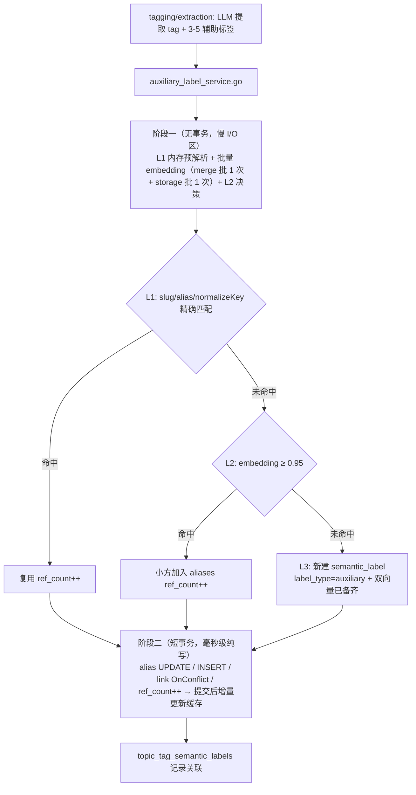
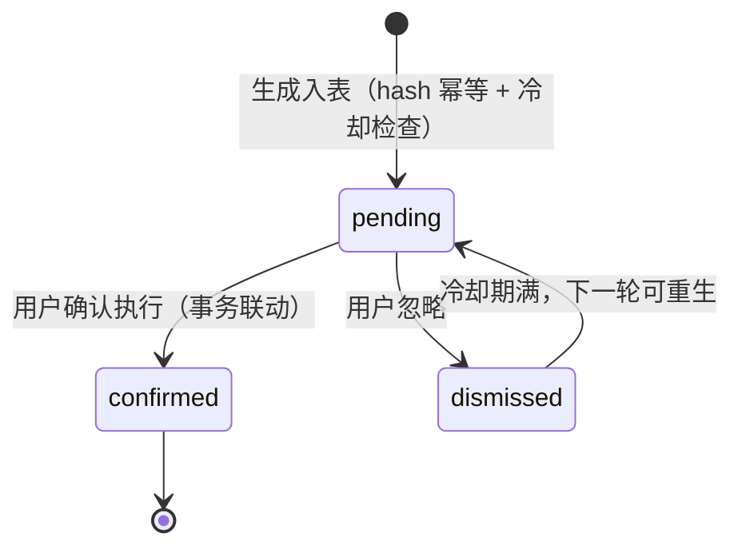
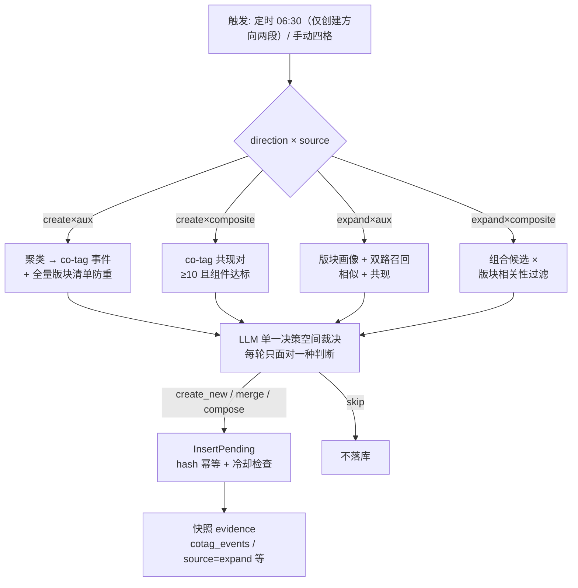
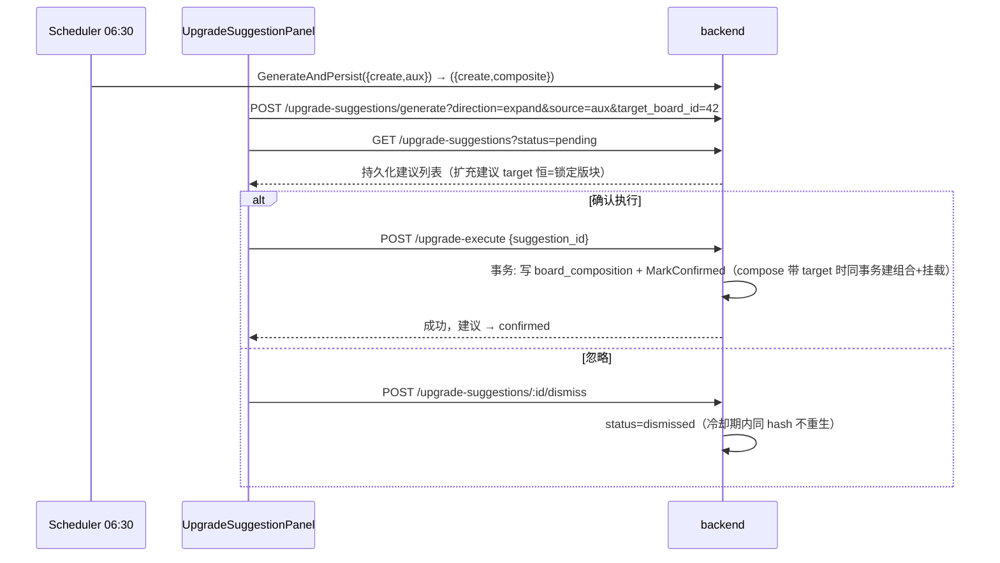

# 语义版块流程（Semantic Board）

<!-- doc-impact-applies: backend-go/internal/tagmanagement/, backend-go/internal/topicgraph/, front/app/api/semanticBoards.ts, front/app/api/normalizers/boardRadar, front/app/features/tags/components/console/BoardRadar, front/app/features/tags/components/console/boardRadar, front/app/features/tags/composables/useBoardRadar | section=业务约束与不变量 -->
> 大功能：辅助标签与组合标签入库、SemanticBoard 匹配/升级/回填、版块治理面板。
> 跨端。互补：`flow/daily-report.md`、`flow/topic-graph.md`。

## 需求说明

SemanticBoard（语义版块）解决「把散装 event 标签组织成持久主题分区」的问题。event 标签每天产生数十上百个，用户无法在平铺列表里快速定位关心的领域。语义版块提供类似 BBS 论坛的持久概念版块（「AI 前沿」/「新能源」/「中美竞争」），让用户：

- **按版块浏览**：每个 section 通过辅助标签挂载到 1-3 个版块，形成折叠/钻取的分区阅读体验。
- **标签去重入库**：LLM 提取的辅助标签经 L1/L2/L3 三级去重，避免近义标签碎片化；组合标签（如「美债收益率」= 美国国债×收益率）按组件集合 L1 + 组合 embedding L2 两级去重。
- **版块自演进**：升级建议（board upgrade suggestion）按「方向 × 来源」四格生成——创建版块（标签簇→建新版）/ 版块扩充（锁定单版块→挂载候选）/ 创建组合（共现对→组合标签）/ 组合扩充（共现对→组合标签并挂载），每轮 LLM 只做一种判断（单一决策空间），用户确认执行或忽略；创建方向由定时任务自动涌现，扩充方向纯手动（必须选版块触发）。
- **粒度阶梯**：辅助标签（中性概念）→ 组合标签（指向性主题，匹配最强信号）→ 版块（持久分区）。组合标签是「中性概念无法表达方向」与「建版块太重」之间的中间粒度。

### 工坊视图入口（rework-workshop-into-radar-and-desk）

> **当前实现风险（2026-10-25 投诉复审，尚未修复）**：下述入口设计不代表旧能力已完整迁移。已确认候选版块的日报入口被 active 泳道门槛挡住、删除版块入口漏迁、站内正文阅读承载缩水；完整去向表、证据边界和恢复顺序见 [本 change 的独立 UI-review](../../../openspec/changes/rework-workshop-into-radar-and-desk/review.md)。本轮仅审查，无数据迁移或重生成要求。

```text
/tags                          L0 今日雷达（BoardRadarView）
  └ /tags/:boardId             L1 版块态势（BoardConsoleShell：矩阵 / 归档 / 编排 / 治理）
      └ /tags/:boardId/:date   L3 日报阅读台（DailyReportDeskShell 两栏：索引 + 正文）
```

- **L0 雷达**：单次 `GET /semantic-boards/overview` 取全部活跃版块；行按关注度降序，≥50 带「热点」分档标记，<15 折叠进「常温」摘要；右栏「今日该读」与「今天可能升温」只读，右栏底部另有「管线状态」块（`add-radar-pipeline-status`）：只读展示标签队列积压、日报生成时刻与兜底时刻、最新日报落点与当日日报状态；该块的**手动生成入口是右栏唯一的写动作**——队列未清空时禁用（手动生成不等队列，当日才完成打标的文章不会进入当日日报），清空后可按板块勾选生成（勾选 = 参与生成，默认全选；同日重生成整份替换，须显式警示）。总览报头「全局治理」承载既有全库动作，首次失败不把右栏空结果当业务结论。报头右上为操作区，依次是统计、返回主页、「全局治理」、新建版块；返回主页紧邻「全局治理」左侧且与其同档（min-height 2rem / 0.7rem 字 / border-medium / hover 变 accent），标题区不另挂返回入口（8F / FB-13）。`/tags?report=&annotation=` 旧深链进入 L0 后反查日报日期并 replace 到 L3 阅读台（8.4 物理清理前旧组件文件保留但不再从入口渲染）。**客户端边界（8A/R-18）**：后端 snake_case JSON 协议不变，仅在 Radar API 分支归一为 camelCase/字符串 ID 读模型（唯一实现在 `front/app/api/normalizers/boardRadar.ts`，`useBoardRadarApi().getOverview` 接线），总览簇组件（`components/console/BoardRadarView.vue` 壳 + `BoardRadarMasthead/Story/Cold/ReadingRail/Governance` + `boardRadarHelpers` + `composables/useBoardRadarOverview`）只消费归一后读模型；首次取数失败不展示业务空态/初始化 0 结论（R-17），有旧数据时刷新失败保留旧值。
- **L1 版块态势**：`BoardConsoleShell` 三区壳（版块栏 / 主舞台 / 上下文右轨）；顶部视图 seg=矩阵·追踪｜文章归档｜研究工作台，另有唯一「打开日报 · MM/DD」、板块管理与新建泳道。矩阵/演进/编年共享 `?lane=` 与一份选中日；选中日点格后下方就地读，不再开 `SectionDrawer`。右轨顺序=版块体检（真实 `llm_score`，不是雷达 attention）→ 构成候选 → 话题追踪（管理仅 `boardId`）→ 来源构成（独立 7/30/90 滚动窗，不随时间视窗）；全库六项/新建版块唯一入口仍在 L0 总览，不在此重复。窄屏 `<768px` 不渲染矩阵/常驻右轨，改 `BoardNarrowSummary`（全部可选泳道 + 休眠折叠 + 下方同一编年 + 「本板块上下文」入口）；新建泳道提示需要宽屏/横屏。
- **L1 归档**：日期是主筛选（默认数据锚点当天，可切近 7/14/30 天与任意起止日期）；文章按日期平铺、行内显示全部命中标签，点文章抽屉看逐标签规则/分数/降级/方向校验与是否进入日报；不按话题分组、只读。
- **L3 阅读台**：独立路由两栏（分区索引 + 正文），日期历史并入索引顶部下拉；删除最左历史栏与右栏演进/本期话题，页边注收为右下抽屉；正文独立滚动；文章抽屉 60vw，窄屏全屏。
- **热度/缓存口径**：泳道行序键=source 全轴线索（thread）合计；矩阵格值=同日 bucket max，演进/趋势=同日 thread 合计；前端 lane-dynamics 仅当前板块 4 档缓存（365 档与池共用一次请求），报告列表索引 1 份、报告详情 ≤14、文章详情 ≤20，失败不入成功缓存、当前展开对象不因 FIFO 逐出消失。

## 链路设计

### 辅助标签入库（L1/L2/L3）



> **两阶段事务边界（fix-aux-label-idle-tx-cache，2026-10-06）**：历史实现在单事务内逐标签调外部 AI embedding API，是生产 `idle in transaction` 4–40s 的元凶（事务持 xmin 阻塞 vacuum，与 autovacuum 调优对抗）。现在 `AttachAuxiliaryLabels` 先在事务外完成全部慢 I/O（缓存加载、批量 embedding——`airouter.Embed` 原生 `[]string` 输入，N 个新标签恰好 2 次调用），再用一个短事务完成全部纯写；全有或全无原子性由阶段二保留（任一写失败整体回滚）。同模式已清理 `ConfirmSuggestion`（板向量/composite 短语 LLM 均事务前预计算，事务内 `ApplyCompositeLabel` 纯写）。规划与写入之间的 slug TOCTOU 与旧事务内「查后插入」一致，靠 `idx_semantic_labels_slug` 唯一索引兑底：冲突冒泡由打标 job 记 warn 跳过。批内重复 label（同 slug/normalizeKey）在阶段一去重共享首个决策；批内语义近似但文本不同的标签各自新建（旧串行路径靠缓存回灌 L2 归并，属罕见场景，后续手动合并治理）。PG 侧另有 `idle_in_transaction_session_timeout=60s` 防呆（`docker-compose.pg.yml`，recreate 生效）。

> **缓存失效增量维护（同 change）**：L2 去重依赖包级 `packageAuxLabelCache`（17.5k 行 merge 向量 ≈ 216MB 文本传输 + 解析，TTL 10 分钟），历史「一写全清」使批量打标每个新标签炸一次缓存再全量拉。现在 L3 新建直接把 merge 向量塞进 map + activeLabels append 轻量副本（列集合对齐、不含向量列）；disable/alias 合并源按行删除；alias 变更仍只清轻量的 activeLabels；时间戳不重置 → 批量打标零全量重拉，仅冷启动 1 次。handler 直改 status 的路径不经 service 失效，由 TTL 兑底（窗口与历史一致）。

> **L2 不会形成「合并黑洞」**：与主标签路径不同（`findOrCreateTag` 的 embedding 命中曾覆盖 label/slug → text_hash 变 → 重生成 embedding → 恶性循环，见 `v1.3.1/fix-tag-blackhole-embedding-match`），aux 的 L2 命中只 `addAlias`（append alias + ref_count++），**不改 Label、不重算 MergeEmbedding**（MergeEmbedding 仅 L3 新建时生成一次，之后恒定）。既有 aux 的「吸引力」= 固定 embedding 的 cosine，不随 alias 增多 / ref_count 升高而自我放大，无循环根因。阈值 `auxiliary_label_dedupe_sim` 可配（默认 0.95）。

> **空结果是合法结论，泛词进不了池**（fix-tagging-pollution，2026-09-25）：LLM 返回空 `keyword_tags` / 空双数组 / 零候选都是「宁缺毋滥」提示词下的合法输出——不再用规则词回填（旧回填把分类名「新闻」与 HTML 属性子串误命的「Coding」以 llm 来源写库），也不降级 heuristic（仅提取调用 err != nil 时降级）；零候选文章保持无标签等待重打。入库前另有泛词黑名单（新闻/论坛/要闻/快讯/文章/内容/技术/发展，Slugify 后完整匹配）在 `persistArticleTags` 入口拦截，跨 feed reuse 复制路径在 siblingLinks 查询处同滤——任何来源的泛词标签不落库、不进辅助标签池。

### SemanticBoard 匹配（add-composite-labels 后五级优先）

```text
semantic_board_matching.go
  → 读取 tag 辅助标签 + tag 组合标签 + active Board composition（aux + composite）
  → composite_hit（组合交集 ≠ ∅，score=1.0，免方向校验）
  > direct_hit（aux 交集 ≥ min_overlap，score=direct_hit_score_factor 默认 0.7，强制方向校验）
  > hit_rate / max_sim / weighted（三间接规则，不变）
  → 写入 topic_tag_board_labels（最多 3 个 Board）
```

- **composite_hit**：tag 挂的组合标签（显式关联 ∪ **推导命中**：tag 挂齐某 active 组合的全部组件 aux 即视为挂该组合——确认组合后重算即生效的闭环来源）∩ board composition 挂的组合标签 ≠ ∅ 即命中，score 恒 1.0、`direction_mismatch=false`（组合命中即指向一致）；同 tag-board 同时满足单标签重叠时只记 composite_hit。组合 embedding 为 NULL（disabled/历史缺失）的组合不参与判定；全量组合组件集进匹配缓存（随 InvalidateBoardData 失效）。
- **direct_hit 降级**：单 aux 重叠是「话题域相同」的弱证据，score 从 1.0 降为 `semantic_board_match_direct_hit_score_factor`（默认 0.7，可配 1.0 恢复旧分数），且与间接规则一样强制方向校验（全库 gap 豁免+绝对+相对三层，见下方红线 4，前端默认隐藏）。0.7 让 direct_hit 仍强于典型 weighted 但弱于组合命中与高质量 hit_rate。
- 只挂组合（无 aux）的 board 不被 aux 数量预过滤拦下，仍可被 composite_hit 命中；board 组合数据进 board match cache（与 auxiliaries/embeddings 同失效语义，composition 变更即失效）。

### 组合标签（composite label，add-composite-labels）

```text
创建（手动 / 升级建议确认，同一服务）：
  composite_label_service.go CreateCompositeLabel
  → 组件校验（2-5 个不同 active aux，去重保序）
  → L1：组件 ID 集合与既有组合（含 disabled）完全一致 → 复用（ref_count++）
  → L2：组合 embedding cosine ≥ composite_label_dedupe_sim（默认 0.95，仅比 active）→ 只 addAlias（防黑洞纪律同 aux）
  → 均未命中：LLM 对「label. description」短语生成 embedding（禁组件向量合成）→ 建 semantic_label(label_type=composite) + composite_components（position 有序）

升级建议产线（compose 决策）：
  semantic_board_compose.go collectComposeCandidates
  → 同一文章内共现（CoTagWindowDays 窗口）的 aux 对/三元组，频次 ≥ semantic_board_upgrade_composite_min_cooccurrence（默认 10），组件 ref_count 达升级阈值
  → 三元组达标时吸收其子 pair；候选按频次降序限 top 20
  → 独立 LLM 裁决（mode=compose，坏 JSON/超时降级跳过本轮 compose 段）→ decision=compose 建议落库（evidence 带共现频次/窗口/代表事件标题）
  → 生命周期全复用：suggestion_hash 幂等 / dismiss 冷却 / 确认事务

确认执行（compose）：
  ConfirmSuggestion 同一事务内调 CreateCompositeLabel（含去重复用路径）+ MarkConfirmed；
  embedder 失败等任何错误整体回滚，建议保持 pending
```

冷启动序列：迁移 → 跑一轮 compose 建议 → 用户确认一批组合标签 → 一次性 `mode="all"` 匹配重算（direct_hit 存量降级重写、组合命中重算为 composite_hit）。

### 升级建议生命周期（split-board-upgrade-directions 四格矩阵）

> **split-board-upgrade-directions 变更**：生成入口从「discover_new/expand_existing 双模式（LLM 全决策空间混跑 + watch 观察池 + 高置信自动合并）」重构为「方向 × 来源四格矩阵 + 锁定单版块 + LLM 单一决策空间」。背景：旧模式 LLM 一次背三种决策，merge 目标产出不可信（实测 17 条全不在算法 shortlist、经常缺 target），前端被迫兜底成人工全量挑目标。watch 观察池与高置信自动合并退役；旧内存探索 UI（candidates/clusters/内存建议）退役，持久化建议为唯一数据源。

#### 四格矩阵与 LLM 决策空间

| 方向 | 来源 | LLM 只答 | 确认动作 |
| ------ | ------ | ------ | ------ |
| 创建版块 | 单标签 | 这个簇值得开新版块吗（create_new\|skip，prompt 带全量版块清单防重复，按簇质心相似度截断 top-60） | 建版块 + 挂 aux |
| 创建版块 | 组合标签 | 这对共现值得变组合吗（compose\|skip） | 建组合标签（去重复用） |
| 版块扩充 | 单标签 | 这个候选属于版块 B 吗（merge\|skip，二分类） | aux 挂进 B |
| 版块扩充 | 组合标签 | 值得组合且属于 B 吗（compose\|skip） | 建组合标签 + 同事务挂进 B |

- 单例簇（size=1）不产任何建议（不进 LLM、无观察池）；全部建议经 LLM 裁决（无合成旁路）；skip 不落库不返回。
- 扩充方向 target 由服务端注入（= 生成前锁定的版块），LLM 输出不含目标字段——从根上杜绝缺 target / off-target 兜底逻辑复活。
- 扩充候选召回（双路并集去重、排除已挂载/disabled、各路上限 40）：相似路（aux embedding 与版块 embedding 余弦距离 ≤ `semantic_board_expand_sim_distance` 默认 0.35）+ 共现路（与版块构成标签同文章共现 ≥ `semantic_board_expand_cooccurrence` 默认 3，窗口同 CoTagWindowDays）；组合路要求至少一组件 ∈ 召回集 ∪ 版块构成集。携带 days>0 时扩充各路收紧：相似路加近 days 天文章引用过滤（批量 EXISTS），共现/compose 路窗口取 min(days, CoTagWindowDays)。
- 版块画像 prompt：版块描述 + 构成标签（组合带标记）+ ≤8 条近期 section 标题（查询失败降级为名称+描述，不阻断）。
- days 时间窗四格恒携（expand-upgrade-days-window）：create×aux 按文章活动过滤候选；expand 相似路要求近 days 天文章中引用过、共现/compose 路窗口取 days 与 CoTagWindowDays 更严者；create×composite 携带但后端忽略；`0`=不过滤（与无时间窗现状一致）。

#### 建议状态机



> watch 状态已退役（split-board-upgrade-directions）：存量 pending watch 行由迁移 20260905_0002 一次性清理；decision 枚举保留 watch 值仅为存量行 DTO 兼容，生成侧不再产生。

#### 生成链路



#### 触发方式

- **定时**：scheduler `job_board_upgrade_suggest`，默认每日 06:30（`semantic_board_upgrade_suggest_time` 可配），**仅创建方向两段**（{create,aux} → {create,composite}），段失败仅记日志继续兄弟段不阻塞；版块扩充纯手动（必须选版块触发，spec：定时生成仅创建方向）。
- **手动**：前端生成入口（方向两选 → 来源两选 → 扩充时版块单选）→ `POST /api/semantic-boards/upgrade-suggestions/generate?direction=&source=&target_board_id=&days=` → `GenerateAndPersist`，返回 `{inserted, skipped, cooldown_blocked}`。参数校验：expand 缺 target / create 带 target / target 非活跃版块 / 旧 mode 参数 → 400。

#### 跨端协作



#### 前端面板分区（UpgradeSuggestionPanel）

- **生成入口（顶部）**：方向两选（创建版块 / 版块扩充）→ 来源两选（单标签 / 组合标签）→ 扩充时版块单选下拉（可搜索，仅活跃版块）+ days 下拉（四格恒显恒携，expand-upgrade-days-window）；未选版块时生成禁用；生成错误行内提示；空态区分「未生成过（引导）」与「本轮无建议（扩充方向附覆盖提示）」。
- **持久化建议列表（唯一数据源）**：决策过滤 tab（全部 / 合并 / 新建 / 组合，观察池 tab 已删）+ evidence 展示（泳道标题 / 共现事件 / 组合证据，缺 key 降级不渲染）+ per-row aux 勾选子集 + 确认执行（带 suggestion_id）/ dismiss。扩充建议卡片展示锁定版块徽标（「→ 美债」），merge 行确认按钮直接合并进锁定版块（无「合并到...」改目标下拉——目标不合适应 dismiss 后换版块重新生成）；compose 建议带 target 时按钮为「创建并挂载」。
- **旧内存探索区（candidates/clusters/内存建议/「获取 LLM 建议」）已整体退役**。

#### 配置项（ai_settings，均可缺省）

| key | 默认 | 说明 |
| ----- | ------ | ------ |
| `semantic_board_upgrade_suggest_time` | `06:30` | 定时生成触发时间点（仅创建方向） |
| `semantic_board_upgrade_suggestion_dismiss_cooldown_days` | `14` | dismissed 冷却期（期内同 hash 不重生） |
| `semantic_board_expand_sim_distance` | `0.35` | 扩充召回相似路阈值（与版块 embedding 余弦距离） |
| `semantic_board_expand_cooccurrence` | `3` | 扩充召回共现路阈值（与版块构成同文章共现篇数） |

> 已退役配置键（残留行无害，代码不再读取）：`semantic_board_upgrade_watch_gc_days`、`semantic_board_upgrade_merge_confidence_margin`。suggestion_hash 的 mode 维度值改为 `direction:source`（create:aux / create:composite / expand:aux / expand:composite），新旧建议 hash 空间天然隔离。

### SemanticBoard 管理 / 回填

```text
SemanticBoard 管理面板
  → 辅助标签入库: L1 slug匹配 → L2 embedding合并 → L3 新建
  → SemanticBoard 匹配: 三规则挂载 → topic_tag_board_labels
  → 升级建议: 见上「升级建议生命周期」（持久化 + 双签名 + 观察池 + 定时生成）
  → 辅助标签治理: 禁用、alias合并、composition移除、suggest-auxiliaries、clusters、gc
  → 回填: all / unassigned / board 三种模式 + backfill-embeddings + rematch-all
```

#### 版块运维端点（`board_crud_handler.go` / `board_match_handler.go` / `board_upgrade_handler.go`）

| 端点 | 业务用途 |
| ---- | -------- |
| `POST /api/semantic-boards/backfill` | 入队一个 backfill job（`SemanticBoardBackfillRequest`，all/unassigned/board 三模式），返回 job 对象 |
| `GET /api/semantic-boards/backfill/:id` | 查询 backfill job 状态/进度（前端 `BackfillProgress.vue` 轮询） |
| `POST /api/semantic-boards/backfill-embeddings` | 为 `embedding IS NULL` 的版块生成 embedding（一次性补齐；`board-direction-check` 引入版块向量后的回填入口） |
| `POST /api/semantic-boards/rematch-all` | 取所有已挂载 `topic_tag`，逐个重跑 `MatchTopicTag`，返回 `{success, failed, total}`（匹配阈值调整后全量重算） |
| `GET/PUT /api/semantic-boards/matching-config` | 读/写匹配阈值（`ai_settings` 中 13 个 `semantic_board_match_*` key；PUT 后调 `InvalidateMatchingConfigCache` 失效缓存）。前端 `MatchingConfigDialog.vue` |

#### 辅助标签治理与建议（`board_crud_handler.go` + `service/auxlabel/`）

| 端点 | 业务用途 |
| ---- | -------- |
| `GET /api/semantic-boards/suggest-auxiliaries?label=&description=` | 全局建议：embed 查询文本 → 与 active aux cosine 排序，分页返回候选 |
| `GET /api/semantic-boards/:id/suggest-auxiliaries` | 版块级建议：以版块 `label+description` 为查询，排除已在该版块 composition 里的 aux |
| `GET /api/auxiliary-labels/clusters` | 聚类：cosine 距离 < 0.2 的连通分量（size≥2），10 分钟缓存，`?refresh=true` 强制重算 |
| `POST /api/auxiliary-labels/gc` | GC 回收，`mode` ∈ `dry_run/disable/delete/recalculate`，可选 `grace_days` |
| `POST /api/auxiliary-labels/merge-alias` | alias 合并（source→target） |
| `POST /api/auxiliary-labels/:id/disable` | 禁用单个 aux |
| `GET/POST /api/semantic-boards/:id/composition`、`DELETE /:id/composition/:aux` | 版块 composition 增删查 |

前端治理 UI（`features/tags/components/`）：`AuxiliaryLabelPool.vue`（辅助标签池）、`AuxiliaryLabelPicker.vue`（选择器，双模式：版块推荐/手动指定）、`BoardHealthPanel.vue`（体检治理主面板，含版块 composition 管理）、`composables/useAuxiliaryLabels.ts`。

### 泳道动态（board-lane-dynamics，取代已退役的话题态势版图）

版块态势页 `/tags/:boardId` 当前是**观察窗 A 路线（名单稳定）**：独立 7/14/30/365 档只由档按钮/显式 URL `days` 改变，决定 A 档名单、前端 source 全轴行序（线索合计 DESC → 分区数 DESC → topicId）与休眠分组（≤2 分区，只展示不写 status）；自由 `start/end` 只裁切显示，恰 7/14/30/365 也不换档。365 池（B）在 A 数据到位且锚点已知即**预取**（顶部时间视窗背景曲线首屏即需整条 365 池曲线，不得只画当前档窗那几天、等用户拖出档窗才补历史；可见日跨出档窗只是复用已取到的池），B **只补 A 名单内同 topic ID 的历史内容**，不参与名单/排序/休眠/候选；池未取到/失败时历史日显示 `?`（不补 0），池提示与「重试历史池」无条件出现（A 侧照常可读、名单/排序不动）。

主舞台：矩阵行=泳道、列=可见日期；日格=**同日各主题桶 thread_count 的峰值（bucket max）**，无分区 `—` 禁用、有分区 0 线索 `0` 可开、历史未取到 `?` 不补 0，无行尾合计列。选中泳道演进节点=**当日线索合计（day sum）**，点径随合计增大；>31 日切趋势图+折叠逐日索引。下方当日编年默认标题收束，单条就地展开真实 summary，相关文章按需，稳定 report/section/thread ID 关联；「打开所选日日报」是带完整日期的历史动作，顶部最新日报入口独立。接口契约见 `docs/reference/api/daily-reports.md` §`GET /semantic-boards/:id/lane-dynamics`。

- **当日其他话题**：矩阵保留折叠组，成员只来自所选日报，沿既有 sectionId/topicId 排除正式与休眠泳道；历史状态取 `topic_status_at_report`，不借当前候选资格。行高/标题/实底热度格/选中与泳道共用视觉，只绘所选日格。选中后，现有日期表头（窄屏复用同源日期条）用黄点标记同 `persistentTopicId` 的可见窗真实记录日，hover/focus 显示当日分区原题；同日多分区只一个点、仍定位原序首 section，不合并正文、不跨新旧 ID 自动补连。点黄点通过 `selectObservedDay` 原子切日期/report/section/topic，普通报日仍走原 `selectDayHeader`；换选更新、清选择/无 ID 清点。**已验证记录日**（黄点当日：观察带里同 ID 的真实分区记录，自带 report/section，证据强于报日索引）在报日索引缺该日（陈旧/不全）时不被选中日普通回落搬走；只保护当前这一个观察目标，普通选行/清场/切泳道/切板块/换日即失效，范围排出（轴外）照旧回落；目标实际无日报时保留日期与目标并显示诚实「所选日没有日报」态，不借旧正文、不退回别日。观察复用 days=0 单份板块缓存，失败/缺 ID 说明及重试留在阅读区，但不再重复日期药丸。正文复用泳道标题/分隔/线索展开，不产滚动态势；0 正式泳道未选其他时只保留选日/选话题方向提示，不画无效选泳道卡。此增量只读、无迁移/重生成/配置，旧无 ID 数据无关联点，缺分区如实提示。
- **展示范围/休眠**：A 档响应中的 active ∪ watch 关联泳道（`board_topic_watches.persistent_topic_id`）；行序按 A 全轴线索合计，不按可见裁切重算；休眠（source 全窗分区 ≤2）仅折叠展示，不改生命周期；candidate 只进候选区/编排入口，需人工激活，不自动转正。
- **日期/锚点**：矩阵轴终点 = A 数据锚点（优先版块独立最新日报日期，0 active 泳道版块同样有；否则回退 A 最新有分区日），与后端 `lane-dynamics` 的 `[anchor-(days-1), anchor]` 对齐；今天无日报时列终点不为空白「今天」，另给「数据截止」提示。雷达每行 `anchor_date` 与全局 `date` 分别表达。
- **态势结算**（日结算异步，见 `flow/daily-report.md` §泳道态势结算）：每日日报生成后为活跃泳道滚动重算 ≤100 字态势句（输入=窗口内「日期+节标题+前3线索」，LLM），存 `topic_lane_snapshots`（每泳道一行覆盖更新）；失败不阻塞日报，下个日报日自愈；快照缺失时卡片「待结算」降级、时间线照常。
- **代码入口**：后端 `backend-go/internal/topicgraph/repository/lane_snapshot_repository.go`（聚合 `GetBoardLaneDynamics` + 结算侧查询）、`service/lane_snapshot.go`（结算管线，operation=`daily_report.lane_snapshot`）、`handler/lane_dynamics_handler.go`；前端观察窗/矩阵/演进/编年 `front/app/features/tags/components/console/{ObservationRangeControls,ObservationMatrix,ObservationLaneEvolution,LaneChronicle}.vue` 与 `composables/{useBoardConsole,useObservationWindow,useLaneDayReading,useOtherTopicObservation}.ts`、同目录组件 `DayOtherTopicsGroup.vue` / `ObservationMatrixDayHeader.vue` / `OtherTopicReading.vue`；API 边界 `front/app/api/laneDynamicsWindow.ts`、`front/app/api/normalizers/laneDynamicsWindow.ts`、`front/app/api/laneDayReading.ts`；旧 `lane-dynamics/LaneDynamicsPanel.vue`/`LaneDynamicsCard.vue` 文件保留但不再作为 `/tags/:boardId` 主路径渲染。

> 退役说明：原话题态势版图（分区卡片墙/活力顶栏/节奏气泡图/mini-lifeline/stance 五态派生）随 overview-lane-dynamics 整体移除（2026-09-10）；stance 派生与 ECharts 图表不再存在，历史设计见归档 change `2026-08-01-board-topic-landscape`。

> 变更溯源见本文件 [§变更溯源](#变更溯源)。

### 板块来源构成（add-source-board-hit-rate，当前右轨/单级工作面）

供血源视角的只读聚合（当前版块右轨简要 + 单级宽工作面全量；不随观察日期/档重算）：`GET /api/semantic-boards/:id/source-breakdown?window=7` 返回该版块窗口内的来源构成——`total_articles`（按文章去重）/ `source_count` / `sources[]`（`feed_id`、本版块篇数 `articles`、占比 `share`、该源窗口总量 `feed_articles`、该源整体命中率 `feed_hit_rate`）。与板块文章列表 `/:id/articles` 的口径差异：articles 是文章列表（分页/过滤、含匹配质量明细），source-breakdown 是按源聚合的命中构成——**含已归档、按文章去重（同版块多标签只计一次、同一文章命中多版块各计一次）、必限窗口**；不变量：`Σ sources[].articles == total_articles`。版块不存在或非 `label_type='board'` → 404；disabled 版块不是 404（按命中口径聚合为 0）。

```text
TagsPage「版块内容」tab（默认）
  → BoardHealthPanel（体检治理主面板，吸收构成管理）之后
  → BoardSourcePanel.vue（不新增 tab；窗口 7/30/90 + 汇总行 + 来源表，只读无写动作）
  → 选中版块变化时与 loadComposition 并行重取（请求竞态沿用既有面板惯例）
```

口径与源视角（`GET /api/feeds/board-hit-stats`，见 [reading.md](reading.md) §源视角观测）共用同一份聚合代码 `internal/tagmanagement/service/sourcestats/`；契约见 [semantic-boards.md](../api/semantic-boards.md)。处置入口不在面板内（仍在设置 → 订阅源）。

### 版块体检（add-board-health-checkup，每日纯读统计）

> 🗺 全链路图：[`diagrams/board-health-checkup.html`](diagrams/board-health-checkup.html)（双主题，含 2026-10-03 评分 prompt 方法学锚：insufficient ≠ 失效，<60 只看真实病征）

版块构成质量的自动反馈环：挂日报生成成功路径之后同步执行（`DailyReportJob` 成功裁决尾步，手动 TriggerNowWithDate 同触发；体检 error/panic 仅日志不污染日报 job），对每个活跃版块算两级统计 + 事实画像 diff，LLM 单次合并产出评分/评语/打扰裁决，落 `board_health_snapshots` 快照（趋势可查，历史不覆盖），异常时经通知中心发 LinkType=board 通知（冷却默认 3 天）。**纯读硬边界：不写匹配表、不落任何扩充建议**（扩充建议仍必须用户手动触发，红线 10 不动）。

- **口径（唯一实现 `internal/tagmanagement/service/boardhealth/`，对标 sourcestats 纪律；2026-10-08 实测修正——初版「单 aux 纯净样本」口径因样本占比仅 2%-11% 且永不增长而废弃，实测数据见归档 change design D4）**：版块级（口径①全部匹配行）= matched_tags / reason_dist / ghost_matches（direction_mismatch 计数）/ vector_missing；标签级（口径②贴合度分布）= 每个构成标签 embedding × 该版块全部挂载 tags 的 identity embedding 现场重算 cosine（MUST NOT 按 tag 的 aux 挂载数量筛样本，不做功劳归因），分布 mean/median/p25/p75/low_sim_ratio（低分线=板块内各构成标签 cosine_mean 的 P25 相对线，自适应板块主题纯度），任一侧向量缺失跳过分布并计数（不按 0 计入），构成标签自身缺 embedding → 该标签 insufficient；samples < `board_health_min_sample_size`（默认 5）标 insufficient 分布置 null。
- **事实画像 diff（uncaptured_candidates）**：已挂到版块的 tags 所携带、但不在版块构成中的高频 aux（排除已挂载与 disabled），按 member_tags 降序存 top 50；只存候选不落建议。
- **member-derived 扩充主路（回退语义）**：手动扩充生成时候选来自最新快照的未收编清单前 `board_health_member_candidates_top`（默认 20，排除已挂载保险滤 + days>0 近期文章过滤）；无快照/清单空/滤后空 → 回退既有相似+共现双路（行为不变）。
- **LLM 降级**：评分单次调用（operation=`tagmanagement.board_health_checkup`，走 `topic_tagging` 能力路由）；坏 JSON/超时 → 统计照常落快照、score/comment 置 NULL，本轮跳过通知不重试。
- **配置（ai_settings，均可缺省）**：`board_health_min_sample_size`(5) / `board_health_alert_threshold`(60) / `board_health_notify_cooldown_days`(3) / `board_health_member_candidates_top`(20) / `board_health_magnet_gap`(0.08) / `board_health_magnet_min_failed`(5)（后两个是三病分诊的磁铁阈值，见下节）。
- **三病分诊与共享描述修复**：体检轮次在同一次纯读里多算三类确定性信号并把标签级分诊清单落进快照（`metrics.triage`），用户可据此逐项核对处置——详见下节「版块体检三病分诊与共享描述修复（board-health-triage-advice）」。
- **只读端点**：`GET /api/semantic-boards/:id/health-checkup?trend=N`（N 白名单 1-90 默认 7，非法 400）：latest + 趋势升序；版块不存在 404，disabled/非 board 返回空态（非 404，同红线 17 端点纪律）。
- **前端**：板块内容 tab 治理主面板 `BoardHealthPanel.vue`（形态 A：吸收构成管理，BoardCompositionPanel 退役）——评分徽章（好≥70/中 60-69/差<60）+ 评语 + 指标 chips + 质量表（行内移除，无快照「待体检」降级）+ 组合标签区 + 趋势 + 未收编候选（收编快捷动作 = 既有 addComposition 手动挂载，不走 LLM 建议管道）；低分时 tab 顶部警告条（点击滚到面板）。

```text
DailyReportJob 成功裁决（failedCount==0）
  → runPostReportBoardHealthCheckup（10min 独立预算，panic 隔离）
  → boardhealth.RunCheckup：遍历 active 版块 → 统计/画像 diff → LLM 评分 → 快照落库 → 通知裁决（冷却）
  → 单版块失败仅记日志继续兄弟版块

手动扩充生成 expand×aux
  → recallExpandAuxCandidates → 最新快照 uncaptured_candidates 非空？主路 top N（保险滤 + days 过滤） ：回退相似+共现双路
```

### 版块体检三病分诊与共享描述修复（board-health-triage-advice）

体检从「一句笼统评语」升级为**可开药方的标签级分诊**：同一轮纯读里为每个构成标签算三类确定性信号，把证据喂给**同一次** LLM 调用，输出四类分诊清单（🔴 建议摘除 / 🟡 建议重写描述 / 🟢 保留澄清 / ⚪ 证据不足），随快照持久化（`metrics.triage`）。摘除与描述修复都**不在体检轮次内执行**：摘除走既有构成 DELETE 接口，描述修复走独立的持久任务链（人工确认后才创建）。

- **三病口径（唯一实现 `internal/tagmanagement/service/boardhealth/`，同轮同内存算，不重算匹配、不筛样本）**：
  - **磁铁失灵（磁铁信号 `magnet`）**：构成标签 embedding 对「`direction_mismatch=true` 的挂载 tag 子集」与「全部挂载 tag」的贴合度均值差（gap = all_mean − failed_mean，阈值 `>=`，可配 `board_health_magnet_gap` 默认 0.08）；失败子集样本数达 `board_health_magnet_min_failed`（默认 5）才成立，**任一侧样本不足或构成标签自身向量缺失 → 标 `insufficient`，MUST NOT 按差值硬凑**。只做分组差统计，**不做「哪个标签吸引了哪个 tag」的功劳归因**（与红线 22 同纪律）。
  - **描述污染（预筛 `desc_flags`）**：构成标签 description 命中固定文章式词根（`此次/本次/该事件/报道/针对/期间/近日`）→ 事件性嫌疑；description 为空不标记。词根集合是闭集常量，不从用户输入拼装。
  - **泛化漂移（最近邻 `neighbors`）**：构成标签在全库 **active 辅助标签**向量空间的 top-3 最近邻（排除自身）及其 cosine，作为「短概念标签最近邻是实例标签 = 语义窄化/漂移」的证据；自身向量缺失 → insufficient。
  - **不是第四种病**：「短名天花板」（短实体名 × 长版块名的 cosine 天然低，如 OpenAI 0.57、MySQL 0.45）是**防误杀判据**不是病症——分诊 MUST NOT 仅因 cosine 低归入摘除，评分层也不因此扣分。
- **体检轮次纯读红线（红线 20 不动）**：体检只写 `board_health_snapshots`（含 `metrics.triage` 附属产物）与少量冷却内异常通知；MUST NOT 新增 `board_upgrade_suggestions` pending 行、MUST NOT 写 `topic_tag_board_labels` 匹配结果、MUST NOT 改任何 description/embedding。**分诊清单是建议不是执行**：🔴 摘除 MUST 经用户确认后调用既有 `DELETE /api/semantic-boards/:id/composition/:auxiliary_label_id`；🟡 重写 MUST 经用户另行核对共享影响并确认后才可创建修复任务。**人工修复与自动扩充的隔离边界不变**：版块扩充建议仍必须用户手动触发（红线 10），体检不自动挂载、不自动摘除、不自动重写。
- **组合标签在分诊中只读（仅摘除可处理）**：`metrics.labels[]` 逐条携带 `label_type`（`auxiliary` / `composite`；历史快照缺该字段 = 类型未知）。描述修复链全程只认 `label_type='auxiliary'`——**组合标签的 🟡 重写项只读展示**（证据照常展开、不隐藏、不当它健康，不提供修复入口、不拉必然 404 的修复上下文）；**🔴 摘除项不受类型限制**（走既有构成 DELETE 链，组合标签的构成关系同样可摘除）。类型未知按不可执行处理，MUST NOT 臆造类型。
- **共享描述修复的影响面（人工确认前必须声明）**：辅助标签是**全局共享**标签——改它的 description 会重算该标签的 storage 向量（`embed("label: description")`），并更新**全部活跃 topic_tags** 的版块匹配（冻结范围含未归属任何版块的标签），因此**可能改变其它版块的挂载归属**。确认前界面须声明：这是共享标签 / 直接引用它的版块都受影响 / 匹配更新覆盖全部活跃话题标签；用户取消则零写入。
- **任务状态机与恢复（持久任务，非内存 job）**：
  - 状态闭集 `pending → embedding → saving → matching → completed`，失败态 `embedding_failed` / `save_failed` / `matching_failed`，终态死路 `conflict`（来源版本已变）/ `unavailable`（标签非 active 或已删）；`stage` 取 `embedding|saving|matching`（`pending` 可空）。`description_committed` 标记「描述+向量是否已原子提交」。
  - **幂等键**：客户端每次确认生成唯一 `idempotency_key`；同键同载荷重发返回**同一任务**（不重复重嵌、不重复提交），同键不同载荷 → `409` 冲突（绝不默默返回旧任务当成功）。同标签存在未结束任务（含三种失败态）时新创建 → `409` 互斥。
  - **原子保存**：storage 向量在**事务外**生成，事务内锁行校验来源版本/类型/状态后**原子写 description+embedding+任务阶段**；失败不清空旧向量、不动 label/aliases/merge_embedding。
  - **重试语义**：三失败态等用户显式 `retry`（后台不自动无限重跑、不烧 AI 额度）；已提交描述的任务重试**只续匹配**，不重嵌、不重存、不改 expected_version/冻结范围；`conflict`/`unavailable` 不可原样重试（须重新核对）；运行中/已完成的重试是幂等 no-op。
  - **`not_applicable` 与 `remaining`**：`not_applicable` = 冻结范围内处理时已失效/删除/合并而**持久跳过**的项数（**不是成功**）；`remaining = total − processed − failed − not_applicable`；四类之和恒等于 `total`（`total` 是创建时冻结的范围数量，不因后续失效而缩小）。只有 `remaining=0` 且 `failed=0` 才算 `completed`，部分失败恒为 `matching_failed`。
  - **恢复**：worker 绑**应用生命周期**（关页面/取消请求不取消已确认任务）；租约+心跳用 DB 实时时钟（`clock_timestamp()`），失租未结束阶段由扫描器重新领取；保存后故障窗恢复**禁再重嵌/再重存**。
- **旧快照与日报不受影响**：修复**不改写**历史体检快照、既有日报正文与历史评分，也不自动追加体检轮次；「更新完成」的措辞只表示匹配已更新，**效果待下一轮体检验证**（不得把复制成功、已排队、描述已保存或部分完成说成已修好）。
- **端点**：`GET /api/auxiliary-labels/:id/description-repair-context`（纯读）、`POST /api/auxiliary-labels/:id/description-repairs`（202 建任务）、`GET /api/auxiliary-labels/:id/description-repairs/:job_id`（纯读）、`POST /api/auxiliary-labels/:id/description-repairs/:job_id/retry`（202）；契约见 [api/semantic-boards.md](../api/semantic-boards.md)「辅助标签描述修复」。
- **代码入口**：后端 `backend-go/internal/tagmanagement/service/auxrepair/`（`auxrepair.go` 读/建任务门面、`embedding.go` 事务外向量生成、`matching.go` 既有匹配引擎调用、`executor.go` claim/心跳/恢复、`retry.go` 显式重试）、`handler/auxiliary_description_repair_handler.go`（四资源，只绑参数/错误/DTO）、`repository/auxiliary_description_repair*.go`（持久化与冻结范围）、`models/auxiliary_description_repair.go`（任务/条目模型）；生产接线 `tagmanagement/wire.go`（`InitDescriptionRepairChain`）+ `tagmanagement/routes.go`（挂四个资源）+ `internal/app/runtime.go`（应用生命周期 ctx + 关停先 cancel 再 join worker）。前端 `front/app/api/normalizers/{boardHealthTriage,auxiliaryRepair}.ts`、`front/app/features/tags/components/console/board-health/`（问题索引 + 单项处理区 + 三阶段进度）。

```text
体检轮次（纯读）
  → boardhealth.RunCheckup：统计/画像 diff → 三病信号 → LLM 单调用（score/comment/notify/triage）
  → 快照落库（metrics 含 triage）→ 通知裁决（冷却）

用户核对问题项（工作面）
  ├─ 🔴 摘除 → 用户确认 → 既有 DELETE composition → 成功才标「已摘除」（历史匹配不自动回填）
  └─ 🟡 重写 → GET description-repair-context（实时描述/版本/直接引用版块/活跃标签数）
             → 用户核对并确认共享影响 → POST description-repairs（幂等键 + expected_version）→ 202
             → 后台：embedding（事务外）→ saving（事务内锁行原子提交）→ matching（既有引擎逐项）
             → 三阶段/计数可查；失败显式 retry（只续匹配）；完成 =「更新完成，效果待下一轮体检验证」
```

### 标签级 watched tags（区别于话题级 topic-watch）

用户可在标签管理里关注（watch）任意标签，用于按标签筛选文章/日报。这与 `flow/daily-report.md` / `flow/topic-graph.md` 的**话题级** topic-watch（watch 持久话题 → 日报评估命中）是两套独立机制：一个 watch 的是**标签**，一个 watch 的是**持久话题**。

路由（`tagmanagement/handler/watched_tags_handler.go` + `service/watched/watched_tags_service.go`，挂在 `/api/topic-tags` 下）：

| 端点 | 语义 |
| ---- | ---- |
| `GET /api/topic-tags/watched` | 列出所有 `is_watched && status=active` 的标签，附 abstract 元信息（`is_abstract` + `child_slugs`，查 `topic_tag_relations`） |
| `POST /api/topic-tags/:tag_id/watch` | 标记 `is_watched=true`、`watched_at=now` |
| `POST /api/topic-tags/:tag_id/unwatch` | 取消关注（`is_watched=false`、`watched_at=NULL`） |

`GetWatchedTagIDsExpanded` 递归展开被关注标签（含抽象标签）的全部子标签 ID，供下游按 watched 标签集合做文章/日报筛选时使用。前端：`api/watchedTags.ts`。

### 标签合并预览（merge-preview，流式扫描/评估）

> 该工作流替代了已废弃的「标签自动合并 scheduler」（见 `flow/scheduler.md`，旧 scheduler 已不存在）。合并不再由定时任务自动执行，而是由用户驱动的 scan → evaluate → 分组 → dismiss/merge 流水线完成。

路由（`tagmanagement/handler/tag_merge_preview_handler.go` + `service/merge/` + `service/core/`，挂在 `/api/topic-tags` 下）：

| 端点 | 语义 |
| ---- | ---- |
| `POST /api/topic-tags/merge-preview/scan` | 启动异步全量扫描（`StartFullScan` 单例锁，已在跑返回 409） |
| `GET /api/topic-tags/merge-preview/scan/stream` | SSE 流式推送扫描进度 |
| `POST /api/topic-tags/merge-preview/evaluate` | 启动异步 LLM 评估（`StartEvaluation`，对候选对逐个裁决） |
| `GET /api/topic-tags/merge-preview/evaluate/stream` | SSE 流式推送评估进度 |
| `GET /api/topic-tags/merge-preview` | 读 pending 的 `TagMergeSuggestion`，过滤 `should_merge=false`，按目标标签分组返回 |
| `GET /api/topic-tags/merge-preview/status` | 返回 scan/eval 是否在跑 |
| `POST /api/topic-tags/merge-preview/add-to-group` | 手动把标签加入某合并组（`source=manual`，`OnConflict DoNothing`） |
| `POST /api/topic-tags/merge-preview/dismiss` | 标记候选对 `status=dismissed` |
| `POST /api/topic-tags/merge-with-name` | 真正执行硬合并：事务内 `FOR UPDATE` 锁两端 → 可选 rename + slug 冲突检测 → `HardMergeTags` → 提交后 `EnqueueMergeReembedding` 入重算队列 → 相关 suggestion 标 `merged` |

工作流：**scan**（全量扫描候选对，SSE 进度）→ **evaluate**（LLM 评估每对，SSE 进度）→ **merge-preview** 列表（按 target 分组）→ 用户对每组 **dismiss** / **add-to-group** / **merge-with-name**。合并后源标签的文章/关系迁移到目标标签，并触发 `merge-reembedding` 队列重算 embedding（见下「队列与回填运维」）。

前端（`features/tags/components/`）：`TagMergePreview.vue`、`TagMergeGroup.vue`、`composables/useTagMergePreview.ts`、`api/tagMergePreview.ts`。后端 service：`service/merge/tag_merge_suggest.go`、`service/core/merge_suggestions.go`、`service/core/hard_merge.go`、`service/core/merge_reembedding_queue.go`。

### 版块治理面板数据流

```text
SemanticBoardPanel
  → loadBoards() → GET /api/semantic-boards
  → viewBoard(id) → GET /api/semantic-boards/:id
  → viewComposition(id) → GET /api/semantic-boards/:id/composition
  → viewUpgradeCandidates() → GET /api/semantic-boards/upgrade-candidate
  → upgradeSuggest() → POST /api/semantic-boards/upgrade-suggest（旧，兼容期）
  → getUpgradeSuggestions() → GET /api/semantic-boards/upgrade-suggestions（持久化列表）
  → generateUpgradeSuggestions() → POST /api/semantic-boards/upgrade-suggestions/generate
  → dismissUpgradeSuggestion(id) → POST /api/semantic-boards/upgrade-suggestions/:id/dismiss
  → upgradeExecute(suggestion_id) → POST /api/semantic-boards/upgrade-execute（联动 confirmed）
  → backfill() → POST /api/semantic-boards/backfill
```

### Event 标签延迟 embedding

```text
Event 标签延迟 embedding: 描述+关键词生成后入队
  → 多行 embedding (semantic + event_keyword)
```

Event 类标签不随入库立即向量化，而是等描述与关键词生成后才入队，产出 semantic 与 event_keyword 两路 embedding。

## 业务约束与不变量

> 本节是 constraint-injection extension 的注入数据源：apply 改 `internal/tagmanagement/` 或 `internal/topicgraph/` 代码前会自动注入 system prompt，必须遵守。

1. **辅助标签按三级去重：L1 slug/alias 精确匹配复用、L2 embedding 相似命中只加 alias、L3 未命中才新建**：L1 slug/alias 精确匹配复用（`ref_count++`）；L2 embedding ≥ `auxiliary_label_dedupe_sim`（默认 0.95）命中只 `addAlias`（append alias + `ref_count++`）；L3 未命中才新建 `label_type=auxiliary` 的 `semantic_label`。
2. **辅助标签 L2 命中只 addAlias，不得改 Label 或重算 MergeEmbedding，以免形成合并黑洞**：aux 的 L2 命中**只 `addAlias`，不改 Label、不重算 MergeEmbedding**。`MergeEmbedding` 仅 L3 新建时生成一次，之后恒定——既有 aux 的「吸引力」= 固定 embedding 的 cosine，不随 alias 增多 / ref_count 升高自我放大。（对照主标签 `findOrCreateTag` 的 embedding 黑洞教训。）（fix-alias-save-vector-wipe：alias 写路径已升级为代码级列级更新——`addAlias` 与手动 alias 合并 target 侧均 `Select("aliases")` 只写 aliases 列，向量列永不沾染；历史全量 `Save` 曾把缓存结构体的 nil 向量写 NULL 致 1505 个 active 死向量，存量由 `POST /api/auxiliary-labels/backfill-embeddings` 回填，见「队列与回填运维」。）
3. **tag 挂版块按 composite_hit→direct_hit→hit_rate→max_sim→weighted 优先级判定，同 board 组合与单标签重叠同时满足只记 composite_hit，单 tag 最多挂 MaxBoards（默认 3）个版块**：composite_hit（tag 组合 ∩ board 组合 ≠ ∅）score=1.0 且免方向校验；单标签 direct_hit 需交集 ≥ `direct_hit_min_overlap` **且交集数 / tag active 辅助标签总数 ≥ `direct_hit_min_ratio`（默认 0.5，0=门槛关闭）**才命中 score=`direct_hit_score_factor`（默认 0.7）；**交集数达标但占比不足时不得 direct_hit，退回相似度路径判定，且重叠标签不得再作为该版块的相似度证据（同一批标签不得既作直接命中证据又作相似度证据——自相似恒 1.0 会变相重新挂载）**；再后 hit_rate → max_sim → weighted（`semantic_board_matching.go`），单 tag 最多挂载 `MaxBoards`（默认 3）个版块写入 `topic_tag_board_labels`。（add-composite-labels：direct_hit 从 1.0 降级 + 免检特权取消；fix-board-match-cross-domain：补占比门槛拦蹭词挂载——2026-10-04 非农事故形态的源头防线。）
4. **除 composite_hit 外的匹配命中（含 direct_hit）必须校验 tag 与 board 向量 cosine，mismatch 仍记录但不计日报且前端默认隐藏**：除 composite_hit（组合命中即指向一致，天然免检）外所有匹配规则——含降级后的 direct_hit——命中后先判**全库 gap 豁免**：挂载版块 identity cosine 与该 tag 对**全部 active 版块**（不限本次匹配候选，垃圾单挂的真家常在候选外）identity cosine 最大值的差值 < `semantic_board_match_direction_gap_exempt_margin`（默认 0.10，≤0 回退并列最优口径：差值 < 1e-9 判等）时豁免双门——长事件 tag × 短板名 embedding 的 cosine 全挤窄带（实测 0.55-0.65）时全库第一名常被语义重叠的磁铁板（如中国国内新闻）抢走，真家排 2-5 名的窄带差距是排序噪声不是跑题；豁免受可选地板线 `semantic_board_match_direction_floor`（默认 0=关闭）压制：floor > 0 且 cos < floor 时豁免不生效、回退双门。未获豁免的挂载走**绝对+相对双门**：①绝对门 cosine(tag identity embedding, board embedding) 低于 `direction_sim_threshold`（默认 0.5）；②相对门 gap = bestCos − cos ≥ `semantic_board_match_direction_relative_margin`（默认 0.15，ai_settings 可配，0/负值=关闭只留绝对门），bestCos=该标签**同轮匹配上的全部版块**（含将被标 mismatch 的候选）中 identity cosine 最大者——单挂标签 gap≡0 恒过，相对门天然只作用于多挂标签；任一门触发即标 `direction_mismatch=true`——**仍记录但不计入日报、前端默认隐藏**；tag identity 或 board embedding 缺失时跳过对应门。（`board-direction-check` 引入绝对门；add-composite-labels 将 direct_hit 纳入强制校验；fix-digest-tag-leak 补相对门拦多挂串味——digest 案例正确归属 0.81 vs 串味 0.60，绝对阈值切不开、相对 gap 0.21 稳定拦截；fix-board-ghost-false-positive 加全库最优豁免层与地板线——绝对门 0.6 切在事件×类目天然 cosine 带 0.50-0.65 上致全库 23.5% 挂载被标、其中 55% 为全库最优冤案，改源头全链路受益；fix-board-direction-gap-exempt 将豁免从并列最优扩为 gap 豁免带——实证真库 ghost 553→229、日本新闻 25→1，磁铁板噪声压制下的真家挂载不再冤杀，默认 0.10 为实证甜点：0.08 美国残留多、0.15 漏放小 gap 真串味、纯 gap 门（去绝对门）会误标强关联不可行。）
5. **max_sim ≥ 0.8 直接挂载必须同时满足 hits ≥ min(2, N) 且 hit_rate ≥ 0.3**：max_sim ≥ 0.8 直接挂载需同时满足 `hits ≥ min(2, N)` 且 `hit_rate ≥ 0.3`，防止单标签高相似度跨域误匹配。（`board-interaction-overhaul` 引入。）
6. **升级建议按 suggestion_hash 幂等，同 hash 已有 pending 行则 skipped 不重复入库**：`ComputeSuggestionHash(mode, decision, targetBoardID, auxIDs)` 为 32-hex 指纹（mode 维度值 = `direction:source` 四格键）；同 hash 已有 pending 行则 `skipped`（幂等 no-op），不重复入库。
7. **被 dismiss 的升级建议在冷却期（默认 14 天）内同 hash 不得重新生成**：被 dismiss 的建议在 `semantic_board_upgrade_suggestion_dismiss_cooldown_days`（默认 14 天）内，同 hash 下一轮生成被 `CountDismissedInCooldown` 拦截（`cooldown_blocked`），期满才可重生。
8. **watch 观察池已退役：单例簇不产任何建议，不得再生成 decision=watch 建议或恢复观察池 GC**（split-board-upgrade-directions）：单标签簇（size=1）既不进 LLM 也不入观察池（等待未来成簇后参与）；生成侧不得产生 watch/高置信自动合并等合成建议（升级建议生成路径单一化）；存量 pending watch 行已由迁移 20260905_0002 一次性清理，decision 枚举保留 watch 值仅为存量行 DTO 兼容。
9. **升级确认执行必须在同一事务内写 board_composition 并 MarkConfirmed，失败整体回滚不留半状态**：确认执行在同一事务内写 `board_composition` + `MarkConfirmed(suggestion_id)`，建议 → confirmed；`board_composition` 写失败则整体回滚，不留半状态。
10. **job_board_upgrade_suggest 定时仅跑创建方向两段、段失败仅记日志继续兄弟段，扩充方向不得自动执行**（split-board-upgrade-directions）：定时任务顺序跑 {create,aux} + {create,composite}，单段失败仅记日志继续下一段，返回 nil error（不标 task failed、不阻塞兄弟 job）；版块扩充纯手动（必须选版块触发），定时任务不得对任何版块自动生成扩充建议。
11. **任何将 semantic_labels 置 disabled 的路径必须同事务清空 embedding 与 merge_embedding，行本体与 aliases 保留**：任何将 `semantic_labels.status` 置为 `disabled` 的路径（API 删除 board、`DisableAuxiliaryLabel`、alias 合并源标记、GC disable 模式、更新接口）MUST 同事务同步置 `embedding=NULL, merge_embedding=NULL`（行本体与 aliases 保留）；重新启用由 backfill / llm_extract 重算。存量 disabled 向量已一次性清理。
12. **删除 topic_tags 行时其向量必须经 DB 层 FK ON DELETE CASCADE 自动级联删除**：`topic_tag_embeddings.topic_tag_id` 有 DB 层 `FK ON DELETE CASCADE`（迁移 `20260820_0001`）——删 `topic_tags` 行时向量自动级联删除。历史孤儿（GORM 声明 CASCADE 但 DB 无约束期间残留的 25.6 万行）已清理；`hard_merge` 等显式删 embedding 的代码路径保持不变（幂等）。
13. **跨版块关系发现只引用现有版块，不得自动创建/合并/修改版块，不影响 tag 版块归属**（add-evidence-backed-cross-board-relations）：跨版块关系发现是「证据→目标」的外部检索能力，目标解析只**引用**现有版块（唯一高分才 resolved，歧义/无目标保持 unresolved），**不强制映射、不自动创建/合并/修改版块、不做 board×board 全量扫描**；tag→版块的语义归属（embedding 匹配四规则）不受关系发现影响。确认关系只注入简报背景字段，不改版块成员。落地点：`dataenrichment/service/relation_resolver.go`（只读解析）/ 约束详见 `flow/data-enrichment.md` 24-27。
14. **组合标签去重 canonical 化：L1 组件 ID 无序集合完全一致复用、L2 组合 embedding ≥ composite_label_dedupe_sim 只 addAlias，命中不得改 label/重算 embedding，均未命中才新建**（add-composite-labels）：L1 与全体组合（含 disabled）比组件 canonical ID 集合；L2 仅比 active（disabled 向量已置 NULL），命中只 `addAlias` + `ref_count++`（防黑洞纪律同红线 2）；新建必须 2-5 个不同 active aux 组件，embedding 由 LLM 对「label + description」短语生成。
15. **组合标签 embedding 禁止组件向量合成/平均，必须由 LLM 对组合短语生成；生成失败创建整体回滚**（add-composite-labels）：组件向量加权/平均 ≈ 主题域泛化向量，恰好丢掉组合的指向性——这是组合标签参与匹配的物理基础；embedder 失败时不得落半成品行。
16. **compose 建议确认必须在同一事务内创建组合标签（含去重复用路径，扩充方向另含挂载 board_composition）+ MarkConfirmed，失败整体回滚建议保持 pending；compose 候选频次未达 semantic_board_upgrade_composite_min_cooccurrence（默认 10）不得进入 LLM，LLM 失败不产半成品**（add-composite-labels + split-board-upgrade-directions）：候选收集限同一文章内共现（窗口同 CoTagWindowDays），组件 ref_count 达升级阈值；确认遇 L1/L2 去重命中按成功处理（目的已达成，复用既有组合）；扩充方向（建议带 target）确认在同事务内建组合 + 挂载，目标版块非活跃则确认失败整体回滚。LLM 失败语义按入口分层：手动单入口（create×composite）诚实报错，定时任务段失败仅记日志继续兄弟段（红线 10）。
17. **源/版块命中统计口径唯一实现于 sourcestats 包且两端点只读，消费方不得复制公式；版块不存在/非 board → 404，disabled 版块不是 404（聚合为 0）**（add-source-board-hit-rate）：`GET /api/semantic-boards/:id/source-breakdown`（与源视角 `GET /api/feeds/board-hit-stats`）的聚合口径唯一实现 `internal/tagmanagement/service/sourcestats/`——按文章去重、含已归档（不过滤 `archived`）、限窗口白名单 {7,30,90}（非法 400 不回退）、命中 = 标签经 `topic_tag_board_labels` 挂到 `label_type='board' AND status='active'`、未打标两分（pending/leased vs 其余）；端点只读（不写库、不触发打标/匹配）；不变量 `Σ sources[].articles == total_articles`。要改口径先改 spec（`openspec/specs/source-board-hit-rate/spec.md`）。
18. **mono 打标输入为预算 4000 runes 的分段采样（文集型按标题均匀采样/叙事型头中尾采样，计量前先剥 markdown 图片与链接噪声），超限不再掐头；采样逻辑唯一实现于 sampling_splitter.go，aggregate 路径的 splitSections 不受影响**（long-form-sampled-tagging）：`buildArticleSummary`（`service/core/article_tagger.go`）按 AIContentSummary → FirecrawlContent → Content → Description 选出打标正文后调 `sampleTaggingSummary`（`sampling_splitter.go`）——正文超 `maxSummaryRunesForTagging`（4000）预算时按标题切段：≤3 段视为叙事型走头中尾采样，>3 段为文集型按段均匀分配预算（句界回退窗口、`……` 省略标记拼接）；噪声剥离先于计量（图片语法整体删、行内链接只留 text，不占采样预算），无标题整篇聚合为单段即叙事型；aggregate 路径的栏目切片 `splitSections`（带 dropIntro/mergeShort/splitLong 后处理）职责不同、互不依赖、不受影响。
19. **打标提取的空结果是合法结论：LLM 空 keyword 数组不触发规则词回填、成功调用零候选不降级 heuristic（仅提取调用 err != nil 时降级），零候选文章保持无标签等待重打；泛词黑名单（新闻/论坛/要闻/快讯/文章/内容/技术/发展，Slugify 后完整匹配）在 persistArticleTags 入口与跨 feed reuse siblingLinks 查询两处拦截，任何来源的泛词标签不得入库/进辅助标签池**（fix-tagging-pollution）：`extractor_enhanced.go` ExtractTags 对空数组只记观察信息（不再调 heuristicKeywordCandidates 回填，该函数已删除——旧回填把分类名「新闻」与凤凰网 HTML `decoding="async"` 属性子串误命的「Coding」以 llm 来源写库）；零候选原样返回（Tags=[]、Source=llm）；`article_tagger.go` 兜底条件收窄为 `err != nil`，`filterGenericLabels` 为 mono/aggregate/heuristic 三路径汇聚拦截点，reuse 路径（不经 persist 入口）在 siblingLinks 查询 join topic_tags 排除黑名单 slug（全黑名单 sibling → reuse 返回 false 落回 AI 提取）。
20. **体检轮次纯读不落任何扩充建议（pending 行零新增）、不写匹配结果表，自动化与扩充手动边界不变**（add-board-health-checkup）：体检挂日报成功尾步自动执行（单版块失败仅记日志继续兄弟版块，error/panic 不污染日报 job），但只写 `board_health_snapshots` + 少量冷却内异常通知；体检产出的未收编候选只是快照附属产物，扩充建议仍必须用户手动触发（红线 10 不动），体检轮次 MUST NOT 造成 `board_upgrade_suggestions` 新增 pending 行或 `topic_tag_board_labels` 任何写入。
21. **member-derived 扩充主路回退语义：最新快照未收编候选非空时候选 ONLY 来自快照清单 top N（排除已挂载保险滤 + days>0 近期文章过滤），无快照/清单空/滤后空必须回退既有相似+共现双路且行为不变**（add-board-health-checkup）：主路命中时不得触发全库相似/共现扫描；组合路（expand×composite）不受影响；suggestion 管道（hash 幂等/dismiss 冷却/LLM 裁决/逐条勾选）零改动，仅候选来源变化。
22. **体检统计口径唯一实现于 boardhealth 包（对标 sourcestats 纪律），标签级=构成标签 embedding × 全部挂载 tags identity embedding 的贴合度分布（现场 cosine 重算，不按 aux 挂载数量筛样本），样本不足标 insufficient 不硬凑，端点只读且 disabled 版块不是 404（空态）**（add-board-health-checkup）：`internal/tagmanagement/service/boardhealth/` 是两级指标/画像 diff/低分线（板块内 cosine_mean P25 相对线）/分布分位唯一实现，`GET /api/semantic-boards/:id/health-checkup?trend=N`（N 白名单 1-90 默认 7，非法 400）只读消费同一实现；标签级归因 MUST NOT 按 tag 的 aux 挂载数量筛选样本（不做功劳归因），规则分数 MUST NOT 作相似度统计输入，任一侧向量缺失跳过分布计入 vector_missing（不按 0 计入），LLM 坏 JSON/超时降级 score=NULL 不重试不丢统计。
23. **event 标签 description 时间锚以首挂文章日期为准：生成/重生成 MUST 以 articleContext 中的 `[日期: …]`（文章发布日期）为参照、MUST NOT 引入 Context 外时间信息（含模型先验知识中的历史事件时间），打标与描述生成的 prompt 示例 MUST 用时间中性/虚构事件（禁真实事件+具体历史年月组合）**（fix-event-tag-time-anchor）：`generateTagDescription` event 分支（`buildEventTagDescriptionPrompt`）与两个 extractor prompt 的正例均不得携带历史时间锚；存量修复走 `cmd/admin fix-event-tag-anchor`（dry-run 默认出清单+备份 CSV，`--apply --ids` 显式圈选，非候选 ID 整批拒绝不触碰，重生成复用首挂文章 articleContext 同一构造口径 `buildArticleContext`）。
24. **体检三病分诊信号口径唯一实现于 boardhealth 包（磁铁失灵/描述污染/泛化漂移），样本或向量不足 MUST 标 insufficient 不硬凑**（board-health-triage-advice）：磁铁信号 = 构成标签 embedding 对 `direction_mismatch=true` 失败子集与全部挂载 tag 的贴合均值差（gap ≥ `board_health_magnet_gap` 默认 0.08 且失败样本 ≥ `board_health_magnet_min_failed` 默认 5，只做分组差统计，MUST NOT 做「哪个标签吸引哪个 tag」的功劳归因）；最近邻信号 = 全库 active 辅助标签 top-3（排除自身）；描述污染预筛 = 固定文章式词根（此次/本次/该事件/报道/针对/期间/近日）命中，description 为空不标记；任一侧样本不足或构成标签自身向量缺失 MUST 标 `insufficient`，MUST NOT 按差值硬凑；「短名天花板」（短实体名 cosine 天然低）是防误杀判据，MUST NOT 仅因 cosine 低判摘除或扣分。
25. **体检分诊清单只是建议不得自动执行，组合标签（composite）在分诊中只读仅摘除可处理**（board-health-triage-advice）：分诊四类 `remove|rewrite|keep|insufficient` 均为建议——remove MUST 经用户确认后走既有构成摘除接口，rewrite MUST 经用户另行核对共享影响并明确确认后才可进入独立描述修复任务；体检轮次/查询端点 MUST NOT 改 description/embedding，MUST NOT 写匹配结果表/升级建议表（红线 20 不动）；构成清单逐条带 `label_type`（auxiliary/composite，历史快照缺该字段按类型未知处理，MUST NOT 臆造类型），描述修复链只覆盖 auxiliary——composite 的 rewrite 项只读展示（证据照常展开、不隐藏、不当它健康、无修复入口），remove 项不受类型限制。
26. **共享描述修复 MUST 人工确认后在同一事务内原子保存 description+storage 向量，任务持久幂等、匹配范围冻结全部活跃 topic_tags，计数四类之和恒等于 total，旧快照与日报不改写**（board-health-triage-advice）：辅助标签是全局共享标签，改其 description 会重算 storage 向量并更新全部活跃 topic_tags 的版块匹配（可能改其它版块归属），确认前 MUST 声明共享影响、取消时零写入；向量生成 MUST 在事务外、事务内锁行校验来源版本/类型/状态后原子写 description+embedding+任务阶段，MUST NOT 清空旧向量绕道，MUST NOT 改 label/aliases/merge_embedding；任务持久化（同幂等键同载荷回同任务、同键异载荷 409、同标签未结束任务互斥、失败态等用户显式 retry 且只续匹配不重嵌），创建时冻结全部 active topic_tags（含未归属者），`total=processed+failed+not_applicable+remaining` 恒成立（`not_applicable` 是失效跳过项 NOT 成功，`total` 不缩小），部分失败 MUST NOT 标完成；修复 MUST NOT 改写旧体检快照/日报/历史评分、不自动追加体检，完成只表示匹配已更新、效果待下一轮体检验证。

## 代码入口

- **后端辅助标签**：`backend-go/internal/tagmanagement/service/auxlabel/`（`auxiliary_label_service.go` L1/L2/L3 去重、`addAlias`、alias 合并、composition 移除、禁用；`composite_label_service.go` 组合标签创建/两级去重/禁用启用/列表）。
- **后端组合建议产线**：`backend-go/internal/tagmanagement/service/board/semantic_board_compose.go`（co-tag 共现候选收集 + compose prompt + 幂等过滤；`GenerateSuggestions` 内独立 LLM 轮，冷启动期聚类输入不足也照跑）。
- **后端版块匹配 / 升级 / 回填**：`backend-go/internal/tagmanagement/service/board/`（`semantic_board_matching.go` 五级优先规则 + 方向校验、`semantic_board_upgrade.go` 四格生成分发（GenerateSuggestions(UpgradeGenerateRequest)）+ compose 确认事务联动（扩充方向含挂载）、`semantic_board_expand.go` 扩充召回（相似+共现双路）+ 版块画像、`semantic_board_expand_prompt.go` 扩充二分类 prompt、`board_upgrade_suggestion_persist.go` `ComputeSuggestionHash` 幂等（mode=direction:source）+ `CountDismissedInCooldown` 冷却、`semantic_board_backfill.go` all/unassigned/board 三模式回填）。
- **后端版块 handler**：`backend-go/internal/tagmanagement/handler/`（`board_crud_handler.go` 版块 CRUD/运维端点/suggest-auxiliaries/clusters/gc、`board_match_handler.go` 匹配/rematch-all/matching-config（composite_hits 详情）、`board_upgrade_handler.go` 升级建议资源（含 compose 决策）/backfill job、`composite_label_handler.go` 组合标签 CRUD、`tag_management_handler.go`）。
- **后端标签关注 / 合并预览 / 队列 handler**：同目录下 `watched_tags_handler.go`（标签级 watched tags）、`tag_merge_preview_handler.go`（scan/evaluate SSE + dismiss/merge-with-name）、`tag_queue_handler.go`、`embedding_queue_handler.go`、`merge_reembedding_queue_handler.go`（见下「队列与回填运维」）。
- **后端 watched/merge service**：`service/watched/watched_tags_service.go`、`service/merge/tag_merge_suggest.go`、`service/core/{merge_suggestions,hard_merge,merge_reembedding_queue,person_metadata_backfill}.go`。
- **后端源/版块命中统计（sourcestats）**：`backend-go/internal/tagmanagement/service/sourcestats/`（口径唯一实现）、`handler/board_source_breakdown_handler.go`（版块视角端点）；源视角端点在 reader 域 `internal/reader/handler/feed_board_stats_handler.go`。
- **后端版块体检（boardhealth）**：`backend-go/internal/tagmanagement/service/boardhealth/`（统计口径/画像 diff/LLM 评分降级/通知冷却/RunCheckup 编排唯一实现；`metrics.go` 两级指标、`signals.go` 三病分诊信号（磁铁分组差/最近邻 top-3/描述词根预筛）、`diff.go` 未收编候选聚合、`llm.go` 合并评分 + 标签级分诊 prompt、`notify.go` 打扰裁决、`run.go` 轮次编排+只读视图）、`handler/board_health_handler.go`（只读端点）；日报尾步挂载 `internal/admin/scheduler/job_daily_report.go`（runPostReportBoardHealthCheckup seam，经 tagmanagement root 门面 re-export）；扩充召回主路 `service/board/semantic_board_expand.go`（recallMemberDerivedCandidates）；快照模型/迁移 `tagmanagement/models/board_health.go` + `database/postgres_migrations.go` 20261006_0001（FK CASCADE）。
- **后端共享描述修复（auxrepair）**：`backend-go/internal/tagmanagement/service/auxrepair/`（`auxrepair.go` 读/建任务门面与 DTO、`embedding.go` 事务外 storage 向量生成、`matching.go` 调用既有匹配引擎逐项推进、`executor.go` claim/心跳/失租恢复、`retry.go` 显式重试）、`handler/auxiliary_description_repair_handler.go`（四资源，只绑参数/错误/DTO，不写 SQL）、`repository/auxiliary_description_repair*.go`（任务/冻结范围持久化与版本校验）、`models/auxiliary_description_repair.go`（任务/条目模型）；生产接线 `tagmanagement/wire.go`（`InitDescriptionRepairChain`/`StartDescriptionRepairExecutor`）+ `tagmanagement/routes.go`（挂四个资源）+ `internal/app/runtime.go`（应用生命周期 ctx + 关停先 cancel 再 join worker）；表/迁移见 [database/tables/semantic-labels.md](../database/tables/semantic-labels.md) §5.6-§5.7。
- **后端版块调度**：`backend-go/internal/admin/scheduler/job_board_upgrade_suggest.go`（定时 06:30，仅创建方向两段：{create,aux} → {create,composite}）。
- **后端版块时间线**：`backend-go/internal/topicgraph/`（`service/daily_report_*.go` 版块时间线、`handler/`）。
- **前端**：`front/app/features/tags/components/UpgradeSuggestionPanel.vue`（升级建议面板：四格生成入口 + 版块单选 + 持久化建议列表（含 compose 卡片与「组合」过滤 tab）；旧内存探索区已退役）、`CompositeLabelPool.vue` + `CompositeLabelEditDialog.vue`（组合标签治理页，未选版块时「组合标签」tab）、`MatchDetailPanel.vue`（匹配详情，composite_hit 组合链展示）、`BoardSourcePanel.vue`（板块来源构成面板，「板块内容」tab 内体检治理面板之后，只读无写动作）、`BoardHealthPanel.vue`（体检治理主面板，吸收原 BoardCompositionPanel 全部构成管理职能：picker 双模式添加/行内移除/组合创建挂载 + 体检评分/质量表/趋势/未收编候选收编；低分警告条与泳道动态 LaneDynamicsPanel 由 TagsPage 直接渲染）、`TagsPage.vue`、`front/app/features/tags/composables/useTagsPage.ts`。

## 队列与回填运维

> settings 页 Queues section（`features/settings/components/SettingsSectionQueues.vue`）直接暴露下列三个队列给用户查看状态与 retry。

| 队列 / 回填 | 路由组 | 用途 |
| ----------- | ------ | ---- |
| tag-queue | `/api/tag-queue/{status,tasks,retry,retag-today}` | 文章打标签任务队列（`TagJob`）。`retag-today` 把今日文章批量重新入队（`force_retag=true`）；对应 `flow/reading.md` 的打标签时机。前端 `features/settings/components/TagQueuePanel.vue` |
| embedding/queue | `/api/embedding/queue/{status,tasks,retry}` | 标签/版块 embedding 生成队列（`EmbeddingQueueService`）。前端 `features/ai/components/EmbeddingQueuePanel.vue` |
| embedding/merge-reembedding | `/api/embedding/merge-reembedding/{status,tasks,retry}` | 标签合并后重算 embedding 的独立队列；`merge-with-name` 提交后由 `EnqueueMergeReembedding` 入队（`MergeReembeddingQueueService`） |
| person-metadata 回填 | `POST /api/embedding/queue/person-metadata/backfill` | 人物标签元数据回填（`service/core/person_metadata_backfill.go` 的 `BackfillPersonMetadata`） |
| 辅助标签死向量回填 | `POST /api/auxiliary-labels/backfill-embeddings` | 重建 active aux 标签缺失（NULL）的 embedding/merge_embedding（L3 同款生成规则，只补缺列、幂等重触发只处理残余、行级失败跳过）；同步查 pending 数、detached goroutine 异步跑、立即 202 `{pending:N}`，重触发至 pending=0 即完成。存量死向量源自己录：addAlias 曾用缓存结构体（不含向量列）全量 Save 把向量写 NULL（fix-alias-save-vector-wipe 修复 + 回填），完成后建议可选跑 `rematch-all` 让版块挂载重新竞争 |

handler 出处：`tagmanagement/handler/{tag_queue,embedding_queue,merge_reembedding_queue}_handler.go`。

## 变更溯源

| 日期 | 变更 | 摘要 | 归档位置 |
| ------ | ------ | ------ | ---------- |
| 2026-11-02 | fix-observation-pool-curve | 顶部时间视窗折线缩略图首屏只画当前档窗（14 天）、拖一下才出历史——根因：365 池加载被挂在「观察范围跨出档窗」触发线上，首屏池从不加载，档窗外全为未知日（`null` 不补 0）⇒ 曲线残缺。修复：池改为 A 数据到位且锚点已知即**预取**（顶部背景曲线首屏即需整条 365 池曲线；「按需拉池」只管历史日内容解析），365 档仍与池共用一次请求；池未取到/失败的提示条与「重试历史池」不再被「是否跨出档窗」门控；后台零改动（复用既有 `days=365` 读端点） | [`openspec/changes/archive/2026-11-02-fix-observation-pool-curve`](../../../openspec/changes/archive/2026-11-02-fix-observation-pool-curve) |
| 2026-10-24 | guard-tag-exemplar-leakage | 打标示例词泄漏护栏：两条 LLM 提取出口（mono 融合提取 / aggregate 栏目片）解析后过滤「prompt few-shot 示例词照抄」候选——label Slugify 归一命中示例词集合且模型可见输入无依据（大小写不敏感 Contains）即丢，auxiliary_labels 逐项同规则过滤；示例词集合与 prompt 同源常量 + 防漂移测试锁定；存量清理 CLI `cmd/admin tagguard-cleanup`（dry-run 默认 + --apply 事务删除 + tag_count 重算 + 孤儿清理，备份 CSV 留底）删 28 条误挂（PostgreSQL 26 + 某国央行上调基准利率 2 + kubernetes 1，PostgreSQL 标签挂载 36→11），416 期周刊不再误挂 | [`openspec/changes/archive/2026-10-28-guard-tag-exemplar-leakage`](../../../openspec/changes/archive/2026-10-28-guard-tag-exemplar-leakage) |
| 2026-10-24 | fix-board-health-llm-misread | 体检 LLM 评分判据三处校准（防系统性误读）：①贴合度分化双条件（相对垫底 low_sim_ratio 大面积偏高 且 多数达标标签 cosine_mean < 0.6，identity 事件句×短名词标签天然带 0.51-0.76）；②短实体标签（人名/地名/技术名词）cosine 低于泛概念属正常形态不扣分；③reason_dist 病征限双条件（弱路径畸高且 ghost 同时偏高，无组合挂载全单标签路径是常态）；实测假低分板全部回归（俄乌 55→92、日本 65→85、卫生 55→72 等） | [`openspec/changes/archive/2026-10-24-fix-board-health-llm-misread`](../../../openspec/changes/archive/2026-10-24-fix-board-health-llm-misread) |
| 2026-10-22 | fix-board-direction-gap-exempt | 方向校验豁免扩围：全库最优豁免（仅并列第一）升级为全库 gap 豁免带（挂载与全库最优差值 < `semantic_board_match_direction_gap_exempt_margin` 默认 0.10，≤0 回退旧口径）——窄带分布下磁铁板抢走全库第一名致真家排 2-5 名被冤杀（日本新闻 25 冤 22）；重算后全库 ghost 553→229、日本新闻 25→1、美国 216→48；红线 4 同步升级 | [`openspec/changes/archive/2026-10-24-fix-board-direction-gap-exempt`](../../../openspec/changes/archive/2026-10-24-fix-board-direction-gap-exempt) |
| 2026-10-15 | fix-board-ghost-false-positive | 方向校验加全库最优豁免层与地板线：绝对门 0.6 切在事件×类目天然 cosine 带 0.50-0.65 上致全库 23.5% 挂载被标、其中 55% 为全库最优冤案（豁免零冤案实证：重算后全库最优挂载 2313 行被标 0）；判定次序 composite_hit 免检 → 全库最优豁免（含并列）→ 绝对门 → 相对门；可选地板线 `semantic_board_match_direction_floor`（默认 0）压制豁免；改源头全链路受益（日报过滤/体检 ghost/前端展示零改动） | [`openspec/changes/archive/2026-10-24-fix-board-ghost-false-positive`](../../../openspec/changes/archive/2026-10-24-fix-board-ghost-false-positive) |
| 2026-10-13 | fix-digest-tag-leak | digest 串味根治双门：方向校验加相对门（gap = bestCos − cos ≥ `semantic_board_match_direction_relative_margin` 默认 0.15，bestCos=同轮全部匹配版块 identity cosine 最大者，composite_hit 豁免、direct_hit 同校验，红线 4 升级双门表述）+ 日报去重 tiebreak 升三级（文章数 > identity×版块 cosine > id，embedding 缺失回退 ID，红线 29）；margin=0.15 真库定值依据：gap≥0.15 抽样 18/18 全串味、0.10~0.15 混合法双归属不能低于 | [`openspec/changes/archive/2026-10-13-fix-digest-tag-leak`](../../../openspec/changes/archive/2026-10-13-fix-digest-tag-leak) |
| 2026-09-27 | fix-alias-save-vector-wipe | addAlias 清向量 bug 修复：L2 归并与手动 alias 合并改列级更新（Select("aliases")+struct，向量列永不沾染，红线 2 升级为代码+测试不变量）；新增死向量回填端点 `POST /api/auxiliary-labels/backfill-embeddings`（L3 同款生成、只补缺列、幂等、行级容错，202 异步）；真库存量 1505 个 active aux 死向量全部恢复（日本新闻版块构成 30 个 aux 复活）；附带修复 testutil 漏注册 discovery 模型的解耦回归（4421c068） | [`openspec/changes/archive/2026-09-27-fix-alias-save-vector-wipe`](../../../openspec/changes/archive/2026-09-27-fix-alias-save-vector-wipe) |
| 2026-09-25 | fix-tagging-pollution | 打标污染修复三件套：LLM 空 keyword 不再触发规则回填（判空=合法结论）、heuristic 兜底仅限提取调用失败、泛词标签黑名单拦截（新闻/论坛/要闻/快讯/文章/内容/技术/发展，persist 前丢弃 + reuse 复制排除）；存量清理（heuristic 484 行 + llm 泛词/Coding ≈800 行）+ retag 重打 586 篇全查零污染、近 3h 新增 llm=1679 行零命中 | [`openspec/changes/archive/2026-09-25-fix-tagging-pollution`](../../../openspec/changes/archive/2026-09-25-fix-tagging-pollution) |
| 2026-09-19 | long-form-sampled-tagging | mono 打标超长输入从「掫头 4000 runes」改为预算 4000 runes 分段采样：先剥 markdown 噪声（图片整删、链接保文字），文集型（标题段 >3）标题全保 + 正文均分段内句界截断（保底 120/段，段数超限退化标题清单），叙事型头中尾采样（2:1:1）；短文（≤4000）行为不变，新采样切分器 sampling_splitter.go 不动 aggregate 路径 | [`openspec/changes/archive/2026-09-19-long-form-sampled-tagging`](../../../openspec/changes/archive/2026-09-19-long-form-sampled-tagging) |
| 2026-09-19 | merge-tag-extraction-branches | mono 打标双分支提取（event/person + keyword 两次 LLM 调用）合并为单次调用双数组输出：两份系统提示合并去重、schema 双数组、数组级部分产出（空数组不触发 heuristic、仅保留另一侧），整体失败仍回退 heuristic；调用数 2→1、prefill 减半，去重优先级/上限/三级入库契约不变，aggregate 回落路径零改动 | [`openspec/changes/archive/2026-09-19-merge-tag-extraction-branches`](../../../openspec/changes/archive/2026-09-19-merge-tag-extraction-branches) |
| 2026-09-17 | fix-spa-nav-loading-ux | 叙事工坊（TagsPage）四个非默认 tab 面板改 defineAsyncComponent 懒加载 + 新增 PanelAsyncPlaceholder 占位（纯实现层性能优化，tab 入口与业务行为不变，主 chunk 瘦身）；同 change 另含全局导航加载反馈（>250ms 触发）与 pre-FCP 双主题背景色，契约见 spa-loading-ux spec 与 loading-experience.md | [`openspec/changes/archive/2026-09-17-fix-spa-nav-loading-ux`](../../../openspec/changes/archive/2026-09-17-fix-spa-nav-loading-ux) |
| 2026-09-17 | expand-upgrade-days-window | 升级建议「候选时间窗」days 从创建×单标签放开到全部四格：前端面板 days 下拉恒显、扩充方向请求携带 days；后端扩充召回时间窗——相似路按「近 N 天有文章引用标签」批量 EXISTS 过滤（days=0 跳过），共现路（扩充×单标签 + 扩充×组合 compose）cutoff 取 days 与全局 CoTagWindowDays 更严者（`effectiveCoTagWindowDays`，days 只收紧不放宽）；days=0 与现状逐字节一致；定时任务仅创建方向不受影响 | [`openspec/changes/archive/2026-09-17-expand-upgrade-days-window`](../../../openspec/changes/archive/2026-09-17-expand-upgrade-days-window) |
| 2026-09-05 | split-board-upgrade-directions | 升级建议生成重构为四格矩阵（方向 create/expand × 来源 aux/composite）：LLM 单一决策空间（每轮只做一种判断）、扩充锁定单版块（target 服务端注入）+ 双路召回（相似 + 共现，上限 40）+ 版块画像 prompt 二分类；watch 观察池与高置信自动合并退役（存量迁移 20260905_0002 清理）；定时任务收窄为创建方向两段，扩充纯手动；compose 确认支持「创建组合 + 同事务挂载版块」；旧内存探索 UI 与 upgrade-candidates 端点退役。归档前两批补修：①浮层样式误删事故（.usp-overlay 恢复 + 浮层展示锚测试 + 验收四维度规范）；②旧 discover_new 存量 150 条 pending 置 dismissed 留痕（迁移 20260907_0001）+ 已存在组合/已挂载组合防重复过滤（filterExistingComposeCandidates）；③聚簇阈值 0.35→0.25（贪心 average-link 传递混簇调研修调，见 scripts/research/candidate_freshness_probe.py） | [`openspec/changes/archive/2026-09-07-split-board-upgrade-directions`](../../../openspec/changes/archive/2026-09-07-split-board-upgrade-directions) |
| 2026-09-04 | add-composite-labels | 组合标签（composite label，指向性中间粒度）：semantic_labels 第三种 label_type + composite_components 组件表；匹配规则改五级优先（composite_hit 1.0 最强免方向校验 / direct_hit 降级 0.7 强制方向校验）；升级建议 compose 决策（co-tag 共现候选 → LLM 裁决，真实库通过率 75%）；组件齐全推导组合命中（确认→重算闭环）；治理 API + 版块上下文创建（本版块置顶/共现联动重排/创建即挂载）；真实库重算 composite_hit 44 行/direct_hit 342 行全降 0.7，过程修复 3 个链路缺口（composition 拒 composite、匹配缓存不失效、组合关联零写入） | [`openspec/changes/archive/2026-09-04-add-composite-labels`](../../../openspec/changes/archive/2026-09-04-add-composite-labels) |
| 2026-08-22 | analysis-remediation | 存储清理两不变量落地：disabled 标签向量置 NULL（四条禁用路径同步置 NULL，重启用由 llm_extract 重算）+ `topic_tag_embeddings` 孤儿一次性清理并加 DB 层 `FK ON DELETE CASCADE`（迁移 `20260820_0001`，与 GORM 声明对齐） | [`openspec/changes/archive/2026-08-22-analysis-remediation`](../../../openspec/changes/archive/2026-08-22-analysis-remediation) |
| 2026-08-02 | revamp-landscape-charts | 话题态势版图可视化改 ECharts：新增「话题节奏总览」气泡图（聚合全部话题节奏成主载体）；卡片节奏条改 ECharts 迷你柱图（柱高=数值），emerging 卡片去图；活力折线改面积图；引入 echarts 模块化按需引入 + `useEcharts` 封装 | [`openspec/changes/archive/2026-08-02-revamp-landscape-charts`](../../../openspec/changes/archive/2026-08-02-revamp-landscape-charts) |
| 2026-08-24 | restore-gorm-default-tags | 修复 a0b03bdc tag 剥离回归：TopicTag/TagMergeSuggestion.Status 恢复 default tag（GORM 零值显式 INSERT 病根）、SemanticLabel.ContextLayers 改 BeforeCreate 填默认（tag 语法不可表达 JSON 数组默认值）、迁移 constrain helper 尊重 notNull 参数（架空 bug）——版块/标签默认状态行为恢复 | [`openspec/changes/archive/2026-08-24-restore-gorm-default-tags`](../../../openspec/changes/archive/2026-08-24-restore-gorm-default-tags) |
| 2026-08-24 | retire-narrative-legacy | 叙事面板死路由 GET /semantic-boards/:id/narratives 下线；「板块」×29 修正为「版块」；叙事面板节改版块治理面板（NarrativePanel 已死块删除） | [`openspec/changes/archive/2026-08-24-retire-narrative-legacy`](../../../openspec/changes/archive/2026-08-24-retire-narrative-legacy) |
| 2026-08-01 | board-topic-landscape | 版块内容 tab 首屏「话题态势版图」：identity 轨态势派生（🌱emerging/🔴pending/🟢active/⏸️stalled/⬛archived + 🌀强吸引叠加）+ 分区卡片墙 + mini-lifeline + 活力顶栏；新增 `GET /semantic-boards/:id/topic-landscape` 聚合接口；禁 similarity 轨五态，可见口径保留 hit≥1（含 emerging 新苗头） | [`openspec/changes/archive/2026-08-01-board-topic-landscape`](../../../openspec/changes/archive/2026-08-01-board-topic-landscape) |
| 2026-09-10 | overview-lane-dynamics | 版块内容首屏「话题态势版图」退役，「泳道动态」接管：active∪watch 泳道卡（滚动14天态势句+发展时间线）+ 候选栏；新端点 `GET /semantic-boards/:id/lane-dynamics`；日报后异步结算 `topic_lane_snapshots`（详见 daily-report.md §泳道态势结算） | [`openspec/changes/overview-lane-dynamics`](../../../openspec/changes/overview-lane-dynamics) |
| 2026-07-23 | board-discovery-expansion | 升级建议持久化生命周期 + 双签名算法 + 观察池 watch + 定时 06:30 生成；`board_upgrade_suggestions` 表（suggestion_hash 幂等）；dismiss 冷却期 + watch GC；旧 upgrade-suggest 保留兼容期 | [`openspec/changes/archive/2026-07-23-board-discovery-expansion`](../../../openspec/changes/archive/2026-07-23-board-discovery-expansion) |
| 2026-05-29 | matching-quality-and-daily-report-redesign | hit_rate/weighted 加方向校验；文章按匹配质量排序；日报展示精简 | [`openspec/changes/archive/2026-05-29-matching-quality-and-daily-report-redesign`](../../../openspec/changes/archive/2026-05-29-matching-quality-and-daily-report-redesign) |
| 2026-05-29 | board-direction-check-and-board-editing | max_sim 方向性校验（direction_mismatch）；版块 embedding 生成 + 一次性 backfill；前端版块编辑 | [`openspec/changes/archive/2026-05-29-board-direction-check-and-board-editing`](../../../openspec/changes/archive/2026-05-29-board-direction-check-and-board-editing) |
| 2026-05-26 | board-interaction-overhaul | max_sim 双因子约束（hits ≥ min(2,N) + hit_rate ≥ 0.3）；升级建议 DTO 增强（label 替代 #id） | [`openspec/changes/archive/2026-05-26-board-interaction-overhaul`](../../../openspec/changes/archive/2026-05-26-board-interaction-overhaul) |
| 2026-05-10 | narrative-concept-boards | `board_concepts` 表，版块从「每日重建」变为跨日持久概念实体；LLM 扫描 + embedding 匹配的版块概念自动建议 | [`openspec/changes/archive/2026-05-10-narrative-concept-boards`](../../../openspec/changes/archive/2026-05-10-narrative-concept-boards) |
| 2026-09-04 | constraint-declaration-redline | 约束节红线句格式化：本域「业务约束与不变量」节每条约束改写为首行加粗自含红线句 + 细节跟后（语义不变），declaration 注入降为红线层（上线后实测 bytes 降约 60%），细节层经关键词/JIT 全节注入按需补全；本域为格式改写，无业务行为变更 | [`openspec/changes/archive/2026-09-04-constraint-declaration-redline`](../../../openspec/changes/archive/2026-09-04-constraint-declaration-redline) |
| 2026-09-05 | add-evidence-backed-cross-board-relations | 跨版块关系发现与版块语义归属正交：目标解析只引用现有版块（约束 13），不自动创建/合并/修改版块、不做 board×board 全量扫描、不强制映射；confirmed 关系只注入简报背景字段不改版块成员 | [`openspec/changes/archive/2026-09-05-add-evidence-backed-cross-board-relations`](../../../openspec/changes/archive/2026-09-05-add-evidence-backed-cross-board-relations) |
| 2026-09-11 | overview-lane-dynamics | 版块内容 tab 首屏「泳道动态」视图（泳道卡：滚动 14 天态势句 + 逐日发展时间线 + watch 角标 + 候选栏），取代话题态势版图（整体退役）；新端点 `GET /semantic-boards/:id/lane-dynamics` 单请求聚合；态势句随日报异步滚动结算（见 daily-report.md） | [`openspec/changes/archive/2026-09-11-overview-lane-dynamics`](../../../openspec/changes/archive/2026-09-11-overview-lane-dynamics) |
| 2026-09-18 | add-source-board-hit-rate | 板块来源构成：新增只读端点 `GET /semantic-boards/:id/source-breakdown`（供血源视角：本版块篇数/占比/该源自身命中率，`Σ sources == total_articles`）；「板块内容」tab 底部（不新增 tab）`BoardSourcePanel.vue` 来源面板；与源视角共用 `sourcestats` 口径唯一实现（按文章去重/含已归档/限窗口，红线 17） | [`openspec/changes/archive/2026-09-18-add-source-board-hit-rate`](../../../openspec/changes/add-source-board-hit-rate) |
| 2026-10-10 | add-board-health-checkup | 版块体检：挂日报成功尾步每日纯读统计（版块级指标 + 标签级贴合度分布，10-08 口径修正弃单 aux 纯净样本）+ 事实画像 diff 未收编候选 + LLM 合并评分/评语/打扰裁决 + `board_health_snapshots` 快照趋势 + 异常通知（冷却 3 天）+ 只读端点 + member-derived 扩充召回主路（无快照回退双路，红线 10/20/21/22）；前端体检治理面板 BoardHealthPanel 吸收构成管理（BoardCompositionPanel 退役）+ 低分警告条 | [archive/2026-10-10-add-board-health-checkup](../../../openspec/changes/archive/2026-10-10-add-board-health-checkup) |
| 2026-10-06 | fix-aux-label-idle-tx-cache | 辅助标签入库两阶段化：AI embedding 调用移出事务（N 新标签恰 2 次批量调用），短事务毫秒级纯写保留全有或全无原子性，idle in transaction 4–40s → 0；同模式清理 ConfirmSuggestion（`ConfirmSuggestion` 预计算 + `ApplyCompositeLabel` 纯写）；缓存失效增量维护仅 activeLabels 半边（mergeEmbeddings 原位写曾致 concurrent map fatal 两次宕机，FB-1 修订回退 TTL 重拉，见 callout 与 code-style.md 事务内慢 I/O 硬禁）；PG 防呆 `idle_in_transaction_session_timeout=60s`（recreate 生效） | [archive/2026-10-10-fix-aux-label-idle-tx-cache](../../../openspec/changes/archive/2026-10-10-fix-aux-label-idle-tx-cache) |
| 2026-10-04 | fix-board-match-cross-domain | direct_hit 占比门槛（交集达标且占比 ≥ 0.5 才命中，不足退回相似度且重叠标签不作相似度证据——拦蹭词挂载，约束 3）+ 匹配配置新 key `semantic_board_match_direct_hit_min_ratio`（matching-config 可调）；存量弱挂载不重算（用户决策），日报侧防线见 daily-report.md 排他约束 | [archive/2026-10-10-fix-board-match-cross-domain](../../../openspec/changes/archive/2026-10-10-fix-board-match-cross-domain) |
| 2026-10-09 | fix-event-tag-time-anchor | event 标签时间锚污染修复：三处 prompt 捒掉自带「2024年4月」历史时间锚的「伊朗袭击以色列」毒示例（generateTagDescription event 分支重构为 buildEventTagDescriptionPrompt + 两个 extractor 正例全换中性虚构事件「某国央行上调基准利率」），event 描述生成加时间锚纪律三句（锚定 Context `[日期: …]`/禁 Context 外时间/同名历史事件以 Context 为准）；存量还债 CLI `cmd/admin fix-event-tag-anchor`（dry-run 默认出清单+备份 CSV，`--apply --ids` 显式圈选非候选拒碰，重生成复用首挂文章 articleContext 同一口径 buildArticleContext）；真库全量扫候选 321，圈选 4 病态标签 apply 4/4 成功，复扫 321→317 全部不再命中（约束 23） | [archive/2026-10-10-fix-event-tag-time-anchor](../../../openspec/changes/archive/2026-10-10-fix-event-tag-time-anchor) |
| 2026-10-29 | board-health-triage-advice | 版块体检三病分诊与共享描述修复：体检同轮纯读算三病信号（磁铁失灵=失败子集 vs 全部挂载贴合均值差，阈值 `board_health_magnet_gap` 0.08 / `board_health_magnet_min_failed` 5；描述污染=文章式词根预筛；泛化漂移=全库 active aux top-3 最近邻）→ LLM 单调用输出标签级分诊清单（remove/rewrite/keep/insufficient）落 `metrics.triage`，摘除走既有构成 DELETE、rewrite 走独立人工确认修复链；新增持久修复任务链（原子保存 description+storage 向量、幂等键、冻结全部活跃 topic_tags 范围、四类计数、显式 retry 只续匹配），共享标签影响面（可能改其它版块归属）确认前声明；体检轮次仍纯读不落扩充建议/不写匹配表，旧快照与日报不改写、效果待下一轮体检（红线 24-26） | [`openspec/changes/board-health-triage-advice`](../../../openspec/changes/board-health-triage-advice)（未归档，归档后由编排者补永久链接） |
| 2026-10-30 | fix-nested-dialog-layering | 治理工作面「组合」页签点「创建并挂载」弹窗被宿主遮罩盖住（嵌套浮层层级写死 60 < 宿主 AppDialog 1000，用户点了按钮完全看不到弹窗）：引入浮层层级契约（`Z_INDEX` 档位表 dialog 1000 / dialogNested 1100 / readingDialog 9100 / readingFullscreen 9200 / toast 9999 + `nestedOverlayZ(hostZ)` 跳过已占档位抬升），组合标签创建弹窗改走嵌套档 1100；契约写入 `standard/frontend/layout.md`（存量手写层级登记豁免，主重构时收敛）；零接口、零数据、零迁移，仅前端层级 | [archive/2026-10-30-fix-nested-dialog-layering](../../../openspec/changes/archive/2026-10-30-fix-nested-dialog-layering) |
| 2026-11-02 | rework-workshop-into-radar-and-desk | 工坊重构为雷达+版块态势台：`/tags` 首屏改今日雷达（单次聚合端点 overview），五 tab 退役（矩阵/归档视图/编排/阅读台承接，8.4 物理清理旧宿主），新建泳道编排工作面（服务端候选链口径+质心推荐+画布缩放平移），阅读台路由化 `/tags/:boardId/:date` + 旧版三栏恢复 + 页边注/收藏/Esc 语义回归 | [archive/2026-11-02-rework-workshop-into-radar-and-desk](../../../openspec/changes/archive/2026-11-02-rework-workshop-into-radar-and-desk) |
