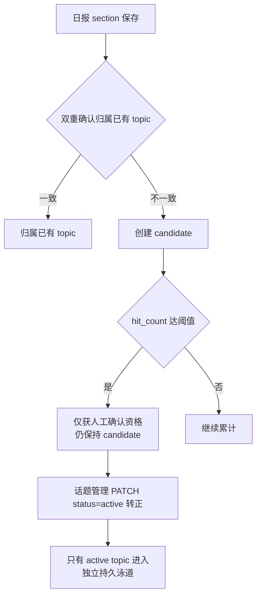

# 话题图谱流程（Topic Graph）

<!-- doc-impact-applies: backend-go/internal/topicgraph/, backend-go/internal/tagmanagement/, front/app/features/tags/components/daily-report/, front/app/features/tags/components/TopicGraphMergeDialog.vue | section=业务约束与不变量 -->
> 大功能：PersistentTopic 日报归属、展示，关系双轨。
> 跨端。互补：`flow/daily-report.md`（叙事生成驱动话题）、`architecture/backend.md`。

## 需求说明

PersistentTopic（持久话题）解决「跨天追踪同一话题演进」的问题。每天生成的日报 section 是一次性的叙事单元，但用户关心的 AI / 新能源 / 中美竞争等**话题是跨天存续、逐日累积**的。话题图谱把每天的 section 锚定到持久话题上，让用户：

- 在话题泳道里看到同一主题**跨天的连续叙事**（identity 轨），而不是每天孤立的一团。
- 在时间线上看到话题的**生命周期状态**——emerging / continuing / split / merge / ending（similarity 轨）。
- 通过 candidate→active 的渐进确认机制，避免噪声 / 瞬态事件污染持久话题集合；任何归档都由用户显式操作触发。

> 话题聚类消费的 event 标签来自标签提取 / 去重 / 层级管线（tagmanagement domain，详见 `flow/semantic-board.md`）；标签质量直接影响聚类纯度。本 flow 聚焦 PersistentTopic 的归属、生命周期与关系双轨。
>
> **边界（related-events，enable-story-cross-day-continuation）**：图上的「相关事件」是**读侧推荐**（event 标签按名称/描述/有效 aux 的语义相似度），不参与本 flow 的任何判定——不读 `subject_key`/实体 ID/指纹信任/thread 向量，不建事件线、不挂 thread、不改 `board_stories`/`story_signals`/热度/`display_tier`，也不做传递聚类。事件线身份判定顺序与红线 12–16 逐字不变。

## 链路设计

### 日报 section 归属与话题启用



双重确认锚定（AND-gate，详见 `flow/daily-report.md` §2）是归属的第一道门：语义门（section 标题向量 ↔ 话题首义向量余弦距离 ≤ 0.30）+ LLM 门（Step3 聚类的 `matched_topic_id` 指向同一话题），两道都过才 anchor_hit 到已有 topic；否则 auto_new 开新 candidate。

### 事件标签结构化指纹与主体归一化（add-event-story-heat）

event 标签（本身就是完整主谓宾句）自 add-event-story-heat 起携带**结构化指纹**，作为事件线（`board_stories`，见 `flow/daily-report.md` §事件线归属与跨期去重）的身份判据：

| 字段 | 语义 | 备注 |
| ---- | ---- | ---- |
| `subject` | 主体原文（公司/机构/人物/组织），展示用 | 可能是「特朗普」也可能是「Trump」 |
| `subject_key` | 归一化实体键，格式 `类型:规范名` | 类型 ∈ person/company/org/product/other；模型同次调用内完成别名归并（Trump/川普/特朗普 → `person:trump`，字节跳动/ByteDance → `company:bytedance`） |
| `action` | 动词短语（发布/宣布/涨价/回应/下架…） | 阶段判定与反向动作表（发布↔召回/下架/否认）的输入 |
| `object` | 对象（产品/政策/资产/事项） | |
| `occurred_at` | 发生日期（可空） | 缺失时由关联文章最早 `pub_date` 代替 |

产出位置：`tagmanagement/service/core/extractor_section.go` 的**融合提取调用**内（`extractor_enhanced.go` 同步），**零新增 LLM 调用**（同一次语义理解的副产品，token 增量约 30-50）；`keyword`/`person` 标签不产出。存 `topic_tags.metadata.event_fingerprint`（存量标签不回填，只在新提取时写入）。

**一致性校验（`fingerprint_trusted`）**：用已有 `metadata.event_keywords`（覆盖 99.7%）做纯字符串比对——`subject` 与 `object` 均须能在关键词集中找到（允许包含关系与 `topic_tags.aliases` 展开 + lower/NFKC 归一）；不通过或关键词缺失 → `fingerprint_trusted=false`（存 `topic_tags.metadata`）并记 warning，**不阻断标签入库与聚类**，归属判定走降级路径（预筛后候选交 LLM 四分类）。实现：`topicgraph/service/story_fingerprint.go`。

**主体归一化三层**（`story_subject_normalize.go` 的 `ResolveSubjectKey`，前层命中即终止）：① `subject_key` 精确匹配（lower + 下划线归一）→ ② `subject_key` embedding cos ≥ 0.92（`subject_embedding` 存 `board_stories`，仅为已建立事件线算一次）→ ③ `subject` 字面归一（lower/NFKC/去空格/去「公司」「集团」后缀）精确匹配；全不命中登记新主体候选。**不用 `topic_tags.aliases` 归并**——实测 person/event 的 aliases 覆盖率 0%、keyword 仅 7.3%，现有标签体系没有实体层；embedding 阈值 0.92（含）远高于事件召回 0.5，因为误归并两个主体的代价高于漏归并。

### 候选生命周期窗口（全人工归档）

candidate 与 active 的归档**完全由用户在话题管理界面手动操作**。`planLifecycle` 仅更新命中计数：当天有 section 归属则 `consecutive_hits += 1`、`hit_count += 1`、`last_seen_date = 当天`；无归属则 `consecutive_hits` 归零。**不自动变更任何 status**；任何 status → archived 的转换只能由显式的用户操作触发。

`persistent_topic_candidate_decay_window`（默认 7 天）在此处仅用于 ClusterTags prompt 的卫生过滤——决定哪些 candidate 注入 LLM prompt，**不触发任何状态变更**。

### 候选展示门槛（observing → 可见 candidate）

`hit_count < upgrade_threshold`（默认 3）的 candidate（"observing"）在话题管理 UI（`GET /api/semantic-boards/:id/topics`）中**隐藏**，但对用户不可见；它们仍持久化于数据库并参与可锚定话题集合（保证跨天命中能累积）。当 `hit_count` 达到 `upgrade_threshold` 后，candidate 自动在管理 UI 可见（无需额外操作）。

> 门槛判据 = **累计命中数 `hit_count`**（不是连续命中 `consecutive_hits`）——代码两处一致：`FilterVisibleTopics`（`repository/daily_report_topic_repository.go`：`t.Status != TopicStatusCandidate || t.HitCount >= upgradeThreshold`）与人工转正门禁（`UpdateTopic`：`topic.HitCount < threshold` → 拒绝）。一个断续出现的话题累计命中够数即转正资格达标（2026-11-16 文档口径修正：原文误写 `consecutive_hits`）。

### `auto_new` 创建门槛

当天 section 无法归属到已有 topic 时，系统自动创建 `status=candidate`、`consecutive_hits=1` 的 PersistentTopic。

### 一次性清理迁移

本 change 附带一次性迁移 `20260628_0001`：幂等删除 `status=candidate AND consecutive_hits < upgrade_threshold` 的历史 candidate，采用 `DeleteTopic` 语义——unlink 关联 section（置 NULL 含 `topic_status_at_report`），硬删 candidate，按 board 重建 relations。

### 可锚定话题选择器

ClusterTags 注入与双重确认归属共享同一个选择器（`ListAnchorableTopicsByBoard`）：全部 active 无条件入选，窗口内 candidate 按 `last_seen_date DESC, hit_count DESC, id ASC` 排序最多取 `persistent_topic_candidate_prompt_limit`（默认 20）条。窗口外 / 被截断的 candidate 两侧一致排除。

### 话题质心（首义锚定 + 滚动均值混合）

话题的匹配锚点是 `board_persistent_topics.centroid`，它 **不再**是纯滚动窗口均值，而是「首义 + 滚动」的加权混合（anchor-topic-centroid-with-embedding）：

```text
centroid = α·首义 embedding + (1-α)·最近 centroid_window 条命中 section embedding 等权均值
```

- **首义向量** = `board_persistent_topics.embedding`（manual 话题 = 创建时所选 section 的均值；auto 话题 = 首条命中 section 的内容 embedding；watch 物化话题 = 检索句向量）。创建时写入，**算法不得改写**；人工可按「手动选定的话题节点范围」显式改写（`PATCH /api/daily-reports/topics/:id/anchor`，mean pooling 与手动建话题同口径），每次改写只追加一行留痕（`topic_anchor_overrides`）——首义是话题的「定义面」。
- **滚动均值** = 最近 `persistent_topic_centroid_window`（默认 30）条命中 section 的 embedding 等权平均（同日多条 section 逐条计入，不去重）。
- **α** = `persistent_topic_centroid_anchor_weight`（默认 **0.5**，`ai_settings` 可配；非法值回退默认并告警）：`0` = 退化纯滚动（旧行为），`1` = 纯首义（话题冻结）。
- **不做 L2 归一化**：匹配全走 cosine（只看方向），混合后模长无意义。
- **退化路径**：可解析 section < 2 → 质心 = 首义向量（不变）；首义为空 / 不可解析 / 与滚动均值维度不一致 → 质心 = 纯滚动均值 + 警告日志（不阻塞刷新）。**向量维度契约（unify-vector-column-dimension）**：`board_persistent_topics.embedding` / `centroid` / `daily_report_sections.embedding` 的**列类型不承载维度**（无维度限定的 `vector`；迁移 `20261117_0001` 已把存量 `vector(2560)` 统一）——维度是运行时属性，逐行随值留存；上面「维度不一致」的退化判定因此仍有效（首义与滚动均值的维度可比）。
- **漂移有界**：质心仍随真实内容自适应（打破标题回声闭环），但滑出窗口的历史 section 不再让锚点脱离当前首义定义（首义本身可由人工显式改写并留痕，见红线 19）——移动幅度不超过纯滚动位移的 `(1-α)`，宽口径话题不会漂成「泛新闻磁铁」。

**存量重算端点**：`POST /api/daily-reports/recompute-topic-centroids?board_id=<可选>` —— 按当前公式与配置把既有话题质心重算一遍（幂等可重跑、单话题失败不中断其余话题），异步执行（返回 `{"success":true,"data":{"status":"processing"}}`，`board_id` 非法返 `400 invalid board_id`）。用途：公式升级后一次性纠正存量漂移（部署后手动调一次，全局无 `board_id` 即全站）。

### 关系双轨

```text
similarity（匈牙利算法）
  → 时间线连线
  → emerging / continuing / split / merge / ending 状态

identity（同 persistent_topic）
  → 话题泳道连续性
  → 不参与时间线状态
```

| 轨 | 算法 | 作用 |
|----|------|------|
| similarity | 匈牙利算法 | 时间线连线、生命周期状态（emerging/continuing/split/merge/ending） |
| identity | 同 persistent_topic | 话题泳道连续性，不参与时间线状态 |

### 概念 bootstrap

```text
概念 bootstrap: 连通分量聚类 → 最小簇过滤 → LLM 命名概念
```

从话题相似度构建连通分量，过滤掉过小簇，再用 LLM 为每个概念簇命名。

### 话题运维操作（重命名 / 状态 / 合并 / 分裂 / 硬删）

话题管理 UI（`GET /api/semantic-boards/:id/topics`）不仅展示全量话题，还通过下列端点把 candidate→active→archived 的状态流转与归并/拆分交给用户显式操作（`backend-go/internal/topicgraph/handler/daily_report_handler.go`）：

| 端点 | 语义 |
| ---- | ---- |
| `PATCH /api/daily-reports/topics/:id` | `{label?, status?}`：重命名（label）与/或改状态（status 仅 `active`/`archived`，即转正/重激活/归档），两字段皆可省略以单独变更。**不止「转正」一种语义**。 |
| `DELETE /api/daily-reports/topics/:id` | 硬删话题：清空其 section 的归属（section 本身保留），不可逆；可逆路径是 PATCH status=archived。 |
| `POST /api/daily-reports/topics/:id/merge` | `{source_topic_ids:[]}`：把若干源话题的 section 全部划归 `:id`，源话题归档。 |
| `POST /api/daily-reports/topics/:id/split` | `{section_ids:[], label}`：把指定 section 从 `:id` 拆出，新建一个话题承载。 |

> 注：旧文档把 PATCH 仅描述为「active 转正」过窄——实际 PATCH 是 rename + status(active|archived) 的组合运维端点，且 merge/split/DELETE 同属话题级治理操作（均不自动触发，需用户显式调用）。

### 前端：演进报告与标签合并

话题图谱前端除 candidate→active 的生命周期操作外，还承载两个与「演进/合并」相关的组件（`front/app/features/tags/components/`）：

- **演进报告 `EvolutionReport.vue`**：由 `BoardEnrichmentPanel.vue` 在板块详情「数据增强」面板的「演进报告」子区块挂载。它消费 boardEnrichment 的 `result` 详情 + `reviews`（`api/boardEnrichment.ts` 的 `EvolutionAnalysis` 复合对象），以报刊式 editorial 呈现话题的演进定位（强化/转折/扩散）、跨泳道引用与证据清单。属「B 分析认知」数据富化循环的展示层（详见 `flow/data-enrichment.md`）。
- **标签合并对话框 `TopicGraphMergeDialog.vue`**：presentational 组件，提供「搜索目标标签 → 把当前标签的所有文章迁移到目标标签」的交互（emit `doMerge`）。注意它是**标签级**合并 UI（区别于上表的**话题级** merge 端点）；当前该组件未被任何视图引用（预留/orphan）。

### 前端：泳道编排态（新建泳道）

版块矩阵顶栏「新建泳道」进入全屏编排态（`front/app/features/tags/components/console/BoardComposeOverlay.vue` + `composables/useLaneCompose.ts`），只在 ≥768px 可用；窄屏仅提示「新建泳道需要宽屏或横屏」。

> **画布语法与选入手势的权威口径在 [semantic-board.md](semantic-board.md) §泳道工作面**（行 = 泳道 / 拖拽选入 / 右栏三段恒定 / 检索范围 = 未归类，rework-lane-compose-swimlane-canvas）。本节只保留入口、候选与保存链路。

- **画布**：14 个连续日期列 × 现有 active 泳道行 + 待确认/未分类行；已归属 section 圆点为「已归属（只读）」，只能聚焦看关系，不能勾选或保存进新泳道（MUST NOT 把已有泳道 section 移出）。
- **候选**：侧栏 `ComposeSidebar` 按 candidate 话题与语义搜索列出候选；「采纳」只预填名称 + 勾选待确认 section，预勾上限 20，并按日期升序取前 20。
- **关系**：点画布圆点显示 top-6 相似 section 连线与侧栏距离（3 位小数）；无 relation 时明确「暂时没有关联 section，画布不画线」。
- **质量指标**：成员数、平均距离（无已知关系显示「—」）、离群数随勾选即时刷新；保存前必须同时有名称与成员，重复点保存只创建一次。
- **退出**：取消 / Esc 关闭且不落库；保存成功退出并回矩阵选中新泳道。组合建议/候选采纳仍走既有 compose 建议确认事务，不在本画布直接建话题。

## 业务约束与不变量

> 本节是 constraint-injection extension 的注入数据源：apply 改 `internal/topicgraph/` 或 `internal/tagmanagement/` 代码前会自动注入 system prompt，必须遵守。

1. **planLifecycle 只更新命中计数、不得自动变更任何 status，归档只能由用户显式操作触发**：`planLifecycle`（`repository/daily_report_assignment.go`）只更新命中计数——当天有 section 归属则 `consecutive_hits += 1`、`hit_count += 1`、`last_seen_date = 当天`；无归属则 `consecutive_hits` 归零。**不自动变更任何 status**；任何 status → archived 的转换只能由用户在话题管理界面的显式操作触发。
2. **candidate 累计命中数达 `upgrade_threshold`（默认 3）仅获人工激活资格、需手动转 active，未达标 UI 隐藏但持续累积**：`hit_count` 达阈值的 candidate 仅**获得人工激活资格**（`CanActivate = Status==candidate && HitCount >= UpgradeThreshold`），仍保持 candidate，需用户 PATCH active 才转 active。该门槛判据是**累计命中数 `hit_count`**（不是连续命中 `consecutive_hits`——代码两处自洽：`FilterVisibleTopics` 与人工转正门禁 `UpdateTopic` 都读 `HitCount`；2026-11-16 文档口径修正）。同时该阈值是**话题管理 UI 的可见门槛**——未达阈值的 "observing" candidate 在 `GET /api/semantic-boards/:id/topics` 中隐藏（仍持久化、参与可锚定集合，保证跨天累积），达阈后自动可见。 **`lane_heat_candidate_weight`（候选泳道在版块关注度里的权重）SHALL NOT 参与本判定**：它只进「当天线索热度」（`flow/semantic-board.md` 红线 29），不改命中计数、连续命中资格、转正门槛与归档；权重取 0 时候选话题仍照常累积、照常可转正（retire-story-adopt-event-metrics D8）。
3. **当天 section 无法归属已有话题时，auto_new 自动创建 candidate 新话题并种命中计数 1**：当天 section 无法归属到已有 topic 时，系统自动创建 `status=candidate`、`consecutive_hits=1`、`hit_count=1` 的新 PersistentTopic（首义向量 = 该 section 标题向量）。
4. **`persistent_topic_candidate_decay_window`（默认 7 天）仅过滤 prompt 注入候选，不得触发任何状态变更或归档**：决定哪些 candidate 注入 ClusterTags prompt，**不触发任何状态变更 / 归档**。
5. **ClusterTags 注入与双重确认归属必须共享同一选择器 ListAnchorableTopicsByBoard，消除单边锚定**：ClusterTags 注入（Step3）与双重确认归属共享同一个选择器 `ListAnchorableTopicsByBoard`——全部 active 无条件入选；窗口内 candidate 按 `last_seen_date DESC, hit_count DESC, id ASC` 排序最多取 `persistent_topic_candidate_prompt_limit`（默认 20）条。窗口外 / 被截断的 candidate 两侧一致排除，消除单边锚定的隐式 bug。
6. **section 话题快照字段在 SaveReport 同一事务写入，不得随后续话题状态变化回填**：每条 section 的 `topic_status_at_report`、`persistent_topic_id`、`topic_match_distance`、`topic_match_confidence` 在 `SaveReport` 同一事务内写入（快照值 = 当时 PersistentTopic 的 candidate|active；未归属写 NULL）。历史快照不随后续 topic 状态变化回填。
7. **用户手动建话题直接落 active，跳过 candidate 阶段与连续命中门禁，归属置信标记 manual**（`source=manual`，详见 `flow/daily-report.md` §2）：用户主动建 active topic 跳过 candidate 阶段与连续命中门禁，`topic_match_confidence='manual'`（人工归属第四态，非算法三态）；下一期日报起与自动 active topic 一样参与 lane 锚定。**sentence_topic 关注的专属话题同属 manual 主权声明家族**（watch-materialized-topic）：首次物化时由系统代建（`Embedding=Centroid=检索句向量`，命中计数种 0、当期 lifecycle 推到 1），与手动建话题一视同仁参与锚定；删除该关注需显式确认并联动归档（`confirm_archive_topic=true`，走 UpdateTopic status=archived 软归档，历史 section 快照不变）。
8. **同一 link 的跨 feed 文章副本必须复用已有打标结果（`source='reuse'`、score 沿用、不超单篇标签上限），只有无可复用标签时才允许调 AI**：`tagArticle`（非 Force）在本副本已打标检查**之前**查同 link 其它副本的 `article_topic_tags`（`article_topic_tags JOIN articles ON link`）：命中则按 score 降序把本副本缺失的标签补齐（已存在的 `(article_id, topic_tag_id)` 不重复写，`idx_article_topic_tags_link` 兑底）、`source='reuse'`、score 沿用、**总数不超过 `maxArticleTags`（6）**，补入即返回且**不调 AI**；本副本已满上限则落到已有的“已打标跳过”分支（也不调 AI）；无同 link 副本标签才走原 AI 提取路径。`RetagArticle`（Force，用户手动重打）**明确不复用**、不受补空间限制，仍走完整 AI 提取 + `limitArticleTags`。副本标签因此向同 link 的完整集合收敛（部分标签副本会被补齐），该路径写完后同步重算 `articles.tag_count`。
9. **打标队列消费必须新任务优先（night-window-alignment）**：`tag_jobs` lease 顺序 = `priority DESC, created_at DESC`（priority 可插队；退避由 `available_at <= now` WHERE 保证，**不把 available_at 作排序键**——Enqueue 时 available_at=created_at，升序排序会复活 FIFO）。陈年 pending 不另做业务侧 TTL 淘汰（原方案于 2026-09-24 验收期用户决策取消）：旧任务几乎不被 lease 到，不挤占分析窗口，随文章 7 天归档 GC 自然失去下游价值。
10. **话题关键事件注记是人工主权层，不参与话题生命周期状态机，话题生命线回看只透出 confirmed 注记（add-topic-key-event-markers）**：`topic_key_event_markers` 只挂 confirmed/dismissed/suggested 三态注记（AI 只写 suggested），不推进 candidate/active/archived 任何状态（与 `planLifecycle` 互不相干）；`GET /daily-reports/topics/:id/lifeline` 与话题 key-events 读端只透 confirmed——建议永不进总览/生命线回看；注记与话题/section 的关系由来源指纹维护（重建重挂/失效快照见 `flow/daily-report.md` 约束 30/31），注记的存在不得反写 section 归属或关系计算。
11. **同一话题同一天可以有多条 section（泳道内主题分桶/手动编排/watch 物化）：命中计数按「日」去重、质心按 section 逐条计入（add-intra-lane-theme-bucketing）**：一篇日报内同一 topic 拥有多条 section（兄弟桶共享 `persistent_topic_id`）时，`planLifecycle` 的 `hit_count` / `consecutive_hits` SHALL 只按该篇日报是否命中 +1（实现上 `hitTopicIDs` 是集合，与 section 条数无关），SHALL NOT 按条数累加；`ComputeTopicCentroid` SHALL 按 `persistent_topic_id` 的最近 `centroid_window` 条 section 逐条均权计入，SHALL NOT 对同日同话题的多条 section 做特殊去重（拆得越细质心越纯，是正向副作用）。`topic_status_at_report` 仍是报告期快照，不随后续状态回填。
12. **【2026-11-12 已摘除】提取链路不再产出事件指纹——【事件指纹】指令段、schema 五字段与解析逻辑已从 `extractor_enhanced.go` / `extractor_section.go` 整体删除（用户决策：融合任务过重致 4B 本地模型 JSON 输出大面积 parse_error，文章大面积掉 heuristic 兜底泛词标签）；存量 `topic_tags.metadata.event_fingerprint` 仍可由 `topicgraph/service/story_fingerprint.go` 只读解析，但不再有新写入。历史契约存档如下（add-event-story-heat；retire-story-adopt-event-metrics D15 曾保留）：**每个 `category='event'` 标签同次调用产出 `subject`/`subject_key`/`action`/`object`（`occurred_at` 可空，缺失时由关联文章最早 pub_date 代替）；`keyword`/`person` 标签不产出。校验用已有 `metadata.event_keywords` + `topic_tags.aliases` 展开（纯字符串比对）：`subject` 与 `object` 均须能在关键词集中找到；不通过或关键词缺失 → `metadata.fingerprint_trusted=false` 并记 warning，标签照常入库照常聚类。**指纹的消费方只剩实体层影子模式**（`tagmanagement/service/entity/hook.go`）；事件线身份判定已停写，不再读指纹（见红线 14-16 的历史标注）。指纹解析/校验唯一实现 `topicgraph/service/story_fingerprint.go`，提取侧 schema 在 `tagmanagement/service/core/extractor_section.go`。
13. **【2026-11-12 随指纹摘除而停用——新打标不再产出 subject_key，下列三层归一仅对存量 metadata 回放有效】`subject_key` 归一化不依赖 `topic_tags.aliases`（实测 person/event aliases 覆盖 0%、keyword 仅 7.3%），主判据是模型同次调用产出的 `类型:规范名` 键（person/company/org/product/other）；三层顺序固定：① subject_key 精确匹配 → ② subject_key embedding cos ≥ 0.92 → ③ subject 字面归一（lower/NFKC/去空格/去「公司」「集团」后缀），前层命中即终止，全不命中登记新主体**（add-event-story-heat；retire-story-adopt-event-metrics D15：本归一化仍随打标链产出，供实体层影子模式使用，**不再用于事件线判定**）：`subject_key` 由模型在同一次调用内完成别名归并（Trump/川普/特朗普 → `person:trump`）；embedding 只兑同义拼写差异（阈值 0.92 远高于事件召回 0.5，含 0.92/不含 0.919），MUST NOT 用于事件判定；`subject_embedding` 存 `board_stories`（存量只读保留，新线不再产生）。实现 `topicgraph/service/story_subject_normalize.go`（`ResolveSubjectKey`）。
14. **事件线归属判定链已硬停写（历史口径）：原顺序为 subject_key 预筛先于一切层、向量只用于召回候选（dist ≤0.5 top10）、subject 一票否决；该链路与 `board_stories` / `story_signals` 一并只读保留，不再作为现行规则**（retire-story-adopt-event-metrics D1/D15 + review R-1）：在线入口 `service/daily_report_story_highlights.go:boundedReportAttribution` 与其调用已整体摘除（`ai_settings.story_attribution_enabled` 键已删除），日报链永久零写入；回填 CLI 写模式拒绝，回滚 = `git revert` 本 change 提交。**话题（persistent_topic）不是事件身份**的历史表述仍成立：同日一话题可拆 1-6 桶，事件线与话题归属正交；现行「今日重点」的当天同事件聚簇见 `flow/daily-report.md` 红线 46-47（只读、内存聚簇、不落库、不做身份）。

15. **全局实体身份层已存在但本期不参与聚簇与重点候选：实体 ID（`entity_registry`）不进当天同事件聚簇、不改写任何标签指纹、话题归属或热度口径**（normalize-event-subject-entities + retire-story-adopt-event-metrics）：实体主体归一是与话题/聚簇并行的另一套身份——`entity_registry`/`entity_mentions`/`entity_aux_links` 三表承载全局稳定实体 ID，默认 `off`（2026-11-10 决策：影子实验后不接线）；影子态下只写实体三表 + 审计 + `metadata.entity_subject` 惰性键，标签/日报/话题/界面字段零变化；显式 `off` 则第一轮提示与 schema 与调用数逐字不变、零二轮调用、零写入；`active` 本期显式报错拒绝。实体层可整层删除而不影响任何既有功能。

16. **事件线建线召回向量为历史口径：存量 `board_stories.embedding` / `daily_report_threads.embedding` 只读保留，新线不再产生，回填 CLI 写模式已拒绝**（enable-story-cross-day-continuation D13 + retire-story-adopt-event-metrics D3）：原口径为建线时现算标题 embedding、召回 `embedding <=> ?` dist ≤0.5 top10、存量补齐走 `cmd/backfill-stories --fill-story-embeddings` / `--fill-thread-embeddings`；停写后这些写模式一律非零退出，只读 / `--dry-run` 保留用于核对存量。
17. **话题质心 SHALL 为「首义锚定 + 滚动均值」的加权混合，质心漂移 SHALL 有界**（anchor-topic-centroid-with-embedding）：质心 = `α·首义 embedding + (1-α)·最近 persistent_topic_centroid_window（默认 30）条命中 section embedding 等权均值`，α = `persistent_topic_centroid_anchor_weight`（默认 `0.5`，`ai_settings` 可配；值域外/解析失败回退默认并告警）。首义 = `board_persistent_topics.embedding`（创建时写入；算法不得改写，人工可显式改写且须留痕——改写只追加 `topic_anchor_overrides` 行、不覆盖历史，见红线 19）。SHALL NOT 回退为纯滚动均值的全量漂移（宽口径话题会漂成「泛新闻磁铁」）；混合不做 L2 归一化（匹配走 cosine，只看方向）。退化路径：可解析 section < 2 → 质心 = 首义；首义为空/不可解析/维度与滚动均值不符 → 质心 = 纯滚动均值 + 警告日志（不阻塞刷新）。存量质心纠正走 `POST /api/daily-reports/recompute-topic-centroids`（可选 `board_id`，异步、幂等、单话题失败不中断其余话题）。
18. **人工修正 SHALL 只写持久事实层，派生缓存 SHALL NOT 由人工直写**（lane-manual-correction-loop）：人工改写首义只写 `board_persistent_topics.embedding` + 追加一行 `topic_anchor_overrides` 留痕 + 置 `centroid_pending_recompute=true`；质心（`centroid`）、吸尘器标记（`is_vacuum`/`vacuum_strong`/`vacuum_mid`）、泳道快照（`topic_lane_snapshots`）SHALL 为算法每日重算的派生缓存，人工修正 SHALL NOT 直写，SHALL NOT 提供「立即重算」的人工触发端点。
19. **算法 SHALL NOT 改写首义列，人工改写首义 SHALL 追加留痕且只追加**（lane-manual-correction-loop D3/D7）：`board_persistent_topics.embedding` 只允许人工显式写入（`PATCH /api/daily-reports/topics/:id/anchor`，首义 = 手动选定节点范围的 mean pooling，与手动建话题同口径）；改写前后向量、输入模式、选定节点 id、操作者、时间落 `topic_anchor_overrides` 追加表——SHALL NOT 覆盖或删除旧行，`topic_id` SHALL NOT 设外键（话题硬删后留痕仍在）；质心刷新只 UPDATE `centroid` 列，SHALL NOT 触碰 `embedding` 列。
20. **人工变更泳道归属 SHALL NOT 改动命中计数与话题状态**（lane-manual-correction-loop D5）：人工移除/加回只写 section 的归属快照列与留痕列；被操作话题的 `hit_count`/`consecutive_hits`/`status`/`first_seen_date`/`last_seen_date` SHALL NOT 因人工修正而变——命中计数只由 `planLifecycle` 按日报命中推进（红线 1），状态流转只由用户显式操作触发（红线 9）。
21. **人工变更泳道归属 SHALL 在同一事务内触发整板关系重建**（lane-manual-correction-loop D6）：归属事务末尾调 `RebuildBoardRelations(tx, board_id)`（identity 边由 `persistent_topic_id` 派生，归属变了边就必须重建），SHALL NOT 做增量重建；重建失败 SHALL 整体回滚——归属变更与留痕一并撤销。
22. **人工改挂 SHALL 只从 candidate（动态）泳道取节点，SHALL NOT 从 active（已转正）泳道改挂**（lane-manual-correction-loop）：人工把 section 加入本泳道时，若该 section 已属其它泳道 —— 来源泳道 `status='candidate'`（尚未转正、素材仍在流动）时 SHALL 允许改挂；来源泳道 `status='active'`（已转正）时 SHALL 拒绝（4xx），已转正泳道的素材不因人工编辑而流动。改挂 SHALL 追加归属留痕（记来源与目标泳道）并 SHALL 把**来源与目标两条泳道**均置 `centroid_pending_recompute=true`（两侧滚动窗口都变了）。候选口径同步放宽：画布候选区与左栏关联推荐 SHALL 覆盖「无归属节点 + 属 candidate 泳道的节点」，属 active 泳道的节点只作只读参照；候选行 SHALL 标注来源泳道名（无来源的装饰性标签禁止）。
23. **质心刷新范围 SHALL 为「当日 touched 话题 ∪ `centroid_pending_recompute=true` 的话题」**（lane-manual-correction-loop D2）：日报生成 post-commit 的质心刷新集合按 board 收敛为该并集（当日无新命中但被标记的话题同样被重算）；重算成功清标记、失败保留标记且 SHALL NOT 中断其余话题的重算；人工修正 SHALL NOT 立即重算质心——质心只由下一次日报生成刷新，修正只影响往后。

## 代码入口

- **后端生命周期与归属**：`backend-go/internal/topicgraph/repository/daily_report_assignment.go`（`planLifecycle` 命中计数、`planTopicAssignments` 双重确认锚定）、`repository/daily_report_topic_repository.go`（status 状态机 `candidate|active|archived`、可锚定选择器 `ListAnchorableTopicsByBoard`）、`repository/daily_report_manual_topic.go`（手动建泳道）。
- **后端事件指纹与主体归一化（add-event-story-heat）**：`backend-go/internal/topicgraph/service/story_fingerprint.go`（`ParseEventFingerprint` 指纹解析 + `ValidateEventFingerprint` 一致性校验，产出 `fingerprint_trusted`）、`story_subject_normalize.go`（`ResolveSubjectKey` 三层归一化）；提取侧 schema `backend-go/internal/tagmanagement/service/core/extractor_section.go`（+`extractor_enhanced.go` 同步）；事件线归属/去重/热度的完整入口见 `flow/daily-report.md` §事件线归属与跨期去重。
- **后端关系双轨 / 聚类**：`backend-go/internal/topicgraph/service/daily_report_cluster.go`（ClusterTags 聚类 + 概念 bootstrap）、`service/daily_report_orchestrator.go`（`GenerateDailyReport` 管线、`RebuildBoardRelations` 关系双轨）、`service/daily_report_merge.go`。
- **后端 handler**：`backend-go/internal/topicgraph/handler/topic_watch_handler.go`（话题 watch）、`handler/daily_report_handler.go`（话题管理列表 + PATCH rename/status、DELETE 硬删、POST merge/split、手动建泳道、backfill-embeddings/relations/topics、recompute-topic-centroids 存量质心重算）。
- **后端人工修正（lane-manual-correction-loop）**：`backend-go/internal/topicgraph/handler/daily_report_anchor_handler.go`（`PATCH /daily-reports/topics/:id/anchor` 人工重设首义）、`handler/daily_report_anchor_read_handler.go`（`GET /daily-reports/topics/:id/anchor` 纯读首义状态）、`handler/daily_report_assignment_handler.go`（`PATCH /daily-reports/sections/:id/assignment` 移除/加回归属 + `POST /daily-reports/topics/:id/detach-date` 按日批量移除）；repository 侧 `repository/daily_report_topic_repository.go`（`SetTopicAnchorFromSections` / `SetSectionTopicAssignment` / `DetachTopicSectionsByDate`）、`repository/daily_report_anchor_read.go`（`GetTopicAnchorState`）、`repository/daily_report_models.go`（`TopicAnchorOverride` 追加表 + `CentroidPendingRecompute` 标记列）。
- **标签提取 / 去重 / 层级**（话题聚类的输入源）：`backend-go/internal/tagmanagement/`（`service/` 抽象标签层级与合并、`handler/` 标签管理、`repository/` 持久化）；文章打标执行点 `service/core/article_tagger.go`（`tagArticle` / `RetagArticle` / `reuseTagsFromSiblingArticle` 跨 feed 复用）。
- **关键事件注记（回看侧）**：`backend-go/internal/topicgraph/repository/key_event_markers.go`（注记模型与人工动作，状态机与指纹详见 `flow/daily-report.md` §关键事件注记）、`handler/key_event_handler.go`（话题读端 confirmed + 注记维护端点）、`GetTopicLifeline`（生命线 `key_events` 字段装配）；前端 `front/app/features/tags/composables/useTopicKeyEvents.ts`（共享缓存单例）+ `front/app/features/tags/components/KeyEventMarkerActions.vue`（注记动作组件：现只有 `mode="review"` 一处挂载在日报 `daily-report/DailyReportTopicSection.vue` 的 thread header，`history`/`overview` 两模式暂无挂载点）。原 `BoardThreadBrowser.vue`（lanes ★n / 焦点合并轴 + 失效快照同轴注记）已随 rework-workshop-into-radar-and-desk 8.4 物理删除，**话题总览泳道视图不复存在**——回看数据仍由 `GetTopicLifeline` 的 `key_events` 字段提供。
- **前端**：`front/app/features/tags/components/SectionLifecyclePanel.vue`（section 生命周期面板，当前无挂载点）、`front/app/features/tags/components/daily-report/`（`SectionAnchorBadge.vue` / `SectionQualityExplore.vue` 等话题锚定与血缘展示）、`front/app/features/tags/components/console/{ObservationMatrix,BoardConsoleShell}.vue`（话题泳道的现行宿主：L1 版块态势页矩阵）；`front/tests/e2e/` 现只剩 `baseline.spec.ts`（原 `topic-graph.spec.ts` 已删）。

## 变更溯源

| 日期 | 变更 | 摘要 | 归档位置 |
|------|------|------|----------|
| 2026-11-17 | unify-vector-column-dimension | `term_notes.embedding`（页边注术语库）/ `board_persistent_topics.embedding`（常青话题）去维度限定；话题质心的向量维度改为运行时属性，Centroid 计算与 lane 分桶的输入语义不变；AutoMigrate 不 ALTER 类型，model 侧 `type:vector(2560)` 已全仓归一 | [archive/2026-11-17-unify-vector-column-dimension](../../../openspec/changes/archive/2026-11-17-unify-vector-column-dimension) |
| 2026-11-14 | lane-manual-correction-loop | 泳道人工修正闭环（批 E1 文档收口）：红线 17 首义条款改为「算法不得改写、人工可显式改写且须留痕」（`topic_anchor_overrides` append-only）；新增红线 18-22（人工修正只写事实层·派生缓存不直写 / 算法不写首义列且留痕只追加 / 移除加回不动命中计数与状态 / 归属变更同事务触发整板关系重建 / 质心刷新 = 当日 touched ∪ `centroid_pending_recompute`） | [`openspec/changes/archive/2026-11-16-lane-manual-correction-loop`](../../../openspec/changes/archive/2026-11-16-lane-manual-correction-loop) |
| 2026-11-12 | anchor-topic-centroid-with-embedding | 话题质心改为「首义锚定+滚动均值」加权混合（红线 17）：α=`persistent_topic_centroid_anchor_weight`（默认 0.5）·首义 + (1-α)·最近 30 条命中 section 均值；治宽口径话题漂成「泛新闻磁铁」（1009 话题漂移致陈杰寻人社会新闻 0.166 直连错挂）；首义不可用回退纯滚动+告警，<2 section 退化不变；新端点 `POST /daily-reports/recompute-topic-centroids`（异步幂等，上线当日全站 1915 话题重算 0 失败） | [`openspec/changes/archive/2026-11-12-anchor-topic-centroid-with-embedding`](../../../openspec/changes/archive/2026-11-12-anchor-topic-centroid-with-embedding) |
| 2026-11-11 | normalize-event-subject-entities | 全局实体身份层影子落地（`entity_registry`/`entity_mentions`/`entity_aux_links` 三表 + 三路候选检索→二判→原子登记/新建全链 + 会话级咨询锁闸门 + 有界评测 CLI；默认 `off`/`shadow`，`active` 显式拒绝）：事件线身份判定不读实体 ID，`subject_key` 三层与一票否决逐字不变，存量不迁移不回填 | [`openspec/changes/archive/2026-11-11-normalize-event-subject-entities`](../../../openspec/changes/archive/2026-11-11-normalize-event-subject-entities) |
| 2026-11-11 | lane-compose-story-chain | **设计废弃（未实施）**：泳道编排新增事件线链（跨天同事件选材维度）经讨论与数据验证后决定放弃，0/24 任务归档；delta spec 未同步，本 flow 主 spec 与行为不变 | [`openspec/changes/archive/2026-11-11-lane-compose-story-chain`](../../../openspec/changes/archive/2026-11-11-lane-compose-story-chain) |
| 2026-11-11 | enable-story-cross-day-continuation | 新增 `related-events`（读侧推荐）：event 标签语义相似度相关推荐，明确**不进**事件线判定/聚合；本 flow 的身份判定顺序、指纹、`subject_key` 三层、热度口径均逐字不变 | [`openspec/changes/archive/2026-11-11-enable-story-cross-day-continuation`](../../../openspec/changes/archive/2026-11-11-enable-story-cross-day-continuation) |
| 2026-11-06 | enable-unbound-jit-injection | 约束标签辖区补全：补后端漏网目录与前端业务区信号，修 5 条孤儿标签；未激活档编辑路径 JIT 注入见 change（本 flow 无业务行为变更） | [`openspec/changes/archive/2026-11-06-enable-unbound-jit-injection`](../../../openspec/changes/archive/2026-11-06-enable-unbound-jit-injection) |
| 2026-11-03 | fix-embedding-model-column-width | `topic_tag_embeddings.model` 由 `VARCHAR(50)` 加宽到 `VARCHAR(100)`（与 `ai_models.name` 对齐）：本地 llama.cpp / GGUF embedding 模型以文件绝对路径注册（61 字符）超限 → `SQLSTATE 22001` → 标签向量落库被拒、embedding 队列批量失败（689 条）；建立「存 embedding 模型名列宽 MUST NOT 窄于模型注册表」不变式（数据驱动测试）；连带恢复被 GORM AutoMigrate 顺带 `DROP NOT NULL` 的 `model` 列约束（迁移 `20261103_0002`） | [`openspec/changes/archive/2026-11-03-fix-embedding-model-column-width`](../../../openspec/changes/archive/2026-11-03-fix-embedding-model-column-width) |
| 2026-10-24 | add-intra-lane-theme-bucketing | 同一话题同一天可有多条 section（泳道内主题分桶/手动编排/watch 物化）：`planLifecycle` 命中按日去重、质心按 section 逐条均权计入（约束 11） | [`openspec/changes/archive/2026-10-28-add-intra-lane-theme-bucketing`](../../../openspec/changes/archive/2026-10-28-add-intra-lane-theme-bucketing) |
| 2026-10-12 | add-topic-key-event-markers | 话题关键事件注记（人工主权层）：生命线/总览回看只透 confirmed（约束 10）、lanes ★n 徽标与焦点视图合并轴/失效快照注记；注记不参与生命周期状态机 | [`openspec/changes/archive/2026-10-15-add-topic-key-event-markers`](../../../openspec/changes/archive/2026-10-15-add-topic-key-event-markers) |
| 2026-07-05 | manual-topic-lane | 手动建泳道：用户主动建 active topic（`source=manual`），次期接入 AND-gate；新增 `board_persistent_topics.source` 列 + `topic_match_confidence=manual` 第四态 | [`openspec/changes/archive/2026-07-05-manual-topic-lane`](../../../openspec/changes/archive/2026-07-05-manual-topic-lane) |
| 2026-05-31 | section-lifecycle-ui | Section 获得独立生命周期（status + prev_section_id），BoardThreadBrowser 从 thread 粒度改为 section 粒度话题总览 | [`openspec/changes/archive/2026-05-31-section-lifecycle-ui`](../../../openspec/changes/archive/2026-05-31-section-lifecycle-ui) |
| 2026-08-01 | inline-compose-lane | 就地编排新建泳道：composeMode 叠加态（不切 viewMode）+ unassigned 主战场勾选 + 贴合度实时分层 + active 淡显可勾走移出 + 聚类质量单卡 + 候选侧边栏（语义搜索/相似推荐/已中断折叠）+ 废弃 ComposePanel；CandidateTopicBrief 补 status 对齐 lanes 移出口径 | [`openspec/changes/archive/2026-08-01-inline-compose-lane`](../../../openspec/changes/archive/2026-08-01-inline-compose-lane) |
| 2026-08-22 | analysis-remediation | 分析报告整改四线：W1 存储清理（topic_tag_embeddings 孤儿 3.07GB 清除 + FK CASCADE 防复发、semantic_labels disabled 行向量置 NULL）；W2 pi-sessions 并行编排；W3 openspec 指令副本收敛；W4 规范可观测（spec-gate 归档门禁强制化） | [`openspec/changes/archive/2026-08-22-analysis-remediation`](../../../openspec/changes/archive/2026-08-22-analysis-remediation) |
| 2026-08-25 | watch-materialized-topic | watch 物化轨与持久话题联动：sentence_topic 专属 manual active 话题（代建/锚定/删除确认归档）；keyword_topic 物化板块不建话题；物化边界约束见 `flow/daily-report.md` §16 | [`openspec/changes/archive/2026-08-25-watch-materialized-topic`](../../../openspec/changes/archive/2026-08-25-watch-materialized-topic) |
| 2026-09-04 | constraint-declaration-redline | 约束节红线句格式化：本域「业务约束与不变量」节每条约束改写为首行加粗自含红线句 + 细节跟后（语义不变），declaration 注入降为红线层（上线后实测 bytes 降约 60%），细节层经关键词/JIT 全节注入按需补全；本域为格式改写，无业务行为变更 | [`openspec/changes/archive/2026-09-04-constraint-declaration-redline`](../../../openspec/changes/archive/2026-09-04-constraint-declaration-redline) |
| 2026-09-17 | dedupe-rss-articles | 跨 feed 同 link 副本打标复用：`tagArticle` 在已打标检查前查同 link 兄弟副本的 `article_topic_tags`，命中则按 score 降序补齐缺失标签（`source='reuse'`、score 沿用、不超 `maxArticleTags`）且不调 AI；Force 重打不复用；同 feed 判重与快讯 upsert 见 `flow/content-enrichment.md` | [`archive/2026-09-17-dedupe-rss-articles`](../../../openspec/changes/archive/2026-09-17-dedupe-rss-articles) |
| 2026-09-22 | lane-trend-overview | 泳道态势结算产物扩展为长短两版（同窗同素材单次 LLM 出 JSON，解析降级不重试不阻塞日报；存量长版不回填）：`topic_lane_snapshots` 加 `rolling_detail` 长版列、lane-dynamics 聚合 snapshot 增 `detail` 可空字段；日报阅读视图泳道展开体顶部新增「泳道趋势」区（14 天长版/月/年三档），结算口径详见 `flow/daily-report.md` §泳道态势结算 | [`openspec/changes/archive/2026-09-22-lane-trend-overview`](../../../openspec/changes/archive/2026-09-22-lane-trend-overview) |
| 2026-09-23 | night-window-alignment | 打标队列消费顺序改新任务优先（priority DESC, created_at DESC，退避由 WHERE 保证）；原方案含过期任务 TTL 淘汰（terminal skipped），验收期用户决策取消（既有 7 天归档 GC 已兜底，未合入）； | [`openspec/changes/archive/2026-09-24-night-window-alignment`](../../../openspec/changes/archive/2026-09-24-night-window-alignment) |
| 2026-10-15 | add-topic-key-event-markers | 话题生命线可选节点扩展：`ListTopicKeyEventMarkers` 按 topic/窗口返回 confirmed 与快照失效注记（`daily_report_topics` 反查归属），总览泳道长轴高亮 confirmed 背景、取消纠错不删背景、来源日报导航；不改变话题归属/生命周期/identity-similarity 关系语义 | [archive/2026-10-15-add-topic-key-event-markers](../../../openspec/changes/archive/2026-10-15-add-topic-key-event-markers) |
| 2026-11-05 | redesign-enrichment-research-workbench | 话题新闻背景管理入口落到话题总览：BoardThreadBrowser focus 头部新增「新闻背景」按钮（AppDialog lg 承载 TopicNewsBackground，话题+粒度+周期独立读写）；不改话题筛选/关键事件/生命周期行为，contexts API 可选 semantic_board_id 归属校验（不传零差异） | [openspec/changes/archive/2026-11-05-redesign-enrichment-research-workbench](../../../openspec/changes/archive/2026-11-05-redesign-enrichment-research-workbench) |
| 2026-10-13 | add-article-search | 站内搜索只读消费标签向量与边：语义召回路径对 `topic_tag_embeddings`（identity 型）做 cosine 近邻、经 `article_topic_tags` 召回文章取 max cosine，零写入、不触发打标/向量任务、不影响话题生命周期；搜索行为契约见 `flow/reading.md` §站内搜索与约束 #10-#12 | [`openspec/changes/archive/2026-10-14-add-article-search`](../../../openspec/changes/archive/2026-10-14-add-article-search) |
| 2026-11-02 | rework-workshop-into-radar-and-desk | 工坊重构为雷达+版块态势台：`/tags` 首屏改今日雷达（单次聚合端点 overview），五 tab 退役（矩阵/归档视图/编排/阅读台承接，8.4 物理清理旧宿主），新建泳道编排工作面（服务端候选链口径+质心推荐+画布缩放平移），阅读台路由化 `/tags/:boardId/:date` + 旧版三栏恢复 + 页边注/收藏/Esc 语义回归 | [archive/2026-11-02-rework-workshop-into-radar-and-desk](../../../openspec/changes/archive/2026-11-02-rework-workshop-into-radar-and-desk) |
| 2026-11-06 | add-event-story-heat | 事件线身份与热度证据分离：新增 `board_stories`（跨天事件线，带 `subject/subject_key/action/object/occurred_at` 指纹与 `participant_count`）与 `story_signals`（每篇证据按 `pub_date` 优先计时）；日报线程加 `story_id/scope/is_development/story_manual/display_tier` 五列。热度改为从 signals 派生（story 48h/24h、lane 14d/72h 独立衰减，`heat-v1-48h-hl24h`），矩阵格值=事件线数、颜色=最热事件线来源数（4 档）、行序=lane_heat→story_count→id、雷达关注度=Σ lane_heat（P80/P20 标定 3.3/0.7）。合并闸门最终收紧为「显式 subject_key 优先、对象严格相等、指纹不可信一律不合并、LLM 不参与合并」；新增 `cmd/backfill-stories`（含 `--rebuild-signals`）与 `cmd/backfill-fingerprints` 两个运维入口。 | [archive/2026-11-06-add-event-story-heat](../../../openspec/changes/archive/2026-11-06-add-event-story-heat) |
| 2026-11-12 | retire-heuristic-tag-fallback | 事件指纹融合抽取整体摘除 + heuristic 规则词兜底删除（提取失败即失败，不再降级打标）：【事件指纹】指令段 / schema 五字段 / 解析逻辑从 `extractor_enhanced.go` / `extractor_section.go` 整体删除（融合任务过重致 4B 本地模型 JSON 大面积 parse_error，文章整篇掉 heuristic 泛词兜底），**红线 12/13 就地标注摘除**——存量 `metadata.event_fingerprint` 只读解析保留、新打标不再产 `subject_key`；`extractor_heuristic.go` 整文件与提取层/编排层两处兜底删除，失败任务改标 failed 进队列退避重试，`source='heuristic'` 停写 | [archive/2026-11-12-retire-heuristic-tag-fallback](../../../openspec/changes/archive/2026-11-12-retire-heuristic-tag-fallback) |
| 2026-11-16 | fix-lane-metric-provenance | 话题成员计数与接近度单一口径（persistent-topic）：窗口内/更早成员两侧用同一向量可用性判据过滤、两个「全部 M」同定义（本话题成员总数，不再一处加法一处去重并集）；接近度保留两把尺子但可区分——成员接近度 = 日报生成时归属快照距离（`1 − topic_match_distance`，入库即冻结）/ 候选与推荐接近度 = 对当前成员质心的实时估算并标「估算」；`GetTopicLifeline` 的 `topic_match_distance` 去掉 `omitempty`（距离恰为 0 不再被省略）；矩阵窗口与泳道工作面窗口末日锚点统一为「最新 completed 日报日」。同 change 顺带修正本文件把候选准入门槛写成 `consecutive_hits` 的口径错（实际判据 = `hit_count >= upgrade_threshold`） | [archive/2026-11-16-fix-lane-metric-provenance](../../../openspec/changes/archive/2026-11-16-fix-lane-metric-provenance) |
| 2026-11-19 | docs-sync-audit-fixes | 文档治理审计清偿（docs-only）：代码入口 BoardThreadBrowser.vue / tests/e2e/topic-graph.spec.ts 已删引用回收、SectionLifecyclePanel.vue 目录漂移订正；溯源表补 retire-heuristic-tag-fallback 与 fix-lane-metric-provenance 两行、修 lane-manual-correction-loop 死链；tables/topic-tags.md 补 tag_category_meta | [archive/2026-11-19-docs-sync-audit-fixes](../../../openspec/changes/archive/2026-11-19-docs-sync-audit-fixes) |
