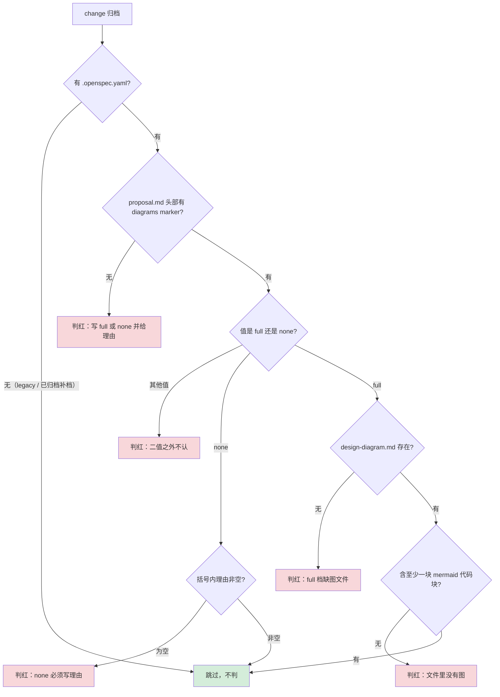
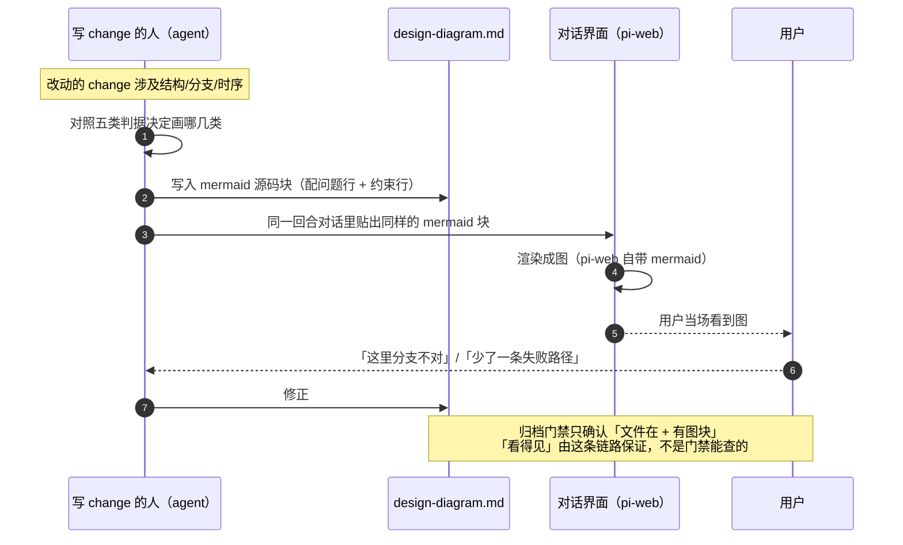
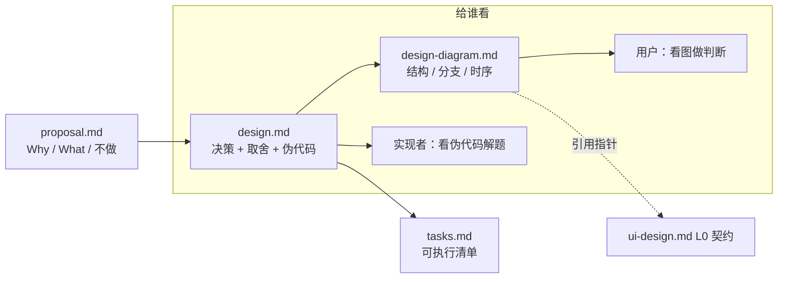

# 决策图

> 事实来源：本 change 的 `proposal.md`（marker 三态与门禁范围）+ `design.md` D3/D6 + `scripts/harness/archive-readiness.sh` 现有七项结构。

## 1. 归档门禁如何判 diagrams

这张图回答：**归档时在一个 change 上看出什么问题会判红**。它不表达 CLI 参数与错误文案（那些随实现变）。

**图不表达的约束**：不判图的类型选得对不对、不判 mermaid 语法、不判 `none` 的理由是否成立。这三件归 review 与看图的人（design D3）。

## 2. 一张图从产生到被看见

这张图回答：**为什么「落盘」不等于「做完了」**。它不表达 mermaid 渲染器的内部实现。

**图不表达的约束**：渲染失败（语法错）只会在对话里暴露，门禁查不到；这条链路依赖 agent 主动贴图，规范里写成 SHALL 也仍可能被跳过——那是 review 的事。

## 3. 伪代码节的位置与本 change 的关系

这张图回答：**伪代码与图的分工**。它不表达具体字段与函数名。

**图不表达的约束**：`ui-design.md` 只写指针不复制图（design D5），复制会漂。
