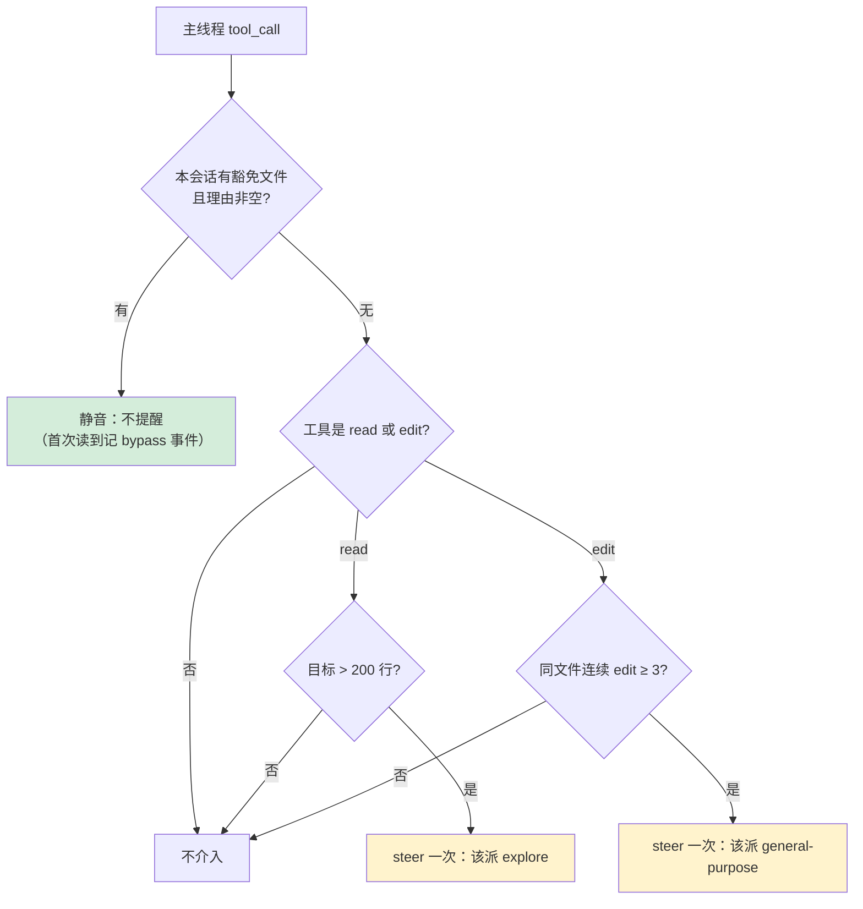
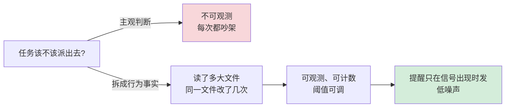
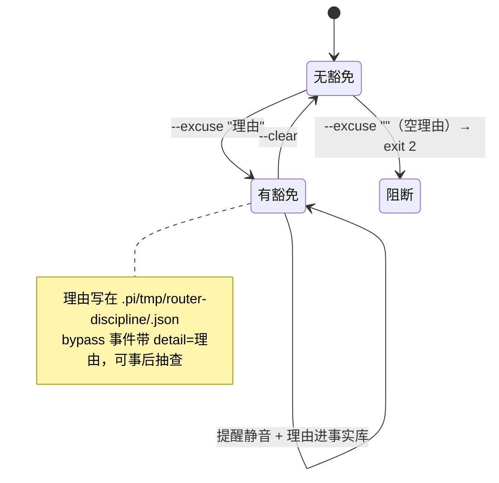

# 决策图

> 事实来源：本 change 的 `proposal.md`、`design.md` D1–D4，以及 `session.rollup` 的实测成本。

## 1. 提醒与豁免的优先级

这张图回答：**一次工具调用里，提醒为什么会被触发或静音**。它不表达阈值常量的来源。

**图不表达的约束**：提醒绝不阻断工具执行；每会话每类信号只提醒一次。

## 2. 为什么是这两个信号

这张图回答：**为什么不判「任务该不该派」而判行为**。它不表达具体成本数字。

**图不表达的约束**：阈值（200 行 / 3 次）是经验值，改常量不必走 change；shell 通道（`cat`/`sed` 读大文件）绕得过提醒，这是明确接受的边界。

## 3. 豁免为什么必须带理由

这张图回答：**隐形跳过与显形跳过的差别**。它不表达文件格式。

**图不表达的约束**：豁免是 per-session 的，新会话自动恢复提醒——不写就用不上，也就不会变成永久静音。
