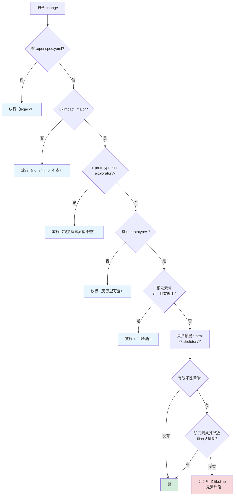
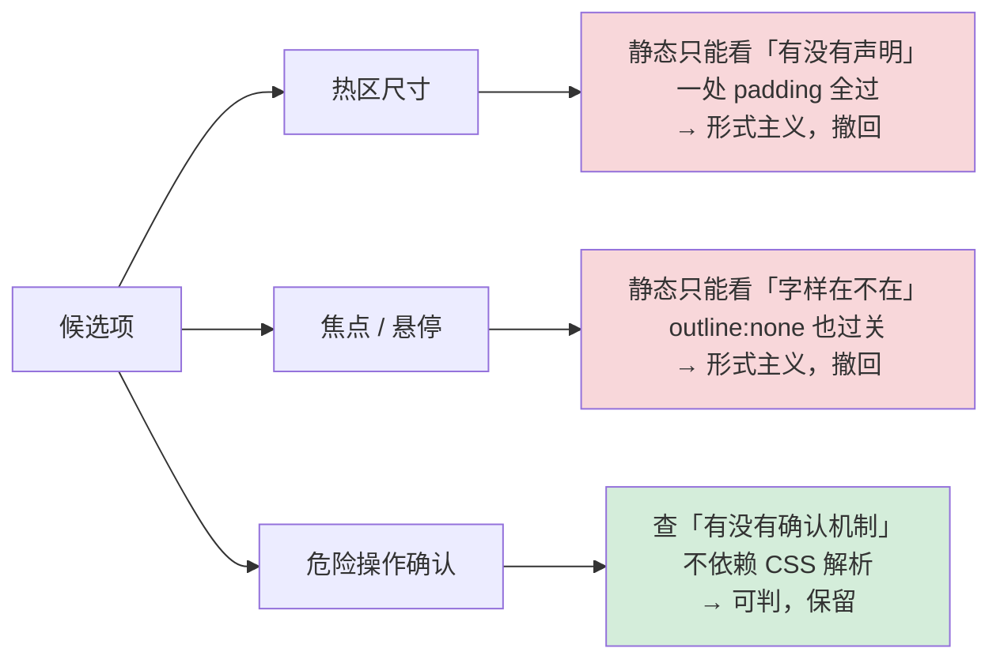
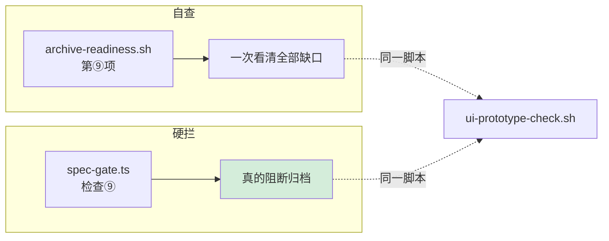

# 判定流程

> 事实来源：本 change 的 `proposal.md`「What Changes」、`design.md` D1–D4，以及
> `docs/reference/standard/frontend/prototype-content.md` 的载体分流条款。

## 1. 一次检查会走哪条路

这张图回答：**什么情况下放行、什么情况下会红**。它不表达正则细节。

**图不表达的约束**：热区/焦点/悬停**不在**这条流程里——它们是设计下限，人核，不做机器检查。

## 2. 为什么只机器化危险操作确认

这张图回答：**四个候选项各自能不能被可信地静态判定**。它不表达具体正则。

**图不表达的约束**：撤回的三项在规范里保留为**人核的设计下限**（热区 24×24 等），并明写「不做机器检查」——不假装查了没查的。

## 3. 门禁挂在两处而不是一处

这张图回答：**为什么同一份判定要跑两次**。它不表达脚本内部结构。

**图不表达的约束**：ISS-01 踩过——门禁只在自查脚本里等于没有（`archive-readiness`
是给作者自己看的，真正的阻断点在 `spec-gate`）。两处都挂、判定逻辑只在脚本里一份。
