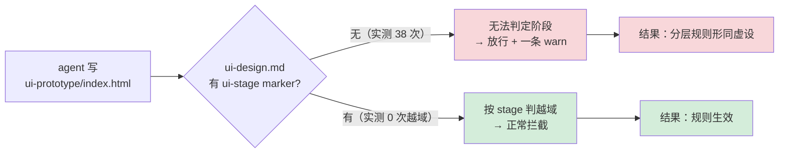
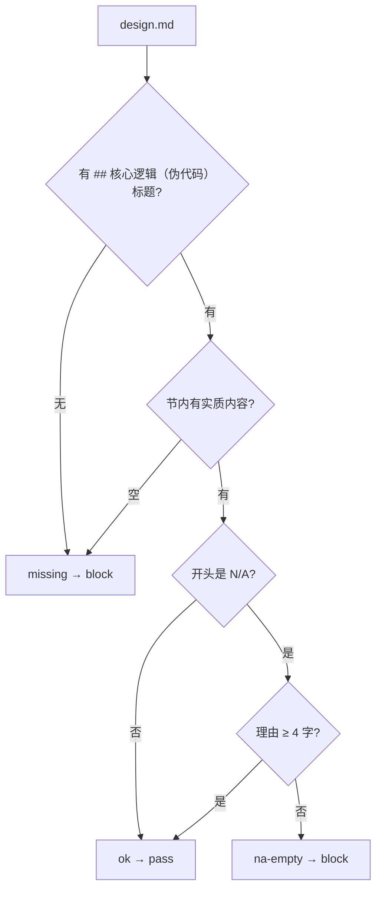

# 决策图

> 事实来源：本 change 的 `proposal.md` 与 `design.md` D1–D5，以及 `events.db` 的 38:0 实测。

## 1. 为什么 marker 方案必然失效

这张图回答：**同一批写入在两种判据下的结局差异**。它不表达 `checkStageScope` 的内部正则。



**图不表达的约束**：marker 缺失时只 warn 不 block 是 `add-ui-stage-accounting` 的观察期设计，不是 bug；错在把「观察期只记账」当成了长期方案。

## 2. 新判据：查文件而不是查申报

这张图回答：**依赖链上每个断点判什么、报什么码**。它不表达 `ui-skip` 的匹配正则。

```mermaid
stateDiagram-v2
    [*] --> 业务未定
    业务未定 --> 业务已定: design.md 有伪代码节<br/>或 N/A 带理由
    业务未定 --> 阻断1: 缺 → block ui-pseudocode-missing
    业务已定 --> 契约未定
    契约未定 --> 契约已定: ui-design.md 八节齐全
    契约未定 --> 阻断2: 缺 → block ui-design-missing
    契约已定 --> 骨架未出
    骨架未出 --> 骨架已出: ui-prototype/skeleton/ 有文件<br/>或 ui-skip: skeleton(理由)
    骨架未出 --> 阻断3: 写非 skeleton 文件 → block ui-chain-out-of-order
    骨架已出 --> 可写原型: ui-prototype/index.html 可写
    可写原型 --> 可灌数据: fixture.json 可写（要求 index.html 已在）
    可写原型 --> 阻断4: 直接写 fixture → block ui-chain-out-of-order

    style 阻断1 fill:#f8d7da
    style 阻断2 fill:#f8d7da
    style 阻断3 fill:#f8d7da
    style 阻断4 fill:#f8d7da
```

**图不表达的约束**：只有 `ui-impact: major` 走完整条链；minor 只过「契约已定」前的两步（八节检查由既有 `evaluateUiContract` 负责）。

## 3. 伪代码节探测的三种结果

这张图回答：**`readPseudocodeSection` 怎么判「有/没有/敷衍」**。它不表达 Markdown 解析细节。



**图不表达的约束**：「≥ 4 字」只是挡住 `N/A：` 这种空壳，不判断理由是否成立——理由成立性归 review。
