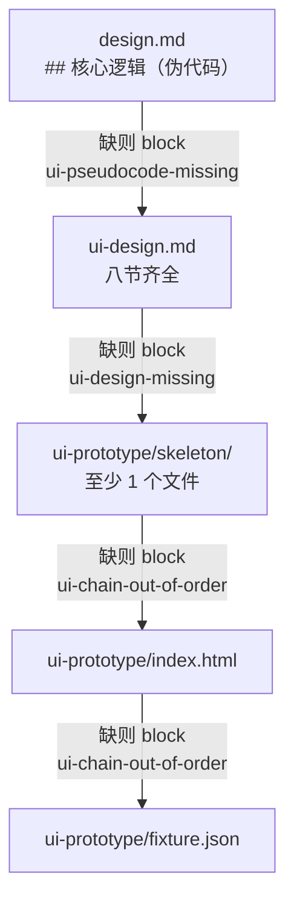

<!-- ui-impact: none -->
<!-- diagrams: full(两条判定链都是分支结构：伪代码前置判定 + 产出物依赖链，纯文字要读三段才明白顺序) -->
<!-- constraint-domains: dev, semantic-board -->

# 业务先定 + 原型产出物依赖链：让分层不靠自觉

## Why

用户的诊断：

> 是这个意思，业务有调整应该先改业务口径，但是怎么约束 llm 呢，靠文本不太行，之前也有堆文字的情况，我设计了原型分层，但是一点都没遵守

前半句是 ISS-02 的诉求（业务先定），后半句是真正的难点：**规范写了，LLM 不遵守**。

事实库给出了直接证据（`.pi/harness/events.db`）：

| 事件 | 次数 | 含义 |
|---|---:|---|
| `ui-stage-missing` | **38** | 写原型时 `ui-design.md` 里根本没有 `ui-stage` marker |
| `ui-stage-scope-out` | **0** | 有 marker 的情况下越域——一次都没有 |

**分层规则从未被触发过，因为没人申报阶段。** `checkStageScope` 的判定逻辑（`l0` 禁写 `ui-prototype/`、`skeleton` 只许写 `skeleton/`）写得完整，但它依赖一个自觉申报的 marker——marker 不写，判定就死了，只剩一条 warn 日志。

结论：**任何「让 LLM 自己申报状态，再按状态检查」的设计都有同一个漏洞——它可以不申报。**

## What Changes

### 1. 换约束方式：不申报阶段，改判产物依赖链

每一环判的都是**文件在不在**，不是「你说你在哪个阶段」。LLM 想跳过骨架直接写完整原型 → 写 `index.html` 时被 block。它不需要记住任何规则，只需要**无法绕过步骤**。

### 2. 业务先定：major 批准的那一刻伪代码必须在

`ui-approval: pending → approved` 是「界面契约定了」的时刻。此时若 `design.md` 没有 `## 核心逻辑（伪代码）` 节（或 `N/A` 无理由），block `ui-pseudocode-missing`。

- pending 期不查（原型期允许边改边定，那本来就该回图）
- `N/A：<理由>` 也算通过（纯界面改动的 change 合法）
- 只对 `ui-impact: major` 强制

### 3. 只对 major 强制，minor 不背骨架链

只改一个按钮位置的小改动不该被逼着产出骨架。minor 只走合同八节检查（既有行为），不查骨架与数据链。

### 4. 显式出口：`ui-skip`

确实不需要某一环时，在 `ui-design.md` 写 `<!-- ui-skip: skeleton(理由) -->` 或 `<!-- ui-skip: data(理由) -->`，理由非空即豁免。留痕不静默。

### 5. reasonCode 扩容两个

`UI_REASON_CODES` 从九值扩到十一值：`ui-pseudocode-missing`、`ui-chain-out-of-order`。同步更新 `ui-design-workflow` spec 的白名单。

## 不做的事

- **不把 `ui-stage-missing` 转成 block**：那会让所有现有 change 立刻卡死（它们全都没写 marker），且 marker 方案本身就是失败的路径
- **不追溯已存在的 change**：只对之后的新写入生效（判定实时读盘，无快照）
- **不判业务语义**：「这个改动算不算业务口径」机器判不了，仍靠 review 与人在对话里喊停（见 `interaction.md` 的划线表）
- **不检查原型 HTML 里的文字量**：那是 ISS-03 的范畴（文字预算降级为参考信号）
- **不动 `ui-stage` 记账机制**：marker 仍可写，仍记账，只是不再作为阻断依据

## Impact

- **代码**：`.pi/extensions/lib/ui-design-gate.ts`（新增 `readPseudocodeSection` / `checkPrototypeChain` / `hasSkipMarker`，`decideUiToolGate` pass 分支加依赖链检查）+ `.pi/extensions/ui-design-gate.ts`（传 `designMd`）
- **门禁**：新增两个 block reasonCode；major approved 时伪代码缺失即卡住
- **文档**：`开发执行规范.md` §3.1.1 补「业务先定」与依赖链；`standard/frontend/interaction.md` 补决策权划线表
- **测试**：`ui-design-gate.smoke.cjs` 新增 15 个 case（§A' 伪代码 6 条、§B' 依赖链 8 条、D7/F5 白名单 11 值）
- **风险**：论 major 档会被强制走骨架链。若某类 major change 确实不需要骨架，用 `ui-skip` 出口——这个出口本身也是留痕
- **向后兼容**：`.openspec.yaml` 缺失的 legacy change 走 `verdict.kind === "legacy"` 分支，不进入依赖链检查

## 已知残留

- `开发执行规范.md` §3.1.1 写的 L0 三节名（`## Interaction Decisions` / `## Data Provenance` / `## 明确不做`）**与 `ui-design.md` 实际的八节对不上**（八节是 User Journey / Information Architecture / Interaction Contract / State Matrix / Layout Contract / Component Reuse / Prototype / Acceptance）。本 change 的依赖链因此**不重复查 L0**（八节齐全已是 `evaluateUiContract` 的 pass 前提），但那份文档的矛盾本身待修——它属于 ISS-02 的文档清理，不混进本 change 的门禁改动
- 「业务口径 vs 界面口径」的划线机器判不了。本 change 只把**顺序**做实（文件依赖），**纪律**仍靠 review 与对话里主动喊停
