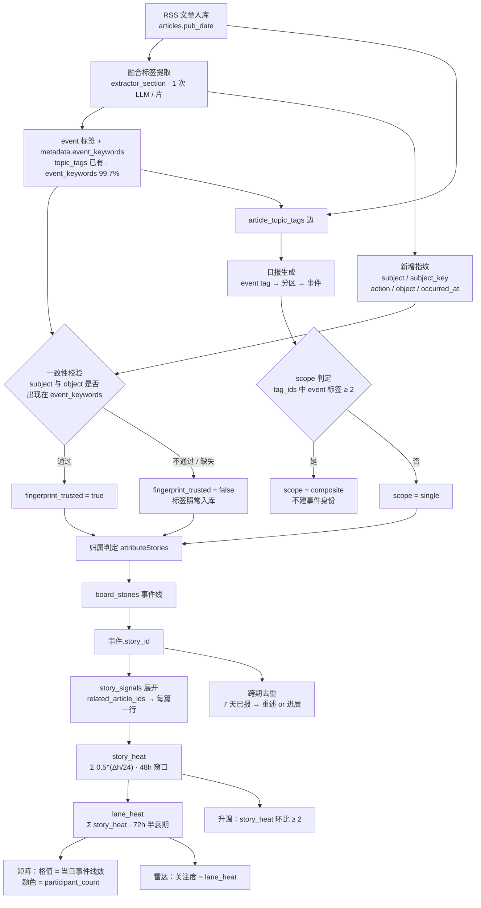
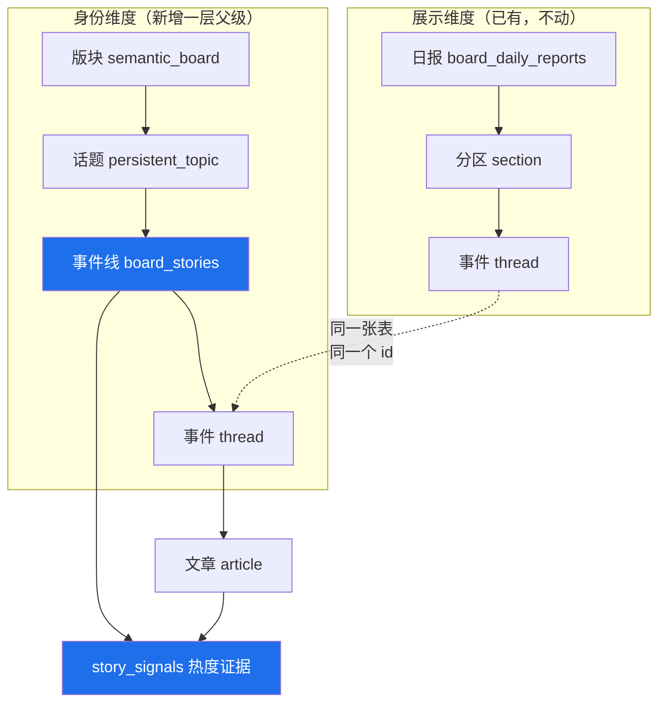
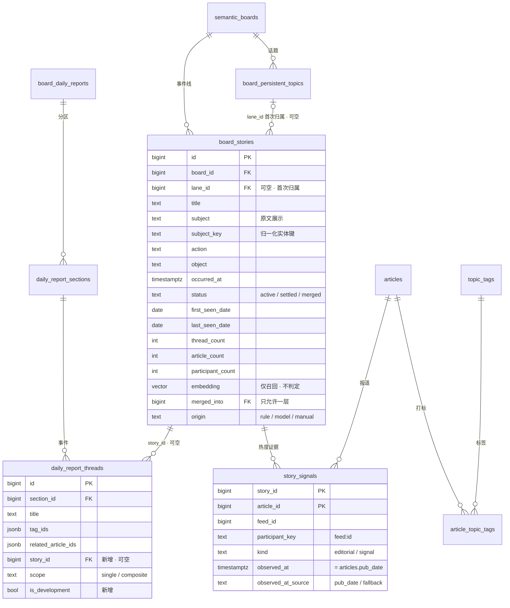
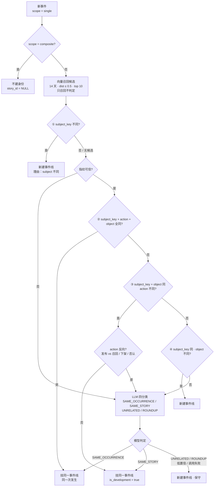
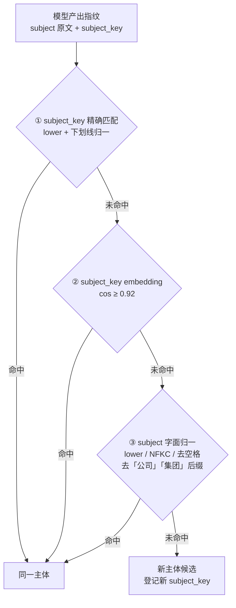
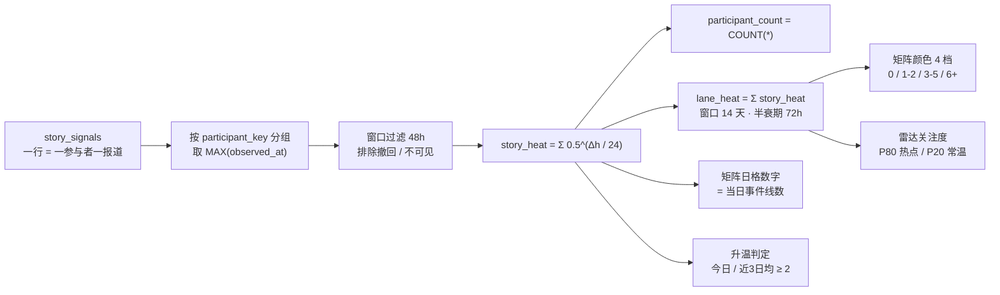
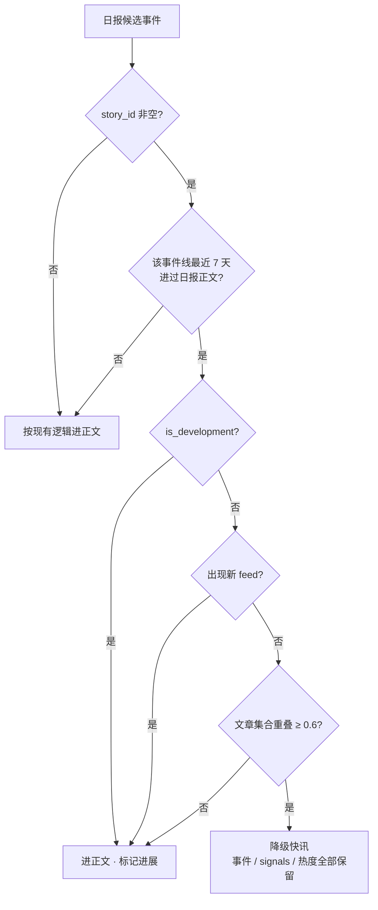
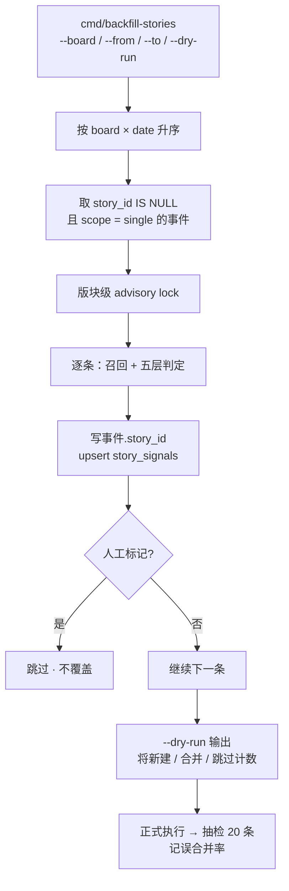

# 数据地图 — 事件线与热度

> 本文件是 `add-event-story-heat` 的**开发指导图谱**：术语定稿、实体关系、判定流程、热度公式、降级路径。
> 实现时对着图写，图与 `specs/` 冲突时以 `specs/` 为准；图与代码冲突时先改图再改码。
> 所有实线为「已存在」，虚线为「本 change 新增」。

## 0. 术语定稿（先统一叫法，再写代码）

| 业务层 | 代码实体 | 定稿术语 | 说明 |
|---|---|---|---|
| 版块 | `semantic_boards` | **版块** | 已有，不动 |
| 话题 | `board_persistent_topics` | **话题**（泳道） | 已有，跨月主题，不动 |
| 事件线 | `board_stories` | **事件线** | 新增。一条线贯穿多天的多个事件；对应参考实现的 story |
| 事件 | `daily_report_threads` | **事件** | 已有。某一天的一条事件，关联多篇文章；代码字段名保留 `thread` |
| 文章 | `articles` | **文章** | 已有，不动 |
| 日报分区 | `daily_report_sections` | **分区** | 已有。展示容器，**不属于身份层**——它随 LLM 分桶的 `k` 变化，不能当身份 |

三条硬约定：

1. **「事件」不是「事件线」**。事件是某天的一次发生，事件线是多天同一事件的聚合。
2. **分区不是身份**。`section` 是某天某话题下的主题桶，`bucket_title` 每天重算，任何身份判定、热度计算、计数都不得引用它不是身份。
3. **代码标识符不改**。`daily_report_threads` / `story_id` / `board_stories` 保留英文，只统一文档、界面文案与 spec 措辞。

## 1. 端到端数据流

**实现要点**

- 指纹与标签**同一次调用**产出（`tagmanagement/service/core/extractor_section.go`），不新增 LLM 调用。
- 热度链 `Q → R → S` **只吃 `story_signals`**，不读 `section` 条数、不读事件行数、不读任何 LLM 字段。这是本 change 的核心不变量。
- `K` 的综合稿判定只依赖 `tag_ids` 里 event 标签数量，不调模型。

## 2. 两个维度正交（事件线不是平行体系）

**串联点只有三处**

| 串联点 | 字段 | 语义 |
|---|---|---|
| 事件 → 事件线 | `daily_report_threads.story_id`（可空） | 加一列，事件本身不变 |
| 事件线 → 话题 | `board_stories.lane_id`（可空） | 仅记录首次归属，用于分组展示，**不参与判定** |
| 事件线 → 热度 | `story_signals` | 从事件的 `related_article_ids` 展开，不改事件 |

**明确不动**：分区生成、话题分桶阈值（0.18 / 0.30）、日报版面、归档的 `in_report` 口径、`related_article_ids` 的算法。

## 3. 实体关系

**为什么身份与热度是两张表**：`thread.story_id` 回答「哪条事件属于哪条事件线」，`story_signals` 回答「谁在什么时候讨论了它」。跨期去重只动前者，热度只读后者——两者互不污染。

## 4. 归属判定（五层，前层命中即终止）

**实现要点**

- **第 ① 层是主防线**：「A 公司涨价 15%」vs「B 公司涨价 10%」向量再近，`subject_key` 不同就绝不合并。
- 第 ① 层比较的是 `subject_key`，不是 `subject` 原文——原文可能是「特朗普」也可能是「Trump」。
- 向量只在第 0 步召回用，**不参与任何一层的判定**。
- 第 ⑤ 层（LLM）只在「指纹不可信」或「前四层都不命中」时触发，量应控制在 5% 以内。
- 保守原则：任何不确定（低置信、调用失败、ROUNDUP）一律**新建**，不赌合并。

## 5. subject 归一化（三层，解决 Trump vs 川普）

**`subject_key` 格式**：`类型:规范名`，规范名用小写英文/拼音。

| 原文 | subject_key | 备注 |
|---|---|---|
| 特朗普 | `person:trump` | |
| 川普 | `person:trump` | LLM 归一，自动合并 |
| Trump | `person:trump` | |
| 字节跳动 / 字节 / ByteDance | `company:bytedance` | |
| OpenAI | `company:openai` | |
| 奥尔特曼 | `person:sam_altman` | 与 OpenAI 正确分开 |
| 中国央行 | `org:pboc` | |
| 英伟达 / NVIDIA | `company:nvidia` | |

类型枚举：`person` / `company` / `org` / `product` / `other`。

**为什么主判据是 LLM 而不是 embedding**（实测依据）：

| 资产 | 实测 | 结论 |
|---|---|---|
| `person` 标签 aliases | 332 个，**aliases 0%** | 不可用 |
| `event` 标签 aliases | **0%** | 不可用 |
| `keyword` 标签 aliases | 7.3%（842/11559） | 覆盖太低 |
| 标签 embedding 覆盖 | 99.9–100% | 唯一可用的向量资产 |

现有标签体系**没有实体层**（person 标签一半是事件句、搜不到 Trump/川普；keyword 是产品技术名），所以：

- 不能靠 `topic_tags.aliases` 归并（覆盖率近 0）；
- 能靠的是 LLM 在生成指纹时顺手归一（同一次调用，+10 token）；
- embedding 只做第二层兜底（`subject_key` 拼写差异），阈值取 **0.92**，远高于事件召回的 0.5——实体归并容错更低。

**`subject_key` 的向量存哪**：不单独建表，存 `board_stories.subject_embedding`（可空）。只为已建立的事件线算一次，量小。

## 6. 热度计算

**参数与版本**

| 参数 | story | lane | 说明 |
|---|---|---|---|
| 窗口 | 48h | 14 天 | story 看单件事的当下动能，lane 看话题的持续热度 |
| 半衰期 | 24h | 72h | 同上 |
| 去重单位 | `participant_key` | 同 | 每参与者只计一次 |
| 版本号 | `heat-v1-48h-hl24h` | 同 | 写入响应，便于口径变更后区分 |

**不变量**（评审重点）

- 公式只依赖 `story_signals` + `board_stories` + 事件归属 + `articles.pub_date`。
- 改分桶 `k`、改日报 prompt、做重述降级 → 热度**不得变化**。
- 任意历史时刻可重算且结果一致（无随机、无模型、无当前时间以外的输入）。

## 7. 跨期去重（只降级展示，不动证据）

**边界**

- 降级只改「正文 or 快讯」这一个展示位，`related_article_ids` 不动 → 归档的「已入日报 / 未入日报」口径不受影响。
- `story_id` 为空或 `scope=composite` 的事件不参与去重，按现有逻辑走。
- 降级前后热度必须完全一致（单测断言）。

## 8. 回填

**幂等**：只处理 `story_id IS NULL` 且非人工标记的事件；重复执行不新建重复事件线、不改已有归属、不重置人工标记。

**并发**：版块级 advisory lock，后到者跳过已处理事件。

## 9. 三条降级路径

```mermaid
flowchart TD
    subgraph "降级 1：指纹不可信"
    A1["fingerprint_trusted = false"] --> A2["标签照常入库"]
    A2 --> A3["归属走 LLM 四分类"]
    A3 --> A4["低置信 / 失败 → 新建事件线"]
    end

    subgraph "降级 2：事件未回填"
    B1["story_id 全为 NULL"] --> B2["格值 = 非综合稿事件数（上界）"]
    B2 --> B3["参与者 = COUNT(DISTINCT feed_id)"]
    B3 --> B4["界面标『事件身份未回填』"]
    end

    subgraph "降级 3：watch 物化事件无 embedding"
    C1["事件.embedding 为空"] --> C2["跳过向量召回"]
    C2 --> C3["只比文章集合 Jaccard"]
    C3 --> C4["无重叠 → 新建事件线"]
    end
```

三条降级的共同要求：**宁可新建，不许误合并；宁可标注，不许静默归零。**

## 10. 代码落点速查

| 步骤 | 文件 | 动作 |
|---|---|---|
| 指纹产出 | `backend-go/internal/tagmanagement/service/core/extractor_section.go` | schema 加 `subject / subject_key / action / object` |
| 指纹校验 | 同上（新增校验函数） | 用 `metadata.event_keywords` 比对 |
| 事件模型 | `backend-go/internal/topicgraph/repository/daily_report_models.go` | thread 加 `story_id / scope / is_development` |
| 事件线模型 | `backend-go/internal/topicgraph/repository/story_models.go`（新） | `BoardStory` / `StorySignal` |
| 迁移 | `backend-go/internal/platform/database/postgres_migrations.go` | 建表 + 加列 + 索引 |
| 归属判定 | `backend-go/internal/topicgraph/service/story_assign.go`（新） | 召回 + 五层 + subject 归并 |
| 信号写入 | `backend-go/internal/topicgraph/repository/story_signals_repository.go`（新） | 展开 `related_article_ids` |
| 热度 | `backend-go/internal/topicgraph/repository/story_heat.go`（新） | 两条 SQL + 版本号 |
| 矩阵接口 | `backend-go/internal/topicgraph/repository/lane_snapshot_repository.go` | 补 `story_count` / `participant_count`，行序换 `lane_heat` |
| 雷达接口 | `backend-go/internal/topicgraph/repository/board_radar_repository.go` | attention 换 `lane_heat` |
| 跨期去重 | `backend-go/internal/topicgraph/service/daily_report_dedup.go` | 新增重述/进展判定 |
| 回填 | `backend-go/cmd/backfill-stories/main.go`（新） | 幂等回填 |
| 前端矩阵 | `front/app/features/tags/components/console/ObservationMatrixGrid.vue` | 格值 + 颜色 + 图例 |
| 前端雷达 | `front/app/features/tags/components/console/BoardRadarView.vue`、`boardRadarHelpers.ts` | 口径与阈值 |

## 11. 评审时对着这张表查

| # | 检查项 | 反例（出现即打回） |
|---|---|---|
| 1 | 热度是否只读 `story_signals` | 代码里出现 `len(sections)` 或 `thread_count` 参与热度计算 |
| 2 | 向量是否只做召回 | 出现「dist ≤ X 即合并」 |
| 3 | subject 比较是否用 `subject_key` | 用 `subject` 原文直接 `==` |
| 4 | 阶段判定是否有反向动作例外 | 发布/召回被当成进展合并 |
| 5 | 综合稿是否真的不建身份 | `scope=composite` 的事件有非空 `story_id` |
| 6 | 去重是否只动展示 | 去重路径里出现 `DELETE` 或热度重算 |
| 7 | 回填是否幂等 | 重复执行产生重复事件线 |
| 8 | 未回填是否降级而非归零 | 矩阵显示 0 且无提示 |
| 9 | 术语是否统一 | 文档/界面混用「线索」「story」「话题」指代事件 |
| 10 | 分区是否被当身份 | 任何判定/计数引用 `section.id` 或 `bucket_title` |
