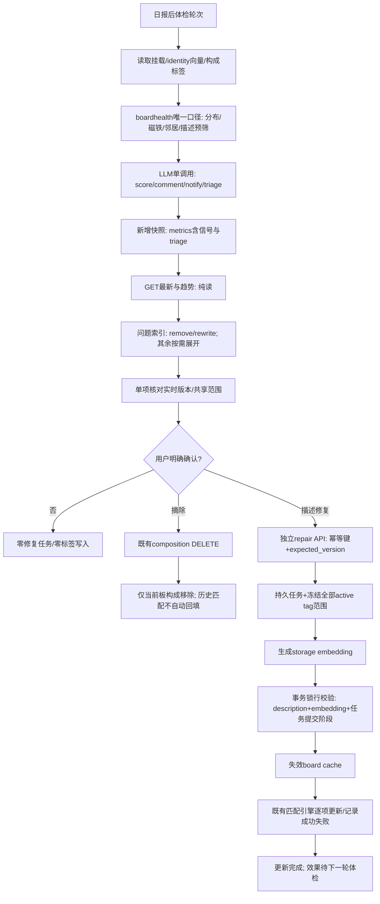
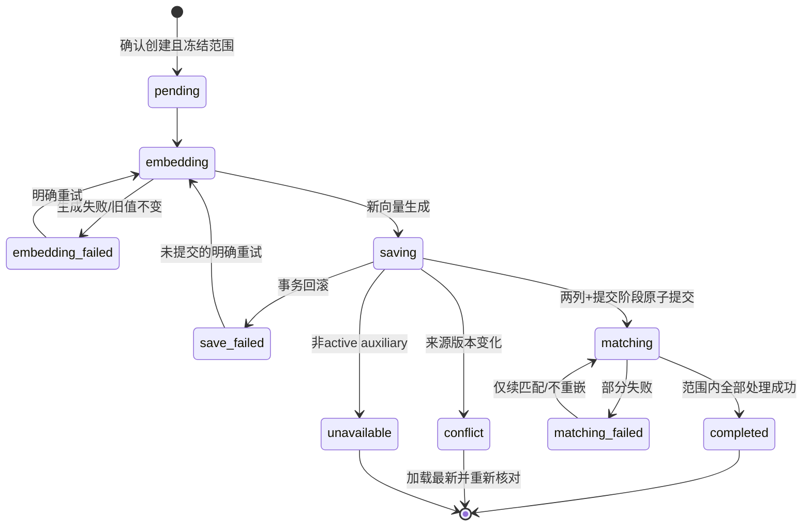
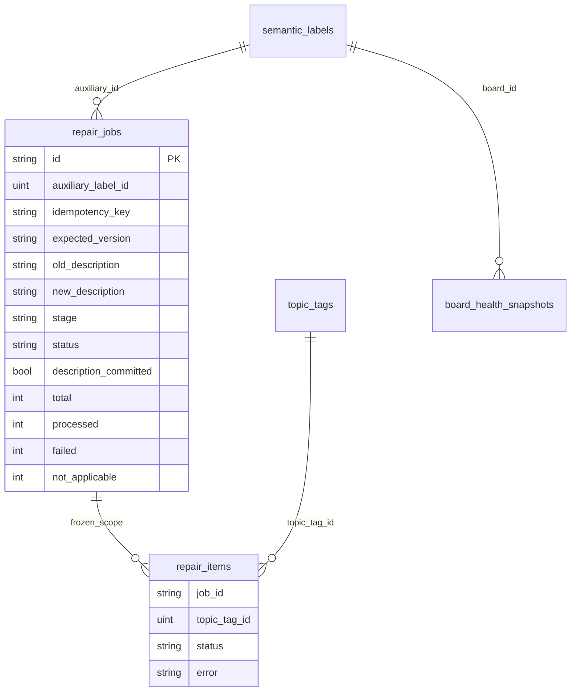

# Data Map — 三病体检与人工修复（v2 获批）

> design D1-D7、implementation-contract.md 的图示附件。用户批准 v2 后替换 v1 仅复制/零DDL图示；示意的是待实现契约，不宣称产品链已交付。

## 1. 纯读诊断与独立手动执行

体检仅写自身新快照/既有通知记录，不写标签/匹配/升级建议。repair不放进boardhealth，不引入boardhealth→board依赖。修复不改旧快照、既有日报，不自动多跑一轮体检。

## 2. 修复任务与故障恢复

任一阶段故障后以持久状态恢复：保存前旧数据不变，保存后只续匹配。并发claim/同标签未结束互斥与同key/payload校验防双写。任务具体租约/恢复机制由 seam B 实现并经PG故障窗验证，不能靠前端map模拟。

## 3. 持久数据关系

> **计数字段来源（task 2.4）**：`total` = 创建时冻结的范围数量（不因后续失效而缩小）；`processed` = 匹配引擎**实际成功**的项数（合法零命中也算成功）；`failed` = 仍处失败态的项数；`not_applicable` = 处理时确认已失效/删除（被删/被禁用/被合并）而**持久跳过**的项数——**不是成功**。`remaining = total - processed - failed - not_applicable`（服务端按同一持久计数计算），四者之和恒等于 `total`；`processed/failed/not_applicable` 由**冻结 items 单源聚合**（同一短事务内重算），不靠内存自增。完成条件：`remaining = 0` 且 `failed = 0` 且各项为 succeeded/not_applicable——否则为 `matching_failed`。旧任务的 `not_applicable` 读作 0；wire 缺 `remaining` 时前端保持未知/不展示，不伪造 0。

图中repair_jobs/repair_items为逻辑名，实际表/索引在 seam B 交接和数据库文档校准；范围中的tag删除/失效不得让任务永久卡死。semantic_labels修复只改description/storage embedding，label/aliases/merge_embedding保持；固定范围包含当时未归属者，不能只枚举topic_tag_board_labels。

## 4. 前端字段来源与用户下一步

| 展示 | 唯一来源 | 不可混淆 |
| --- | --- | --- |
| 评分/诊断/污染证据 | 体检快照 metrics.triage/signals | 旧快照不因本地处理标记变健康 |
| 实时原描述/版本/引用版块 | repair-context API | 不拿旧快照内容直接覆盖共享标签 |
| 原子保存是否已提交 | 持久任务 description_committed | 已保存不等于匹配全部完成 |
| 三阶段与成功/失败数 | 持久任务 status/stage/counters | 排队或部分失败不得叫已修复 |
| 不再适用项数 | 持久任务 not_applicable（items 单源聚合） | 跳过项**不是成功**，不计入 processed |
| 继续下一项 | 本轮问题索引 + 当前任务真实结果 | 仅本轮处理进展，不是新体检结论 |
| 效果验证 | 下一轮新体检 | 不回写旧评分/旧日报 |

运行后编辑区/证据/共享说明收成只读折叠摘要，主区专注进度、恢复、下一项；窄屏有返回索引与粘性主动作。所有API经边界归一，组件不自行重算统计或直发请求。

### 4.1 seam C1（task 3.1）前端归一后的字段源与降级规则

前端只搬运、不重算：体检侧只消费**同轮快照**（无独立分诊请求），修复侧只消费 repair API 的**持久任务**（不凭本地 map 假冒进度）。

| 展示字段（前端视图名） | 唯一来源（wire） | 归一/降级规则 |
| --- | --- | --- |
| 分诊项 `triage.items[]`（auxId/category/evidence/suggestion/actionable） | 同轮快照 `metrics.triage[]` | **按 aux 分组**：组内 category/evidence/suggestion 完全一致才去重留 1；任何矛盾 → **整组不可执行**（全部丢弃并按组内条目数计 `dropped`）；非法分类 / 非法 aux 引用（不在 `metrics.labels`）/ 无证据 → 丢弃；keep/insufficient 的 suggestion 清空且 actionable=false |
| 分诊项 `triage.items[].labelType` | 同轮快照 `metrics.labels[].label_type`（auxiliary / composite；缺字段 = 旧快照） | 逐条透传，不前端推断；**非 auxiliary 的 rewrite 项 actionable=false**（描述修复链只覆盖辅助标签 → 无修复入口）；类型未知同样按不可执行处理；remove 项不受类型影响 |
| 本轮是否有分诊 `triage.available` | 快照是否带 `metrics.triage` 字段 | 缺字段 = 历史快照（旧形态，不反推诊断）；空数组 = 降级轮次（available=true、条目空） |
| 标签级信号 `magnet` / `neighbors` / `descFlags` | 同轮快照 `metrics.labels[].magnet/neighbors/desc_flags` | 数值原样搬运；gap、阈值、top-k、词根判定均在后端 boardhealth 包，前端不重算；`neighbors=null` = 自身向量缺失（信号不足） |
| 实时原描述/版本/引用版块 `context.label/directBoards` | `GET description-repair-context` | `version` 是**不透明令牌**：只透传，不解析不拼接；缺 `auxiliary_label` → 上下文不可用（不造版本）；服务端返回的标签必须就是请求的标签（归属校验） |
| 任务阶段/计数 `task.status/stage/total/processed/failed/notApplicable/remaining` | 持久任务 `GET/POST description-repairs` | 计数服务端单源；`total/processed/failed` 缺失或非法 → **null（未知）**，不得捏造 0（否则会造出完成进度）；`notApplicable` 单列（**不是成功**，旧 wire 缺字段按 0 读）；wire 缺 `remaining` → 未知（null，不展示、不补 0、不用差值猜） |
| 任务状态词表 | 服务端 status 闭集 | 已知值 typed；未知值落 `unknown`（不猜语义）；**停止轮询集** = 终态 + 三失败 + unknown；**互斥释放集**（允许显式新确认）= completed/conflict/unavailable（三失败态后端仍持同标签锁 → 只能 retry）；**可重试集** = 三失败 |
| 提交幂等 | 客户端冻结的 `idempotency_key` + payload | 一次确认 = 一键 + 一份冻结 payload；超时/网络错/5xx/408 等超时取消类 = 结果未知 → 重发同键同体；改内容不得复用旧键；4xx（除超时取消类，含 409）为确定拒绝（未建任务）→ 可用新键重提，409 保留草稿并透传服务端 message |
| 冻结解除的唯一凭据 | `context.latest_task` 与冻结记录的比对 | 只有**同键 + 同 payload + 归属一致**的任务才证明本次确认已被受理 → 采纳并解冻；**单次查询为空或只返回他键任务都不能证明未受理** → 不解冻、不换键、不把别的任务当本次结果；无冻结时才按 latest_task 做重进恢复 |
| 执行元数据（claim_owner/phase_token/committed_version/committed_at 等） | **不进 wire** | 归一按白名单逐字段映射，即便 wire 混入也不透出 |

## 4.2 seam C2（task 3.2-3.3）工作面展示字段 → 来源

工作面只搬运服务端事实：分诊与信号来自同轮快照，任务阶段/计数来自持久任务，共享范围来自 repair-context。

| 展示（工作面位置） | 唯一来源 | 不可混淆 / 降级 |
| --- | --- | --- |
| 顶部「本轮需核对 N 项」 | 同轮快照 `metrics.triage` 的 remove/rewrite 条目数 | 只数**需核对项**；keep/insufficient 不计入；旧快照/空清单时改为展示状态说明而非数字 |
| 顶部「当前进展」 | 持久任务 `status`（+ processed/total） | 只报**当前项**真实进展；无任务不显示；不统计本地处理过的项（不冒充持久进度） |
| 索引项（标签/类别/证据/状态） | 分诊项 + 该标签的真实任务状态 | 状态只反映**已知任务**；状态图标在标题左侧带 aria-label；状态说明行是纯 `
`（不伪装动作） |
| 「其余标签」折叠项 | 分诊的 keep/insufficient 条目（各带证据） | 只读；不展示成"已处理"；空则明说没有保留/不足项 |
| 折叠区「本轮体检依据」 | 既有 `BoardHealthSignal`（评分/评语/挂载统计/趋势） | **零额外请求**；逐标签质量表/组合/候选仍由既有页签承载（不复制统计实现） |
| 当前项证据（磁铁/最近邻/词根/失败挂载流向） | 同轮快照 `metrics.labels[].magnet/neighbors/desc_flags` + `metrics.board.magnet_flow` | 服务端口径，前端只搬运；缺信号显示"未知/不足"，不把空数组当健康 |
| 原描述 / 直接引用版块 / 活跃标签覆盖数 | repair-context `auxiliary_label.description` / `direct_boards` / `active_tag_count` | 字段缺失 = **未知**（null），不谎称 0 范围；合法 0 才显示"当前没有版块直接引用它" |
| 三阶段 | 持久任务 `status`/`stage` | 由服务端状态推导，不自造阶段；unknown 不当完成也不当失败 |
| 计数（范围/已更新/失败/跳过/待处理） | 持久任务 `total`/`processed`/`failed`/`not_applicable`/`remaining` | null → 显示「未知」；跳过项**不是成功**；不重算 remaining、不以 P+F 判完成 |
| 完成文案 | 持久任务 `status === 'completed'` | 严格「更新完成，效果待下一轮体检验证」；旧评分/旧快照/日报不改写 |
| 未知结果时的原确认内容 | C1 冻结的 payload（幂等键 + 描述 + 来源版本） | 只读展示；重发严格同 key + 同 payload；**不展示技术 key 值**；刷新不解冻 |
| 摘除结果 | 宿主回传的 `removedAuxIds`（3.4） | 未收到宿主真实成功反馈前**不标「已摘除」**；只移本版块构成、不删共享标签、历史不自动回填 |
| 不可执行说明（组合标签的描述修复） | 分诊项 `labelType`（服务端 `metrics.labels[].label_type`） | **组合标签暂不支持描述修复**（类型未知 → 「标签类型未知，无法执行描述修复」）；证据照常展开、不隐藏、不当它健康；不拉必然 404 的修复上下文 |

## 4.3 seam C3（task 3.4）宿主接线与状态来源

| 展示 / 动作 | 唯一来源 | 不可混淆 |
| --- | --- | --- |
| 体检依据页签内容 | `BoardHealthWorkspace`（C2 工作面） | 完整评语/统计/趋势在工作面内**默认折叠的「本轮体检依据」**（复用 `BoardHealthSignal`，零额外请求）；右轨 brief 仍只给轻结论 |
| 「已摘除」 | 宿主回填的 `removedAuxIds`（真实 DELETE 成功后）**∩ 当前构成中已不存在的标签**（4.1 C3-L1） | 未回填前**不标已摘除**；只移本版块构成、不删共享标签、**历史匹配不自动回填**；**同一标签被重新挂回后徽标自动撤销、摘除按钮恢复**（会话记录不撤销，按当前构成取差集） |
| 摘除失败提示 | 既有 `useBoardComposition.removeLabel` 的 notifyError | **只通知一次**（壳层不叠加 toast）；工作面不自带 toast |
| 版块「可能已经不存在」形态 | `useBoardHealth.errorStatus` ∈ {404, 403} | **不是**「刷新失败显示上次快照」；该形态下**不展示可操作清单**；网络错/5xx 仍按 stale（保留上次快照 + 提示行） |
| 既有页签（构成/组合/候选/来源/设置） | 原 `BoardHealthDetail` / `BoardSourcePanel` / `BoardSettingsForm` | 本批只换体检页签渲染；旧入口零丢失，旧统计实现不复制 |

## 5. 执行元数据（task 2.5，全部私有、不进 wire）

执行链的内部状态只在 `repair_jobs` 上，**不新增任何公开字段**：`claim_owner` / `claimed_at` / `lease_expires_at`（本次执行的所有权与租约）、`phase_token`（本次尝试的执行权，CAS 领取，结束即作废）、`committed_version` / `committed_at`（已提交的来源版本与时刻）。它们都是 nullable 的内部列，**不出现在任何 HTTP DTO**，前端不得推断或展示。

- 租约与心跳的判定一律用数据库**实时**时钟（`clock_timestamp()`），不用固定在事务/语句开始的 `now()`。
- 扫描只领取 `pending` 与「租约已过期的未结束阶段」；`embedding_failed` / `save_failed / matching_failed` **不自动重跑**，等用户 retry（retry 只把**同一任务**重新排入，不改 `expected_version` / `new_description` / 冻结范围）。
- 队列就是数据库：没有内存 map，也没有进程内任务表；重启后由扫描器重新发现未完成任务。
