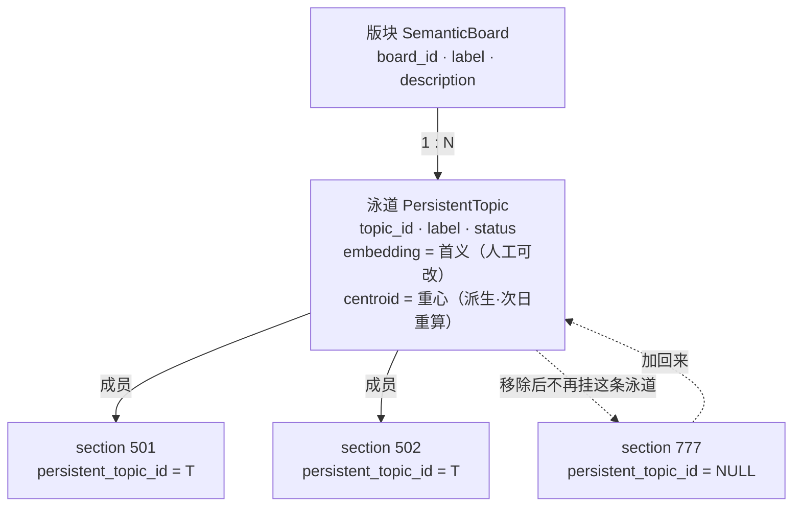
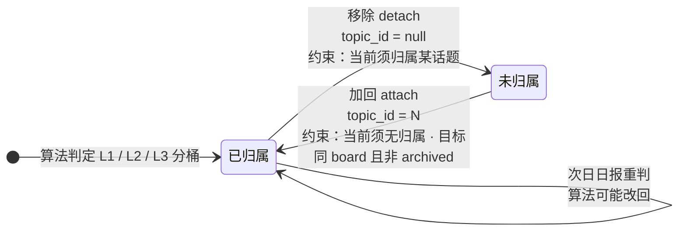
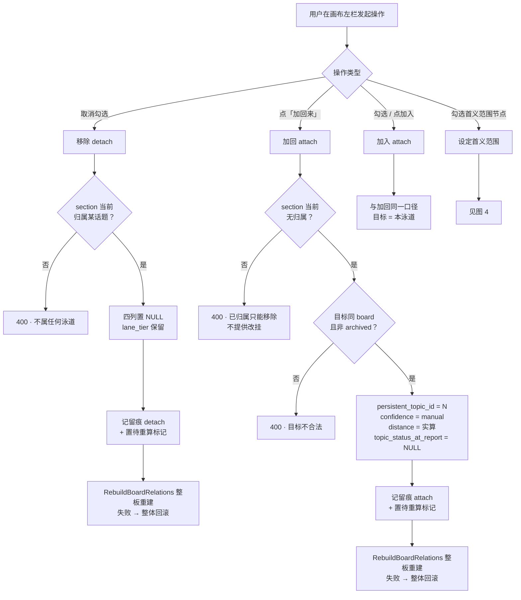
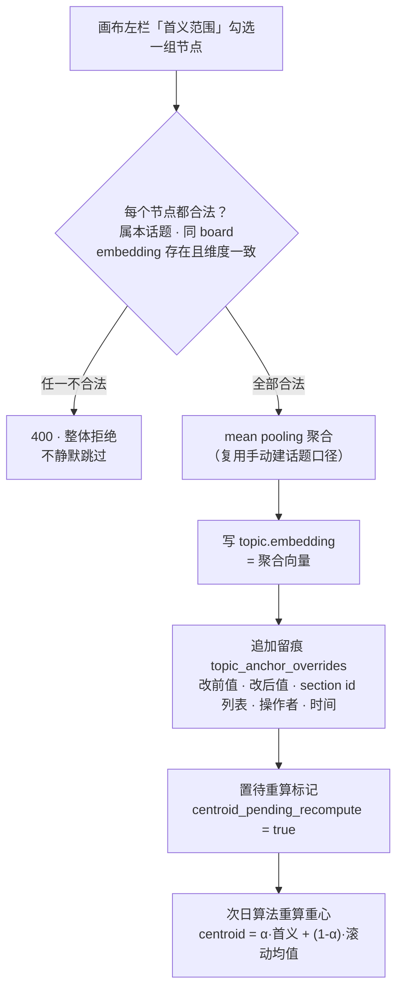
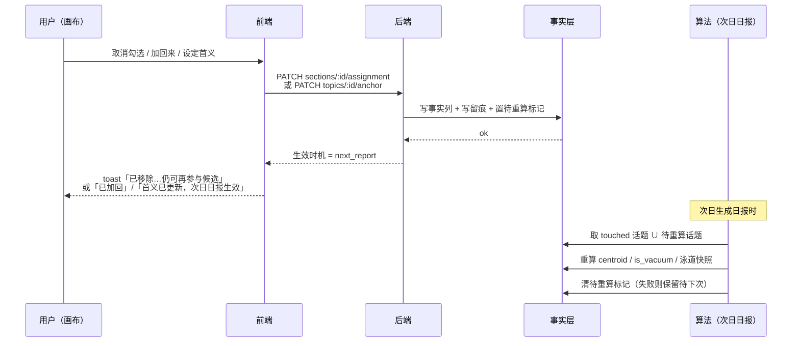

## Context

本 change 的技术现状已在 proposal.md 交代动机，此处只记**约束实现方案的现状事实**：

**事实 1 · 质心是纯派生缓存，人工无处落脚。**
`board_persistent_topics.centroid` 的写入点全仓仅三处，全是系统侧：`UpdateCentroidOnSectionChange`（`backend-go/internal/topicgraph/repository/daily_report_topic_repository.go:1047`，每次 SaveReport 后无条件 UPDATE）、一次性迁移 SQL、backfill 内部 running-mean。`is_vacuum` / `vacuum_strong` / `vacuum_mid` 同理（唯一写入点 `RecomputeVacuumStats`）。`topic_lane_snapshots` 唯一写者是日报生成后的结算链。

**事实 2 · 质心只被「未来归属」读，历史输出不依赖它。**
`centroid` 的读取点只有三处：L1/L2/L3 分桶的锚点构造（`backend-go/internal/topicgraph/service/daily_report_lane.go:116`）、三态判定的锚点集命中（`backend-go/internal/topicgraph/repository/daily_report_assignment.go:84`）、退化兜底（`daily_report_topic_repository.go:1034`）。关系重建 `RebuildBoardRelations` 只用 section 自身 embedding 与 `period_date`，**不读 centroid**；真空统计只读历史 `topic_match_distance` 快照，**不读 centroid**。→ 重算质心不改任何已有输出。

**事实 3 · 质心刷新范围受 touched 集合限制。**
`SaveReport` post-commit 只对本次日报涉及的 topic（anchor 目标 + 新建 candidate）调 `UpdateCentroidOnSectionChange`（`backend-go/internal/topicgraph/repository/daily_report_repository.go:397`）。一条泳道若当日无新内容命中，其质心不会重算。

**事实 4 · 首义对自动话题而言只是一条内容的向量。**
auto topic 首义 = 首条命中 section 的内容 embedding（`backend-go/internal/topicgraph/repository/daily_report_assignment.go:308`）；manual topic = 创建时所选 section 的均值（`backend-go/internal/topicgraph/repository/daily_report_manual_topic.go:427`）；watch 物化 topic = 检索句向量（`backend-go/internal/topicgraph/repository/topic_watch_repository.go:458`）。质心 = α·首义 + (1-α)·近 30 条命中 section 均值（α=0.5）。

**事实 5 · 「把 section 从当前话题摘出来」的人工路径不存在。**
`UpdateSectionTopicAssignment`（`daily_report_topic_repository.go:448`）全仓仅三个系统侧调用者（`daily_report_manual_topic.go:443`、`daily_report_backfill_topics.go:200`、`daily_report_assignment.go:346`），无 HTTP handler。既有 merge/split 只写两列（`persistent_topic_id` + `topic_match_confidence`），遗留 distance / status 旧值，形成自相矛盾行。

**事实 6 · 所有人工路径的共同事后动作是整板关系重建。**
`RebuildBoardRelations`（`backend-go/internal/topicgraph/repository/daily_report_matching.go:298`）删该板全部关系边 → 载入全部历史 section → 按日分组做 buildDistMatrix + 三阶段匈牙利匹配 → 写 identity 边（identity 边由 `persistent_topic_id` 派生）。成本与被改条数无关。

**事实 7 · 版块本体编辑的后端能力齐全，但改完不生效。**
`PUT /api/semantic-boards/:id`（`backend-go/internal/tagmanagement/handler/board_crud_handler.go:263`）会重算 embedding，但**不调 `InvalidateMatchCache()`**；全仓该函数的生产调用点只有两处（删/增 composition）。而 board embeddings 缓存**无 TTL**（`backend-go/internal/tagmanagement/service/board/semantic_board_cache.go:128` 自陈）。→ 改完版块名，方向校验仍用旧向量。

**事实 8 · 前端有四套并行的版块/泳道编辑实现，其中三套是死代码。**
活的：`BoardSettingsForm.vue`（L1 治理工作面第 7 页签）。死的：`AddSemanticBoardDialog.editMode`（无调用方传参）、`BoardEditDialog.vue`（279 行，无 import）、`BoardGovernanceDrawer.vue`（无 import，内含设置页签）、`BoardGovernanceRail.vue`（无 import，内含新建版块按钮）。矩阵行 `ObservationMatrixLaneRow.vue` 只 emit 选中事件，无任何操作入口。

## 行为契约图解

> 对应 `specs/lane-manual-correction/spec.md` 与 `specs/persistent-topic/spec.md` 的 delta。文字契约是权威，本节是同一契约的图解。

### 图 1 · 对象关系：谁包含谁，改动落在哪一层

**四类数据，两种性质**：

| 数据 | 性质 | 谁写 | 何时生效 |
|---|---|---|---|
| `section.persistent_topic_id` 等归属列 | **事实** | 人工（移除/加回） | 立即 |
| `topic.embedding`（首义） | **事实** | 人工（选定节点范围） | 次日（写列即存，质心次日重算） |
| `topic.centroid` / `is_vacuum` / 泳道快照 | **派生草稿** | 只有算法 | 每日日报生成时 |
| `topic.status` / `label` / 命中计数 | 事实（展示层）/ 派生（计数） | 人工 / 只有算法 | 立即 / 每日 |

### 图 2 · section 归属状态机

**两个方向的约束展开**（与图 3 对应）：

| 方向 | 允许 | 拒绝 | 写列 |
|---|---|---|---|
| **移除** `topic_id=null` | section 当前归属某话题 | section 本就不属任何泳道 | `persistent_topic_id` / `topic_match_distance` / `topic_match_confidence` / `topic_status_at_report` → **NULL**；`lane_tier` 保留 |
| **加回** `topic_id=N` | section 当前无归属；目标同 board、非 archived | section 已归属（**不提供改挂**）；目标跨 board；目标已归档 | `persistent_topic_id` → N；`topic_match_confidence` → `manual`；`topic_match_distance` → 实算；`topic_status_at_report` → NULL；`lane_tier` 保留 |

### 图 3 · 每个操作的校验分支

**三个动作共用的不变式**：

| 不变式 | 说明 |
|---|---|
| 归属变更不动命中计数与状态 | `hit_count` / `consecutive_hits` / `status` 只属算法，人工不动 |
| 归属变更不立即重算质心 | 事务内只写事实 + 置「待重算」标记，质心由次日算法刷 |
| 关系重建失败即整体回滚 | 不留「已改归属但关系没重建」的中间态 |

### 图 4 · 首义重设：手动选定话题节点范围

**约束**：首义**只**由选定节点范围定义——不收自然语言描述（传描述字符串直接 400）。用户对「这条泳道是什么」的描述，其可操作形态就是「哪些节点定义它」。

### 图 5 · 生效时序：人工改事实，算法往后刷

**为什么要有「待重算标记」**：质心刷新默认只覆盖当天日报涉及的泳道（touched 集合）。若某条泳道当天没有新内容命中，改了首义 / 移除了节点也等不到重算，修正就永远不生效。标记让「人工改过但当天没动静」的泳道也被纳入次日重算——既不立刻重算（不干扰已有输出），又保证修正最终落地。

## Goals / Non-Goals

**Goals:**
- 让「人工修正」能落进算法每次都会读的持久状态，从而**往后生效**（不是当天显示变了、明天照旧）。
- 用**两个用户动作**（重设首义 / 剔除节点）覆盖「这条泳道不对」的主要成因，其余能力由它们衍生。
- 不新增「立即重算」类写路径，派生缓存的生命周期仍由算法独占。
- 让人工修正可追溯（谁、何时、改了什么、从哪挪到哪）。

**Non-Goals:**
- 不做 per-topic 的 α / L1 阈值覆盖（不把 `ai_settings` 全局键 per-topic 化）。
- 不做只读试算/预演端点。
- 不做「排除样本」护栏（记住某个误入内容的向量、近似者禁入）。
- 不做「按新规则重跑本板历史归属」——历史 section 归属不回填（红线）。
- 不自动重跑版块匹配表（`topic_tag_board_labels`）。
- 不改版块层的构成标签修正（误入根因可能在 composition 泛化词，但那属版块层）。

## Decisions

### D1. 人工修正只写「事实层」，派生缓存由算法每日重算

- **结论**：本 change 不提供任何「立即重算质心 / 立即重算真空统计 / 立即重算泳道快照」的人工触发端点。人工动作只写：首义向量、section 归属列、移除留痕、待重算标记。质心、真空标记、泳道快照的刷新完全交给日报生成后的既有链路。
- **落点**：`backend-go/internal/topicgraph/repository/daily_report_topic_repository.go:UpdateCentroidOnSectionChange`
- **取舍**：被否「新增 `POST /topics/:id/recompute-centroid` 立即重算端点 + 人工直写 `centroid` 列」——`centroid` 是纯派生缓存，直写必然被次日刷新覆盖（用户原话：「没这个必要重算，往后影响即可」）；且会多出第二条重算写路径，与既有单一刷新点相悖。代价：用户改完当天看不到判定变化，必须接受「次日生效」。

### D2. 用「待重算标记」保证人工修正在无新命中时也生效

- **结论**：新增 `board_persistent_topics.centroid_pending_recompute`（boolean，非空，默认 false）。人工修正（重设首义、移除节点）把相关话题置位；质心刷新范围 = 当日 touched 话题 ∪ 该标记为 true 的话题；重算成功后清标记，失败保留待下次重试。
- **落点**：Scenario「待重算标记强制纳入刷新范围」
- **取舍**：被否「写完就等该话题下次被命中时自然重算」——事实 3 表明一条泳道可能长期无新内容命中，改首义会长期不生效；被否「重设首义时同事务立即重算」——能保证生效但违背 D1 的单一刷新点原则，且把人工动作与算法动作混在同一事务。代价：多一列 + 刷新轮多一个查询分支。

### D3. 首义由「手动选定的话题节点范围」定义

- **结论**：重设首义只有一种输入——用户选定一组 section（话题节点），服务端按 mean pooling 聚合为新首义（复用手动建话题的聚合口径）。首义 SHALL NOT 由自然语言描述设定。被选节点 SHALL 属本话题、embedding 存在且维度一致，否则整体拒绝。
- **落点**：`backend-go/internal/topicgraph/repository/daily_report_manual_topic.go:aggregateEmbeddings`
- **取舍**：被否「自然语言描述首义」——用户对「这条泳道是什么」的描述，其可操作的形态就是「哪些节点定义它」；自然语言需再走一次向量化，且产出不可见、用户无法核对「我说的那句」到底被算成了什么向量。代价：无法用语言表达「只要这类不要那类」的软偏好——那属后续的排除样本/护栏能力，不在本 change。

### D4. 归属变更是双向的：移除（解除归属）与加回，不需要选去处

- **结论**：端点 `PATCH /api/daily-reports/sections/:id/assignment` 带 `topic_id`：`null` = 移除（`persistent_topic_id` 置空，**不再归属任何泳道**），数值 = 加回到该泳道（仅限当前无归属的 section）。内容**保留在库中**，后续仍可再参与候选。
- **落点**：Scenario「加回本次被移除的节点」
- **取舍**：被否「改挂到当天其它已有话题」——用户评审明确「移除直接就是不归属任何泳道，不需要选择其他泳道改挂」；指定去处会凭空多出「当天有哪些泳道可选」的信息负担，且用户表达的是「它不该在这儿」而非「它该在那儿」。被否「移除不可逆」——用户评审追加「已移出的本次应该也能再加回来」；移除若不可逆，用户在画布上试错一次就永久损失一条内容归属。代价：加回只能作用于**当前无归属**的 section，不提供「A 泳道 → B 泳道」的改挂；被移除的内容在泳道时间线上是游离节点。

### D5. 归属变更的快照列口径：移除四列置 NULL，加回置 manual + 实算距离，`lane_tier` 保留

- **结论**：移除把 `persistent_topic_id` / `topic_match_distance` / `topic_match_confidence` / `topic_status_at_report` 写为 NULL（口径与既有硬删话题时的解绑一致，`daily_report_topic_repository.go:371-381`）；加回把 `persistent_topic_id` 写为目标话题、`topic_match_confidence` 写为 `manual`、`topic_match_distance` 写为到目标锚点的实算距离、`topic_status_at_report` 写为 NULL。两种方向 `lane_tier` 都保持原值。
- **落点**：Scenario「手动解除归属」
- **取舍**：被否「只清 `persistent_topic_id`、其余保留」——会留下「无归属却有距离/置信/状态快照」的自相矛盾行（merge/split 的既有毛病，本 change 不复制）；被否「置 `topic_match_confidence='unmatched'`」——`unmatched` 是算法判定的三态之一，人工解除归属写进去会污染归属语义统计。代价：`lane_tier` 保留会让该 section 仍带 `l1_direct`/`l2_llm` 标记，可从读侧看出它曾经属于哪条泳道（可追溯，是有意的）。

### D6. 关系重建沿用整板 `RebuildBoardRelations`，不做增量

- **结论**：移除事务末尾照既有口径调用 `RebuildBoardRelations(tx, boardID)`，整板重建；不实现只重建受影响 section 的增量路径。
- **落点**：`backend-go/internal/topicgraph/repository/daily_report_matching.go:RebuildBoardRelations`
- **取舍**：被否「增量重建（只处理被改 section 相关的边）」——identity 边跨相邻天成对产生且由 `persistent_topic_id` 派生，增量路径的正确性边界难以证明；整板重建是 merge/split/manual 三条既有路径的唯一口径，行为一致。代价：改 1 条与改 100 条耗时相同，单次事务在超大版块可能较慢。

### D7. 留痕用追加表 + section 上的留痕列，不复用既有冻结快照表

- **结论**：新增 `topic_anchor_overrides` 追加表（`topic_id`、改前向量、改后向量、输入模式、输入摘要、操作者、时间）；`daily_report_sections` 新增移除留痕列（移除时间、移除前话题 id）。
- **落点**：`backend-go/internal/topicgraph/repository/daily_report_models.go:BoardPersistentTopic`
- **取舍**：被否「只在 topic 行上存 `last_anchor_override_*` 几列」——只留最后一次，答不出「什么时候被谁改过」；被否「复用 `topic_key_event_markers` 那类冻结快照表」——那是关键事件注记的专用语义链，混用会污染该链的读侧。代价：多一张表 + 一处迁移。

### D8. 矩阵解除只读只解到「行头入口」，格内保持只读

- **结论**：矩阵**日格**保持纯只读（点格只切选中日/选中格）；**行头**新增「⋯」操作入口，打开泳道编辑面板。矩阵内不提供归档/转正/合并等生命周期写操作。
- **落点**：Scenario「矩阵内不就地改生命周期」
- **取舍**：被否「在日格内直接放操作按钮」——格是日期数轴上的热区且尺寸小，放按钮必然挤压日格、破坏矩阵可读性，且与既有 grid 布局冲突；被否「维持完全只读」——用户投诉的正是「没地方编辑」。代价：多一次点击（行头 ⋯ → 面板）。

### D9. 版块编辑入口放雷达行；后端只补缓存失效，不自动重跑匹配

- **结论**：L0 雷达行尾新增「⋯」菜单承载「编辑版块」（复用既有 `PUT /api/semantic-boards/:id` 与 `BoardSettingsForm` 的字段定义，不新造端点）；后端在 `updateSemanticBoard` 内补 `InvalidateMatchCache()`，使方向校验立即使用新向量。**不**自动重跑 `topic_tag_board_labels`。
- **落点**：`backend-go/internal/tagmanagement/handler/board_crud_handler.go:updateSemanticBoard`
- **取舍**：被否「改版块时自动重跑匹配」——匹配重跑会牵动共享辅助标签描述修复链的跨版块影响面（`docs/reference/flow/semantic-board.md` 红线 26），且 `POST /api/semantic-boards/backfill?mode=board` 已是现成的手动入口；被否「新建独立的版块编辑端点」——既有 PUT 已覆盖 label/description/display_order/protected，新端点只会造成第二套契约。代价：改完版块描述，匹配表仍是旧结果，需用户另行触发回填。

### D10. 删除三套僵尸版块编辑实现，避免第四套并行

- **结论**：删除 `BoardEditDialog.vue`、`BoardGovernanceDrawer.vue`、`BoardGovernanceRail.vue`，并移除 `AddSemanticBoardDialog.vue` 的 `editMode` prop 分支。保留 `BoardSettingsForm.vue` 为唯一的版块本体编辑表单。
- **落点**：`front/app/features/tags/components/BoardEditDialog.vue`
- **取舍**：被否「保留备用」——这批死代码正是「编辑入口藏得深 / 实现漂移」的病源，留着下次还会有人接错线；且 `AddSemanticBoardDialog.editMode` 的标题分支会让用户看到「编辑板块」却无处触发。代价：删除历史实现（已确认全仓无 import / 无调用方）。

### D11. 「话题管理」更名为「泳道管理」，不拆成两个入口

- **结论**：L1 顶栏「板块管理」下的该入口更名为「泳道管理」，同时承载泳道列表、重命名、归档、进入编辑面板。候选激活作为该面板内的子能力保留，不单列入口。
- **落点**：`front/app/features/tags/components/dialog/TopicManageDialog.vue`
- **取舍**：被否「拆成『泳道管理』与『候选激活』两个入口」——候选激活是泳道管理的一个子集（candidate 是泳道的一种状态），拆开会让用户面对两个高度重叠的列表；被否「保持原名」——原名「话题管理（候选人工激活）」指向的是子功能，与该入口实际管理的对象（泳道实体）不符，也是用户「不知道这里能管泳道」的原因之一。代价：文案变更需同步既有单测断言。

### D12. per-topic 参数、试算、排除样本一律不做

- **结论**：α / L1 阈值的 per-topic 覆盖、只读试算端点、排除样本护栏，本 change 一律不做。它们各自要动判定链或加新表，回归面显著大于本 change 的收益，且都不是「调质心 + 剔除节点」两个核心动作的必要衍生。
- **落点**：`openspec/specs/persistent-topic/spec.md`
- **取舍**：被否「一并实现」——per-topic 覆盖需在判定链读时应用（改 L1 判定与配置装载两处）、试算需新的只读端点与候选集查询、排除样本需新表 + 判定处否决检查；任一都会让本 change 的回归面翻倍。取舍代价：用户当下没有「看效果再决定」的预览能力，只能等次日。

### D13. 修正操作的主战场是编排画布，不是弹窗

- **结论**：修正一条既有泳道 SHALL 在全屏编排画布（workspace 三栏，修正模式）完成；弹窗 SHALL 只承载单字段轻量操作（改名 / 归档 / 编辑版块）。
- **落点**：`front/app/features/tags/components/console/BoardComposeOverlay.vue`
- **取舍**：被否「用一个大弹窗承载全部修正」——弹窗里既要看清「当时选了哪个节点」、又要���节点挪到别的话题、还要重设定义面，信息量与操作路径都超载；且既有画布已具备「已选 + 关联推荐 + 节点卡跟随」的完整交互骨架，复用它比重造便宜。代价：修正需进入全屏工作面（不能一屏完成），窄屏不可用（沿用既有编排的窄屏禁用规则）。

## Risks / Trade-offs

- **[整板关系重建耗时]** 移除 1 条与移除 100 条耗时相同（事实 6），大版块可能秒级 → 事务内超时保护 + 前端 loading 态 + 移除前展示影响面提示；失败即回滚（D5 口径）。
- **[人工改首义引起归属大范围变化]** 首义是定义面，改它等于改变这条泳道的判定基准，可能让原本命中的内容不再命中 → 面板在提交前二次确认并展示当前首义来源；提供留痕可追溯；用户可随时再改回。
- **[待重算标记扩大刷新轮工作量]** 被标记的话题在次日即使无新命中也要重算 → 量级等于「被人工动过的话题数」，远小于全站话题数；单话题失败不中断其余（既有语义）。
- **[矩阵行头加按钮挤压日格]** 行头宽度固定，日期数轴可能变窄 → 「⋯」按钮绝对定位叠在行头右上角，不参与 flex 分配，行头 min-width 不变；需在 1440×900 视口下验证日格不被压缩。
- **[删除僵尸组件误伤]** 三个文件全仓无 import、`editMode` 无调用方，但可能存在动态引用或文档引用 → 删除前以 grep 全仓复核（含 `front/` 与 `docs/`），并同步修正 `docs/reference/flow/semantic-board.md` 中已过期的组件指代。
- **[方向校验切换到新向量后既有匹配行的语义漂移]** 旧 `topic_tag_board_labels` 行的 `direction_mismatch` 仍是按旧向量算的 → 本 change 不重跑匹配表，这些标记值保持原样直到下一次匹配发生；界面上不宣称「已重跑匹配」。
- **[人工移除与算法归属的竞争]** 人工移除后，次日重跑日报可能把该 section 重新判回算法认为对的话题 → 内容本身未被排除，回归算法判定是预期行为（与「仍可再参与候选」一致）；用户在面板看到的结果以次日为准。

## Migration Plan

1. **数据库迁移（显式迁移，不依赖 AutoMigrate）**
   - `board_persistent_topics` 新增 `centroid_pending_recompute boolean NOT NULL DEFAULT false`（历史行默认 false，**无需回填**，不触发额外重算）
   - 新增表 `topic_anchor_overrides`（`id` / `topic_id` / `old_embedding` / `new_embedding` / `source` / `input_summary` / `operator` / `created_at`；`topic_id` 建索引）
   - `daily_report_sections` 新增归属变更留痕三列 `manual_assignment_at timestamptz NULL` / `manual_assignment_from_topic_id bigint NULL` / `manual_assignment_action text NULL`（`detach` / `attach`）
   - 补（review R-2）：新增 append-only 表 `section_assignment_overrides`（`id` / `section_id` / `topic_id_from` / `topic_id_to` / `action` / `operator` / `created_at`；`section_id` 建索引，**不设外键**）——三列留痕只保留最近一次快照，完整历史在本表查
2. **后端**：新端点 + repository 方法 + `updateSemanticBoard` 缓存失效修复（1 行）
3. **前端**：泳道编辑面板 + 三处入口 + 雷达行版块轻编辑 + 僵尸组件清理
4. **无数据回填需求**：新列均为可空/有默认值；旧数据首义视为「人工未改写」，留痕表为空
5. **回滚策略**：停用新端点即可回退功能面；新增列与表留在库中无害（不被旧代码读写）；已产生的人工修正数据（首义改写、归属移除）**不回滚**——回滚会造成「界面回到旧状态但算法基准已变」的不一致，比保留修正更危险。若必须回退，走 `POST /api/daily-reports/recompute-topic-centroids` 把质心刷回当前公式口径。

## Open Questions

- 是否需要提供「按新规则重跑本板历史归属」的显式操作（人工修正后修历史）？本 change 不含（红线：快照不得回填）；若用户后续需要，须新开 change 并单独评估与 `RebuildBoardRelations` 的关系重建成本。
- 首义改写是否需要「回滚到上一次留痕值」的一键操作？本 change 只留痕不回滚；回滚可由用户用「选定内容」模式重新指定等价集合实现，无需专门端点。
