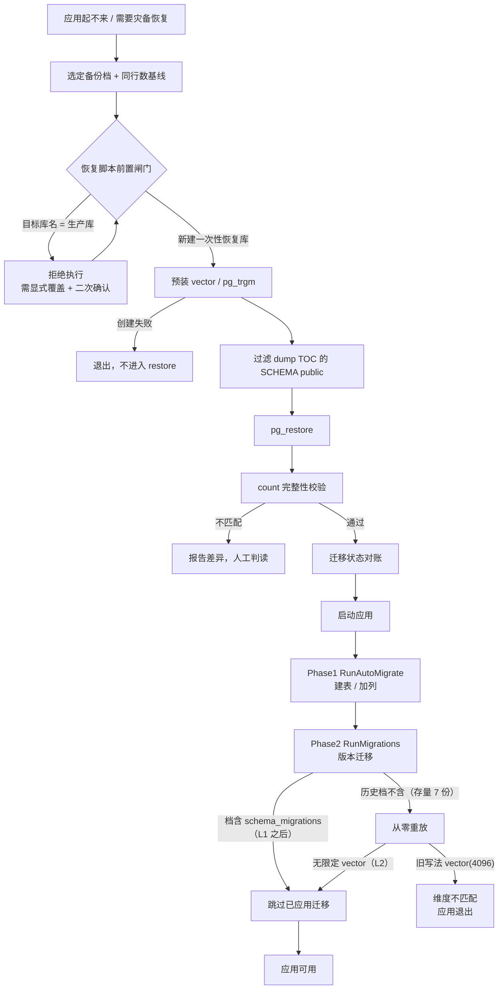
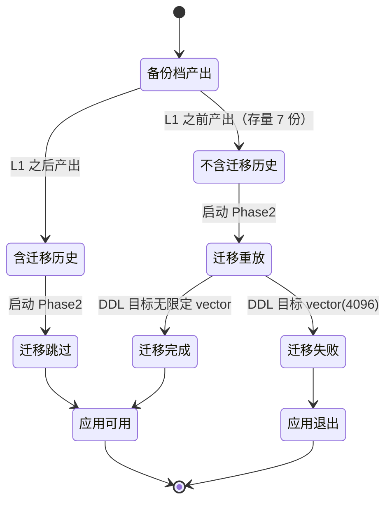
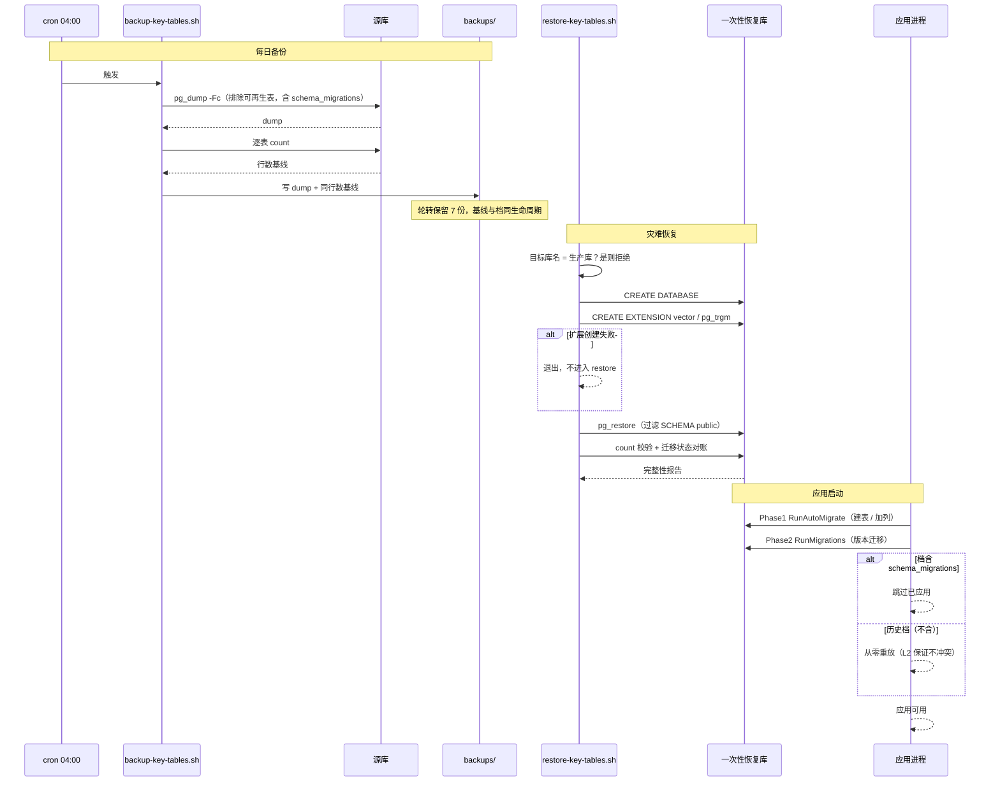

# 灾备恢复链路图（补档样板）

> 本文件由 change `add-change-diagram-convention` 补入，作为「change 图表达」的参考样板。
> 性质：非 schema 制品，只新增、不改动本 change 的任何原制品（§12 补档范畴）。
> 事实来源：本目录 `proposal.md`（三条根因 L1/L2/L3）与 `design.md`（D1–D10）。

## 用户故事核心路径

**这张图回答**：一个值班人从「应用起不来」到「应用可用」要走哪几步，哪些判断会导致回退。

**图不表达的约束**：count 校验与迁移对账只出报告，缺口不阻断退出码（可再生表由 AutoMigrate 重建）；恢复耗时量级 35min（SD 卡 1.7MB/s），不在图上体现。

## 状态流转

**这张图回答**：备份档「含/不含迁移历史」两种状态，在旧 DDL 与新 DDL 下分别落到哪个终态。

**图不表达的约束**：「无限定 vector」是去掉 typmod、放宽而非收紧约束，因此对任意维度存量数据都成立；存量列统一（`unify-vector-column-dimension`）不在本图范围，仍保持 `vector(2560)`。

## 顺序图

**这张图回答**：备份、恢复、启动三段里，谁先调用谁，哪一步失败会拦住后续。

**图不表达的约束**：备份与恢复都是单机磁盘操作，无异地同步与加密；恢复脚本不自动执行，必须人工触发（D3 硬闸）；演练按 D10 人工定期执行，未接 cron。
