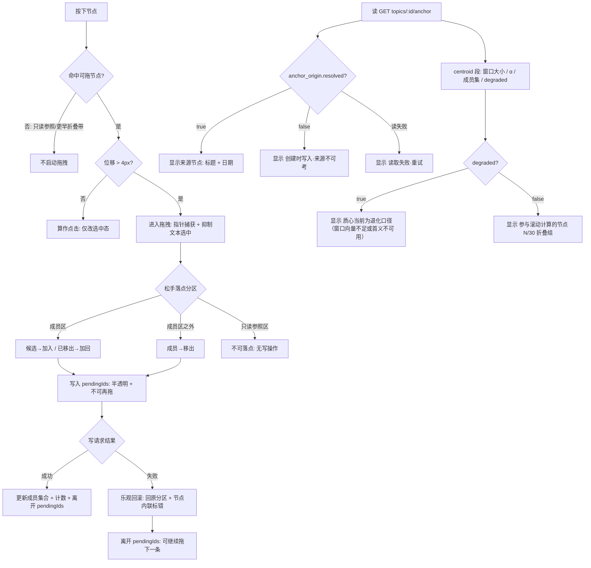

# align-lane-correction-workface — 设计

## Context

见 `proposal.md` — Why（动机与范围）。本节只记实现侧必须知道的现状事实（全部带 `文件:行`，细节见 `explore-findings.md`）：

- **两个画布两套组件**：编排画布 `front/app/features/tags/components/compose/LaneComposeCanvas.vue`（约 2100 行，pointer 手势齐全）；修正画布 `front/app/features/tags/components/console/LaneCorrectionCanvas.vue`（约 1000 行，**只有空白处平移**，无任何节点拖拽）。两者共用 `.lcc-` CSS 前缀与 `.lcc-drag-ghost*` / `.lcc-canvas__dropzone` 视觉语言。
  > 注：`proposal.md` 的 Impact 段把编排画布写成 `components/console/LaneComposeCanvas.vue`，**实际路径是 `components/compose/`**——以仓库实际路径为准。
- **修正画布坐标系是「日期列 × 横向带区」**（不是编排画布的「行」）：成员基线 `MEMBER_Y=86`、话题带 `BAND_Y=44`、左缘「更早」折叠带 `LEFT_PAD=150`；分区 `zones`（候选区 / 只读参照区）起点跟随成员区底部下移。
- **候选「相关度」肉眼不可辨的根因**：`LaneCorrectionCanvas.vue:appearanceOf` 走绝对口径 `1 − 距离/阈值`，且**不传** `proximityOverride` / `recommendRange` / `strengthRange` → 半径被压在 3.6–4.6px；`laneComposeLogic.ts` 注释点名「修正画布逐位不变」。编排画布走 `relativeProximities` 批内归一（`LaneComposeCanvas.vue:743-745`）。
- **抬候选半径会卡住**：`recommendCap = min(cap*0.72, memberBase−0.5)`，成员基准半径 `MEMBER_BASE_RADIUS = 5.5`（`LaneCorrectionCanvas.vue:122`）→ 候选上限被压到 5.0；抬成员基准半径会牵动 `NODE_BLOCK_H` / `nodeRowGap` / `membersBottom` / `zones` 一整条布局链。
- **图例语义错位**：「虚线=首义」只画未提交的 `anchorSelection`（`LaneCorrectionCanvas.vue:473`），**已生效首义成员反而无标记**；图例 5 项在 `:971-978`。
- **编排画布高度只按内容算**：`LaneComposeCanvas.vue:610-612` `max(460/560, 内容高)`，完全不读容器高度 → 单候选链时内容 326px 被抬到 460，视口 ~660 时下方空约 30%。修正画布已有正确写法：`baseCanvasHeight = max(360, containerHeight||360)` + `canvasHeight = max(baseCanvasHeight, needed)` + `zones` 均分余量（`LaneCorrectionCanvas.vue:276/347/353`）。
- **首义读端点只返回 5 个字段**：`TopicAnchorState{topic_id, source, section_ids, override_count, effective_from}`（`backend-go/internal/topicgraph/repository/daily_report_anchor_read.go:32-45`），**不含**解析出的来源 section、参与滚动的 section 列表/窗口/α/degraded。`source` 靠「`topic_anchor_overrides` 行数 ≥1 → manual」判定（`:64-93`）。
- **滚动窗口 SQL 是内联的**：`ComputeTopicCentroid`（`backend-go/internal/topicgraph/repository/daily_report_topic_repository.go:987`）内联一条 raw SQL 取窗口内 section，窗口 = `persistent_topic_centroid_window`（默认 30）。
- **手动建泳道不留痕**：`CreateManualTopic`（`backend-go/internal/topicgraph/repository/daily_report_manual_topic.go:559`）把选中 section 的均值写进 `embedding`，但**不写** `topic_anchor_overrides` → 读端点把它读成 `auto`（模型缺口）。
- **`.is-drop-other` 是空样式**：编排画布 `:1451` 绑了这个 class，但全仓无任何 CSS 规则 → 拖到非目标行零反馈（既有缺陷）。
- **编排画布 `overflowing` 判据**：`canvasHeight*zoom > viewport+1`（`:637-641`）→ 内容恰好贴合容器时不吸顶（语义正确，需在改高度后复核）。

## Goals / Non-Goals

**Goals**

- 归属变更在修正画布上从「三次点击」降到「一次拖动」，且**不新增第二份成员集合**（与节点卡按钮、左栏勾选共用同一条写路径）。
- 候选之间的接近度差别在默认缩放下**肉眼可辨**（批内相对归一），成员接近度口径**一字不动**。
- 首义来源与质心滚动窗口**可读可核对**：能回答「这条泳道当初是哪些节点定义的」「现在哪 30 条在参与质心计算」。
- 手动建泳道的首义**当场留痕**，历史存量**不编造**（不可考就说不可考）。
- 编排画布**填满容器高度**，富余空间给散料区，不再空掉 30% 视口。

**Non-Goals**

- 不改质心公式、窗口默认值（30）、α 默认值（0.5）与任何匹配阈值。
- 不引入草稿 / 应用 / 撤销栈（归属变更仍即时生效）。
- 不回填任何历史数据（首义来源、快照、质心）。
- 不做「拖拽改日期」/「拖拽排序」；不改布局模式、栏宽、导航、入口、dialog 尺寸档。
- 不触碰左栏「辅助标签」面板（属活跃 change `topic-lane-auxiliary-label-constraint`）。
- 不动 `auto_new` 自动建候选话题的首义留痕（另议）。

## Decisions

### D1. 拖拽落点按「分区」判定，不按日期列

- **结论**：修正画布的拖拽落点只判三个分区（成员区 / 候选区含已移出 / 只读参照区）。拖入成员区 = 加入或加回，拖出成员区 = 移出。复用编排画布的 pointer 手势纪律（4px 起拖阈值、`contentPointOf` 坐标换算、Esc 取消、拖后 250ms 吞 click、指针捕获只在判定为拖拽那一刻启用），但**落点判定另写**（分区 ≠ 行），且**只读参照区与「更早」折叠带节点不可拖**。
- **落点**：`front/app/features/tags/components/console/LaneCorrectionCanvas.vue:onSurfacePointerDown`（既有平移分流点，扩成分区落点）+ `front/app/features/tags/composables/laneComposeLogic.ts:isDragBeyond`（4px 阈值直接复用）
- **取舍**：否掉「拖到某一日期列 = 改日期」——X 轴是报告期事实，改它等于改写日报归属快照，越权且不可逆；否掉「直接搬编排画布的 `rowAtPointer` / `applyDrop`」——那套以「候选链 = 行」为模型，修正画布是固定三区，且 emit 语义是「本地草稿 Set」而非「即时落库 + `pendingIds`」，搬过来会带进第二份状态。

### D2. 归属变更即时落库，不引入草稿 / 应用 / 撤销

- **结论**：松手即调既有写路径（`PATCH /daily-reports/sections/:id/assignment` 与左栏的 remove / restore 路径），落库期间该节点进既有 `pendingIds`（半透明 + 不可再次拖），请求结束移出。失败 → **乐观回滚**（节点回原分区、成员集合复原）+ **节点内联标错**（红描边 + `title`/`aria-live`），**不弹窗**、不中断连续拖拽。
- **落点**：`front/app/features/tags/composables/useLaneCorrection.ts:pendingIds` + `front/app/features/tags/composables/useLaneCorrection.ts:addMember` + `front/app/features/tags/composables/useLaneCorrection.ts:removeMember` + `front/app/features/tags/composables/useLaneCorrection.ts:restoreMember`
- **取舍**：否掉「拖拽先进本地草稿、底部「应用」统一提交」——与既有「归属变更立即生效 / 无需保存」口径（`lane-correction-surface`「修正工作面 SHALL 常驻展示生效时机结论」）直接冲突，且会引入第二份成员集合；否掉「撤销栈」——编排画布的 3 秒撤销是草稿态语义，修正画布落库已生效，撤销要么再发一次反向请求（把历史倒序变成命令栈），要么与「立即生效」自相矛盾。

### D3. 候选相关度改「批内相对归一」，且只作用于候选桶

- **结论**：候选节点的尺寸与填色改为**同一渲染批次内的相对归一**（最近 = 最大最深、最远 = 最小最浅，单点或全等距取中值），复用既有 `relativeProximities` + `pointAppearance` 的 `proximityOverride` / `recommendRange` / `strengthRange` 三个入参。归一**只作用于候选桶**（含已移出节点）；成员与只读参照**不参与**。成员接近度恒为快照原值 `1 − topic_match_distance`，候选接近度恒为估算 `1 − 质心距离`（标注「估算」），两者**不同名不同形**。

  **三方案对比**：

  | 方案 | 做法 | 否决理由 |
  |---|---|---|
  | A. 只调常量 | 换分母 / 扩大半径区间，把 `1 − 距离/阈值` 的结果抬高 | 该批实测距离 0.59–0.67、阈值同量级 → 归一后只有 0.04–0.14；调分母只是把窄区间挪个位置，阈值一变又要重调，治标不治本 |
  | B. **批内相对归一**（选中） | 同一渲染批次内 min-max 归一，最近=1 / 最远=0 | — |
  | C. 后端下发档位 | 服务端算好档位随响应下发 | 相对分档是**渲染批次**的属性（批次随窗口、过滤、成员变化而变），后端无从得知「本次渲染批次」，且等于把前端分档逻辑复制到服务端 |

- **落点**：`front/app/features/tags/composables/laneComposeLogic.ts:relativeProximities` + `front/app/features/tags/composables/laneComposeLogic.ts:pointAppearance`
- **取舍**：否掉 A、C（理由见上表）；保留「成员快照值不进归一」这条硬边界——归一是**显示层**手段，一旦让成员快照参与批内归一，同一条成员的接近度会随同屏候选多少而变，违反 `persistent-topic`「泳道成员计数与接近度的单一口径」。

### D4. 抬候选半径必须同步抬成员基准半径（布局链联动）

- **结论**：`recommendCap = min(cap*0.72, memberBase−0.5)` 把候选半径上限钉死在成员基准半径之下，因此要拉开档差**必须**同步抬 `MEMBER_BASE_RADIUS`，并**同批**重算 `NODE_BLOCK_H` / `nodeRowGap` / `membersBottom` / `zones`。行距基准口径不变（仍是「圆顶→标签底 + 4px 间隙」推导），候选半径档位变化**不影响行距基准**。
- **落点**：`front/app/features/tags/components/console/LaneCorrectionCanvas.vue:appearanceOf`（成员基准半径入参）+ `front/app/features/tags/components/console/LaneCorrectionCanvas.vue:canvasHeight`（余量分配）+ `front/app/features/tags/components/console/LaneCorrectionCanvas.vue:zones`
- **取舍**：否掉「只抬候选半径上限、成员半径不动」——上限被 `memberBase−0.5` 卡死，抬不出档差（这正是今天 3.6–4.6px 的成因）；否掉「把行距改成固定 44px」——那正是 spec 明令禁止的「与占高无关的固定常量」，且成员半径一变就会重新引入重叠。

### D5. 首义来源的数据形态：`resolved` 三态，不可考即不可考

- **结论**：读端点新增 `anchor_origin{resolved, section_id, title, period_date}`。`resolved=true` → 返回来源节点三元组；`resolved=false` → 节点字段为 `null`，**SHALL NOT 用「最早成员」等推测值冒充**。前端把三态渲染为三件可区分的事：人工（选定的 N 个节点）/ 自动 · 来源可考 / 自动 · 来源不可考。
- **落点**：`backend-go/internal/topicgraph/repository/daily_report_anchor_read.go:TopicAnchorState` + `front/app/features/tags/composables/useLaneCorrection.ts:anchorOriginKind`（归一后的三态载体；`anchorSourceLabel` 是它的展示派生，不可考/读失败不得回退成 auto 文案）
- **取舍**：否掉「只回一个字符串标签」——用户要核对的是「哪条节点」，标签答不了；否掉「不可考时回最早成员」——那是把推测写成事实，撞 `lane-correction-surface`「自动首义不虚构节点列表」与「auto 无节点集不得虚构」两条既有契约。

### D6. 首义来源可考性三路径：只读现状 + 建话题时留痕，**不回填历史**

- **结论**：手动建泳道（`CreateManualTopic`）在**同一事务内**追加一行 `topic_anchor_overrides`（`source=selected_sections`、`input_summary` = 实际参与聚合的 section id 列表），使读端点返回 `source=manual` 并可反解首义节点集；**历史手动建的泳道不回填**，继续按「创建时写入 · 来源不可考」读。

  **三路径对比**：

  | 路径 | 做法 | 结论 |
  |---|---|---|
  | A. 回填历史 | 给存量手动泳道补写留痕，从最早成员推断首义集 | **否**：事后推断即编造，且推断值会写进留痕表冒充「人工选择」 |
  | B. 只读现状 | 读端点如实报「不可考」 | **采纳**（历史泳道走这条） |
  | C. 建话题时留痕 | 手动建泳道当场写一行留痕 | **采纳**（新建泳道走这条） |

- **落点**：`backend-go/internal/topicgraph/repository/daily_report_manual_topic.go:CreateManualTopic`（写留痕）+ `backend-go/internal/topicgraph/repository/daily_report_anchor_read.go:GetTopicAnchorState`（读来源）
- **取舍**：否掉「只用 B」——手动建泳道明明有用户选中的节点集，不留痕等于丢事实；否掉「只用 C 不做 B」——历史泳道必须有一个可读的终态（不可考），不能沉默；否掉「A 与 C 并行」——A 制造的是假事实。

### D7. `ListCentroidWindowSections` 抽取：口径单点 + 逐字搬迁保证等价

- **结论**：把 `ComputeTopicCentroid` 里的内联窗口 SQL **逐字**抽成只读 `ListCentroidWindowSections(topicID, window)`，质心计算与首义读端点**共用这一份实现**。取数口径 SHALL 与现状**完全等价**：谓词「归属本话题 + `embedding IS NOT NULL`」→ 排序「报告期倒序、同期按 section id 倒序」→ 上限 `LIMIT window`（窗口取自既有配置，默认 30）。

  **等价性验证方式**：① 抽取时**逐字搬 SQL**（不改写、不「顺便优化」），使等价性成为构造事实而非待验命题；② 加一条用例断言「质心计算用的窗口成员集合」与「读端点返回的 `centroid.section_ids`」**逐 id 相等**；③ 加一条用例锁定排序与上限（窗口 30 时只取最近 30 条、同期按 id 倒序）。
- **落点**：`backend-go/internal/topicgraph/repository/daily_report_topic_repository.go:ComputeTopicCentroid`
- **取舍**：否掉「读端点另写一条等价查询」——两份实现必然随窗口口径演进而漂移，且漂移是静默的（读端点显示的成员集与实际质心用的成员集不一致，用户无从察觉）；否掉「窗口成员表化 / 缓存」——那是派生缓存，违反「派生缓存不由人工直写」，且会引入过期口径。

### D8. 手动建泳道首义留痕的事务位置：与建话题同事务，失败即回滚

- **结论**：留痕写入落在 `CreateManualTopic` 的**同一事务内**，位置在「归属改写之后、`RebuildBoardRelations` 之前」。留痕写入失败 → **整个建话题事务回滚**（连同话题创建与归属改写），SHALL NOT 留下「有话题、无留痕」的半成品——那正是本 change 要消除的「来源不可考」状态。
- **落点**：`backend-go/internal/topicgraph/repository/daily_report_manual_topic.go:CreateManualTopic`
- **取舍**：否掉「留痕写在事务外 / 事后补写」——事务外补写失败会造出半成品，且用户当场就看到「来源不可考」；否掉「记全部被选 section（含无向量被跳过的）」——留痕必须与**实际构成首义向量**的节点集一致，否则读端点会解析出一个与首义向量无关的节点集。

### D9. `override_count` / `effective_from` 语义：留痕条数口径统一，不新增来源枚举

- **结论**：`override_count` 语义明确为「该话题的**首义留痕条数**」（`topic_anchor_overrides` 行数；手动建泳道的创建留痕计入其中）；`effective_from` 语义**不变**（有留痕 = `next_report`，无留痕 = 空串）。`source` 仍是 `auto`/`manual` 两态。
- **落点**：`backend-go/internal/topicgraph/repository/daily_report_anchor_read.go:TopicAnchorState`
- **取舍**：否掉「新增来源枚举区分创建留痕 vs 改写留痕」——本 change 明令不新增来源枚举；且读端点真正要回答的只有「来源可不可考 + 节点集是什么」；否掉「`override_count` 只数改写、不数创建留痕」——那需要额外的区分依据，而留痕行本身不可区分（创建留痕与改写留痕同表同字段语义）。

### D10. 图例语义修正：已生效首义与待提交勾选各一种标记

- **结论**：画布上「当前首义集里的成员」与「左栏首义面板里勾选但尚未提交的节点」SHALL 各有**独立可辨**的标记；底部图例 SHALL 改为**尺寸图例**（小圆—大圆）表达候选分档。
- **落点**：`front/app/features/tags/components/console/LaneCorrectionCanvas.vue`（图例与节点标记渲染）
- **取舍**：否掉「只改图例文案」——文案对了、画面上仍只有一套标记，用户依然分不清哪个是已生效的；否掉「取消待提交勾选标记」——待提交勾选是「本轮重设首义」的选区，与已生效首义是不同语义，两者都要留。

### D11. 两个「窗口」必须分开命名

- **结论**：成员计数口径「窗口内 N · 全部 M」（成员总数）与质心口径「参与滚动计算的节点（N/30）」SHALL **分开命名**，同屏不得出现两个含义不同的「窗口 N」。
- **落点**：`front/app/features/tags/components/console/LaneAnchorScope.vue:poolCountText` + `front/app/features/tags/composables/useLaneCorrection.ts`
- **取舍**：否掉「滚动窗口也叫『窗口』」——两把尺子（报告期观察窗 vs 质心滚动窗）不同源，同名会让用户把「30 条参与滚动」误读成「窗口内 30 个成员」。

### D12. 「不可落点」视觉两画布共用一套 `.lcc-` 样式

- **结论**：在 `.lcc-` 前缀族里补齐 `.is-drop-other` 的样式（与落点高亮明确不同），编排画布与修正画布共用；修正画布的落点高亮按**分区**（成员区高亮 / 不可落点区弱化）。
- **落点**：`front/app/features/tags/components/compose/LaneComposeCanvas.vue:onSurfacePointerDown`（既有 is-drop-other 绑定处）+ `front/app/features/tags/components/console/LaneCorrectionCanvas.vue`
- **取舍**：否掉「修正画布另起一套类名」——两画布已共用 `.lcc-` 前缀与 ghost/dropzone 视觉语言，分叉会让后续维护成本翻倍；否掉「只在编排画布补、修正画布不补」——修正画布的拖拽本 change 就要上，没有不可落点反馈等于把用户引向误操作。

### D13. 编排画布高度贴合容器：先贴合再撑高，余量给散料区，吸顶判据随内容溢出

- **结论**：`canvasHeight = max(容器实测高度, 内容所需高度)`；富余高度**全部**给底部散料区，**本次泳道行与候选链行的位置不变**。吸顶判据维持 `canvasHeight*zoom > viewport+1` → **内容恰好贴合容器时不吸顶**（无溢出即可见）。

  **反馈环处理**：容器出现横向滚动条时会占用 `clientHeight`，反过来改变画布高度 → 又可能改变是否溢出 → 抖动。处理方式：① 高度测量以**容器 `clientHeight` 实测值**为准（滚动条已占位后的值），用既有 `ResizeObserver` 监听容器尺寸变化；② 画布高度**只依赖容器高度与内容高度**，不反向依赖「是否溢出」——溢出判据只用于吸顶，不参与高度计算，避免自指反馈环；③ 滚动条出现/消失引起的容器高度变化由 `ResizeObserver` 单向驱动（容器 → 高度），不构成环。
- **落点**：`front/app/features/tags/components/compose/LaneComposeCanvas.vue:canvasHeight` + `front/app/features/tags/components/compose/LaneComposeCanvas.vue:overflowing`
- **取舍**：否掉「纯 CSS `height:100%` 让 SVG 自适应」——SVG 需要确定像素高度才能算行位、槽位与落点坐标；否掉「保留 460/560 地线不贴合容器」——那正是空 30% 视口的根因；否掉「富余高度均分给所有行」——用户已拍板「本次泳道行与候选链行位置不变」，均分会整体下移，破坏既有空间记忆。

### D14. 首义来源与滚动窗口的只读块：失败不阻断写入口

- **结论**：左栏「首义范围」块新增「首义来源」一行 + 可折叠「参与滚动计算的节点（N/30）」组（默认收起）。读失败时该块显示「读取失败 · 重试」，**不阻断**画布拖拽、节点卡按钮与左栏勾选等写入口。读端点**零写副作用**（不写表、不动 `centroid`/`embedding`、不置待重算标记、不触发重算、不回填快照）。
- **落点**：`front/app/features/tags/components/console/LaneAnchorScope.vue` + `backend-go/internal/topicgraph/repository/daily_report_anchor_read.go:GetTopicAnchorState`
- **取舍**：否掉「读失败就禁用整个工作面」——只读块失败不该让用户失去修正能力；否掉「读端点顺手把缺失的首义快照补写回去」——那是回填，撞「历史快照不得回填」。

### D15. 修正画布三处可用性补丁：标题换行、横条移除、空白轻点取消聚焦

- **结论**（2026-11-24 用户实机反馈）：① 节点卡标题去单行省略，完整展示、按需换行；② 话题带强调色横条 `.lcc-band-bar` + 刻度线 `.lcc-band-tick` 整组移除，标签与中性基线保留；③ 聚焦在场时轻点画布空白处 → emit `clear-focus`（与编排画布同名事件），宿主接既有 `useLaneCorrection.clearFocus()`。
- **落点**：`front/app/features/tags/components/console/LaneCorrectionCanvas.vue`（样式 + 模板 + `onSurfacePointerDown/Up`）+ `BoardComposeOverlay.vue`（`@clear-focus` 接线）。
- **取舍**：取消聚焦只认「空白轻点」——`panStart` 记录起手是否落在 `[data-node]` 上，落在节点上的轻点不抛（否则「再点同一节点取消」会被随后的 click 重新聚焦，切换语义坏掉）；平移松手不抛（滚动不是选择）；不新增「关闭」按钮到节点卡（编排画布的「×」是它自己的卡片语言，修正画布已有顶部「取消聚焦」按钮兜底）。横条移除不动 `BAND_Y` / 分区布局，纯视觉删减。

### 图表达

**这张图回答什么问题**：修正画布拖拽改归属的落库时序与失败回滚路径，以及「读 anchor → 三态展示」的分支。

图不表达的约束：读端点零写副作用（不在图上展开为写路径）；`pendingIds` 同时服务节点卡按钮与左栏勾选（图中只画拖拽一条入口）；`resolved=false` 是终态而非占位（不画「补录」分支）。

## Risks / Trade-offs

- **拖拽命中精度**（点半径小）→ 拖起后 ghost 放大跟随指针；命中区沿用既有 `[data-node]` 选择器 + 4px 阈值；不可拖节点光标保持 `default`，按下不启动拖拽。
- **拖拽与平移误判** → 一次 `pointerdown` 内一次性分流（命中节点 → 拖拽候选；空白 → 平移），不做二次猜测；拖完 250ms 吞 click。
- **抬成员基准半径会牵动整条布局链** → 行距基准仍是「圆顶→标签底 + 4px」推导，不是固定常量；`zones` 余量分配随之重算；验证节要求同批跑 `LaneCorrectionCanvas` 组件测试（重叠断言）。
- **相对归一只对候选桶生效，用户可能误读成员大小** → 尺寸图例只解释候选；成员保持固定尺寸，图例文案不得暗示成员按接近度变大小。
- **`override_count` 语义从「改写次数」变为「留痕条数」** → 该字段当前**未被界面消费**（只存在于 API 类型与测试夹具），语义调整不产生用户可见偏差；但 API 文档须同步说明。
- **`effective_from` 对手动建泳道变为 `next_report`** → 语义上「写入首义定义面、质心混合同次日日报生效」成立；该字段同样未被界面消费。
- **读端点多返回一段滚动窗口数据** → 响应体积增加（最多 30 条 section 摘要），可接受；取数走单条 SQL，无 N+1。
- **编排画布贴合容器后横向滚动条占用高度** → 高度只依赖容器实测高与内容高，溢出判据不参与高度计算（见 D13），避免自指反馈环。

## Migration Plan

- **无数据库结构变更**：复用既有 `topic_anchor_overrides` 表与既有列；无新表、无新迁移、无新索引。
- **无历史数据回填**：存量手动泳道继续显示「创建时写入 · 来源不可考」；存量自动话题首义来源不可考，滚动窗口成员照常可读（推算自当前成员，不是历史快照）。
- **API 向后兼容**：`GET /api/daily-reports/topics/:id/anchor` 只增字段，既有 5 个字段语义不变（`override_count` 的口径说明见 D9，数值含义随留痕条数变化，但界面不消费该字段）。
- **回滚**：纯代码回滚，无数据迁移需要回退；已写入的 `topic_anchor_overrides` 创建留痕行是**追加式事实**，回滚后仍保留（后续重新读时仍按 manual 处理）——这与「留痕只追加、不可删」的既有契约一致。
- **部署顺序**：后端先发（读端点扩展 + 建话题留痕），再发前端（前端对新字段做缺失兜底，读端点未升级时 `anchor_origin`/`centroid` 为 `undefined` 不崩）。

## Open Questions

- **成员基准半径的抬升幅度**：本 change 只定「必须同批抬、且行距基准不变」的口径，具体数值（5.5 → ?）属实现期参数，须与「画布高度贴合容器」同批验证（见 `stage.md` 待定项）。该参数**不改变任何 spec 条款**，故留到实现期定档。
- **已生效首义标记的具体图形**（实线环 / 实心点 / 角标）：属视觉实现选择，不改「两种标记必须可区分」的契约。
- **手动建泳道留痕行的 `input_summary` 是否需要附带被跳过的 section id**：本 design 定为**只记参与聚合的节点**（与首义向量一致）；若实现期认为需要保留「用户原本选了 4 条」的原始意图，需要新增字段或新枚举——那会突破「不新增来源枚举」与「无新表」的边界，须回到提案层决策，**不在本 change 实现期自行扩张**。
