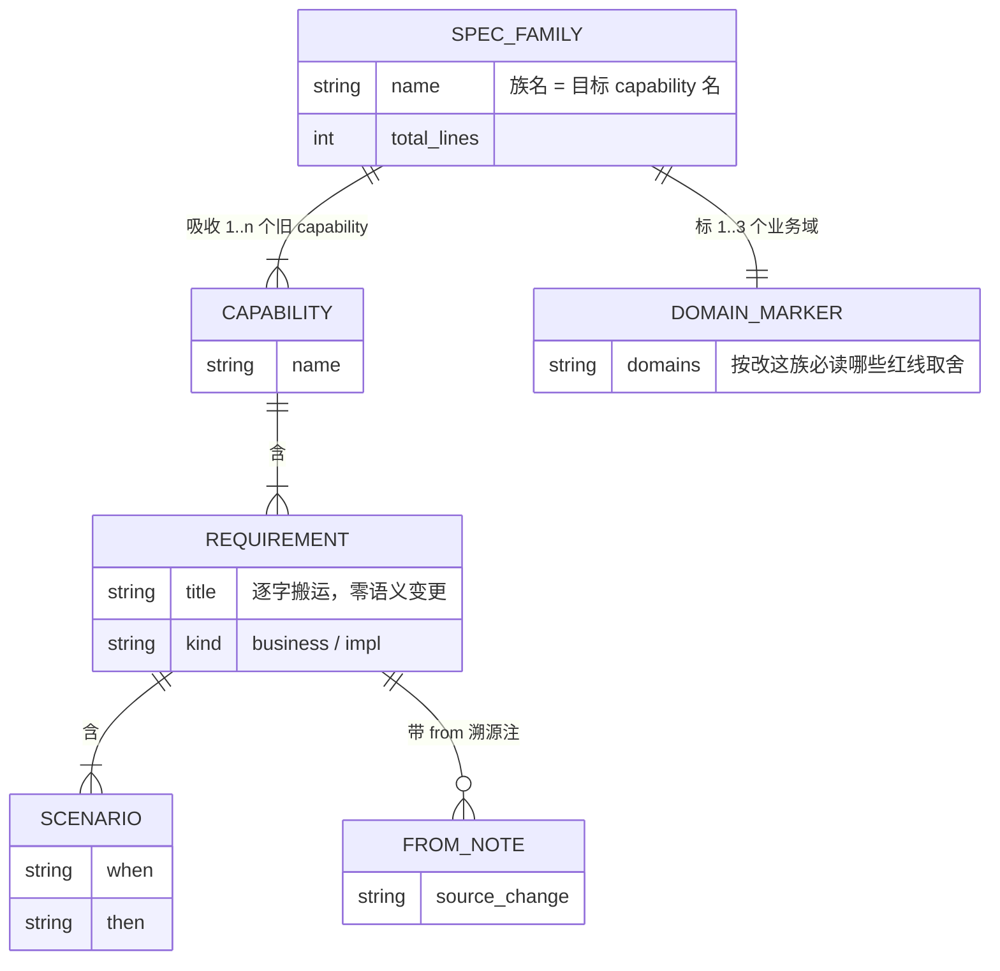
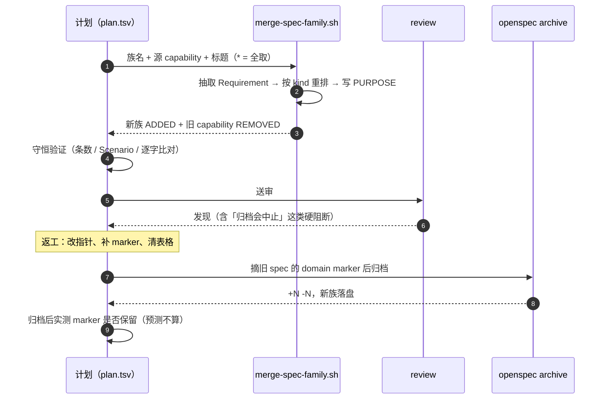
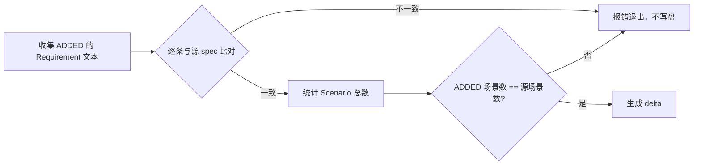

# 决策图（补档样板）

> 补档说明：本文件按 §12「只增不改」范畴补于 2026-11-26（change `add-diagram-and-pseudocode-layer`），
> proposal / design / specs / tasks 保持归档时原样。事实来源：本 change 的 `proposal.md` 与 `design.md` D1–D7。

## 1. spec 族的层级结构

这张图回答：**一个族级 capability 里面装的是什么**。它不表达字段类型与 naming 约定。

**图不表达的约束**：Requirement 条数与 Scenario 条数必须守恒（ADDED = REMOVED）；`impl` 类条款排在族尾但不改变内容。

## 2. 一次族合并的执行顺序

这张图回答：**从计划到归档要经过哪几步、哪一步可能返工**。它不表达具体命令与脚本参数。

**图不表达的约束**：归档前必须清掉旧 spec 里的 markdown 表格与首段后散文段（openspec 判为「不可点名内容」），否则 retire 拒绝删除。这条只在 `lane-ops` 那轮实测到。

## 3. 伪代码示意（族合并的守恒断言）

这张图回答：**「零语义变更」在代码上如何被验证**。它不表达真实 shell 实现。

**图不表达的约束**：比对要**规范化空白后再比**（source spec 里可能有软换行），但对内容必须逐字。
