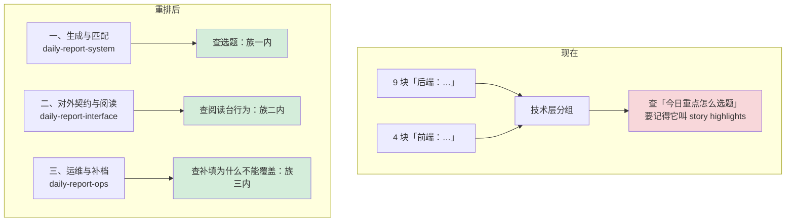
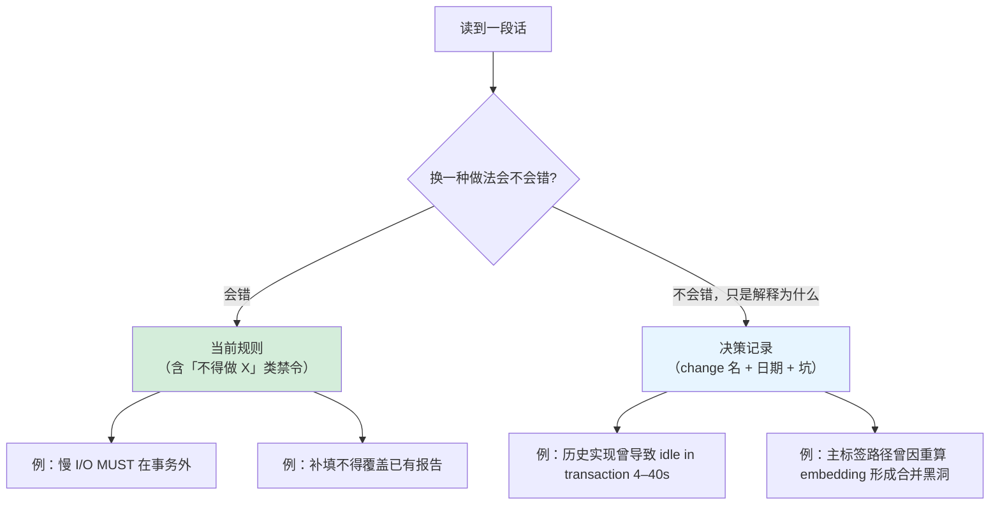
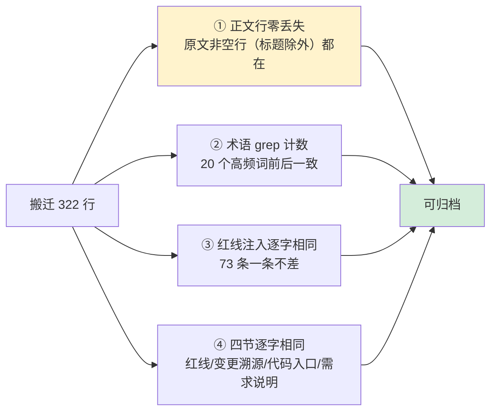

# 重排结构

> 事实来源：`docs/reference/flow/daily-report.md` 实测（555 行 / 链路 322 行 / 14 块），
> 以及 `openspec/specs/daily-report-{system,interface,ops}` 的 Requirement 分布。

## 1. 从「后端/前端」到「生成 → 阅读 → 运维」

这张图回答：**为什么族顺序不是原文的前后端**。它不表达每块的具体内容。

**图不表达的约束**：族与 spec 一一对应（3 族对 3 个 spec），不是「按感觉分三堆」。

## 2. 每族两层的分界线

这张图回答：**一段话该放「当前规则」还是「决策记录」**。它不表达具体条目。

**图不表达的约束**：这是上一轮 semantic-board 的 review 校准出来的判据——第一版我用「有没有 change 名」判，结果把「慢 I/O MUST 事务外」这类现行约束误下沉了。

## 3. 对账四条防线

这张图回答：**怎么证明 322 行没丢东西**。它不表达具体数字。

**图不表达的约束**：**行数不是判据**——重排必然新增结构行（3 族标题 + 6 层标题 + 族说明），总行数一定涨。上一轮我把「非空白行数相等」写进 spec，是错的。
