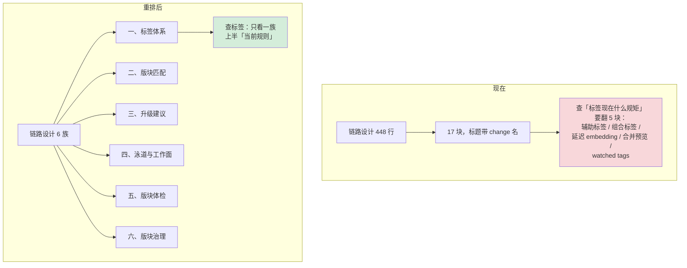
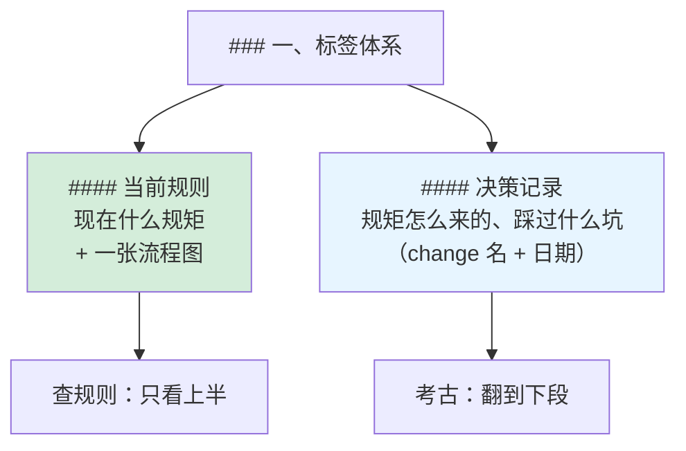
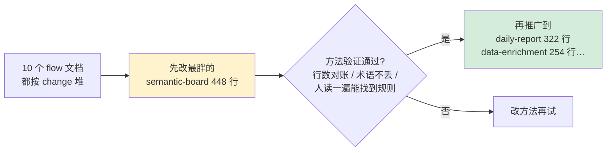

# 重排前后

> 事实来源：`docs/reference/flow/semantic-board.md` 的实测行数与块清单（2026-11-26）。

## 1. 从「按 change 切片」到「按能力组织」

这张图回答：**重排前后读者找一条规则的路径差在哪**。它不表达具体块的搬迁顺序。

**图不表达的约束**：红线节（48 行 / 39 条）与变更溯源表（76 行）完全不动——它们本来就是干净的。

## 2. 每族内的两层

这张图回答：**同一个族里「当前规则」和「决策记录」怎么放**。它不表达具体条目。

**图不表达的约束**：决策记录必须保留——台账抽样确认有些坑（两阶段事务边界导致 `idle in transaction` 4–40s、L2 命中改 Label 形成合并黑洞）**spec 里永远没有**。

## 3. 为什么这次只改一个域

这张图回答：**改动范围与验证节奏**。它不表达各域行数。

**图不表达的约束**：ai-summary（49 行链路）与 research-data-sources（20 行）这类小文档不该动——重排的成本大于收益，判据是「链路设计 >150 行且块数 ≥10」。
