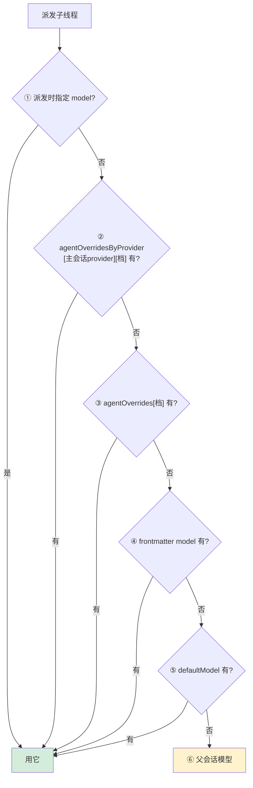
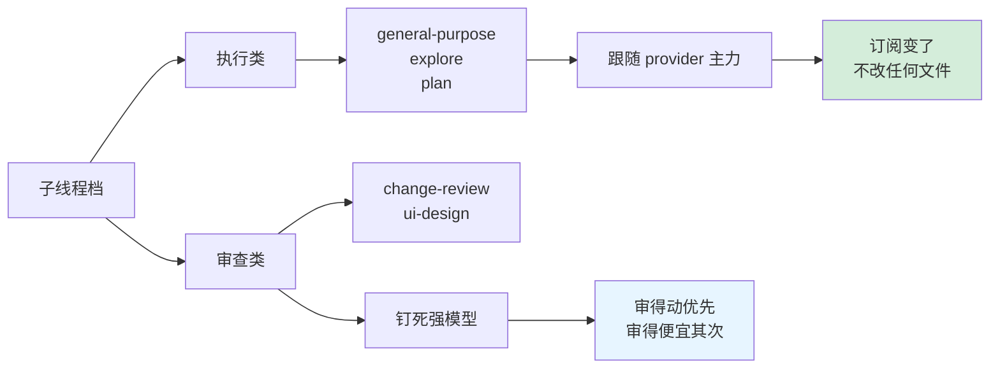
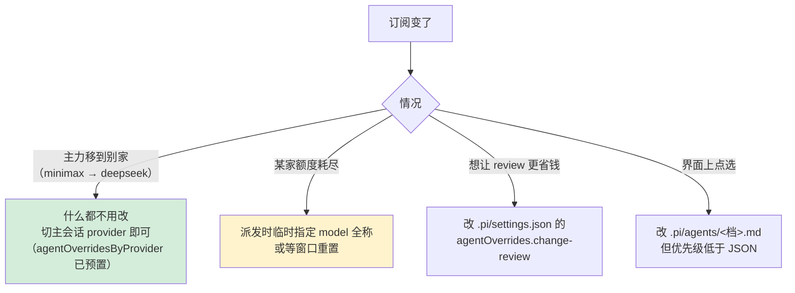

# 模型路由

> 事实来源：pi-subagents 官方文档 `docs/models.md` 的优先级声明，与本仓库
> `.pi/settings.json` / `.pi/agents/*.md` 的实际配置。

## 1. 六层优先级

这张图回答：**一次派发到底用哪个模型**。它不表达具体的模型名（那些在配置里）。

**图不表达的约束**：`thinking` 是同级独立字段，不拼进 model 串；provider 错误（401/429）如实抛回，**不换模型重派**。

## 2. 两类档位

这张图回答：**为什么有的档跟随 provider、有的钉死**。它不表达具体模型。

**图不表达的约束**：执行档产出有客观标准（编译过不过、测试绿不绿），便宜模型错了立刻暴露；审查档产出没有客观标准，便宜模型错了不报错、只悄悄漏。

## 3. 换订阅时改什么

这张图回答：**三种情况下分别动哪里**。它不表达 JSON 结构。

**图不表达的约束**：预置了四套 provider 层（minimax-cn / deepseek / zai-coding-cn / openai-codex），新增 provider 需要自己往 JSON 里加一层。
