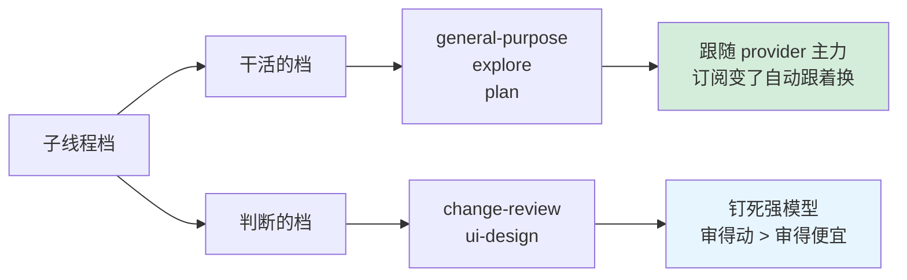

# Design

## D1 为什么不做自动 fallback

pi-subagents 的文档写得很明确：

> Provider errors, including HTTP 429 responses, are returned from that model rather than selecting another one.

也就是说**框架本身不换模型**。要自动降级得自己写扩展：拦 429 → 猜下一个 provider → 重派。代价：

| 方案 | 好处 | 代价 |
|---|---|---|
| 手工换（选它） | 0 维护；额度问题暴露给人 | 每次 30 秒 |
| 自动 fallback | 不中断 | 要维护一条状态机：谁有额度、降级顺序、失败后回滚；且**掩盖额度问题**——直到所有 provider 都空才报错，那时更难查 |

选手工。今天实测换三次各 30 秒，比维护状态机划算。

## D2 为什么分「跟随 provider」和「钉死」两类



理由：**执行档的产出有客观标准**（编译过不过、测试绿不绿），用便宜模型错了会立刻暴露；**审查档的产出没有客观标准**（"这个设计有没有漏洞"），便宜模型错了不会报错，只会悄悄漏掉——所以不能用便宜的。

## D3 为什么 frontmatter 和 settings.json 都要

| 落点 | 谁改 | 优先级 |
|---|---|---|
| `.pi/agents/<档>.md` frontmatter | **pi-web Subagents 界面**（`/api/subagents/profiles` 路由支持 `model`/`thinking`） | 低 |
| `.pi/settings.json` `agentOverrides*` | 手改 JSON | 高 |

两个都要的理由：

- **界面可改**才能"顺手点一下"——这是你要的"根据自己状况调整"
- **JSON 优先级更高**才能在界面值不对时应急覆盖，且 `agentOverridesByProvider` **只有 JSON 能表达**（界面按档编辑，不按 provider 分层）

两者并用时以 JSON 为准，所以界面上改了 frontmatter 却"不生效"是可能的——文档里写清这条。

## D4 为什么 defaultThinking 也配

`thinking` 跟 `model` 是同级字段（frontmatter 里两个独立键）。只配 model 不配 thinking 会让高档模型跑在默认思考档，等于浪费。所以每处都成对写。

**`defaultThinking` 的语义边界（review R-4）**：它只作用于「**没有** `thinking` 值的档」。我们五档 frontmatter 都已写 `thinking`，所以这个键对它们**不可达**——它只是兜底，不在生效链上。别误以为它能覆盖 frontmatter。

## 核心逻辑（伪代码）

### 关键数据结构

```
Settings = {
  subagents: {
    defaultModel: "provider/model"
    defaultThinking: "off|minimal|low|medium|high|xhigh|max"
    agentOverrides: { <agent>: { model, thinking } }
    agentOverridesByProvider: { <provider>: { <agent>: { model, thinking } } }
  }
}
AgentDef = { name, model?, thinking? }   # .pi/agents/<name>.md frontmatter
```

### 主流程

```
resolveModel(agent, parentModel, perRunModel):
    if perRunModel:                                    return perRunModel        # ① 派发时
    p = providerOf(parentModel)
    if Settings.agentOverridesByProvider[p][agent].model:
        return Settings.agentOverridesByProvider[p][agent]                      # ② 跟随 provider
    if Settings.agentOverrides[agent].model:
        return Settings.agentOverrides[agent]                                   # ③ 单档钉死
    if AgentDef[agent].model:
        return AgentDef[agent]                                                  # ④ 界面默认
    if Settings.defaultModel:
        return Settings.defaultModel                                            # ⑤ 兜底
    return parentModel                                                          # ⑥ 最终
```

### 失败与边界分支

- **provider 错误（401/429）**：如实抛回主会话，附"换哪个 provider"的建议。**不换模型重派**（D1）
- **裸模型名**：仅当该 id 在已配置 provider 中唯一才允许；否则报错要求全称（`glm-5.3` 跨 provider 重复注册，fuzzy 会按字母序落到错的）
- **`thinking` 独立**：不拼进 model 串（`model: xxx:max` 是派发时参数的语法，配置字段是两键）
- **provider 名匹配**：按主会话模型的 provider 前缀精确匹配；未配置该 provider 时落到 ③④⑤
- **JSON 坏掉**：settings.json 解析失败时 pi 会忽略整个文件——此时 frontmatter 生效，行为退化为"档位默认"，不会崩
