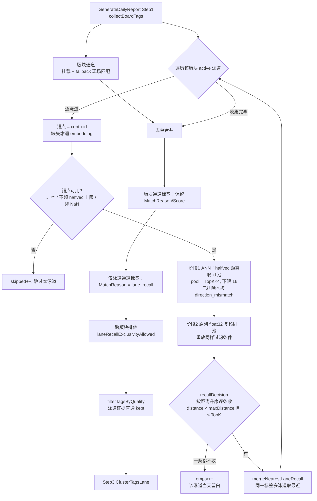
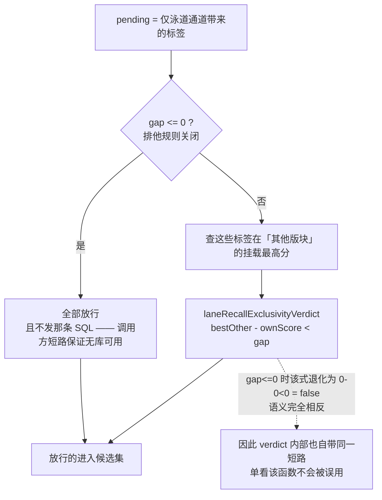
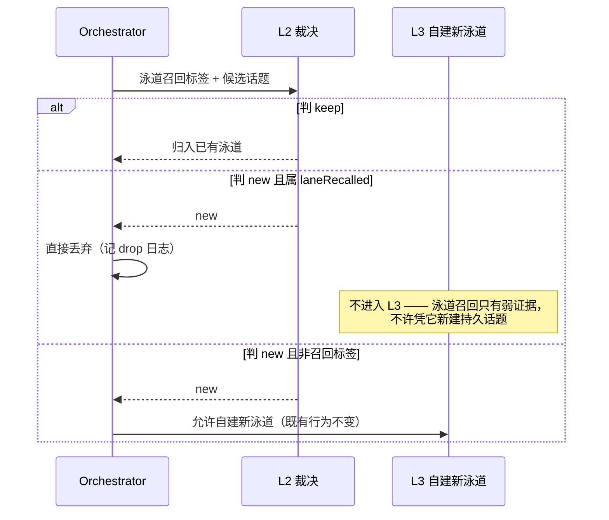

# 设计图：lane-first-recall

> 只画「看文字容易漏」的三处：双通道收集的先后与去重、两阶段召回的门槛位置、以及 `filterTagsByQuality` 二元开关被绕过的确切点。

## 1. 候选收集：双通道 + 两阶段召回

## 2. `filterTagsByQuality` 的二元开关与绕过点

```mermaid
flowchart TD
    A[去重后的标签集] --> B[分区 kept / weighted]
    B --> C[kept = composite_hit ∪ direct_hit<br/>∪ hit_rate ∪ max_sim]
    B --> D[weighted = 其余<br/>单篇新事件恒在此]
    C --> E{len&#40;kept&#41; < 10 ?}
    E -->|是| F[weighted 全放回<br/>噪声也进]
    E -->|否| G[weighted 全丢<br/>11-19 起常见分支]
    D --> H{标签在 laneRecalled 集合?}
    H -->|是| I[直接并入 kept<br/>—— 不改二元开关本身，只给泳道证据一个独立入口]
    H -->|否| D2[留在 weighted]
    I --> E
```

> 为什么要独立入口而不是改开关：开关的两端各自都对应一次真实事故（10-04 非农、10-10 digest），
> 收紧的是「挂载层」这条永久事实防线。泳道证据是**单日行为**，绕过开关但不写挂载表，
> 两者语义不同层，混同即回到老路。

## 3. 排他判定与 gap=0 的短路位置

## 4. L3 防污染闸（D4）

