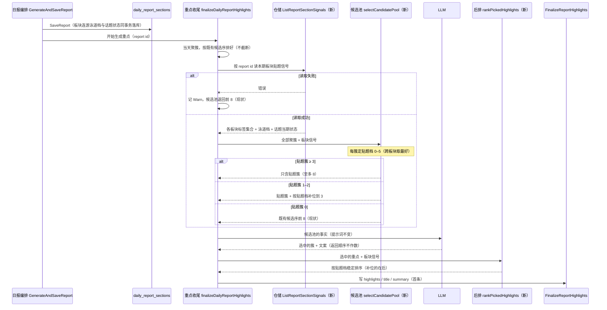

# design-diagram — rank-report-highlights-by-board-relevance

> 本 change 的时序图。落点与取舍见 `design.md` Decisions；图只画稳定骨架（消息先后与回退分支），不画易变字段名。

这张图回答什么问题：**模型是在哪一步、从哪些候选里挑重点的？贴题门槛加在哪？正文板块为什么必须先落库？查不到贴题信号时走到哪？**

图不表达的约束：贴题档的取值顺序（近 → 手动关注 → 中-在跟 → 中-候选 → 远 → 无对应板块）、梯队内部只比文章数（section 数与泳道热度不参与）、模型选中的重点不因贴题档被移除、标签回退模式不走这条路——这些在 `specs/daily-report-system/spec.md`「今日重点聚簇候选」与 `design.md` D3 / D7 / D11。
